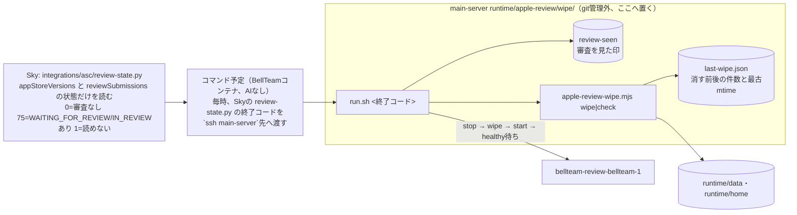

# 審査用サーバーの審査後消去

Appleの審査が終わるたびに、審査用サーバー（main-server `/home/kite/BellTeam/runtime/apple-review/server`、Compose project `bellteam-review` の `bellteam`）から、審査員が残した端末番号・試しの購入記録・入力内容を消す。デモアカウント（Dex、別project）と審査用の設定は消さない。担当はラピ（審査用サーバーの運用。トロニー裁定 2026-11-19）。依頼元はミランダ（プライバシー統括、工程 privacy/f01-rapi）。

## 機能図

## データの流れ

| 入力 | 処理 | 出力 |
|---|---|---|
| review-state.pyの終了コード | 75: `review-seen`を作って何も触らない。0かつ`review-seen`あり: 消去へ。0かつ印なし: 何もしない。その他: 失敗として終わり何も触らない | 予定の結果（失敗は予定所有Botとユーザーへ届く） |
| `runtime/data`・`runtime/home` | `bellteam`を止め、`WIPE`の表（スクリプト内）に当たるものだけ消し、`subscription.json`は`signedTransaction`・`verification`・`error`だけnullへ戻す。`bellteam`を起動してhealthyまで待ち、`review-seen`を消す | `last-wipe.json`（カテゴリごとの件数・バイト・最古mtime。値は書かない） |

- 消す対象（カテゴリ）: `push-devices`（`state/push-devices.json`・`fcm-devices.json`）、`purchase-records`（`shared/subscription.json`の購入情報）、`typed-content`（`logs`・`rooms`・`state/owner-questions`・`state/secret-requests`、各Botの`memory`・`play`・`docs`・`rag/{notes,raw,index.db}`、共有の`memory`・`play`・`rag/{notes,raw,index.db}`）、`cli-transcripts`（`.bash_history`、`.throughline`、`.codex`・`.claude`・`.cursor`・`.gemini`・`.grok`のうち、認証・設定・hook・拡張を除いた全部）。
- 残すもの: 各Botの`bot.json`・`AGENTS.md`・`CLAUDE.md`・`schedule.json`・`assets`・`environment`・`.git`、`owner/`、`shared/onboarding.json`、`shared/tools`、CLIのログイン情報・設定、`.cache`・`.npm`・`.local`・`.config`・`Library`。
- どの表にも載らないファイルは、`check`が「unclassified」に名前を出し、触らない。消す側の見落としと残す側の見落としを、無言にしないため。

## 失敗の扱い

- 審査中・審査の状態が読めない時は何も触らない。守るのは審査中のデータで、次の毎時の確認で自然に抜ける。
- 停止後に消去が失敗しても、`trap`で`bellteam`を起動し直す。`review-seen`は残るので次の毎時に再試行する。
- 起動後にhealthyにならなければ失敗で終わり、`review-seen`は残す。
- 審査が短く、毎時の確認の間に始まって終わった場合は、印が付かず消去されない。審査は提出から数時間以上WAITING_FOR_REVIEWに留まるため、通常は起きない。

## 設置と試験

- 設置: `scp scripts/apple-review-wipe.mjs distribution/apple-review/wipe/run.sh main-server:/home/kite/BellTeam/runtime/apple-review/wipe/`。予定（コマンド、毎時）: `python3 -I /srv/bellteam/bots/bot-b4eca144/integrations/asc/review-state.py >/dev/null; ssh main-server "sh /home/kite/BellTeam/runtime/apple-review/wipe/run.sh $?"`。
- 読取確認（件数と有無だけ）: `ssh main-server 'node /home/kite/BellTeam/runtime/apple-review/wipe/apple-review-wipe.mjs check /home/kite/BellTeam/runtime/apple-review/server/runtime'`。
- 試験: `node --test test/apple-review-wipe.test.mjs`。実物のimage（`ghcr.io/kitepon/bellteam-server@sha256:61106e27…`）で、本番のコピーを別projectとして立て、`run.sh`が75・読取失敗では何もせず、0では消去してhealthyに戻ることを確認した。確認で、`subscription.json`の鍵を消すと本体が`SUBSCRIPTION_STATE_INVALID`で起動しないと分かり、nullへ戻す形にした。
- 限界: レビュアーが編集した`bot.json`・`owner/profile.json`などの設定ファイルは「設定」として残す。復元には原本が要るため、この仕組みは扱わない。
