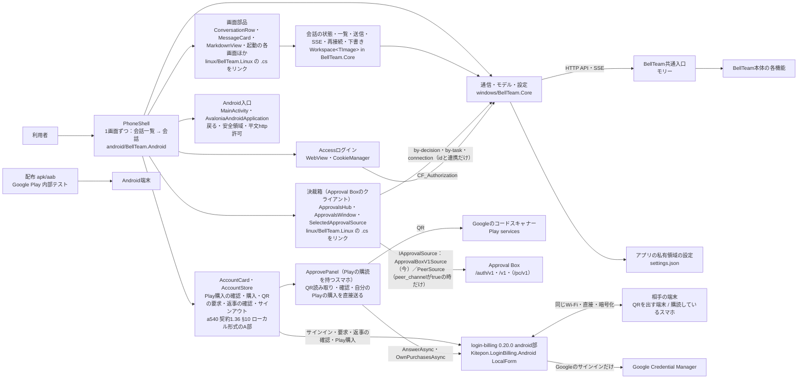
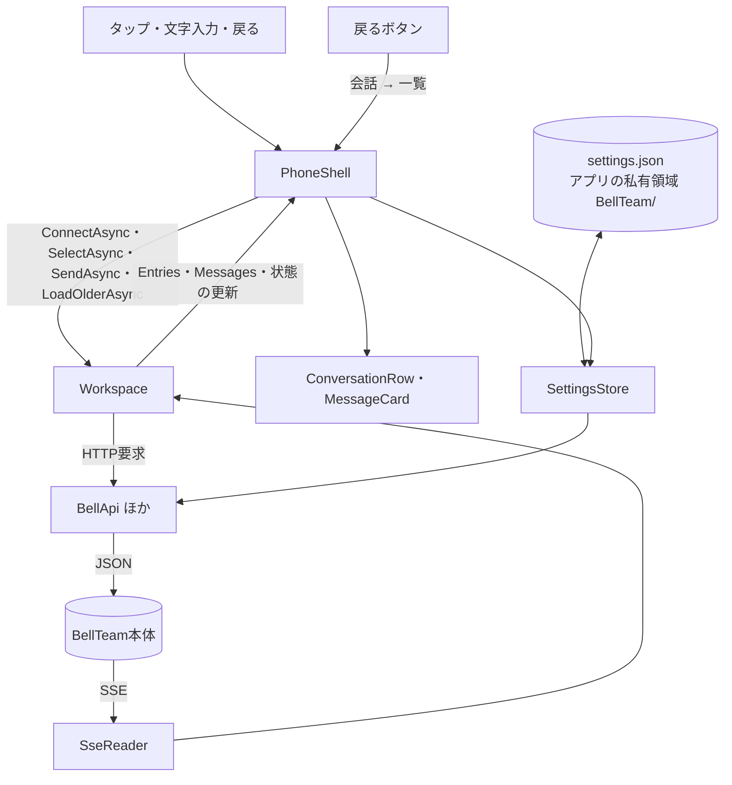

# Androidアプリの機能図と作業手順

担当はネオン（`bot-208dcbab`）。この文書をAndroid製品内部の機能図とデータの流れ図の正本とする。本体側の接続登録は[Androidアプリ](architecture/modules/android/README.md)、担当と変更手順は[機能担当と変更の手順](architecture/module-ownership.md)を参照する。

オーナー指示（2026-11-17、task a350）：全プラットフォームで仕様は1つ。見た目と操作はMac版（`ios/`）に揃え、BellTeamのAndroid版をGoogle Playの内部テストへ出す。コードは[Linuxアーキテクチャ](linux-architecture.md)と同じ方針で、`windows/BellTeam.Core`（plain `net10.0`、所有はアニス）をProject参照で使い、画面はAvalonia 12（`net10.0-android`）で作る。Androidで新しく書くのは「携帯の形」の殻（`PhoneShell`）とAndroid固有の入口だけとする。

## 機能図

- Linux版の画面部品は、`BellTeam.Android.csproj` が `linux/BellTeam.Linux/*.cs`（`Program.cs`・`App.cs`を除く）をそのままコンパイルして使う。画面の直しは1か所（Linux側）で両方へ届く。窓（`Window`）に載る画面は携帯では使えないため、`PhoneShell` が1画面ずつの頁として載せ直す。
- `BellTeam.Core`の所有者はアニス。Coreを変える時は小さなPRでアニスをレビューに入れ、Windowsの挙動を変えない（Linuxと同じ合意）。
- アセンブリ名は `BellTeam`（WindowsとLinuxと同じ）。Coreの`InternalsVisibleTo("BellTeam")`と`avares://BellTeam/`の資源が同じ名前で届くため。
- 本体の状態は共通入口のHTTP APIとSSEだけで使う。本体の内部状態を直接読み書きしない。

## データの流れ

- 接続先は`SettingsStore`の`ServerUrl`（`SpecialFolder.LocalApplicationData`＝アプリの私有領域）に保存する。起動時に保存があれば`StartupRoute`に従って自動で接続し、無ければ接続先の入力画面（Mac版と同じ）を出す。
- 画面の部品が窓に頼る3つ（転送のシート・メンバー間の連絡のシート・画像ギャラリー）は、Linux側の`IMessageHost`（`ISheetHost`を含む）に分けた。カードは見た目の祖先から`IMessageHost`を探して頼み、Linuxでは`MainWindow`、Androidでは`PhoneShell`が答える（シートは頁の上に重ね、ヘッダー右の「転送」などの保存ボタンは`ISheetSave`に従う。ギャラリーは全面）。返信の帯（`Workspace.Quote`）は入力欄の上に出す。戻るボタンはギャラリー → シート → 頁の順に閉じる。
- 窓の画面を頁にする：Avalonia `Window`はAndroidで作れない（`NotSupportedException`）ため、Androidプロジェクトは`namespace BellTeam.Linux`の中に携帯用の`Window`（`WindowShim.cs`。`ContentControl`）を置く。同じ名前空間の型が`Avalonia.Controls`の取り込みより優先されるので、リンクしたLinuxの`EditorWindow`・`ApprovalsWindow`・`LatticeWindow`・`WorkGraphWindow`などは変更なしに頁として使える。`Show()`で`PhoneShell`の頁の積み重ねへ載り、`Close()`で外れる。コントロールから窓を探す所は`OwnerWindow.Of`（Linuxは`TopLevel`、Androidは視覚の祖先）に一か所化した。`MainWindow`・`Launcher`・描画確認（`*Render`・`*Fixture`）・`SingleInstance`はAndroidへリンクしない。頁の戻るは`IPageBack`（決裁箱の詳細→一覧）を先に聞く。
- 狭い画面向けの並べ方（`Compact`）：決裁箱は一覧と詳細を1列ずつ切り替え（詳細は上の集計を外し、つながりを詳細の下へ）、工程表の一覧は幅いっぱいのカードを縦に並べる。Linuxの並べ方（3列・折り返し）は変えない。一覧画面の入口は「決裁箱（件数）」「工程表」。相関図（`WorkGraphWindow`）の頁も同じ仕組みで開く。エミュレーターで、作業中のメンバーの顔写真・輪・名前・依頼の線と吹き出しまで描かれる。AndroidのSkiaは、角丸の矩形へ`ImageBrush`で顔写真を描くと細い切れ端しか出さない（途中で相関図が空白に見えた原因と考えられる）ため、顔写真は角丸のクリップの中へ`DrawImage`で描く（Linuxも同じ描き方）。
- 通知（閉じている間のFCM。契約は[FCM通知](architecture/modules/usage/fcm-push.md)、サーバー側はミカ）：アプリは起動のたびと`onNewToken`でFCMの端末トークンを`POST /api/notifications/android/devices {token, server, previousToken?}`で今つないでいるサーバーへ登録し、ログアウトとつなぎ先の変更の前に`POST …/android/unregister {token}`で外す（`PushRegistration`。3秒で打ち切り、つながらなくても切り替えを止めない）。サーバーがFirebaseの鍵を持たない間の503・拒否の400は静かに記録するだけで、再試行は次の起動に任せる。`google-services.json`（Firebaseの設定、シエロのa379）が無いと`FirebaseApp`が無く、登録は動かない（ビルドと起動は通る）。通知チャンネル`bellteam_messages`（重要度high）を起動時に作る。アプリが閉じている間はシステムが題名と本文を出し、タップで`MainActivity`が`data`を引数に起動する。`PushRouter`がそれを受け、つながり次第`kind`/`roomId`/`botId`の会話を開く（別のサーバーのものは捨てる。iOSと同じ）。アプリが開いている間は`BellPushService.OnMessageReceived`が自分で通知を出すが、いま見ている会話のものは出さない。更新通知（`kind: update`、サーバー側はミカのa381）は題名「BellTeam」・本文「更新があります。Updateで確認してください。」で届き、タップすると設定の「アップデート」の頁を開く（今つないでいるサーバーのものだけ。自動では更新しない。端末登録に`proof`は送らない）。送り主の顔写真はv1では送られない。
- 設定：Androidの設定の頁（`PhoneSettingsPage`）は接続・利用と課金（Linuxと同じ`PurchaseEntry`）・アプリの版をAndroid用に描く。その上の「AI・端末・追加機能などの設定」は、Linuxの`SettingsWindow`を携帯の形（`compactHidden`：頁の一覧 → 選んだ1頁。戻るは`IPageBack`）で開く。Linux版が自分で描く接続・利用と課金（Stripeの行）・アプリの版・通知（freedesktop）は一覧から外す。AIのCLIの導入（a451。AIの設定の「最新版を入れる」・要対応の帯・初期設定・Botの編集）は、このLinuxの画面を共通部分としてそのまま使い、[Linuxアーキテクチャ](linux-architecture.md)に従う。
- メンバー編集：メンバーとの会話の見出し右の歯車で、Linuxの`MemberEditorWindow`（名前・テーマ色・AI・端末とフォルダ・予定など）を頁として開く。キャンセル／保存はその画面のもの。
- リンク：メッセージ・案内文のリンクと設定のリンクは`ExternalLink.Launch`で開く。Linuxは.NETのシェル実行（xdg-open）、Androidは起動時に`ExternalLink.Opener`へ`ACTION_VIEW`のIntentを入れる（シェルが無いため）。失敗は呼び出し側が平易な文で示す。
- 画像の添付：入力欄左のクリップでシステムのファイル選択（`StorageProvider`）を開く。選ばれた画像は内容URIなので、アプリのキャッシュへ写してから`Workspace.AttachFilesAsync`へ渡す。入力欄の上に縮小画像と取り消しを並べる。
- サーバーのログイン（a485。[linux-architecture.md](linux-architecture.md)のログインの項と同じ`ConnectView`、`kind`は`android`）：サーバーが`login.enforced`なら起動画面は`ConnectView`になり、鍵は`KeystoreSessionTokenStore`が持つ。`login`キーが無いサーバーは下のAccessの流れのまま。
- Cloudflare Access（HTTPSの外部接続）のログイン（Windowsの`DesktopAccess`・`AccessLoginView`と同じ流れ）：`Workspace`が「ログインが要る」（`NeedsLogin`）と判定すると、起動画面がAndroidの`WebView`のログイン頁（`AccessLoginPage`）に替わる。WebViewの`CookieManager`が`CF_Authorization`を次の起動まで保つ。頁を読み終えるたびにそのクッキーをCoreの`AccessCookies.Replace`で`AccessSession.Cookies`（`BellApi`が送る`CookieContainer`）へ写し、`GET /api/session`が`authenticated`を返したら接続し直す。接続の前（`prepareConnection`）にも前回のログインを写す。設定の「サインアウト」（Accessの接続先だけ）は`CookieManager`とコンテナを空にして`Workspace.SignOut`を呼ぶ。HTTPSでない接続先にはログインを出さない。
- LAN上のサーバーは平文のhttpなので、Androidの`UsesCleartextTraffic`を有効にする（接続先の検査は`ServerOrigin`が行い、httpsかlocalhost・LANのhttpだけを通す）。
- 書き込み（POST・PUT・DELETE）は自動で再送しない。SSEと一覧の読み直しは、Coreの上限付きバックオフ（`ReconnectBackoff`）で再試行を続ける。起動の失敗画面は同じ間隔で自動再試行し、回数の上限で打ち切らない。

## 現在の範囲と順序

1. 済：接続先の入力・起動の各画面（Mac版と同じ。キーボードの上に持ち上げ、入力欄を表示位置へ送る）・会話一覧（アバター・在席・要約）・会話（履歴・返信/転送/コピーの印・送信）・戻る・設定の頁（接続・利用と課金・アプリの版）。エミュレーター（API 36）で本番サーバーに接続して確認。
1b. （取り下げ：a492のHomeConnectionによる本体サーバーへのログインは、a540でLinuxとAndroidから外した。運営のパスが無いと成り立たないため。サーバーへ入る道は上のコンソールのコードとアプリの追加だけ。）
1c. 決裁箱用の2つ目のログイン部品（a515n、login-billing 0.18.0・契約1.24。開発版で何も出荷しない）：`ApprovalBoxAccount`が、BellTeamのものとは別の`LoginBilling`を1つ持つ（接続先は`product.json`の`approvalBoxAuthUrl`＝`https://approval-box.kitepon.dev/auth/v1`、保管は`storageName`＝`approvalbox`で、フォルダもKeystoreの鍵の別名もBellTeamと別。ウェブのサインインだけで、ネイティブのGoogle・購入・領収書は使わない）。2つは何も共有せず、片方をサインアウトしてももう片方は残る。ウェブの戻りは各部品が自分のAuth Tabの起動口を`MainActivity.OnCreate`で登録し、検証済みリンクの`Intent`は先にBellTeam側、受けなければ決裁箱側へ渡す。戻りのアドレス（`approvalBoxWebReturn`）は決裁箱の運営側が一覧に載せるセッションスキーム`approvalbox-websignin`で、正確な文字列は`approvalbox-websignin://return`（ナユタ 2026-11-22。サーバーはスキームだけを見る。httpsの`/app/websignin`は決裁箱自身のアプリ用で、BellTeamは使わない）。画面と`/pc/v1`への接続は、デルタの設計（peer-channel-signin.md）とアニスのピアチャネル部品に従って別工程（a520）で作る。
1e. （取り下げ：a529nの端末の一覧`HomeSessionsCard`は、a540でLinuxとAndroidから外した。ホームのセッションが無いため。）
1i. カードの文言（a540、ラピの最終表。トロニー裁定 2026-11-23：支払うスマホがAndroidでもよい所は「iPhone」でなく「スマホ」）：カードの題「BellTeamの購読」・状態の1文（購読はまだありません。／購読中です。（…まで））・「購読しているスマホで確認する」・注意文・「QRを出す（Google）／（Apple）」・QRの読み上げ名「確認用のQRコード」・「スマホの返事を待っています（{QRが切れる時刻}まで）」・「購読を確認しました。」・期間が終わった時の「購読の期間が終わっています。新しいQRを出してください。」・失敗の文（ライブラリのコードごと）は、すべてCore（`LocalFormText`・`StoreAccountText.Approve*`。アニスが表のとおりに置いた共通ファイル。Windowsも同じ文）で、`AccountCard`と`ApprovePanel`（承認する側の「別の端末を承認する」「別の端末を承認しますか」「承認」「やめる」「確認の返事を送りました。」「この端末には購読がありません。先に購読してください。」も表のとおり。QRの読み取りはGoogleのコードスキャナーの画面なので、その題と閉じるはそちらのもの）は使うだけ。表に無い「10分」の補足行は出さない。QRの切れる時刻は、QRを出した時刻の10分後（`LocalForm.ListenMinutes`）。
1j. 決裁箱の端末部品（a520a。ピアチャネルの端末部品はLinuxと同じC#のpc/1核）：`linux/BellTeam.Linux/LinuxAccountAbx{Device,Files,Host}.cs`をAndroidへリンクして使う（`LinuxApprovalBoxDevice`に`platform="android"`を渡す。登録簿の保護は`software`＝アプリ専用の領域のファイル、Keystoreは未使用）。口座だけがAndroid固有で、`AndroidApprovalBoxDevice.cs`の`AndroidApprovalBoxAccount`が`IApprovalBoxAccount`を満たす（1cの2つ目の`LoginBilling`インスタンス：`PassHeader(url)`はサイン済みなら決裁箱の接続先だけに渡るAuthorizationの値、`CheckAsync().K`は最初の登録簿と承認に使う口座のK、`SignInWebAsync`はウェブのサインインだけ。login-billing 0.20.4・契約1.40、ミント受入済み。アプリ内の「QRを読み取る」は0.20.4から、Windows/Mac/Linuxの二台形のQR（lbq4:）も受け付ける）。ネイティブエンジンlibdatachannel v0.24.6は`android/native/prebuilt/{arm64-v8a,x86_64}`（レシピと確認は`android/native/README.md`）で、csprojの`AndroidNativeLibrary`でAPKに入る。`PhoneShell`はApplication.OnCreateで作られ（Activityより前）、`ApprovalBoxAccount`はApplication.Contextで作る。決裁箱はApproval Boxのクライアントで、常に動く（旗もスイッチのファイルも無い。デルタの契約client-v0.5.md、オーナー裁定 2026-11-24）：口は`IApprovalSource`、今のアダプターは`ApprovalBoxV1Source`（Approval Boxの`/v1`を2つ目のログイン部品のpassで読む）、サーバーの`GET /v1/auth/config`が`peer_channel`をtrueにした時だけ、この端末の`/pc/v1`のセッション（`PeerSource`。ネイティブエンジンが要る）へ移る（`SelectedApprovalSource`。詳しくは`linux-architecture.md`の第5段）。デバッグ版でファイル`files/approval-box-device`に決裁箱の接続先を書くと、その開発サーバーへ向く（実験用）。画面はLinuxと共有の`ApprovalsHub`・`DeviceStrip`（9つの状態）。2026-12-12のルート削除（a490h2n）以後、一覧と入口の件数は決裁箱の口（`IApprovalSource`）だけから作り、サーバーの`/api/approvals`の一覧・答え・保留・添付・events・summaryは使わない（結びつきのバッジは`by-decision`、「工程表との連携」は`connection`・`connect`だけ。詳しくは`linux-architecture.md`の第3段b）。product.jsonに決裁箱の接続先が無い時だけ「この端末では、決裁箱をまだ使えません。Approval Boxのアプリで答えてください。」の1枚を出す。`peer_channel`がtrueになってもエンジンが無い版は「この版では、決裁箱をまだ使えません。アプリを更新してください。」と「今すぐ試す」。サインイン・承認依頼・「アカウントを削除」（`DeleteLocalAsync`）の配線はLinuxと同じ。確認済み（a490h2n、2026-11-23）：x86_64のエミュレーターで、決裁箱のローカル開発サーバー（`approval-box`の`dev:server`、adb reverseの8788）に対し、サインイン→未承認（16文字のコードとQR）→`dev:admit`で承認（登録簿v3）→`Live`→コネクタが出した申請を端末で受信→答える→コネクタへ答えが届く、までの一周が通る。画面（サインインの案内・承認待ち・一覧・申請の詳細と答える）も目視済み。この確認のために、スイッチのファイル`files/approval-box-device`の中身が空でなければそれを決裁箱の接続先（例`http://127.0.0.1:8788/auth/v1`）にし、デバッグ版だけはその時`SignInForTestingAsync`（開発サーバーの偽のid token、Apple・`dev-person`）でサインインする（`ApprovalBoxAccount.LabUrl`）。実際のWebサインインはAuth Tabが要り、Chrome 133のエミュレーターでは`return_not_received`（ライブラリが先に断る）になるため、実機のGoogleサインインの通しは未確認。arm64：ライブラリ`libdatachannel.so`（arm64-v8a）は、Android 16のx86_64イメージのARM変換（libndk_translation）の上で、`android/native/loopback-check.c`（同一プロセスの2つのピア接続がloopbackでつながり、データチャネルが開いてメッセージが届く）に通った。アプリ全体は、arm64だけのAPKをその変換の上で動かすと最初の画面操作で応答なしになり（決裁箱の部品を切っても同じ）、arm64のアプリの中での通しは未確認。未確認：実機のarm64、実際のGoogleサインインから`Live`までの通し（AIが持てるテスト用アカウントが無い）。画面の幅：`ApprovalsDeviceStrip`は文言を折り返しボタンを画面内に収め（横積みのStackPanelをGridにした）、承認コードは折り返して全桁を出す。
1g. 「アカウントを削除」（a540。置き場と文はラピの最終表[account-deletion.md](architecture/modules/apple/account-deletion.md)をそのまま写す。ポリ承認済み。変えてよいのは購読の1文だけ：「購読はGoogle Playのものなので、この操作では解約されません。解約はGoogle Playの「定期購入」から行ってください。」）：`AccountCard`の最後（区切り線の下、危険色のボタン1つ）に、サインインの有無にかかわらず出す。確認の題・本文・「削除する」「やめる」はカードの中。文の本体はCoreの`AccountDeletionText`（アニスの共通ファイル。Windowsも同じ文）。BellTeamはどのサーバーにも何も持たないので、削除はローカルのサインアウトと決裁箱のサインアウトだけ。実行は`AccountDeletion.Run`（PhoneShellが`DeleteAccountAsync`を入れる）で、順序はラピの表のとおり：⓪最初に、生きている接続でFCM登録を取り消す（サーバーが端末のトークンを持ち続けると削除後も通知が届くため。失敗したら部分「通知の登録」で止める。接続していない時は飛ばす）。①2つのサインアウトを両方試す（決裁箱＝`ApprovalBoxAccount.SignOutAsync`、BellTeamの購読の確認＝`signOutLocal`＝この端末のサインインと受け取った返事を消す。通信は要らない。通ったものは通ったまま残る）。どちらかが失敗したら止める：何にも触れず、失敗の本文だけを出す（題「アカウントの削除を終えられませんでした」、部分は「決裁箱のサインイン」「BellTeamの購読の確認」、理由は「ネットワークにつながっていません」「決裁箱の運営に届きません」「処理できませんでした」の3つ）。②両方が通った時だけ、接続（トークン・Accessのログイン・`model.SignOut`・保存した接続先）を外し、最初の画面（アカウントの関門）の上に結果の通知を1回出す（題「アカウントを削除しました」）。押し直すと残りだけをやり直す。ほかの端末のサインインは止めない。サーバーの会話と設定、決裁箱のアカウントは残る。
1f. リリースの注意（トロニー裁定 2026-11-23。リリース担当へ）：(a) 最低APIは24から26に上がる。login-billingのAndroid部（AARの`uses-sdk minSdkVersion=26`）がそう要求するため。Android 7.x（API 24・25）の端末にはインストールできなくなる。(b) a540で運営のWorkerは使わなくなった（`loginBillingWorkerUrl`・`-p:LoginBillingWorkerUrl`は不要）。`product.json`の該当キーは決裁箱の接続先と共有のファイルに残る。(c) ローカル形式はAndroid 17の`ACCESS_LOCAL_NETWORK`を宣言し、`MainActivity.OnCreate`で`RegisterLocalNetwork`を呼ぶ（契約1.36の義務）。(d) Play公開に必要な値（Playのライセンスキー・Googleクライアントid）はCoreの`LocalFormIds`にある。
2. 課金（a540、login-billing 0.20.0・契約1.36 §10「ローカル形式」。オーナー裁定 2026-11-23。0.20.0は開発版）：サーバーは一切使わない。運営も、本体による中継も、AppleのWebページも置かない。出てくるのは2台だけ：QRを出して入りたい端末と、購読しているスマホ。設定の頁の`AccountCard`が、Androidの2つの役を持つ。`AccountStore.Local`が`Kitepon.LoginBilling.LocalForm`を1つ持つ（Googleの`serverClientId`はWebクライアント。受け付けるaudienceと店の規則はCoreの`LocalFormIds`：BellTeamのGoogleクライアントid一覧・PlayのライセンスキーとAppleのバンドル・商品id。Playのキーが空の間は画面が「購読の接続先がまだ決まっていません。」を出す）。(1) Playの購読を持つスマホ：開くたびと前面に戻るたびに`OwnPurchasesAsync`で自分のPlayの購入を確かめ（商品id `dev.kitepon.bellbot.monthly`）、持っていれば「購読中です」と`ApprovePanel`を出す。`ApprovePanel`は「QRを読み取る」（Googleのコードスキャナー。こちらはカメラの権限を持たない）で相手の端末のQRを読み、`AnswerAsync`が同じアカウントかを確かめ、「このログインを許可しますか？」（自分で始めたログインだけ許可）に「許可」「許可しない」で答えたあと、自分のPlayの購入を同じWi-Fiの中で直接送る（`signin_required`ならGoogleでサインインして1回だけやり直す）。結果は許可した・許可しなかった・購読がない。(2) 購入を持たないスマホ：Playの商品が読めれば購入ボタン（`ProductDetailsAsync`→`PurchaseAsync`）、「Googleでサインインして、スマホで確認する」（`SignInLocalAsync`→`MakeRequestAsync("google")`）、「iPhoneのAppleサインインで、スマホで確認する」（`MakeRequestAsync("apple")`。サインインせず、iPhoneの返事がAppleの本人確認を運ぶ）を出す。QRは`QrView`がQRCoderで描き、待ち時間は10分、「やめる」で取り消す。返事は`AwaitPaidAsync`がストアの署名つき証明を自分で確かめ、有効期限を記録する（保管はライブラリの保護領域。表示・ログ・送信をしない）。失敗の言葉はCoreの`LocalFormText.Failure(code)`で（購入の失敗`purchase_failed`・`purchase_unverified`は、コードを出さず「購入を完了できませんでした。もう一度お試しください。」。iPhone・Macと同じ文。トロニー裁定 2026-11-24）、次は新しいQR（自動更新はしない）。期間が終われば`PaidUntil()`が空になり、関門が新しいQRを求める。初回起動は`PhoneShell.BeginAfterAccountAsync`が先にアカウントを求め（7e）、自分の購入か記録した期間が有効な端末、または確かめられない時（値が無い・Playに尋ねられない）はそのまま次へ進む。パスもアカウントの番号もホーム部品も無い。成り立つ最低条件は同じWi-Fi（「ローカルネットワークへのアクセス」の許可。拒まれたら`local_network_denied`の文で案内）。パッケージは`android/fetch-login-billing.sh`が版とsha256を確かめて`android/packages-local`へ置く。実機でのGoogleサインイン・PlayのライセンステストでQRの往復を通した確認は未了。
3. 次：通知（サーバー側のpush＝FCMの対応が要る）。Avaloniaの`Window`はAndroidで作れない（`NotSupportedException`）ため、それらの画面は窓の継承を外した頁に分けてから載せる。
4. 配布：署名鍵・AABのbuild・Google Play Consoleの内部テストへのアップロード（Play Consoleの操作はオーナーのアカウントが要るため、トロニー経由で申請する）。

アプリID（`applicationId`）は`dev.kitepon.bellbot`。Appleの`bundleId`と`services/subscriptions/product.json`の名前に揃える。Google Playは公開後にアプリIDを変えられない。

## 開発の手順

- .NET 10 SDK（`~/.dotnet`）、`dotnet workload install android`、JDK 17、Android SDK（`~/Android/Sdk`）が要る。`dotnet build -c Debug -t:Install -p:AndroidSdkDirectory=$ANDROID_HOME -p:JavaSdkDirectory=$JAVA_HOME` で接続中の端末またはエミュレーターへ導入する。
- 画面の確認は端末で行う（`adb exec-out screencap -p`）。本番のサーバーへつなぐ時は、送信など書き込みを伴う操作をしない。
- 会話の過去ログ（a471-linux-android-older-button。契約は[machine-stream.md](architecture/modules/conversation/machine-stream.md)「History pages of a long stream」、仕様は全クライアント共通）：会話の上に「以前のメッセージを読む」ボタンは置かない。古い分はLinuxの窓と同じ`HistoryPaging.NeedsOlderPage`で、スクロールの動き・表示の大きさの変化・最初の描画のあとに`PhoneShell.PrefetchOlderAsync`が読む（位置は読む前後で保つ。読むかどうかは描いた高さで決め、最初の頁を読んだあとにもう一度確かめる〔a471-fill-drawn-linux〕。読みに失敗したら次のスクロールでまた読む）。
- 見ている行が動かないこと（a471-scroll-jump-linux）：古い頁を上に足す読み込み（`PhoneShell.LoadOlderPreservingPositionAsync`）は位置を手で戻さず、`MessageCard`が登録するスクロール固定に任せる。読んでいる間にスクロールを続けても、上の行の高さが変わっても、見ている行は動かない（Linuxの窓と同じ。測定と試験はLinux側、`ScrollJumpTests`）。
- 通知の小アイコン（a471-android-push-icon-crash）：アプリ自身のアイコンを持たないので、`ApplicationInfo.Icon`は0で、アプリが開いている間に届くプッシュは`Notification.Builder`の「小アイコンが無い」例外でアプリを落としていた。`Resources/drawable/ic_stat_bell.xml`（白い鐘のベクター）を足し、`BellPushService`はそれを小アイコンに使う。エミュレーターで本番のプッシュを受け、落ちずに通知が1件出ることを確かめた。
- 会話は最新行を錨にして並ぶ（a471-open-newest-android。Linuxの窓と同じ契約と同じ`NewestColumn`（`linux/BellTeam.Linux/NewestColumn.cs`をAndroidが取り込む）を`PhoneShell`が持つ）：開く・送る・新着・取り直しにスクロール命令も追いつきの動きも要らず、最新行が最初の枠から下にある。読み戻している間は何も動かない。33px刻みの`BottomFollower`は廃止した。古いページは、表示の上の描いた高さが`max(1画面, 上向きの速度の2秒分)`に満たない間だけ読み、開いた直後は描いた行が1画面に満たない間だけ読む（`HistoryPaging.NeedsOlderPage`・`NeedsFirstScreen`、`PhoneShell.NeedsOlder`。最初の表示後の背景の読み込みは廃止）。
- 「最新へ ↓」／「新着メッセージ ↓」のボタン（a471-latest-button-android。Linuxの窓と同じ動き）：`PhoneShell`が会話の下に重ねて持つ。最新から80px以上離れて読んでいる間に出て、読んでいる間に下へ行が届くと「新着メッセージ ↓」に変わり（見ている行は動かさない）、押すと`NewestColumn.FollowNewest`で最新へ戻って追従に戻る。最新の近くへ戻ると消える。