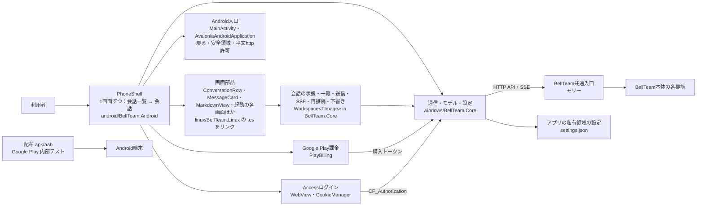
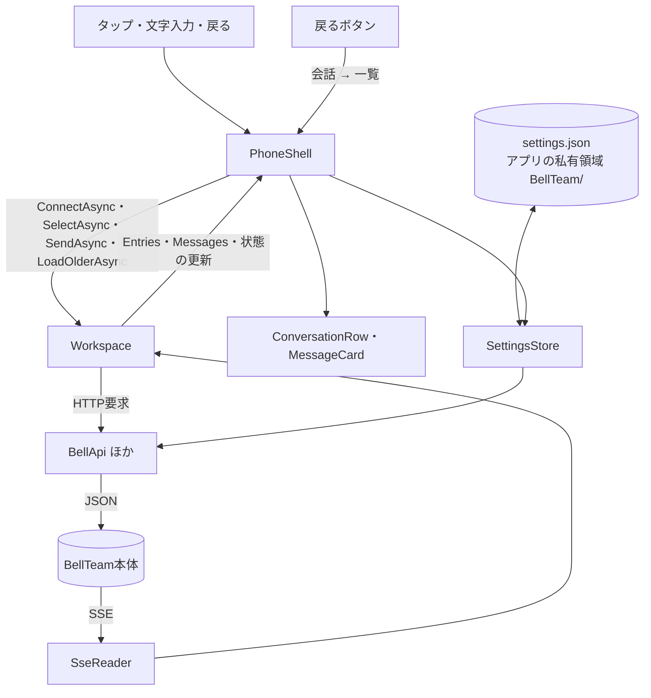

# Androidアプリの機能図と作業手順

担当はネオン（`bot-208dcbab`）。この文書をAndroid製品内部の機能図とデータの流れ図の正本とする。本体側の接続登録は[Androidアプリ](architecture/modules/android/README.md)、担当と変更手順は[機能担当と変更の手順](architecture/module-ownership.md)を参照する。

オーナー指示（2026-11-17、task a350）：全プラットフォームで仕様は1つ。見た目と操作はMac版（`ios/`）に揃え、BellTeamのAndroid版をGoogle Playの内部テストへ出す。コードは[Linuxアーキテクチャ](linux-architecture.md)と同じ方針で、`windows/BellTeam.Core`（plain `net10.0`、所有はアニス）をProject参照で使い、画面はAvalonia 12（`net10.0-android`）で作る。Androidで新しく書くのは「携帯の形」の殻（`PhoneShell`）とAndroid固有の入口だけとする。

## 機能図

- Linux版の画面部品は、`BellTeam.Android.csproj` が `linux/BellTeam.Linux/*.cs`（`Program.cs`・`App.cs`を除く）をそのままコンパイルして使う。画面の直しは1か所（Linux側）で両方へ届く。窓（`Window`）に載る画面は携帯では使えないため、`PhoneShell` が1画面ずつの頁として載せ直す。
- `BellTeam.Core`の所有者はアニス。Coreを変える時は小さなPRでアニスをレビューに入れ、Windowsの挙動を変えない（Linuxと同じ合意）。
- アセンブリ名は `BellTeam`（WindowsとLinuxと同じ）。Coreの`InternalsVisibleTo("BellTeam")`と`avares://BellTeam/`の資源が同じ名前で届くため。
- 本体の状態は共通入口のHTTP APIとSSEだけで使う。本体の内部状態を直接読み書きしない。

## データの流れ

- 接続先は`SettingsStore`の`ServerUrl`（`SpecialFolder.LocalApplicationData`＝アプリの私有領域）に保存する。起動時に保存があれば`StartupRoute`に従って自動で接続し、無ければ接続先の入力画面（Mac版と同じ）を出す。
- 画面の部品が窓に頼る3つ（転送のシート・メンバー間の連絡のシート・画像ギャラリー）は、Linux側の`IMessageHost`（`ISheetHost`を含む）に分けた。カードは見た目の祖先から`IMessageHost`を探して頼み、Linuxでは`MainWindow`、Androidでは`PhoneShell`が答える（シートは頁の上に重ね、ヘッダー右の「転送」などの保存ボタンは`ISheetSave`に従う。ギャラリーは全面）。返信の帯（`Workspace.Quote`）は入力欄の上に出す。戻るボタンはギャラリー → シート → 頁の順に閉じる。
- Cloudflare Access（HTTPSの外部接続）のログイン（Windowsの`DesktopAccess`・`AccessLoginView`と同じ流れ）：`Workspace`が「ログインが要る」（`NeedsLogin`）と判定すると、起動画面がAndroidの`WebView`のログイン頁（`AccessLoginPage`）に替わる。WebViewの`CookieManager`が`CF_Authorization`を次の起動まで保つ。頁を読み終えるたびにそのクッキーをCoreの`AccessCookies.Replace`で`AccessSession.Cookies`（`BellApi`が送る`CookieContainer`）へ写し、`GET /api/session`が`authenticated`を返したら接続し直す。接続の前（`prepareConnection`）にも前回のログインを写す。設定の「サインアウト」（Accessの接続先だけ）は`CookieManager`とコンテナを空にして`Workspace.SignOut`を呼ぶ。HTTPSでない接続先にはログインを出さない。
- LAN上のサーバーは平文のhttpなので、Androidの`UsesCleartextTraffic`を有効にする（接続先の検査は`ServerOrigin`が行い、httpsかlocalhost・LANのhttpだけを通す）。
- 書き込み（POST・PUT・DELETE）は自動で再送しない。SSEと一覧の読み直しは、Coreの上限付きバックオフ（`ReconnectBackoff`）で再試行を続ける。起動の失敗画面は同じ間隔で自動再試行し、回数の上限で打ち切らない。

## 現在の範囲と順序

1. 済：接続先の入力・起動の各画面（Mac版と同じ。キーボードの上に持ち上げ、入力欄を表示位置へ送る）・会話一覧（アバター・在席・要約）・会話（履歴・返信/転送/コピーの印・送信）・戻る・設定の頁（接続・利用と課金・アプリの版）。エミュレーター（API 36）で本番サーバーに接続して確認。
2. 課金（Google Play。契約は[課金クライアント契約](billing-client-contract.md)）：「利用と課金」にGoogle Play・App Store・Stripeの3行を同じ大きさで置き、買えるのはGoogle Playの行だけ。`PlayBilling`（NuGet `Xamarin.Android.Google.BillingClient`）が購入と復元を行い、購入トークンを`POST /api/subscription/google/verify`（`{purchaseToken, productId}`）へ送り、サーバーが`entitled`を返してからPlayへ確認済みを返す。サーバー側（a157）が無い間は404で、平易な文で示して確認済みにしない。商品IDは`services/subscriptions/product.json`の`productId`。
3. 次：画像ビューア・添付・通知、窓の部品（`EditorWindow`系・`MainWindow`）に載っている画面（工程表・相関図・決裁箱・メンバー設定）の頁化。Avaloniaの`Window`はAndroidで作れない（`NotSupportedException`）ため、それらの画面は窓の継承を外した頁に分けてから載せる。
4. 配布：署名鍵・AABのbuild・Google Play Consoleの内部テストへのアップロード（Play Consoleの操作はオーナーのアカウントが要るため、トロニー経由で申請する）。

アプリID（`applicationId`）は`dev.kitepon.bellbot`。Appleの`bundleId`と`services/subscriptions/product.json`の名前に揃える。Google Playは公開後にアプリIDを変えられない。

## 開発の手順

- .NET 10 SDK（`~/.dotnet`）、`dotnet workload install android`、JDK 17、Android SDK（`~/Android/Sdk`）が要る。`dotnet build -c Debug -t:Install -p:AndroidSdkDirectory=$ANDROID_HOME -p:JavaSdkDirectory=$JAVA_HOME` で接続中の端末またはエミュレーターへ導入する。
- 画面の確認は端末で行う（`adb exec-out screencap -p`）。本番のサーバーへつなぐ時は、送信など書き込みを伴う操作をしない。
