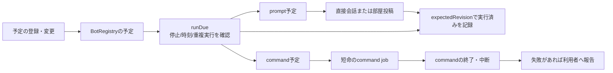
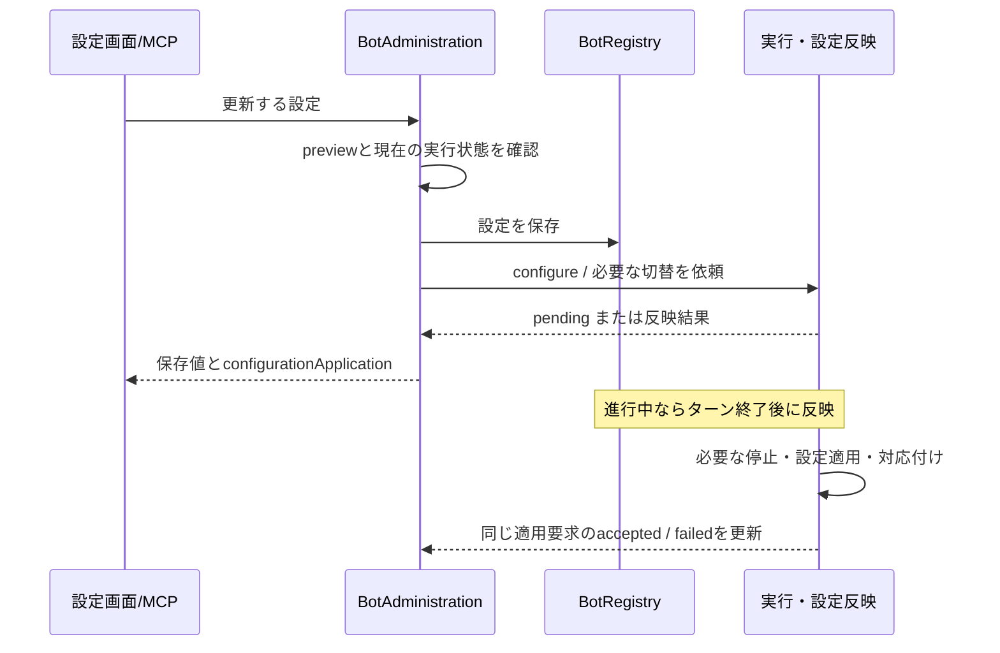
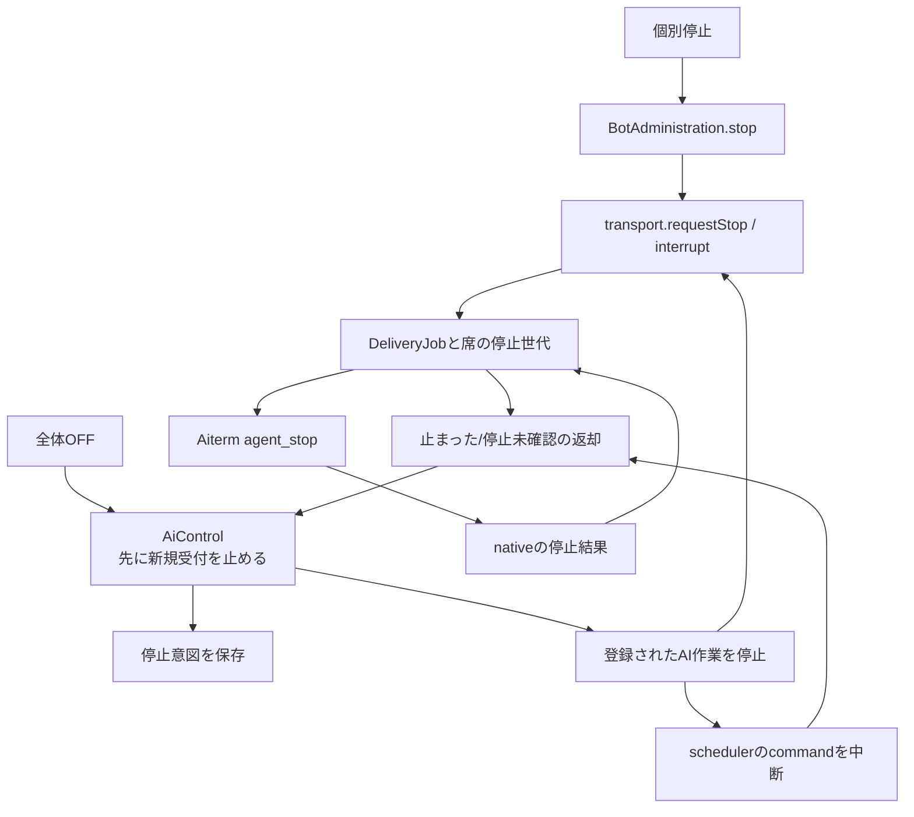
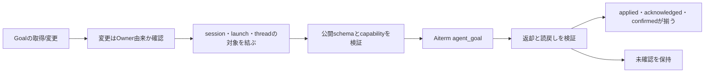

# 予定・設定・停止・Goal

[全体図](feature-map.md)の制御側。保存された要求、実行の受付、実行後の観測を分ける。

## 予定は会話の別入口

予定の起動とcommandの終了は別の時点。予定処理は失敗・結果不明でもその発行を消して自動再送しない。停止中は新しく発行せず、再開時には停止中に期限を過ぎた予定を `prepareResume` で区切る。古いrevisionの完了で編集後の予定を上書きしない。

夜間の再起動判定に使う完了ターン数はThroughlineの責任である。基底でschedulerだけtransportの再exportを経由していたため、直接 `throughline-context.mjs` を参照する形へ揃えた。Throughline自体の機能変更は不要。

## 設定を保存することと席へ反映すること

acceptedはCLI側の設定受付の根拠であり、モデルの内部動作を実測した意味ではない。設定だけを保存して反映済みとは扱わない。fastModeの既知未開始時の巻戻しと、失敗した同じ設定値を明示して再試行できる分岐を維持する。

台帳の更新、反映待ちの状態、nativeのsession対応を別の保存経路として整理し、同じMapにまとめない。

## 止める機能と状態の所有

AiControlは永続化を待つ前に新規受付を抑止する。永続化や停止確認が失敗しても、黙ってAIを再開しない。個別停止は通常nativeの `agent_stop` に接続し、`stop_sent` やsession保持を返す。停止要求を送ったことを、sessionの削除や外部副作用の取消へ読み替えない。

`stopRegisteredWork` は登録Botだけでなく、transportのjobに残る対象も拾う。現在は `transport.deliveryBots()` がSeatActivityの停止対象からBotを返し、AiControlが内部jobsを読む接続を置き換えた。削除済みBotの進行中jobを含む。全内部Mapを一括で隠す変更はしていない。legacy adapterの停止fallbackと同期的な受付障壁も維持する。

基底の `docs/current-design.md` のiPhone節には「個別停止=close/exists=false/200 stopped」という古い説明が残っていた。今回の文書で通常経路の202 stop_sent/互換経路の200 interruptedへ訂正した。製品の停止処理やApple画面を変更したものではない。

## Goalの操作

参照のために席を起こさない。空のsession、古い対象、未確認のmutationを成功へ補完しない。Goalの永続状態はAiterm側が所有し、BellTeamに同じ状態の別DBを増やさない。

## 関数と確認先

| 段階 | 主な実装 | 変更時に確認する試験 |
| --- | --- | --- |
| 予定の発行/世代/停止 | scheduler.mjs: runDue, dispatchBotSchedule, dispatchRoomSchedule, prepareResume / schedule-mutations.mjs / BotRegistry | scheduler, scheduler-failure, schedule-generation, http-schedule-list |
| 設定更新と反映 | bot-administration.mjs / bot-session-state.mjs / aiterm-transport.mjs | bot-administration, model-application-state, bot-session-state |
| 全体の停止/再開 | ai-control.mjs: AiControl, stopRegisteredWork | ai-control, ai-control-integration, goal-global-stop |
| 個別停止と競合 | session-interruption.mjs / delivery-job.mjs / seat-activity.mjs | member-stop, session-interruption, delivery-job, seat-activity |
| Goalの対象と返却 | bot-goals.mjs / http-goal-api.mjs / mcp-tools.mjs | bot-goals, goal-targets, http-goal-api, grok-goal-current |

実装は `src/`、試験は `test/<名前>.test.mjs`。すべての独立製品内部や全停止競合をこの調査で再試験したわけではない。
