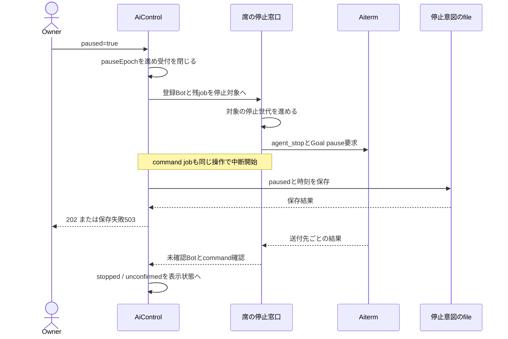
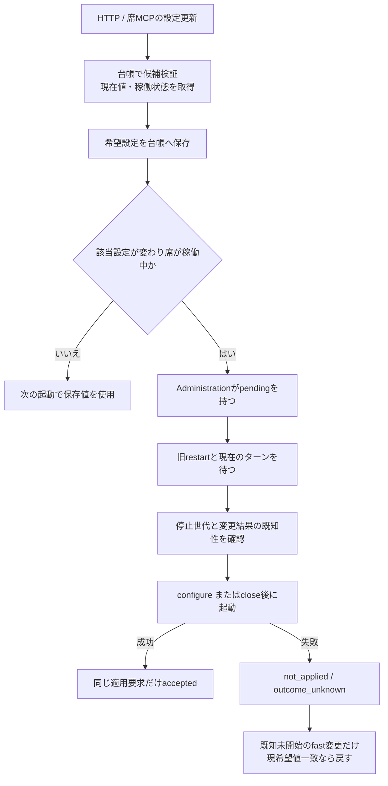
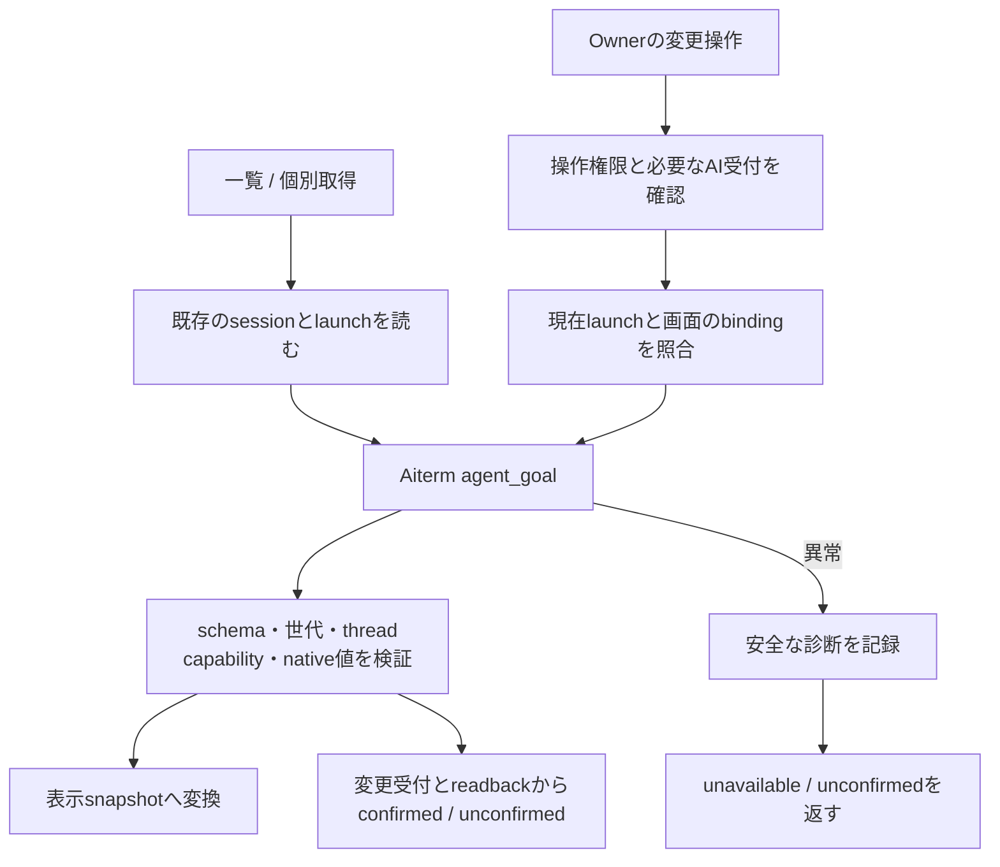

# 停止・設定適用・Goalの責任

対象sourceと確認範囲は[全体図](feature-map.md)に従う。[制御の全体像](control-and-state.md)に対する関数と状態の対応。処理を止めること、席を閉じること、希望設定を保存することは別の操作である。

## 全体停止は保存より先に受付を閉じる

| 状態/実関数 | 所有と成立条件 |
| --- | --- |
| `AiControl.paused/pauseEpoch/admit` | 新規仕事の入場と、入場後の全停止を識別するcheckpoint。再開後も旧epochの依頼は取消のまま |
| `AiControl.update/writes/pendingIntent` | 保存要求は順番に進める。ONの重複は同じ処理を返す。永続fileはOwnerの停止意図だけで、native停止receiptは保存しない |
| `stopRegisteredWork` | 台帳Bot＋配送jobに残るBotを重複除去。native停止を開始後にcommand中断も開始。削除済み対象を取り落とさない |
| `stopOperation/sendStopOperations` | 根の停止世代更新、開始時のjob snapshot、停止Promise公開、対象job.requestStop、finallyで解放。通常RPCは関係/状態/ディスク読取より前に発行 |
| `sendSessionStop` | sessionを重複除去、全停止では`pause_goals`を要求。sent/idle/partial/failedと全根の存在を検証。Goal pauseが欠ければpartial |
| 停止返却の適用 | sent/idle対象のjobをstoppedにし、到達した子Botの旧準備世代も無効化。新しいOwner入力を永続拒否するfenceは作らない |
| `AiControl.enforce` | 保存成立＋未確認Botなし＋command確認でstate=stopped。これは現在の停止APIの成立で、外部副作用の取消やCLI終了の証明ではない |
| 停止/保存異常 | pausedを維持しunconfirmed、勝手に再開しない。再起動時は保存ONからunconfirmedへ戻し、再観測する |
| 再開 | `beforeResume → scheduler.prepareResume → save`の後に受付を開く。停止中に期限を過ぎた予定を再送する操作ではない |

個別停止は`BotAdministration.stop → interrupt → interruptMany`。通常の結果は`stop_sent`、旧adapterを注入した構成の厳密な結果は`interrupted/sessionPreserved`。`stopFailureReport`の出力失敗で停止応答を変えず再送もしない。各HTTP状態コードはHTTP側が所有する。

`BotSessionState.stopVersions`は本体内の準備世代、nativeのlaunch IDはAitermの実個体世代であり、互いの代用品ではない。`sessionChanges`は発行中の起動/設定/close、`uncertainChanges`は変更結果不明を所有する。正常typed拒否と通信断での可能な適用を区別する。

## 保存値と現在席への適用を結ぶ

| 機能 | 関数/caller | 例外と副作用 |
| --- | --- | --- |
| 希望値更新 | `BotAdministration.update → BotRegistry.previewUpdate/update` | 保存とnative適用は非transaction。返却の`configurationApplication`はAdministrationのMapから合成し、台帳の永続fieldではない |
| 適用結果 | `apply/view` | 新しい更新が同じBotに来た場合、古いPromiseは新しい状態を書き換えない。失敗した同じ値の明示更新はreapply対象 |
| 同一CLIの変更 | `reconfigure → changeSession(agent_configure)` | model/effort/fastの必要fieldsだけ。Cursorのeffortにはmodelも添付。保存済み値の取得だけで当ターン適用済みと言わない |
| CLI切替/空へ戻す等 | `reconfigure → restartNow` | harness変更、既model/effortを空へ戻す、reapplyで空指定の場合はclose→wake。開始前に停止世代を再検証 |
| 明示restart | `restart` | 同一Botの重複は既Promiseを返す。世代を進め、既発行の変更とwake返却だけ待つ。終わらないターンや未発行idle待ちを待たない。close成立後に旧jobs/watchを止め新席へ |
| 任意機能設定の反映 | `ApplicationFeatures → stopForConfiguration` | 前のconfiguration Promiseの成功/失敗後に次のcloseを並べる。失敗を次の配送にも返し、旧登録へ黙って送らない |
| 削除 | `BotAdministration.remove → transport.stop` | idle→close→画像掃除→部屋除名→台帳削除の順。背景失敗はlog、後続削除へ進まない。全体rollbackはない |

設定適用Map、SeatActivity.configurationChanges、sessionChanges、BotRegistry保存値は、それぞれ表示・配送の待合せ・発行済み変更・次回起動の希望という異なる所有を持つ。ひとつの「設定状態」へまとめて待合せの意味を失わせない。

## Goalは本体に複製せずnativeの対象を確認する

| 関数 | 正本と保持条件 |
| --- | --- |
| `list/goalTargets` | 一覧だけpty_listで既存対象をまとめて読む。launch_idなしの旧返却だけ個別generationへ。存在しない席を起こさない |
| `generation/inspect` | pty_observeのsession/exists/launchを検証。指定対象を読む前後でsessionが変わればunavailable |
| `mutate` | origin=userのみ。create/edit/resumeはadmitWork、pause/clearは停止中も操作可能。expected session/launch/threadをnativeへ渡す |
| `call` | v1/v2返却、mutation/readback、field capability、Codex/Claude/Grok別native形を検証。typedエラー結果も同じ検証に通す |
| `snapshot` | availableでもbinding/goalなしはunavailable。create/edit/pause/resumeの表示可否は現在Goalと公開capabilityの両方から制限 |
| confirmed | `applied && acknowledged && confirmed`のみ。rejectedは409、unsupported/unavailableは503。unknownを成功へ変えない |
| 診断接続 | `reportError`はawaitされる。既callerのGOAL_OPERATION_UNCONFIRMED / goalsをDiagnosticsへ登録し、組立て反例を修理した。安全な診断の後にunavailable/unconfirmedを返す。保存自体の失敗時に伝播する既例外は変更していない |

実装：[ai-control.mjs](../../src/ai-control.mjs)、[execution-transport.mjs](../../src/execution-transport.mjs)、[session-interruption.mjs](../../src/session-interruption.mjs)、[bot-administration.mjs](../../src/bot-administration.mjs)、[bot-session-state.mjs](../../src/bot-session-state.mjs)、[bot-goals.mjs](../../src/bot-goals.mjs)。確認先はai-control/integration、member-stop、session-interruption、model-application-state、bot-session-state、goal-targets/global-stop、bot-goals。今回の局所実行範囲は[確認範囲](detail-status.md)を参照。全停止やnative操作を再実行した意味ではない。
