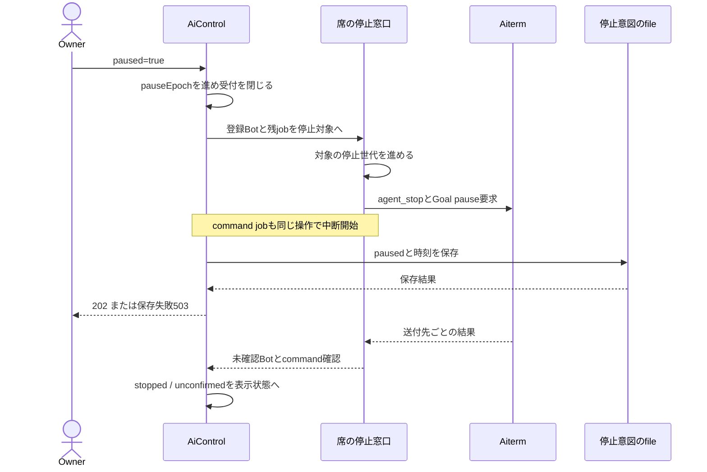
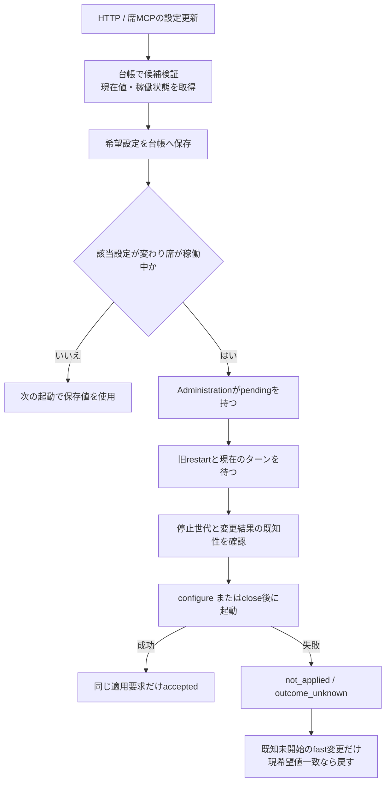
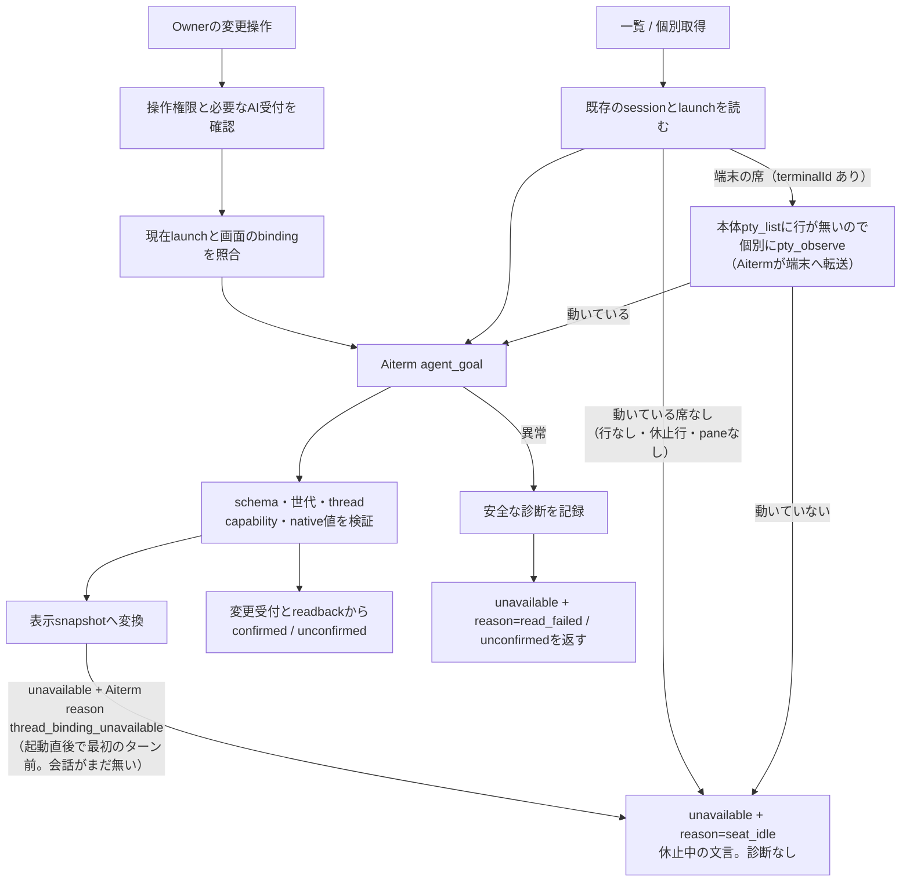

# 停止・設定適用・Goalの責任

members子の交換中に親の起動/保存を維持する新入場・既leaseの契約は[execution/members-admission](modules/execution/members-admission.md)。全体停止epochと別に扱い、既stop/AI/job/watchの寿命を交換で変更しない。

正式0.63.6の新設定要求は[execution/configuration-requests](modules/execution/configuration-requests.md)に従い、保存原ID/公開launchをtracked apply/reconcileへ束縛する。既legacy不明に新IDを付けず、希望値と歴史的結果/current unsupportedを区別する。

対象sourceと確認範囲は[全体図](feature-map.md)に従う。[制御の全体像](control-and-state.md)に対する関数と状態の対応。処理を止めること、席を閉じること、希望設定を保存することは別の操作である。

## 全体停止は保存より先に受付を閉じる

| 状態/実関数 | 所有と成立条件 |
| --- | --- |
| `AiControl.paused/pauseEpoch/admit` | 新規仕事の入場と、入場後の全停止を識別するcheckpoint。再開後も旧epochの依頼は取消のまま |
| `AiControl.update/writes/pendingIntent` | 保存要求は順番に進める。ONの重複は同じ処理を返す。永続fileはOwnerの停止意図だけで、native停止receiptは保存しない |
| `stopRegisteredWork` | 台帳Bot＋配送jobに残るBotを重複除去。native停止を開始後にcommand中断も開始。削除済み対象を取り落とさない |
| `stopOperation/sendStopOperations` | 根の停止世代更新、開始時のjob snapshot、停止Promise公開、対象job.requestStop、finallyで解放。通常RPCは関係/状態/ディスク読取より前に発行 |
| `sendSessionStop` | sessionを重複除去、全停止では`pause_goals`を要求。sent/idle/partial/failedと全根の存在を検証。Goal pauseが欠ければpartial |
| 停止返却の適用 | sent/idle対象のjobをstoppedにし、到達した子Botの旧準備世代も無効化。新しいOwner入力を永続拒否するfenceは作らない |
| `AiControl.enforce` | 保存成立＋未確認Botなし＋command確認でstate=stopped。これは現在の停止APIの成立で、外部副作用の取消やCLI終了の証明ではない |
| 停止/保存異常 | pausedを維持しunconfirmed、勝手に再開しない。再起動時は保存ONからunconfirmedへ戻し、再観測する |
| 再開 | `beforeResume → scheduler.prepareResume → save`の後に受付を開く。停止中に期限を過ぎた予定を再送する操作ではない |

個別停止は`BotAdministration.stop → interrupt → interruptMany`。通常の結果は`stop_sent`、旧adapterを注入した構成の厳密な結果は`interrupted/sessionPreserved`。`stopFailureReport`の出力失敗で停止応答を変えず再送もしない。各HTTP状態コードはHTTP側が所有する。

`BotSessionState.stopVersions`は本体内の準備世代、nativeのlaunch IDはAitermの実個体世代であり、互いの代用品ではない。`sessionChanges`は発行中の起動/設定/close、`uncertainChanges`は変更結果不明を所有する。正常typed拒否と通信断での可能な適用を区別する。

## 保存値と現在席への適用を結ぶ

| 機能 | 関数/caller | 例外と副作用 |
| --- | --- | --- |
| 希望値更新 | `BotAdministration.update → BotRegistry.previewUpdate/update` | 保存とnative適用は非transaction。返却の`configurationApplication`はAdministrationのMapから合成し、台帳の永続fieldではない |
| 適用結果 | `apply/view` | 新しい更新が同じBotに来た場合、古いPromiseは新しい状態を書き換えない。失敗した同じ値の明示更新はreapply対象 |
| 同一CLIの変更 | `reconfigure → changeSession(agent_configure)` | model/effort/fastの必要fieldsだけ。Cursorのeffortにはmodelも添付。保存済み値の取得だけで当ターン適用済みと言わない |
| CLI切替/空へ戻す等 | `reconfigure → restartNow` | harness変更、既model/effortを空へ戻す、reapplyで空指定の場合はclose→wake。開始前に停止世代を再検証 |
| 明示restart | `restart` | 同一Botの重複は既Promiseを返す。世代を進め、既発行の変更とwake返却だけ待つ。終わらないターンや未発行idle待ちを待たない。close成立後に旧jobs/watchを止め新席へ。closeにAitermが失敗を返した時（`aitermResponseReturned`）は`RESTART_CLOSE_FAILED`（旧席は残る、起動0、Aitermの理由付き）で呼び手へ返す |
| 任意機能設定の反映 | `ApplicationFeatures → stopForConfiguration` | 前のconfiguration Promiseの成功/失敗後に次のcloseを並べる。失敗記録は別に保持し、配送は[設定不明とidentity不明を分ける判定](modules/execution/configuration-delivery.md)を使う |
| 削除の席終了 | `members.startMemberRemoval → transport.stop(allSessions)` | activeだけ明示restartと同じ`retireSeatWork`：世代を進め、既発行の変更とwake返却だけ待ち、終わらないターン（Claude初回画面など、lab 2026-11-12）を待たずclose→close成立後に旧jobs/watchを止める→画像掃除→同メンバーの全席close。起動はしない。部屋整理・台帳cleanup・既pending再開・CLI同期の成否は[membersの正本](modules/members/deletion.md)。既pendingではnative停止を再発行しない |

設定適用Map、SeatActivity.configurationChanges、sessionChanges、BotRegistry保存値は、それぞれ表示・配送の待合せ・発行済み変更・次回起動の希望という異なる所有を持つ。ひとつの「設定状態」へまとめて待合せの意味を失わせない。

## 明示restart後の旧native占有の退役（2026-11-06修理）

機能：同Botの明示restartは既発行の変更/wake返却を待ち、captured旧sessionをcloseする。closeの同sessionへのtyped成功を確認するまで旧job/native未知と新配送拒否を保持する。確認後だけ、close対象に束縛した旧jobの実行枠とnative継続参照を退役し、新launchを一回起動する。元receipt/元unknown/保存失敗を成功へ変更せず、他Bot・新session・保存ACK/背景参照は解放しない。

データフロー：Owner明示restart→既session/旧job snapshot→pty_close→同sessionのclosure証拠→旧job停止・旧native占有退役（歴史的unknown保持）→wake→新規配送。close欠測/失敗/相関不一致→旧占有維持・起動0。Aitermが返したclose失敗は`restartNow`が`RESTART_CLOSE_FAILED`（effect not_started、`reason`=Aitermの文の1行目）で投げ、`BotAdministration.restart`→HTTP restart→`restart_session`まで同じ失敗を返す（2026-11-10、リモート席bot-ed14f4f7の07:35Z。旧実装はclose失敗後もwakeし、同名の既存席で`agent_launch`が拒否され、HTTPは先に202を返していた）。返りの無いclose（結果不明）は従来どおり記録して起動する。出口：理由を直した後の次のrestart、または次の配送。元本文/元jobの再発行は無い。

現sourceはmarkStoppedのみでnativeUnconfirmedの占有が残る。直接反例でこの不足を固定し、closure証拠の必要形はAiterm公開契約と照合して実装する。公開Rootのrunning単独をこの条件の成立証拠にしない。

### 受付後の追跡失敗の自己退役（2026-11-11）

機能：受付済みjobの`waitUntilDone`が最終結果なしで失敗した時（`nativeUnconfirmed`）、明示restartを待たずに退役できる出口を足す。証拠は既CurrentWorkの観測だけ：失敗の記録より後に始まった有効な読み取り（`beginRead`の`seq`が失敗時の`workState.seq`より大きい）が、同じsessionを`idle`または`absent`と読んだこと、またはAitermのdone（`completedTurn`）でそのsessionがidleになったこと。そのsessionで動くturnが無いので、受付済みの入力のturnは終わっている。`running`・`unknown`・`unread`・失敗前に始まった読み取りは証拠にしない。

データフロー：waitUntilDone例外（turnCompleted以外）→job.nativeUnconfirmed＋退役印{session, seq}→CurrentWork読み取り/done→`settledAfter(botId, session, seq)`→job.nativeSettled→activity/native解放・一時画像掃除→`conversationAdmission.confirmNativeSettled(delivery, receipt)`でnativeUnknownから除外・既pending後にrelease。履歴のaccepted/completion unknownと元failedは書き換えない（成功へ変えない）。明示restartのclosureが先なら印を捨てる。新timer・再送・待ちは無い。

Guard（guards.self-exit）：占有はturnが動いている可能性のある席へ別の入力・設定を重ねないため（既存状態の上書き防止）。出口：次の有効な観測でidle/absent、またはdone。席が動き続ける間は占有が続き、それは正しい。

発行済みsendのreceiptがcloseより後に返る場合も、発行前の実session記録→元jobのclosure保持→後着receipt/opaqueで消費する。元send返却を待つためにcloseを遅らせず、元送信は一回のまま保持する。

## Goalは本体に複製せずnativeの対象を確認する

| 関数 | 正本と保持条件 |
| --- | --- |
| `list/goalTargets` | 一覧だけpty_listで既存対象をまとめて読む。端末の席（`isRemoteBot`、remote-seat.md）は本体のpty_listに行が出ない（Aitermは端末の席をsession名で端末へ転送するだけ）ので、行で判断せず、launch_idなしの対象として個別generation（pty_observe、端末へ転送）へ回す。作業中の端末の席を休止中と出さない（Centi lab 2026-11-12、chart a05）。agent_goalも端末へ転送されるまで（Aiterm、Elegg）は、動いている端末の席はread_failedになり得る。launch_idなしの旧返却だけ個別generationへ。存在しない席を起こさない。行なしと、`current_command`がAitermの休止状態名（stopping/hibernated/resuming/failed/unknown/vanished）の行は動いている席ではないので対象にせず、agent_goalを呼ばない |
| `generation/inspect` | pty_observeのsession/exists/launchを検証。`exists=false`・`pane_alive=false`・休止行（reason `agent_*`）は席が動いていない状態としてseat_idle。指定対象を読む前後でsessionが変わればunavailable（read_failed） |
| 公開snapshotの`reason`（2026-11-12追加） | 加算fieldだけで`availability`の値集合は変えない（Apple 1.0.6とWindows 0.4.7はavailabilityを閉じた列挙でdecodeする）。`seat_idle`＝席が今動いていない通常状態。messageは「休止中です。メッセージを送ると再開します。」で、診断を記録しない。`read_failed`＝本当の取得失敗で、従来のmessageと診断のまま。available/unsupportedは`null`。clientは`reason=seat_idle`だけを休止中表示にし、それ以外のunavailableは失敗表示を保つ |
| `mutate` | origin=userのみ。create/edit/resumeはadmitWork、pause/clearは停止中も操作可能。expected session/launch/threadをnativeへ渡す |
| `call` | v1/v2返却、mutation/readback、field capability、Codex/Claude/Grok別native形を検証。typedエラー結果も同じ検証に通す。Grokの`current_status`は任意（2026-11-12 a08、Elegg合意。Aiterm a09以降のinspectは入力せず`goal={kind,native}`だけを返す）。あれば従来どおり厳密に検証してそのまま渡す。無ければ公開snapshotの`goal.current_status`を保存済みnativeから`goal detail`形で埋める（Trony ruling a08: 出荷済みApple/Windows/Webのdecode形を変えない）: `status`＝`native.status`（`user_paused`→Paused、他→Active）、`phase`/`tokens_used`/`phase_display`＝null、`status_display`＝「進行中（保存時点）」/「一時停止（保存時点）」、`budget_display`＝「保存時点 <tokens_used_high_water> / <token_budget> tokens」、`elapsed_display`＝`native.elapsed_ms`。公開契約: grok-cliの`current_status`は最後に保存された状態で、画面からの新しい読み取りではない。`observedAt`はAitermの読み取り時刻のまま。pause/resume判定も同じ値から取る |
| `snapshot` | Aitermの`reason=thread_binding_unavailable`（binding null）は、起動直後で最初のターン前の席（Codexは最初のターンで会話を作る）なので取得失敗ではなくseat_idle（休止中の文言、診断なし。Trony ruling 2026-11-12）。availableでもbinding/goalなしはunavailable。create/edit/pause/resumeの表示可否は現在Goalと公開capabilityの両方から制限 |
| confirmed | `applied && acknowledged && confirmed`のみ。rejectedは409、unsupported/unavailableは503。unknownを成功へ変えない |
| 診断接続 | `reportError`はawaitされる。既callerのGOAL_OPERATION_UNCONFIRMED / goalsをDiagnosticsへ登録し、組立て反例を修理した。安全な診断の後にunavailable/unconfirmedを返す。保存自体の失敗時に伝播する既例外は変更していない |

実装：[ai-control.mjs](../../src/ai-control.mjs)、[execution-transport.mjs](../../src/execution-transport.mjs)、[session-interruption.mjs](../../src/session-interruption.mjs)、[bot-administration.mjs](../../src/bot-administration.mjs)、[bot-session-state.mjs](../../src/bot-session-state.mjs)、[bot-goals.mjs](../../src/bot-goals.mjs)。確認先はai-control/integration、member-stop、session-interruption、model-application-state、bot-session-state、goal-targets/global-stop、bot-goals。今回の局所実行範囲は[確認範囲](detail-status.md)を参照。全停止やnative操作を再実行した意味ではない。
