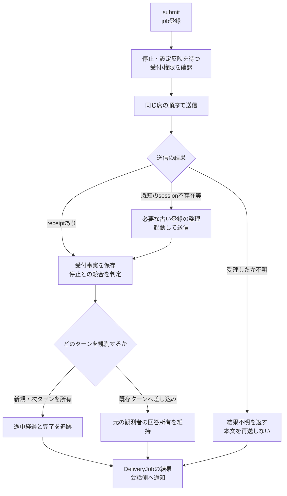

# 会話・配送・履歴・画面更新

[全体図](feature-map.md)の「会話 → 実行 → 記録 → 表示」を詳しく見る。対象sourceと調査の範囲は全体図に従う。

## 人がBotへ送る

正本を[会話・履歴module](modules/conversation/flow.md#人がbotへ送る)へ移した。

## 実行・配送の分岐

これは主要な判断点の図。実装の各checkpoint、legacy adapterのreservation、停止との競合処理は `submit/dispatch` と `DeliveryJob` が持つ。unknownをsession不存在と同じ再試行へ流さない。途中経過や回答callbackの表示側失敗と、nativeの配送失敗も同一にしない。

`SeatTurns` は現在のnativeターンから処理中/途中経過を観測する。`SelfTurns` はThroughlineの保存ターンから自主ターンの回答を取り込む。観測対象とタイミングが異なるため一つのpollへ機械的に統合しない。

## Bot間・通話・失敗配送の操作

正本を[会話・履歴module](modules/conversation/flow.md#bot間通話失敗配送の操作)へ移した。

## 部屋の会話

正本を[会話・履歴module](modules/conversation/flow.md#部屋の会話)へ移した。

## 履歴を画面へ戻す

正本を[会話・履歴module](modules/conversation/flow.md#履歴を画面へ戻す)へ移した。

## 関数と確認先

正本を[会話・履歴module](modules/conversation/flow.md#関数と確認先)へ移した。
