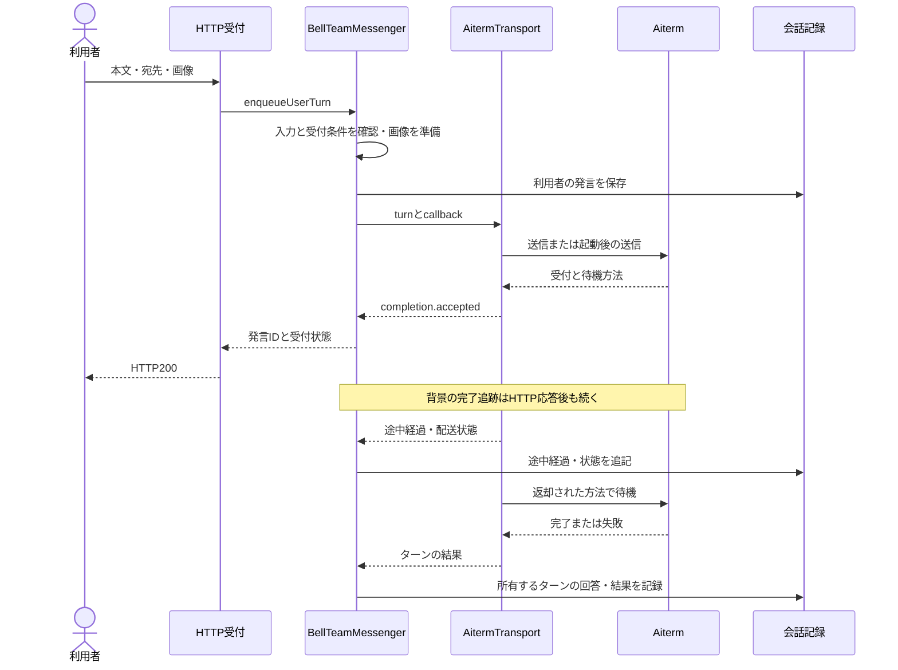
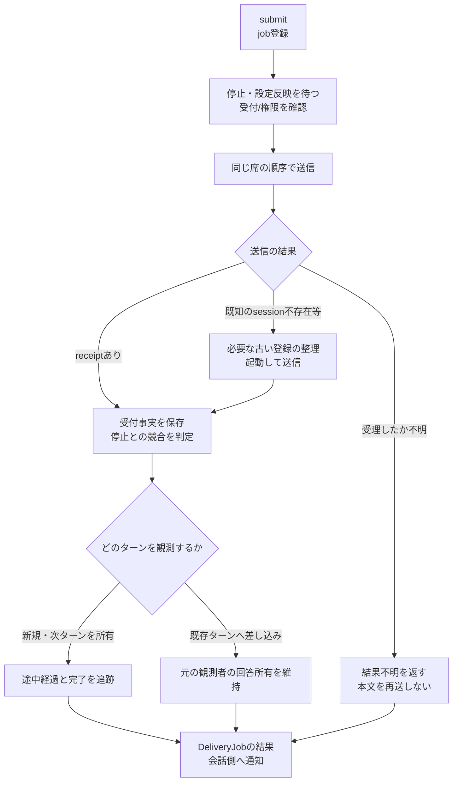
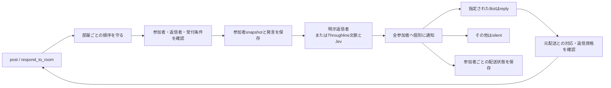
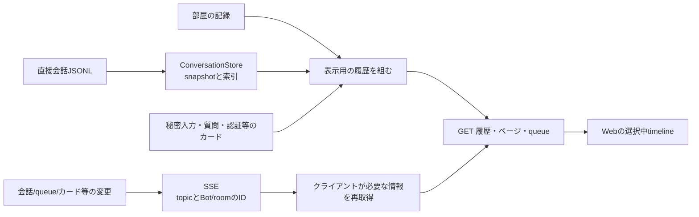

# 会話・配送・履歴・画面更新

[全体図](feature-map.md)の「会話 → 実行 → 記録 → 表示」を詳しく見る。対象sourceと調査の範囲は全体図に従う。

## 人がBotへ送る

`enqueueUserTurn` は受付を待ち、背景の `finishUserTurn` が結果を処理する。`userTurn` は完了を待つ入口なので、HTTPの受付だけを待つ経路と置き換えない。入力拒否、画像の失敗、実行受付前後の失敗で保存済みのものが異なる。

## 実行・配送の分岐

これは主要な判断点の図。実装の各checkpoint、legacy adapterのreservation、停止との競合処理は `submit/dispatch` と `DeliveryJob` が持つ。unknownをsession不存在と同じ再試行へ流さない。途中経過や回答callbackの表示側失敗と、nativeの配送失敗も同一にしない。

`SeatTurns` は現在のnativeターンから処理中/途中経過を観測する。`SelfTurns` はThroughlineの保存ターンから自主ターンの回答を取り込む。観測対象とタイミングが異なるため一つのpollへ機械的に統合しない。

## Bot間・通話・失敗配送の操作

| 入口 | 会話側が決めること | 実行側へ接続するもの |
| --- | --- | --- |
| sendmessage | 送信者/宛先の確認、受付、本文/画像の保存 | notify、配送metadata、進行/回答/終了callback |
| receiveCallBridge | 通話のsession/event/seqと受信内容の保存 | notify、通話metadata、同じ意味のcallback |
| resumeDelivery | 復旧可能な保存配送か確認し、明示操作を受付 | notify、recoveredExecutionなどのmetadata |
| closeDeliveryLaunch | 同じ適用対象の検証後、未解決の起動を閉じる | 本文の再送とは別の明示操作 |

直接通知の `onStatus/onInterim/onAnswer/onTurnEnd` の接続は同じ意味の重複である。notificationCallbacksで共通化した。一方、利用者の回答保存には差し込み時の回答所有と重複抑止がある。部屋には参加者別の保存形式と返信者の検証がある。見た目が似ているだけで全経路を同じ処理へまとめない。

## 部屋の会話

自動選定の有効/無効と明示targetsの優先を維持する。全員への配達と「誰が返事するか」は別の判断。一部の配送が失敗した時は保存済み投稿を取り消さず `posted_with_failed_deliveries` として返す。失敗本文の自動再送はしない。

## 履歴を画面へ戻す

SSEは本文全体ではなく変更通知。サーバーはtopicと対象IDをまとめて通知する。`web/app.js` は選択のtokenで古い取得結果を捨て、ページ・queue・スクロール位置を維持する。

基底では選択中の会話と関係しないSSEでも `loadMessages` を呼んでいた。現在はeventAffectsTimelineで対象を選び、refreshFromEventが必要な再取得を接続する。ただし一覧の最新活動は他の会話の変更でも更新が必要で、`loadBots` まで一緒に止める根拠にはならない。ready/all/未知形式には全体更新のfallbackを残す。

基底で重複していたConversationStoreの読取cache/索引は、組立て側のstoreをMessengerへ注入して共有した。二重writerや保存破損を修理したという意味ではない。

## 関数と確認先

| 段階 | 主な実装 | 変更時に確認する試験 |
| --- | --- | --- |
| 人の受付/回答保存 | messenger.mjs: prepareUserTurn, enqueueUserTurn, finishUserTurn, recordUserReply | messenger, execution-source |
| 通知/復旧/通話 | messenger.mjs: sendmessage, receiveCallBridge, resumeDelivery, closeDeliveryLaunch | messenger, delivery-recovery, call-bridge-server |
| native配送と結果 | aiterm-transport.mjs: submit, dispatch / delivery-job.mjs | aiterm-transport, aiterm-send-rejection, delivery-job |
| 部屋の投稿/返信 | room-messenger.mjs / mcp-tools.mjsのrespond_to_room | room-messenger, room-routing, mcp-tools |
| 自主ターンの観測 | seat-turns.mjs / self-turns.mjs / turn-reports.mjs | seat-turns, self-turns, turn-reports |
| 保存記録の読取り | conversation-store.mjs / timeline-index.mjs / http-messages.mjs | conversation-store, server-history-performance |
| 変更通知/画面更新 | http-events.mjs / application-runtime.mjs / web/app.js | http-events, application-runtime, timeline-open-queue, chat-input |

実装のパスは指定がなければ `src/`、試験は `test/<名前>.test.mjs`。
