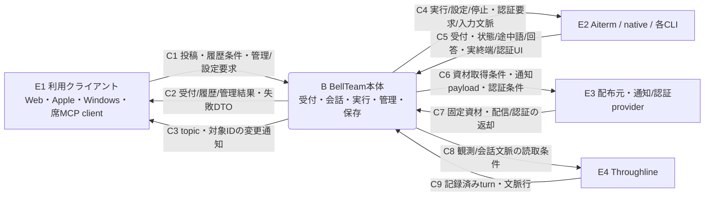
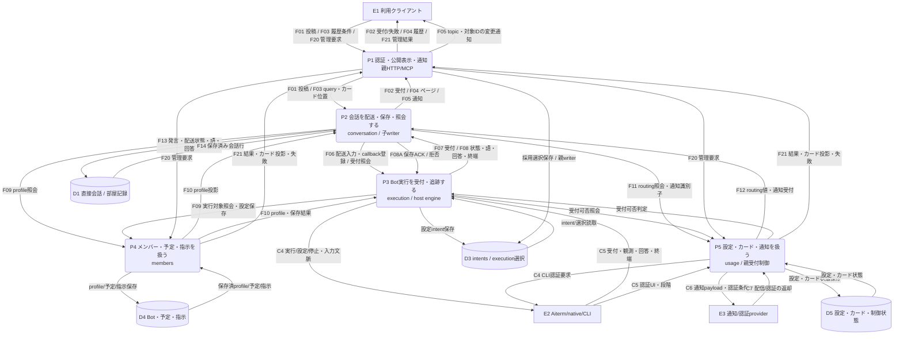
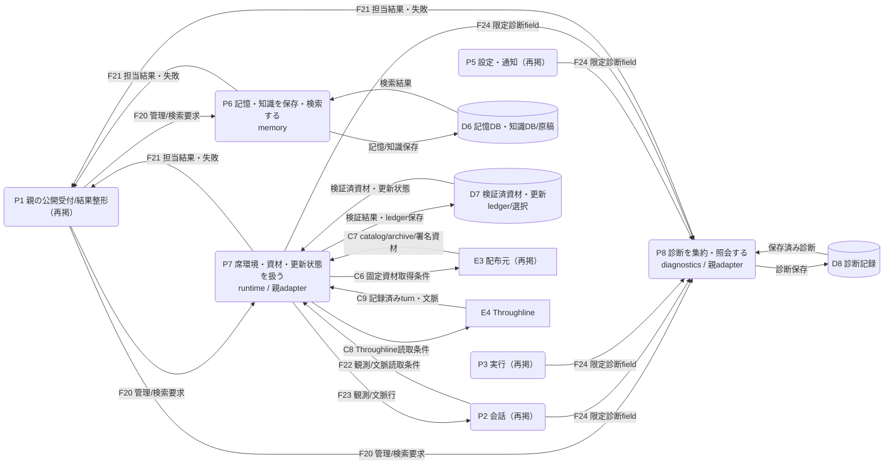
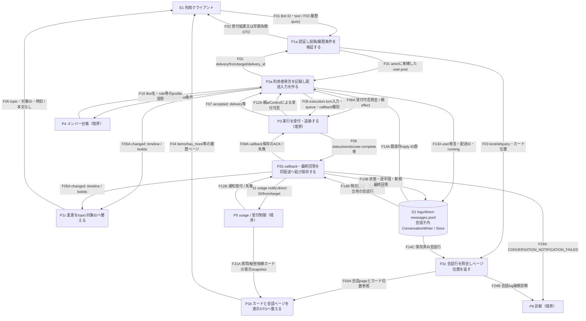

# BellTeam本体のデータフロー（初回レビュー候補）

対象はsource **`9fccf85c59a528838f6e442c28ad8e32f9698515`**。参照commit `f527c9c0fedf810956b6cc9fb43c111791023b35` と同じtreeを基準にした静的読取りであり、本番421dの配置や実行成功を示す図ではない。実環境で選択された別署名moduleの内部は、そのselected sourceの追加照合が必要であり、本図から同一と推定しない。全体境界・契約はトロニー、製品文書・親組立はモリー、業務内部は各担当、DFD指導はレヴィアタンが所有する。**Root→Levi確認前のdocs-only候補**。

[全体機能図](feature-map.md)のuses/providesは窓口への依存を表す。本図は運ぶデータの方向を別に表す。既sequence/flowは受付・実終端・保存ACK等の順序を説明する補助資料として残す。P番号は処理の識別子で、処理順ではない。

凡例：四角E=外部主体、丸角P=データを検証・変換する処理、円柱D=保存先。全て片方向のデータ線。要求と返却は別線、変更通知は履歴本文と別線。親の関数・opaque lease・実completionは同processの能力であり、子へ渡すDTOや保存本文に複製しない。辞書中の「確認」はsource接点の確認を指す。

## コンテキスト：対象システムと外部データ

HTTP/MCP受付、親組立、サーバー側各moduleと本体が管理する保存データをBellTeam本体の境界内とする。利用クライアント、Aiterm/native/各CLI、Throughline、配布/通知/認証providerの内部は境界外。秘密値・本文の実例は載せない。

## 全体DFD：主要処理と保存先

交差を抑えるため全体DFDを配送・管理面と補助処理面の二枚に分ける。P/E IDは両面共通。

P1とP2の単一Bot text経路を次節で開く。他のmoduleは公開接点と既担当図の束で示し、全内部read/writeを完了した図とはしない。同一E/D IDの再掲は同じ主体/ストアを意味する。

### 全体DFD・補助処理面（同じP/E IDを再掲）

P6〜P8を開き、P1/P2/P3/P5は接続元として再掲する。上面のP1/P2/P3/P5の内部や、部屋・画像・Mの詳細を追加展開した図ではない。

D3の設定intent writerはexecution内、採用選択writerは親`createExecutionAdoptionStore`。同じストア記号にしたことは単一writer/transactionを意味しない。D5も業務別ファイルの束であり、下表で物理writerを分ける。履歴検索条件はP2内のreaderへ渡り、D1への線は実際に読み取った会話行を表す。検索index/キャッシュはストアの別コピーとして永続化を主張しない。

## 詳細DFD：P1＋P2の通常text投稿・返信保存・履歴読取

対象入口は通常公開 `POST /api/bots/:id/messages`、`GET /api/bots/:id/messages?limit&before&after`、SSE `GET /api/events`。textのみ、images=[]。部屋・画像・通話・M設定切替の内部はこの詳細の対象外。P1/P2の内部を開くため、実行P3・台帳P4・usage P5・診断P8を境界相手として再掲する。

### 小flow辞書と実source対応

線に載るDTOはsourceの閉検証へ従う。以下は代表fieldと意味で、独自schemaの追加ではない。相対リンクはこの対象tree内を指す。

| ID / データ | 生成元 → 利用先・変換 | 実接点 / 返却・失敗 |
| --- | --- | --- |
| F01 投稿 | E1→P1a→P2a。botId、trim済みmessage、images=[]。認証後actor=ownerの同親scope | [http-conversation-api](../../src/http-conversation-api.mjs) `createBotConversationApi`、[http-server](../../src/http-server.mjs) authorize / `conversationAssembly.run`、[facade](../../src/conversation-facade.mjs) `user.post`。不在Bot404、空投稿400、認証拒否403等はP1から返す |
| F02 受付 | P3→P2a→P1→E1。delivery、delivery_id、from=user、target | [messenger](../../src/messenger.mjs) `userTurn` の `.accepted` / [dispatcher](../../src/conversation/dispatcher.mjs) `user.post`。HTTP200とrunning/steeredは回答保存の完了ではない |
| F03 履歴条件 | E1→P1→P2c。kind=bots、id、query={limit,before,after}、cardsのid/at位置 | [http-messages](../../src/http-messages.mjs) `messagePage`、[facade](../../src/conversation-facade.mjs) `store.messagePage`。カード本文は親に保持し、位置と本文を同snapshotへ束縛 |
| F04 履歴 | D1→P2c→P1b→E1。会話row/カード位置→items、has_more等 | [ConversationStore](../../src/conversation-store.mjs) snapshot/timelineView、[timeline-index](../../src/timeline-index.mjs) `conversationHistoryPage`、http-messages `webMessage`。保存失敗/破損を空の成功履歴へ補完しない |
| F05 変更通知 | P2→P1c→E1。type=changed、topics、all、botIds、roomIds→SSE時刻 | [dispatcher](../../src/conversation/dispatcher.mjs) `emit`、[assembly](../../src/conversation-assembly.mjs) watch、[http-events](../../src/http-events.mjs) `startMessageWatch`。本文/画像bytesを送らず、履歴readを促す通知 |
| F06 配送入力 | P2a→P3。deliveryId、target、envelope message、queue、kinds | [ConversationNative](../../src/conversation/native.mjs) `#register/turn`→[parent effects](../../src/conversation-execution-effects.mjs) `execution.turn`→transport.turn。同親lease/actualCompletionは親に保持しwire fieldから再構成しない |
| F07 native受付 | P3→P2a。result.acceptedを既配送へ対応付ける | conversation-execution-effects `deliver`。親は最終Promiseを受付へ変換せず、callbackと実completionの寿命は[会話寿命](modules/conversation/README.md)・[execution待機契約](modules/execution/wait-contract.md)へ |
| F08 実行通知/返却 | P3→P2b。delivery.status / delivery.words / user.complete（turn.end等は他配送callbackの別経路）。P2b→P3はcallback ACK/失敗 | [conversation-ipc](../../src/conversation-ipc.mjs)、ConversationNative `dispatchCallback`。user.completeのreplyを保存へ結びACK、callback同generation/operation/delivery/target検査を保持 |
| F09/F10 台帳 | P2/P3→P4の照会、P4→P2/P3のprofile投影を別線にする | [parent effects](../../src/conversation-parent-effects.mjs) `members.profiles.read`、conversation-execution-effects `member`。子Mapは投影、親がfresh registry読取を仲介 |
| F11/F12 usage | P2→P5のrouting照会/通知識別子。P5→P2の値・受付。F06A/F12Aはexecution.assertAccessを通じた親aiControlの照会/検査結果 | [usage/conversation-effects](../../src/usage/conversation-effects.mjs)、[conversation-execution-effects](../../src/conversation-execution-effects.mjs)。直接text投稿のrouting資格利用はこの詳細に含めない。通知payloadはID中心、配信成功は別 |
| F13 保存 | P2a/P2b→D1。direct-message / delivery-status / interim-wordのJSONL | [ConversationWriter](../../src/conversation-writer.mjs) append→file.sync→onMessage。物理writerは会話子、replyは`recordUserReply`が明示返信/knownReplyIds/claimedReplyIdsを照合。空回答とsteeredは新最終発言を作らない |
| F14 読取 | D1→P2a/P2b/P2c。reply照合又は表示ページ用の保存済row | ConversationStore `records/timelineView`。書込側と読取側を区別。D1のreaderが行を検証し索引へ投影 |
| F20/F21 管理束 | E1→P1→各担当の管理/検索要求、各担当→P1→E1の結果/失敗・カード表示値 | [HTTP登録](../../src/http-application-api.mjs)、[親組立](../../src/application-services.mjs)、各担当正本。F21Aは親のsecretRequests/ownerQuestions.timelineView表示snapshotで秘密値本体ではない |
| F22/F23 観測束 | P2→P7→E4のThroughline読取条件、E4→P7→P2の記録行 | [parent effects](../../src/conversation-parent-effects.mjs) `runtime.room.context/runtime.observer.*`、[self-turns](../../src/self-turns.mjs)。代表text投稿のcallback回答と、この別観測から得る回答を混同しない |
| F24 診断 | 各処理→P8の限定code/field。詳細では通知失敗とlog破損 | dispatcher `emit`、ConversationStore onCorruption→diagnostic。全例外が必ずD8へ保存されるという線ではない。受付後の追跡失敗はD1にaccepted/completion=unknownの既tupleを保持 |

### 保存先の業務owner・物理writer・reader

`root`は組立時の本体data root。実mountをこの図から推定しない。

| ID / 保存データ | 業務owner / 物理writer | reader・実sourceと確認範囲 |
| --- | --- | --- |
| D1 direct JSONL / rooms | conversation / 子のConversationWriter、RoomRegistry・RoomMessenger | ConversationStore/RoomHistory→facade→親ページ整形。`logs/direct-messages.jsonl`、`rooms/`。[delivery](modules/conversation/delivery.md)。今回詳細はdirectだけ |
| D3 intents / 選択 | executionの設定処理 / ConfigurationIntents。選択は親createExecutionAdoptionStore.save | `state/configuration-intents/`、`state/execution-release.json`。load/start/replace/rollbackの同factoryへ親がports viewを供給。writerを一つと表現しない |
| D4 Bot/profile/schedule/instructions | members / members子のregistry・ProjectFiles | `state/bots/:id/{bot.json,schedule.json}`と席project。親BotRegistry facade・各reader。[registry](modules/members/registry.md)。seedと現在stateを混同しない |
| D5 設定/カード/制御 | usage各service / FeatureSettings、SecretRequests、OwnerQuestions等。aiControl.jsonは親AiControl | 設定=shared/tools/bellteam-settings/settings.json、カード=state/secret-requests、state/owner-questions。表示snapshotだけP1へ。値file/依頼stateは別保存で単一transactionを主張しない。[usage](modules/usage/README.md) |
| D6 記憶/知識 | memory / BellTeamMemory、seat構成では同公開memory module | [memory-service](../../src/memory-service.mjs) ensureScope/openMemory/openKnowledge。SQLiteと知識原稿/索引。個人/共通scopeの具体pathは同関数の選択を参照し、この初回で全store内部を展開しない |
| D7 資材/ledger/選択 | runtime / 既root updater・installerと親adoption writerの各責任 | [runtime](modules/runtime/README.md)、[catalog](modules/distribution/update-catalog.md)、[execution-loader](../../src/execution-loader.mjs)。署名検証/採用/実更新を別データにする。外部registry→保存先の直結線は引かない |
| D8 診断 | diagnosticsの業務＋各callerの限定code / Diagnostics.record/save又は現diagnostics子 | [diagnostics](../../src/diagnostics.mjs)、親のdiagnostics facade。`logs/diagnostics.json`のdefaultと現module差は組立に従う。実保存成功を今回のdocs検査から宣言しない |

### 親子の入出力対応（balancing）

| 親図の境界データ | P1＋P2詳細への対応 | 親/子の実現 |
| --- | --- | --- |
| C1/C2/C3（context↔client） | F01/F03/F20入力、F02/F04/F21返却、F05通知 | 全体のP1に集約。詳細はそのうちtext投稿/履歴/イベントだけ。F20他管理は詳細対象外として残し、消失扱いにしない |
| P1↔P2 F01/F02/F03/F04/F05 | P1a→P2a/P2c、P2a→P1a、P2c→P1b、P2保存変更→P1c | 親HTTP/安定facade→conversation RPC（user.post/history.page）、child accepted/result/chunk/event→親。履歴chunkは会話行、イベントはtopic/ID |
| P2↔P3 F06/F07/F08 | P2a→P3、P3→P2a/P2b、P2b→P3のACK | 会話子effect→親onExecution→同graph transport、親callback→会話子保存。ACK返却を今回の全体F08束に含める |
| P2↔P4 F09/F10 | P2a↔P4 | 親effectsがmembers facadeへ照会し限定profile DTOを子へ返す。opaque membersLeaseはhost側に残る |
| P2↔P5 F11/F12 | P2b↔P5の通知受付。F06A/F12AはP3の親effectを通じた受付照会/結果 | text経路にrouting/API key線は追加しない。全体F11/F12は通知/routing/受付制御の束、詳細では該当要素だけ展開 |
| P1↔P5 F20/F21 | P5→P1bのF21A（カード表示snapshot） | 詳細P1bへ新しく必要な外部入力として明示。P2cへ渡すのは同snapshotのid/at位置、カード本文は親で合成 |
| P2↔D1 F13/F14 | F13A/B、F14A/B/C | 親のP2を開いた内部ストアのread/write。P1の直書き線なし |
| P2→P8 F24 | F24A/B | 限定診断。その他の失敗データはF02/F08/D1に残り、全てを診断保存へ変換しない |
| P2↔P7 F22/F23 | このtext代表経路では未使用 | room文脈/独立turn観測の別経路として全体に保持。全moduleの詳細完成を主張しない |

## 具体edgeから次に整理する候補と未確認

- **旧execution portsの不整合（修理済み接点）**：loaderが検証後のselected namespaceから`supportsModelHandoff`を返し、親は旧世代へstorage3key、新世代だけdeliveryAnchorを渡す。MCPは現available generationで入口を選び、invoke前に再照合する。[接続図](modules/integration/model-handoff.md)。能力metadata、接続用関数、業務上のdelivery情報は別のデータであり、依存図の`uses:turn`だけで互換を証明しない。
- **Aiterm世代reset（未移行）**：通常installerが新しい`/srv/bellteam-aiterm`保存先世代を選ぶ実差は、旧volume残存と別。`src/aiterm-client.mjs`/runtime配置契約とCenti製品原本が次の接点。旧→新保存先へのactive state移行を観測しておらず、移行線やactive native継承を描いていない。DFDのD7と外部E2の間に架空の移行矢印を足さない。
- **親の表示用カード合成**：会話子へ送るカード位置と親のカード本文snapshotの対応はhttp-messagesが所有する。返却を二度複製するwriterがあるとは今回確認していない。実測なしに削除・統合しない。
- **error/unknownの違い**：投稿前の認証/本文/台帳拒否はHTTP失敗DTO、受付後の追跡不明はD1のdeliveryTracking、通知provider失敗は限定診断。保存済み発言を失敗で取り消した図にしない。

未確認：部屋/画像/通話の詳細、全memory/runtime/diagnostics内部のwriter分解、全endpoint、外部provider内部、実native継続と全M。初回はsourceの代表接点と既担当正本の照合までで、全source監査・旧試験再走・新generator・本番/AI作用は行っていない。DFDに基づく実装リファクタリングは具体edgeと責任をRootが採否した後、当該ownerの図と同差分で進める。
