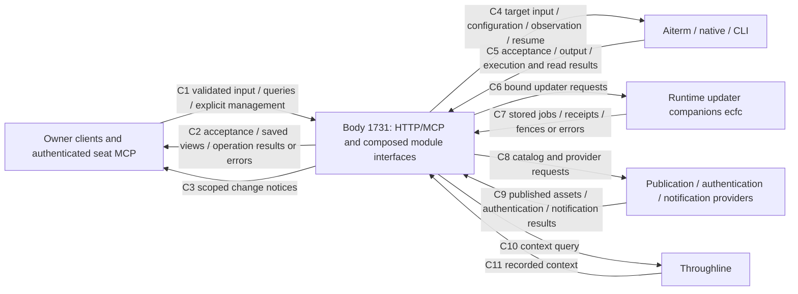
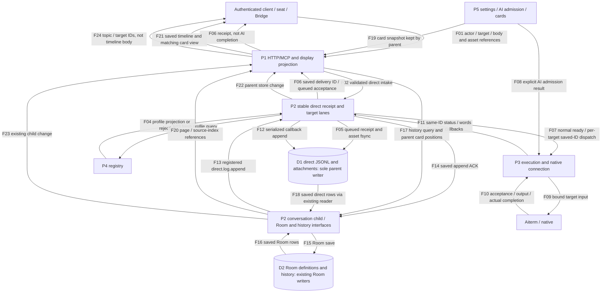
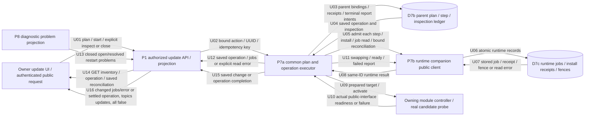
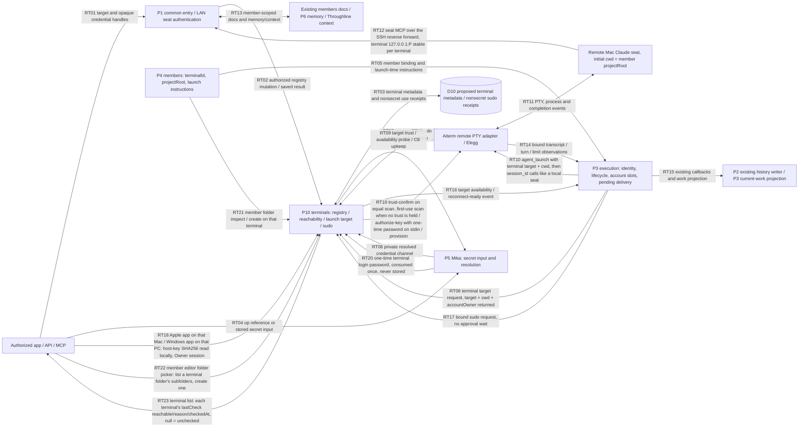
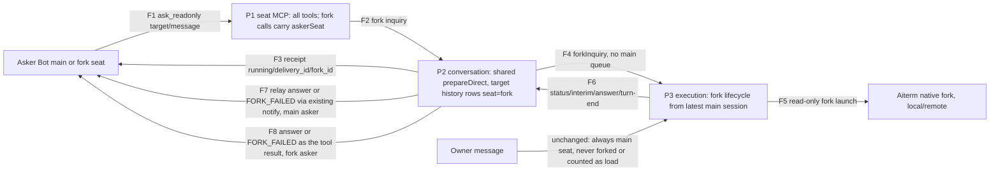

# BellTeam overall data flow

## Version, scope and canonical diagrams

This composition keeps body source **`1731cc273cd997f60d3822c1b23a393b2ed7be28`** and the separately deployed updater companions **`ecfc1dd6`** as its production baseline, as identified by Root. This diff composes the accepted **B close-only common ownership** and **A current-bound termination successor** source changes into the same upcoming formal source/image **S**. A's author source is `58eaf4217643b74bf82eb6e4c2ab628b779b806f`; its [runtime function/DFD](modules/runtime/module-installer.md#current-bound-successor-of-an-immutable-termination-record) owns the private predecessor/current evidence. Implementation and inherited checks do not claim S is deployed. This composition replaces the initial-review `9fcc` composition without relabeling that historical audit; the [1731 snapshot](https://github.com/kitepon/BellTeam/blob/1731cc273cd997f60d3822c1b23a393b2ed7be28/docs/architecture/data-flow.md) retains its amendments.

The [overall function map](feature-map.md), generated from each `module.json`, is the canonical dependency/ownership index. **This file is the single overall data-flow composition.** Each module README and its linked diagrams remain the sole authority for its internal functions, public I/O, state writers and failure handling. The tables below compose those contracts; they do not duplicate their implementations or assert that every module internal has been audited. Overall contract rulings belong to Root; Molly maintains this composition and normal-main adoption. Other owners keep their module scope in [module-ownership](module-ownership.md).

Covered changes since the initial review: durable per-target direct delivery and the parent direct writer; cold active-reference resume and shared child recovery; durable updater jobs, inspection/close and restart problems; scoped update events; deferred settings versus new input; and target-only screen reads. Existing members, usage, memory, diagnostics, Room, attachment, Bridge and distribution connections are retained through their public contracts. Native/CLI, Throughline, external providers and client internals are linked, not redrawn. A body version does not advance a selected release or a companion binary. Source/diagram completion does not prove a production update, successful old-operation reconciliation, runtime timing or an Owner-device outcome.

Opaque authorization, leases, callbacks, SDK request context and actual-completion Promises stay within their owning process. They are not serialized as synthetic proof. Every arrow below names data or an explicit public request/result; returned acceptance, saved output, change notification and actual completion remain separate.

The [adopted remote-terminal P0 design](#proposed-remote-terminal-seats-p0) is a separate **unimplemented design delta** for Mac + Claude. It does not change the production baseline or assert remote readiness. Trony adopted its P10/D10 and cross contracts; remote methods remain unimplemented; existing P1-P9/D1-D9 below retain their current meaning.

## Context

The product boundary includes the body and its separately versioned updater companions; the diagram labels their distinct ownership below. Requests and responses are separate from SSE invalidation and provider/native outcomes.



## Processes, public contracts and failure ownership

Process IDs identify responsibilities, not execution order. Host composition can implement part of a module's interface without acquiring that module's business-state ownership.

| ID / owner | Public input -> output | State and failure boundary / canonical detail |
| --- | --- | --- |
| P1 integration / Molly | Authenticated HTTP/MCP -> same composed services; acceptance, saved views, closed error DTOs and SSE | Authentication, caller context, parent assembly and projection. [Integration](modules/integration/README.md), [entrypoints](entrypoints.md). Internal updates remain forbidden; an internal seat or JSON actor is not Owner authority |
| P2 conversation / N102, parent assembly / Molly | Direct/Bridge input -> durable receipt; target-lane dispatch -> saved callbacks; history/Room operations -> pages and changes | One parent direct writer, separate existing Room ownership. Receipt fsync precedes queued acceptance; unknown input is not replayed. [Durable receipt](modules/conversation/durable-receipt.md), [parent receipt connection](modules/integration/message-receipt.md), [conversation](modules/conversation/README.md) |
| P3 execution / Kiro; native / Elegg | Bound target input/configuration/resume/observation -> native acceptance, callbacks, tracked completion or read result | Dispatch ordering, desired settings and real execution references. Deferred settings do not block running-turn input. Screen failure is this tick's display availability, not proof of absence. [Configuration/delivery](modules/execution/configuration-delivery.md), [screen](modules/execution/screen-observation.md), [host factory](modules/execution/host-factory.md) |
| P4 members / Belorta | Profile, schedule, instruction, membership and Owner-data requests -> registry projections and saved results | Members owns registry/project writes. A copied profile is not a second authoritative registry. [Members](modules/members/README.md) |
| P5 usage / Mica; parent AI admission / execution | Settings/authentication/cards/notification requests -> stored settings, cards and provider results | Secret input owns stored/reference sources, opaque handles, revision and availability; authorized consumers receive only a resolved value or native-use capability. P1 receives only source-free cards and connection-dependent input options. [C5 secret credentials](modules/usage/secret-credentials.md). Update candidate -> notification child -> APNs status/apns-id -> per-attempt private receipt -> paged existing notification-status GET; parent additive IPC compatibility ships before the module. [Usage](modules/usage/README.md), [update receipt contract](modules/usage/update-push.md#saved-apns-update-attempt-receipts-2026-11-08) |
| P6 memory / Biscuit | Scoped remember/search/knowledge requests -> saved records or search results | Personal/shared scope and DB writers remain memory-owned; no startup bulk-copy into another module. [Memory](modules/memory/README.md) |
| P7a common updates / Molly | Owner plan/start/read/inspection requests -> bound parent operation and runtime projections | Parent plan/step/inspection ledger is distinct from runtime job storage and adopted release selections. [Common updater jobs](modules/integration/update-jobs.md), [inspection/close](modules/integration/README.md#同install-idのinspectionと明示close入口) |
| P7b runtime / Epinel, distribution / Centi | Fixed release/plan/UUID/key -> installation, stored jobs, candidate readiness, receipts and fences | Companions, installer, shared child controller and recovery retain their own versions and writers. [Runtime jobs](modules/runtime/update-jobs.md), [installer](modules/runtime/module-installer.md), [shared child lifecycle](modules/runtime/module-process.md), [distribution](modules/distribution/README.md) |
| P8 diagnostics / Signal | Allowlisted caller/restart observations -> serialized diagnostic records and closed problem projections | No inference of missing historical evidence; read/write failures remain explicit. [Diagnostics](modules/diagnostics/README.md), [restart problems](modules/diagnostics/module-restart-limit.md) |
| P9 work-graph / Black (child); facade, effects and mount / Molly | Owner `GET /api/work-graph` and `/api/work-graph/events` -> body facade -> root `refresh`/`snapshot` on the work-graph module child -> snapshot and versioned SSE change batches | Own module child, module-only exchange. The child reads providers only through parent effects inside a root call: members.registry, execution.observation (turns, queue), conversation.history (room responders). No persistent state; a new child is a new epoch. Edges are live Bot-to-Bot delivery processing, not task completion. [Work graph](modules/work-graph/README.md), [shared app motion spec](modules/work-graph/behavior-spec.md) |
| P11 lattice / Flora (child); facade, effects, mount and MCP registration / Molly | Owner `GET /api/lattice/charts[/:projectId[/events]]` and authenticated seat MCP `lattice {project, name?, args, input?}` -> P1 -> body lattice facade -> root `charts`/`chart`/`refresh`/`run` on the lattice module child -> chart list, snapshot and versioned SSE snapshots; run result `{exitCode, result, stdout, stderr}` | Own module child, module-only exchange. `from` is the Bot id from the seat's authentication, never a tool argument. The child alone writes D11, only through the bundled Lattice CLI (seat commands) and its chart-name file; it reads members only through the `members.list` parent effect inside a root call, and sends startable notices (Lattice 0.90.0) to the Bots waiting on them (`todo wait`) only through the `messages.send` parent effect (messenger.sendmessage, the public send path), inside a root `run` or the per-generation root `deliver`; every minute the facade calls root `nudge`, which reads every chart's cards from the memo (the screens' display read) and sends ONE prompt per lane Bot with an in-progress or startable task when the `turns.read` effect does not say that Bot is working, and hands each Owner-lane task once to its chart creator Bot (`messages.send`), which files the one plain-Japanese Approval Box request; requests Lattice filed before 2026-11-14 are read, routed or cancelled through `decisions.read`/`decisions.cancel`. The Owner reads every chart's stops (`GET /api/lattice/blockers`, root `blockers`) and removes one (`POST /api/lattice/charts/:id/unblock`, root `unblock`, the only Owner write: `todo unblock` with actor `owner`). A failed read keeps the last snapshot with `degraded`; an I/O error on the charts root is 503 `LATTICE_UNAVAILABLE`, never "no charts"; nothing is cached, so the next call recovers. [Lattice](modules/lattice/README.md), [parent side](modules/runtime/lattice-child.md), [screen spec](modules/lattice/screen-spec.md) |

The L-1 addition composes the existing P7a candidate input with P5 notification-owned saved APNs attempt receipts and P1 existing authenticated status reads. Its parent compatibility and module activation order is defined in the linked update-receipt contract; this source diff does not assert production activation.

## Delivery, history and display composition



| Connection | Current composition and limits |
| --- | --- |
| F02-F07 receipt and execution | The parent owns one `DurableMessageReceipts` instance. A validated direct record and assets become queued only after persistence; current execution/child admission is not a prerequisite for saving that receipt. Existing onPending, available execution/conversation and explicit AI-enable events request drain; there is no new polling/retry service |
| F07 target lanes | One lane per target preserves that target's saved order and picks up later queued records. Lanes run concurrently; another target's native acceptance cannot hold all targets. The parent request cycle kicks lanes without waiting for their acceptance; close still waits the cycle, lanes, actual completions and append queue. Saved dispatching/unknown/accepted inputs are not replayed; only the existing exact not-started contract permits queued continuation |
| F11-F14 direct writer | All direct records, including child-originated records, use the sole parent writer. The child forwards append through the registered effect and receives its saved ACK; it does not create a fallback direct JSONL writer. The existing child emit and parent store watch preserve notification ownership without double-publishing the same child append. Room writers remain separate |
| F17-F21 history | The parent keeps one request's card body snapshot, sends only card id/at positions with the user's page query, then resolves returned references against that same snapshot. The current parent direct reader also serves public display where composed; it reads the same D1, not a copied ledger. See [history](modules/conversation/flow.md) and [parent page composition](modules/integration/README.md) for their distinct callers |
| F22-F24 events | Timeline notices prompt a history GET; publication and append timestamps are not proof of client rendering. The existing coalescing window is not an end-to-end latency bound. Update events use the separate scoped flow below; they do not request an all-resource timeline refresh |
| Configuration and screen | P1 also calls P3 directly for its authorized management/observation interfaces. Same-harness deferred settings stay tracked but ordinary input skips that deferred barrier; the eventual apply joins the same per-Bot acceptance chain. A screen GET performs one target `pty_read`, without `pty_list`; success, including empty success, yields online, while a call failure logs the original server error and returns offline/empty for that tick. This does not prove that the session is missing |

Direct entrypoints and error framing: [HTTP conversation](../../src/http-conversation-api.mjs), [stable receipt assembly](../../src/direct-receipt-assembly.mjs), [durable receipts](../../src/durable-message-receipts.mjs), [HTTP screen caller](../../src/http-bot-api.mjs). These links locate composition points, not a second copy of their contracts.

## Lattice process charts (P11)

```mermaid
flowchart LR
  Seat[Authenticated seat MCP]
  Apps[Owner apps: Web / Apple / Windows]
  P1[P1 HTTP mount and MCP registration]
  F[Body lattice facade: serialized root calls, refresh timer, SSE subscribers]
  C[P11 lattice child: core, projection, CLI runner]
  P4[P4 members registry]
  D11[(D11 chart stores and chart names)]
  Seat -->|LT1 lattice project, name?, args, input?; from = seat Bot id| P1
  Apps -->|LT2 GET charts / chart / events| P1
  P1 -->|LT3 run / charts / chart / subscribe| F
  F -->|LT4 root run, charts, chart, refresh| C
  C -->|LT5 members.list effect inside a root call| F
  C -->|LT10 messages.send effect: startable notice to each waiting Bot| F
  F -->|LT11 root nudge every 1 min| C
  C -->|LT12 turns.read effect; messages.send ONE prompt per lane Bot not running| F
  Apps -->|LT13 GET blockers; POST charts/:id/unblock stopId (Owner only)| P1
  F -->|LT14 root blockers / unblock| C
  F -->|LT6 bots.listForClient| P4
  C <-->|LT7 Lattice CLI seat commands, display read/source; name file| D11
  C -->|LT8 run result, chart list, snapshot with name/createdBy/degraded| F
  F -->|LT9 tool result; JSON; SSE snapshot on version change| P1
```

Target (task a102, Owner 2026-11-14): LT7 becomes the Lattice product's contracted CLI only ([K1-K8](modules/lattice/README.md#bellteam---lattice-connection-target-task-a102)); D11 is Lattice's own store, which BellTeam never reads or writes directly; the chart name and creator live in Lattice (K4) and the Owner-lane filing record in BellTeam's own state. LT1-LT9 compose the [lattice module contract](modules/lattice/README.md) with the [parent side](modules/runtime/lattice-child.md); neither is redrawn here. Screens show the chart name (fallback 「作った人の工程表」 / 名前のない工程表), never `projectId`.

## Startup, restart/resume and child loss

| Flow | Source of state -> public action/result | Failure and ownership |
| --- | --- | --- |
| Cold body startup | Adopted release selections and same business stores -> existing parent assembly -> controller start -> ready producers | Runtime launches the selected code; initialized source and persisted selection are distinct. [Runtime module start](modules/runtime/module-start.md), [integration](modules/integration/README.md) |
| Actual prior-active reference | P3 accepted/observed native work -> D9 execution-owned active-only reference -> cold startup consumes once -> supported promptless `require_existing_resume` -> existing conversation and one authorized gap-summary path | No saved task body replay, fresh fallback or launch for idle/missing/unsupported references. Corrupt activity prevents automatic reconnect, not ordinary application startup. Hot handoff carries references and does not repeat cold resume. [Restart/resume](modules/execution/restart-resume.md), [distribution contract](modules/distribution/restart-resume.md) |
| Child loss and replacement | Current child's pending calls -> recorded unknown outcomes; observed writer death -> shared selected-source recovery -> current child | Old native/completion references remain facts, not a new-operation or recovery lock. Planned exchange still ends the actual writer before replacement. Shared cancellable backoff resumes a retained generation or restores selected code; it never replays the failed business request. [Current lifecycle](modules/runtime/module-process.md), [conversation process](modules/conversation/process.md) |
| Configuration after readiness | Saved desired settings and configuration epochs -> same execution controller -> actual apply/receipt; available events -> existing direct pending drain | Desired save, actual apply, ready, dispatch acceptance and business completion remain different results. Repeated lifecycle resume ACK may acknowledge the same already-running engine without restarting producers. [Configuration/delivery](modules/execution/configuration-delivery.md), [host factory](modules/execution/host-factory.md) |
| Repeated child restarts | Actual runtime attempt/window observations -> P8 diagnostic writer -> open/resolved problem -> P7a inventory -> P1 update view | Problems expose stored evidence, not a stop/restart policy. An unavailable/read failure cannot be fabricated as a healthy record. [Restart limit](modules/diagnostics/module-restart-limit.md) |

## Update jobs, inspection and scoped update events



| Connection | Public boundary, persistence and failure |
| --- | --- |
| U01-U08 admission | A plan preview admits no job. Start returns 202 only after every step's runtime admission and parent receipt are saved. Partial admission is `admission:pending`, not a seventh job state. Same bound key/plan retains its IDs. Six stored states are queued/downloading/verifying/swapping/ready/failed; legacy unknown operations retain their historical representation |
| U05 fixed release installation | The shared fixed installer waits for private-root SH and component install EX rather than refusing busy. Locks protect private-tree overwrite and live staging/publication; owner FD close on completion/error/process exit releases them and automatically admits the waiter. A transaction marker alone is ignored and preserved. Signature/hash and immutable publication remain unchanged. [Installer function/state/DFD](modules/runtime/web-gateway-release.md#installer-wait-and-maintenance-marker-correction-2026-11-08) |
| U09-U12 activation/readiness | The owning controller prepares/activates and completes its real public-interface probe before ready. Runtime stores its job; common stores parent bindings/report intent. A stored terminal report may be acknowledged idempotently without repeating activation. Reader errors remain explicit; no synthetic success or job state fills missing storage |
| Inspection versus saved read | Reconciliation GET returns only the saved parent inspection/resolution. Explicit inspect POST calls runtime inspection and persists its receipt in D7c and D7b: it is effectful. Current body exposes the existing public Owner route; an internal seat, schedule, actor JSON or historic decision is not an Owner grant. [Common inspection/close](modules/integration/README.md#同install-idのinspectionと明示close入口), [runtime inspection](modules/runtime/module-installer.md#元install-idの追補照合明示解決) |
| Explicit close (A+B delta) | The executor-local ledger/exchange owner excludes active original work and checks the exact original, apply-not-issued, claim, fresh Owner authorization, current and catalog bindings before a new durable claim. Runtime owns the actual original worker, storage, predecessor/successor and fence checks; a matching fence and parent completion converge the same claim. Retained intent uses readFence only, with no new finalize, admit, work or read reconciliation. No global application mutex or native/writer drain is added; normal Bot reception remains available. [Common close contract](modules/integration/update-jobs.md#close-only-function-and-data-flow-delta) |
| U13 restart problem | Runtime owns attempt/healthy-window observation; diagnostics owns serialized problem state. Common forwards the closed `problems[]` projection. Missing save/read evidence is not invented; diagnostic/private log storage is not exposed as an arbitrary update API |
| U14 Web runtime opt-in | Web reads `/api/updates?runtime=1` on its existing triggers and displays the four runtime rows plus stored `kind:runtime` jobs. Single-component plan/start use existing routes; impact is no container restart, application is next launch, with no runtime rollback control. Common P7a/runtime own selection and jobs; Web owns display cache only. [Web contract](modules/web/update-notice-design.md#runtime-updates-in-the-normal-update-screen-2026-11-08-z-b2-slice-d), [runtime slice D](modules/runtime/runtime-updates.md#inventory-plan-and-start-slice-d) |
| U14 Web component status | Optional `components[].status` + the same jobs/operation records from common -> Web card overview: per-part card (icon, name, version name, colored badge 最新/更新あり/更新中+step/失敗/要対応, last-updated JST, one 更新 action only where possible), summary header and a plain-words failure banner. The server line, versions, codes, job/request IDs remain in 詳細; absent or malformed optional status falls back per row to comparison/job records without rejecting inventory or blocking plan/start. Latest-job selection and wording belong to common; Web derives badge/progress presentation only. [Web display contract](modules/web/update-notice-design.md#card-overview-redesign-2026-11-08-owner-via-trony) |
| U15-U16 update events | Only saved changes and operation completion invalidate the update view. Read-only inventory refresh does not notify. The existing publisher coalesces reads, retains a pending invalidation and drops identical jobs/error bodies except for actual module-work settlement after active is cleared and the exchange reservation is released. That internal completion hint forces one inventory invalidation without changing the public event shape. Events are scoped to updates with `all:false`, not a global refresh. Web/Apple re-read the inventory; Apple runs that side refresh independently of receiving timeline events. [Common jobs/events](modules/integration/update-jobs.md), [Web updates](modules/web/README.md), [Apple sync](modules/apple/state-and-sync.md) |

## State ownership and physical write boundaries

State IDs below identify existing stores; they introduce no new persistence. Relative `root` is the existing composed data root, not a guessed host mount. A controller's memory state and its durable adoption ACK are not interchangeable.

| Store | Authoritative owner / physical writer | Readers and public return path |
| --- | --- | --- |
| D1 direct messages, delivery status, interim output and asset references | Conversation/N102 business contract; **single parent DurableMessageReceipts writer**, with child `direct.log.append` forwarded into that queue. Attachment fsync uses existing Assets | Same ConversationStore reader, direct receipt drain, current history/display composition; callbacks stay bound to original IDs |
| D2 Room definitions/history | Existing RoomRegistry/RoomMessenger writers under conversation ownership | Room access/history and members membership cleanup use their public interfaces; no parent-direct-writer ownership is inferred for Room internals |
| D3a configuration intent/receipt audit | Execution's ConfigurationIntents and request handling | Per-Bot execution/configuration read; desired profile is D4 and receipt is not an admission lock |
| D3b adopted release selections | Each controller's existing durable adoption callback/store; execution uses `state/execution-release.json` | Parent startup/controller selection and current/previous display. No selection file is copied into the update ledger or changed by merely loading a newer body |
| D4 Bot/profile/schedule/project instructions | Members registry and ProjectFiles | Fresh member/profile projection to conversation, execution and public views; schedule claim/dispatch uses the members/scheduler contract |
| D5 settings, questions, secret requests and AI-control state | Owning usage services; parent AI-control writer remains separately owned | Authorized settings/auth/card consumers; private secret-sources, secret-credentials and parent-native credential records and current-selection tombstones stay with usage. Owner terminal cards have no Bot requester, retain terminal/purpose, and correlate completion by requestId. P1 receives appropriate display projections; credential authority is captured by the parent, never inferred from a handle or context DTO |
| D6 memory/knowledge | Memory's existing scoped DB and knowledge writers | Scoped public read/search through its facade; runtime process/proxy does not acquire memory business ownership |
| D7a verified release assets | Existing runtime/distribution installation paths | Owning release loaders/controllers validate manifest, selected code and compatibility; material availability is not adoption or runtime readiness |
| D7b common update ledger | `createModuleUpdateExecutor` serialized atomic save in `state/update-ledger/ledger.json`; all mutating publicJobs, report flush and interrupted-read reconciliation saves share the executor-local owner with close | Common plan/operation/inspection/readback and terminal-report reconciliation; no direct mutation of runtime jobs |
| D7c runtime jobs and install receipts/fences | Updater companion's own atomic storage/installer writer | Existing body clients -> common projection; saved companion source/binding and actual disk error remain visible, separate from parent code version |
| D8 diagnostics and restart-limit problem records | Diagnostics/Signal serialized writer | Closed diagnostic/problem projection; historical missing fields are not reconstructed |
| D9 active-only restart references | Execution writer, `state/execution-activity.json` | Cold resume selection and hot handoff; consumed references are not a new queued-input store |
| D11 Lattice chart stores and chart names | P11 lattice child: Lattice CLI writes `/srv/bellteam/state/lattice/<projectId>/.lattice/**`; the child writes `.bellteam-chart.json` `{name}` beside it; Lattice HOME `/srv/bellteam/state/lattice-home/` | P11 `todo display read/source` -> projection -> P1 chart list/snapshot (display name, never the project id, on screens). Not copied into another store |

## 親execution境界の詳細対応

This existing anchor is retained for its callers. The overall boundaries are P1/P3 for authenticated management, P3/P2 for delivery-anchor/history reads, P3/E2 for native control/receipt and P3/D3a-D3b for intent/adoption state. Their single detailed contracts remain [integration model handoff](modules/integration/model-handoff.md), [execution consumer](modules/execution/model-handoff.md) and [host factory](modules/execution/host-factory.md). The named `9fcc` case in those documents is a historical compatibility explanation, not a declaration that all native handoff stages or every selected module have completed.

## MH04–MH06 read-window修理のデータ寿命

This existing anchor is retained for catalog/consumer references. A caller's deadline stops its own wait and rejects late preparation; the original read's authorization and actual completion remain tracked until real termination. Parent card/history context, native lease identity and opaque host callbacks are not replaced by serialized promises. See the [execution wait/completion contract](modules/execution/model-handoff.md) and [integration binding](modules/integration/model-handoff.md) for the exact supported fields and remaining limits; this overall composition introduces no cancellation RPC or new handoff schema.

## Proposed remote terminal seats (P0)

Canonical owner: [terminals / Crust](modules/terminals/README.md), public dependency descriptor [module.json](modules/terminals/module.json). This is the new P10 responsibility, not an implementation claim. Trony adopted contracts C1-C9 in the owner document; their remote extensions and incoming consumer edges remain unimplemented. Other owners update their own descriptors/diagrams as they implement them. The generated function map indexes terminals' proposed outgoing dependencies only.



| Flow / ownership | Proposed data, storage and failure boundary |
| --- | --- |
| RT01-RT04 registry and secrets | P10 alone writes D10: `<stateRoot>/terminals.json` with host/user/port/OS, target account domain, trusted host identity/revision and opaque SSH/sudo handles. P5 owns the actual op:// or stored-value source and resolver, offering 1Password first when connected, fallback retained. Values never enter D10, registry JSON, argv, transcripts or logs. Registry save failure preserves prior state and reports the real failure |
| RT05-RT11 launch | P4 owns member terminalId/projectRoot and launch instruction content. P3 selects the existing account slot within the terminal owner's account domain and keeps existing seat identity. P10 hands P3 the terminal target; Aiterm (Elegg) alone opens the SSH connection at launch (ONE launch path, Trony 2026-11-09). P10 opens a transient process only to probe reachability and run C8. Initial process cwd is projectRoot so the folder's rules load; BellTeam instructions/MCP options arrive at launch without writing the user's repository or home. Invalid cwd/target has no substitute target or directory. Later RT10 calls bind by session inside Aiterm; there is no second launch path |
| RT12-RT13 direct MCP and documents | Remote seat talks directly to P1 through Elegg's SSH reverse forward to Molly's container-loopback ingress (no LAN listener), with Molly's trusted binding of existing seat identity to member/terminal/folder. Existing seat authority remains distinct from Owner authority. Canonical Bot docs/AGENTS.local remain in BellTeam's member project, accessed through a proposed member-scoped docs MCP interface; memory/knowledge stay in P6, handoff in its existing context provider. No relay AI, full home/repository sync or second remote memory store |
| RT14-RT16 messages, history and recovery | Existing saved delivery IDs remain pending while the terminal sleeps. Non-AI availability observation resumes the existing P3/P2 drain when the terminal returns. Native capture/cursor/completion/limit events feed existing conversation history/current-work through P3, preserving existing writer ownership. Catch-up must not duplicate history or resend already delivered input. P10 owns no message queue or transcript store. A network/read failure is an observation, never proof of a vanished seat or an unknown-outcome lock |
| RT17 sudo and account domain | P10 resolves the optional sudo handle only for a bound requested use; no approval wait; every use gets a nonsecret receipt in `<stateRoot>/terminal-sudo.jsonl` (D10). Ordinary work does not require sudo. P3/P5 must keep product Owner Claude credentials off non-Owner terminals and support the terminal owner's own 1st/2nd accounts; limit switch creates a fresh seat on the same terminal/folder |
| Target protections and exits | The [P10 state diagram](modules/terminals/README.md#state-and-required-protections) names secret exposure, privilege escalation and wrong-target protection. Credential/channel revision or secret-source availability (such as 1Password becoming reachable again) re-evaluates credential-bearing work; a target mismatch is shown to the Owner in plain words with a concrete corrective action that creates an authoritative target/member/trust revision (such as confirming the new host key), which rebinds a desired launch; ordinary work continues without sudo; actual availability events reconnect. No sticky manual unlock or new approval gate |
| RT18-RT21 self-service registration | The Owner registers and assigns with screens only ([terminals self-service](modules/terminals/README.md#self-service-registration-and-assignment-trony-request-2026-11-10-design)). Host trust comes from the Apple app on that Mac (or the Windows app on that PC) over the Owner session, and Aiterm writes it only when its own scan is equal. A missing key authorization is fixed by a one-time password that P5 hands over once and Aiterm uses only against the trusted host. The remote Aiterm side is provisioned without user steps. P4 checks or creates the member folder through P10 on save. No secret reaches D10, a screen or chat |
| RT22 folder picker | The member editor chooses the terminal folder from a listing ([terminals folder picker](modules/terminals/README.md#folder-picker-s6-owner-request-2026-11-10-094x-jst-design)); P10 reads it through Aiterm `list_dirs` in a transient process and writes nothing. An unreachable terminal is a reason shown on the picker. Creation reuses RT21's create |
| RT23 last check on the list | Web/Apple settings show each terminal's state without a press (Trony, Owner order 11/11). P10 keeps the last check per terminal in memory and returns it as `lastCheck` on list/get ([terminals last check](modules/terminals/README.md#last-check-on-the-list-trony-request-2026-11-11)). P10 checks each terminal once on its own at start and after each registry change; any successful open of the terminal (launch upkeep, folder) also records it; a failed check is re-checked by the non-AI observer (30 s doubling to 5 min) until it reaches the terminal. No AI wake. A restart or a registry change shows unchecked until that check ends |
| CLI upkeep | C8 requires each terminal CLI (all five harnesses, 2026-11-10) to follow official latest without pinning, with native setup/update at fresh launch and non-AI maintenance. Do not replace a running executable. Report update failure, preserve installed CLI and pending work. Crust leads terminal maintenance (run by `connection.target` before every harness's launch; a logged-out CLI is not started: Aiterm's launch preflight for claude-code/cursor-cli/antigravity-cli, C8 `cli_auth_status` for codex-cli/grok-cli), Elegg provides transport, and Centi owns product testing; this diagram claims neither the remote updater nor acceptance checks already exist |

P1 first usable path is the Owner's Mac, existing key, no sudo, API/MCP configuration; P2 adds Web/Apple UI; P3 completes remote per-model account switching, sudo and non-Owner terminals/product testing. Ziz is rebuilt after all four Owner completion conditions are met, including remote account switching. Required C1-C9 include Belorta's field/instruction revisions, Kiro's lifecycle/account/seat identity, Elegg's private remote PTY, Molly's LAN MCP/runtime composition, Mika's 1Password resolution, remote docs/memory access, transcript catch-up and latest CLI maintenance. Trony adopted them; this docs-only diff changes no peer's implementation or private state.

## Proposed read-only fork inquiry

Canonical owner: [conversation / N102, fork inquiry](modules/conversation/fork-inquiry.md). Design from the Owner-agreed spec of 2026-11-10 JST, adopted in #949. Conversation's side of F1–F3, F6 and F7 is implemented in source; F4/F5, fork-seat listing and client/work-graph/Throughline parts follow from their owners, and the feature becomes usable only when execution's `fork` port exists. No existing edge changes. Module descriptors change with each owner's implementation.



Remote forks launch like local ones; until Elegg 0.70.5 + Kiro #946 are live their in-turn words are missing exactly like a remote main seat's, and the answer still arrives. A failure after receipt reaches the asker as one `FORK_FAILED` message on F7, or as the tool result on F8 when the asker is itself a fork. A fork's `sendmessage` keeps today's edges, labelled `from_seat` fork. In the module child assembly F2/F4/F6 cross the conversation facade (root `fork.ask`), `ConversationNative` (effect `execution.fork`) and the parent channel as a registered delivery, like `notify`; owners and contracts in [child boundary B1–B8](modules/conversation/fork-inquiry.md#module-child-boundary-production-defect-2026-11-11). The only refusal is `FORK_UNAVAILABLE{readonly_unenforceable}`. No fallback into the main queue.

## Coverage, inherited verification and concrete limits

The composed owner contracts above cover the requested post-9fcc connections at body1731 plus the accepted A+B close-only delta in this diff. Existing author verification for per-target receipts, restart/resume/shared lifecycle, job/inspection/reporting, scoped updates, deferred input and target-only screen read is inherited; no internal source audit or successful test group was repeated for this documentation. The generated function map and module descriptors remain unchanged. This revision checks its own links and flow/store ownership, not runtime success.

One concrete operational mismatch remains **Q-1**, owned by runtime/Epinel and Root's separate decision: the saved original install's worker-termination receipt binds source421d, while the selected installer companion configuration binds ecfc. If that bridge remains current, a new inspection can persist `HOST_MODULE_INSPECTION_UNCONFIRMED`; the saved inspection's old runtime-current binding is not a fresh proof. The new body, a saved GET, this diagram and an inherited successful lab update cannot resolve that source-bound receipt or authorize a new close. Runtime A now implements a separately published immutable current-bound successor, minted only by an explicit authorized inspection; finalize and read paths only validate an existing successor. Common B retains the same original-ID claim and public authentication/receipt connection. Matching body and installer source S still require a separate operational decision and supported image-only body plus generated companion adoption; full install.sh/Switch compatibility is not claimed. Production module-only updating is therefore still incomplete. No general old-operation/J/Host work or reconciliation is authorized by this revision.

External/native/provider internals, every endpoint's internal algorithm, arbitrary selected-release compatibility and every Room/image path are outside this overall-level reconciliation. Their owner links are the coverage boundary, not unresolved ownership. The overall composition adds no runtime layer or store. The A+B source changes and two scoped author checks ship in this diff; A verification is inherited without rerun. Natural image creation and Centi supply follow normal main. No production inspection/close/replacement, extra product gate or claim that all internals are verified follows from source completion.
