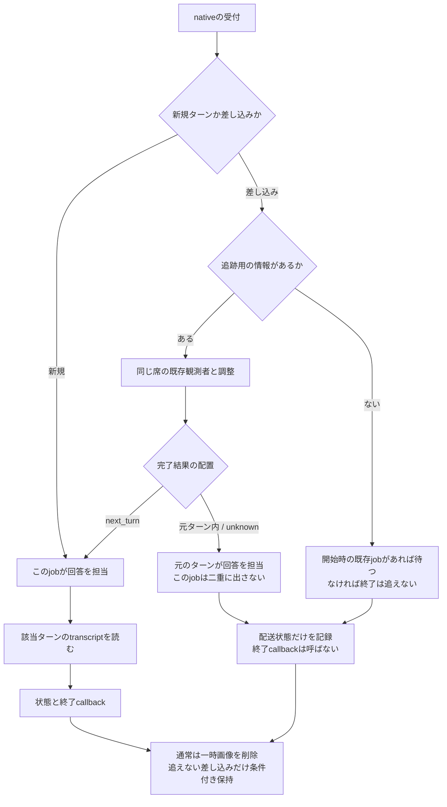
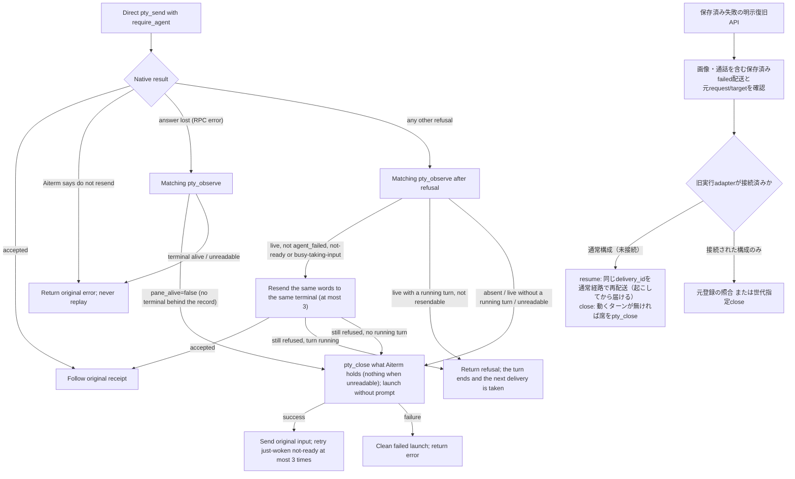

# 配送の受付・完了・回答の所有

対象sourceと確認範囲は[全体図](feature-map.md)に従う。[会話の全体像](conversation-flow.md)から、一回の送信を詳しく追う。以下は実装を読んだ現状図であり、新しい配送や実席試験の結果ではない。

## 入口が違っても、受付と終了は別の時点

正本を[会話・履歴module](modules/conversation/delivery.md#入口が違っても受付と終了は別の時点)へ移した。

## 会話の保存画像と、nativeへ渡す一時画像を分ける

正本を[会話・履歴module](modules/conversation/delivery.md#会話の保存画像とnativeへ渡す一時画像を分ける)へ移した。

## 差し込みと画像の寿命

| 実関数/状態所有 | 正確な役割 |
| --- | --- |
| `AitermTransport.submit` / `DeliveryJob` | jobは受付前から`jobs`に登録。停止/設定待ちと検証後に`active`へ入る。dispatchは呼出元の本文をそのままnativeへ渡し、共通規範の節を末尾に追加しない。キューの存在をnative受付済みの証拠にしない |
| `submit` → `DeliveryJob.native` | jobは受付前に一つのAiterm世代をpinし、`pty_send`・wait process・合間の言葉・transcriptをその世代へ送る。pinの解放は`activity.release`と同じ時点（[aiterm-generation-pin.md](modules/execution/aiterm-generation-pin.md)） |
| `dispatchInOrder` / `SeatActivity.dispatches` | Bot別に直前のdispatchの返却まで順序付け。ターン終了まで直列化しない。先の拒否を次の独立入力へ伝播しない |
| `submit`のreceipt以後 → `followAcceptedDelivery` | receipt代入→停止結果適用→checkpoint→steer/follower判定→`job.follows`設定→running通知→checkpoint→accepted。最初のcheckpointは残す。follower判定と印の設定の間へawaitを入れない |
| `waitForTurnCompletion/followInterim` | nativeのwait processとevent cursorから待つ。途中経過は既存followerがあれば重ねて出さない。最後にも一度読む。途中経過の読取失敗はそのpollだけを止めstderrへ |
| `waitUntilDone` | timeout/runningは同じwaitを継続。error/rate_limited/stopped等は終了異常。これは本文の再送ではない |
| `readTurnAnswer → transcriptText` | typed transcriptはturn_idを照合。不一致を別ターンの回答として保存しない。通知の表示読取失敗はstderrに残し配送完了を維持、利用者のtranscript取得失敗はcompletion失敗 |
| `imageFiles/imageFile` | 既存pathは借用し削除しない。data画像だけ0600/wxの一時file。席分離構成の作成と削除はSeatRuntimeのUID1000へ渡す。作成途中/dispatch途中の失敗も作成済み分を削除 |
| `submit`のfinally → `retainUntrackedImages` / `retainedImages` | 未停止・追跡情報なしのsteer・開始時の親jobなしの場合だけ一時画像を保持。他は削除。保持分は後の新規dispatch、明示close/restart、idle closeで除く。finallyの片付け失敗もPromiseの失敗になり得る |

`DeliveryJob.checkpoint/failure`は停止結論の所有者。受理済みreceiptがある時と、まだ入力を発行していない時を区別する。`finishExecution`の追跡記録失敗は`executionFinishUnconfirmed`に保持し、native受付済みの文を再送しない。

## 起動と明示復旧は別の経路

送信が断られた後の`dispatch`は、席を起こせる限り起こしてから届ける（オーナー裁定 2026-11-07「起こしてから届ける」、2026-11-08「何かがまた無駄に止めてる」、共通規範 guards.give-up-is-a-guard / remove-unnamed）。2026-11-08の本体入れ替えでは、端末が消えたのにAitermが前の起動記録を残した。そのためClaude席への送信が`AGENT_RESUME_UNCONFIRMED: 作成したnative端末が置き換わっています。`で断られ、起こされないまま失敗した（PR #500で回復を二つの符号に絞っていたため、#540で修理）。いまの経路は次のとおり。端末があり、`agent_failed`でなく、`BOT_INPUT_NOT_READY`/`BOT_SEND_BUSY`で断られた席には、同じ端末へ同じ文を送り直す（負荷で起動が遅いだけの席を閉じない）。それでも受けず、動いているターンも無ければ、閉じて起こす。端末が無い席、端末はあるが動いているターンが無い席、観測が読めない席は、起こして同じ文を送る。閉じるのは、Aitermが持っている物（端末、または端末が消えた起動記録）だけで、観測が読めない時は何も閉じない。観測が読めない時に生きた席があれば、`agent_launch`が打つ前に断る。

失敗で終わる分岐、それぞれが守る物、そこからの出口：
| 分岐 | 守る物 | 出口 |
|---|---|---|
| Aitermが結果不明と答えた（`BOT_SEND_OUTCOME_UNKNOWN`、「再送しないでください」） | 打った文を二度実行させない | 席には触れない。次の配送は通常どおり進む。この記録はunknownのまま残り、送り手が会話を見て新しく送る |
| 答えが届かなかった（RPCの失敗）で、観測すると端末が生きている、または観測が読めない | 打った文を二度実行させない | 同上。端末が無い（`pane_alive=false`：記録だけ残った席、休止中の席）と観測できた時は失敗にせず、閉じて起こして届ける。端末が無ければ文は打たれていない |
| 動いているターンがある席が、送り直しても受けない | 動いているターンを壊さない | ターンが終われば、次の配送が受理される（差し込みか新しいターン） |
| 起動の失敗、または起こした席が3回の送信で受けない | 同じ席への後の配送の順番（無限の送り直しでその席の後続を止めない） | 次の配送が観測からやり直し、閉じて起こす。Aitermの元のエラーを返す |

モジュールの入れ替えで、会話のleaseか実行の世代が閉じた配送（`CONVERSATION_NOT_ACCEPTED` / `EXECUTION_GENERATION_RETIRED`）を考える。文がまだCLIに届き得ない時は、型付きの未開始`{schema:'aiterm.execution-error.v1', code:'EXECUTION_STALE_GENERATION', effect:'not_started', follow_up:'none'}`を`error.executionError`に付ける。失敗の状態（`onStatus('failed')`）は、どの呼び手にも従来どおり書く。出口は呼び手ごとに次のとおり（エピネル指摘 2026-11-08）。直接配送（messenger）と部屋（room-messenger）の行は`failed`になり、明示の回復（#549）で同じIDのまま届け直せる。保存配送（durable receipts、N102）は、この印を見て同じIDを`queued`へ戻し、入れ替えの後に届ける。「届き得ない」とは、このjobの`pty_send`が一度も発行されていないか、発行した全てが明示の未送信（`AGENT_SESSION_REQUIRED`/`BOT_INPUT_NOT_READY`/`BOT_SEND_BUSY`、または「送信していません」）で断られたこと（`job.inputMayHaveStarted`）。それ以外は印を付けない。

2026-11-13（a46、同じ操作の4回目の失敗）。本体の入れ替えで端末が消えたClaude席へ送ると、Aiterm 0.70.41以降は記録を休止として引き取り、ログインが要るので再開を断る（`AGENT_RESUME_SECRETS_REQUIRED`、未送信）。MCP SDKのClientは`listTools()`を一度呼ぶと各道具の出力schemaで`structuredContent`を検証し、合わない返りを`callTool`の例外（-32602）に変える。この断りは`isError`の返りに型付きの`structuredContent`を載せていたので、例外になって答えごと失われ、「結果不明」として席に触れずに終わった。席は休止のまま残り、後の配送もすべて同じ形で失敗した（出口が無かった）。4回の失敗に共通する原因は、起こすかどうかを「見ないで送った文の断られ方」から読み取っていたことにある。読めない断り（新しい符号、一覧に無い符号、途中で失われた答え）が来るたびに配送が止まった。直しは二つ。答えが届かなかった時は席を観測し、端末が無ければ起こす（断りの中身に依らない）。`AitermClient`の機能確認は`tools/list`を直接読み、共有するClientに検証を入れない（型付きの断りを読める状態に保つ）。

Aitermが受け付けた後の返りに追う手がかり（event_cursor/wait_process）が無い時は、失敗にせず受理として終える（完了は追えない）。配送前には設定操作を挟まない。通常送信の前には観測を挟まない。設定延期と各条件の保護対象・解除は[配送と設定の正本](modules/execution/configuration-delivery.md)に従う。

`agent_launch`の`startup=ready`と`pty_send`の入力受付確認は、Aitermの中で別々の30秒予算である（どちらも入力欄が500ms間隔で11回続けて入力待ちと読めた時に通る。`pty_send`に公開のready_timeoutは無い）。起こした直後の席は入力欄を描いた後も起動の仕事（MCP初期化・hook・履歴の描画）を続け、同時起動の負荷（2026-11-07 20:18–20:20、9席同時、load≈18）では二つ目の予算が尽きて`AGENT_INPUT_NOT_READY`（本文未送信、「少し後で再度pty_send」の案内付き）で断られる。元から生きていた席への送信は同時刻に全部通った。`dispatch`は、このdispatchで起こした席への最初の送信がその型付き未入力拒否（`BOT_INPUT_NOT_READY`、`agentResumeResult`なし）で断られた時だけ、同じ文を上限3回まで送り直す。各回の待ちはAitermの受付確認が持つので配送側は眠らない。起こしていない席の断りは上の段落の経路（閉じて起こす）へ行き、受付後の不明は送り直さない。上限まで断られた時はその失敗を返し、再起動を繰り返さない。

型付き復帰拒否は`pty_send`の`aiterm.agent-resume-error.v1`（Aiterm 0.70.43以降は`_meta["aiterm/resume_error"]`、それより前は`structuredContent`）を同session・固定enum・ID型・未送信/席確認の契約で検証する。本文や旧版の文言から推測せず、相反するexecution errorを優先する。型付き復帰拒否は明示の未送信なので、動いているターンが無ければ閉じて起こす。この分岐は新契約を返すAitermの正式供給が必要であり、席のlive世代や復旧成功の証明にはしない。

通常構成は`createApplicationServices → createManagedTransport`で**executionBridge=null**、直接`pty_send/agent_stop`を使う。`ExecutionBridge`の実装が存在することを、通常運転で全配送が登録されている意味にしない。通常構成の`resumeDelivery/closeDeliveryLaunch`（2026-11-08、トロニー「失敗記録から出られない」の修理）では、`BotSessionState.reconcileLaunch`が席の一致だけを確かめ、通常経路の回復値`{ordinary:true, reservation:{request}, binding:{target:{launch:target}}}`を返す（親の`conversation-execution-effects`が照合する`binding.target.launch`を持つ。nullは親で読めず落ちる）。`submit`はこの値を`job.execution`にせず、通常のdispatchで届ける。保存済みの配送は同じdelivery_idのまま通常の`notify`で再配送され、席が無ければ起こしてから届ける。同じ席への順番は`dispatchInOrder`が保つ。`closeLaunch`は動いているターンが無い時に席を`pty_close`し、次の配送で起こす。残る拒否は二つ。席の不一致（`BOT_RECOVERY_TARGET_INVALID`）は別の席を閉じないため。出口は正しい席を指定し直すこと。動いているターンがある席のclose（`EXECUTION_BUSY`、未実行）はそのターンを壊さないため。出口はターンが終わった後のclose。再配送してよいか（結果不明の文を送り直すか）は、明示の回復を求めた送り手が判断する。

旧adapterを注入した構成では、`ExecutionBridge.reserve/ExecutionRequest.invoke`がrequest・source・target世代・入力境界を結び、`acceptBinding`が不完全な追跡とnative受付を分離する。明示resumeは元registerを再作成せず、元sendがnot_issuedと確認できる時だけ`reconcileLaunch`→同じ配送IDのnotifyへ進む。closeは元unknown launchの期待世代に対する管理操作であり、元配送のunknown記録は変更しない。通信断やstatus不一致を成功へ補完しない。

`AitermClient.call`がnativeの厳密な未入力拒否を`BOT_INPUT_NOT_READY/BOT_SEND_BUSY/AGENT_SESSION_REQUIRED`へ写す。`BOT_SEND_OUTCOME_UNKNOWN`は起動復旧より先に拒否する。認証/起動はtyped receiptと安全enumだけを残し、`captureMcpError`の通常本文記録の対象外。席側の短命起動でも`run-seat-aiterm-launch`が選別したエラーfieldsを返す。

Aiterm 0.63.12 prefixes `AGENT_INPUT_NOT_READY` and `AGENT_INPUT_TARGET_UNAVAILABLE` identify pre-input refusal branches. The client accepts those prefixes alongside the legacy text only for the requested session's `pty_send` and the explicit unsent phrase, preserving the original diagnostic message and existing `BOT_INPUT_NOT_READY` classification. This adds no wait, replay, or structured input-effect certificate.

## 部屋は全員への配送と返信担当を分ける

正本を[会話・履歴module](modules/conversation/delivery.md#部屋は全員への配送と返信担当を分ける)へ移した。

## 整理の単位

配送全体を汎用taskへ置換せず、同期追跡・回答取得・画像保持を小関数へ分けた。checkpointの位置、同期のfollower決定、例外の返し先は上表のまま。通常/旧adapterの状態と公開Map別名は互換callerを確認してから整理する。単なるMap名の変更や全callbackの一本化はしない。

実装：[messenger.mjs](../../src/messenger.mjs)、[aiterm-transport.mjs](../../src/aiterm-transport.mjs)、[delivery-job.mjs](../../src/delivery-job.mjs)、[room-messenger.mjs](../../src/room-messenger.mjs)、[execution-bridge.mjs](../../src/execution-bridge.mjs)。確認先はmessenger、aiterm-transport/send-rejection、delivery-job/recovery、room-messenger/routing、bot-session-state、execution-bridge、seat-aiterm-launch。局所検証と図の読取確認は[確認範囲](detail-status.md)で区別する。

現branchでは追跡担当の同期決定を`followAcceptedDelivery`、回答取得を`readTurnAnswer`、画像保持の同期判定を`retainUntrackedImages`へ抽出した。全checkpoint、accepted/completionの所有、onTurnEnd/回答を出す分岐、削除awaitとactivity.releaseの位置はsubmitに残る。関連123件を局所確認し、本番/native再送はしていない。
