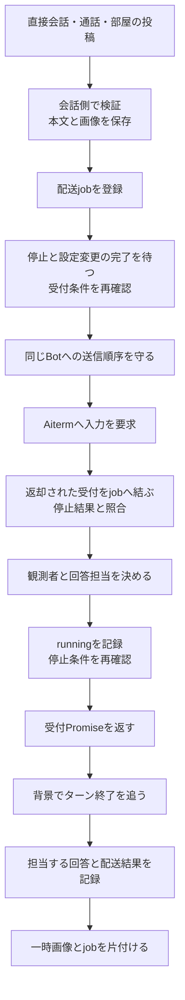
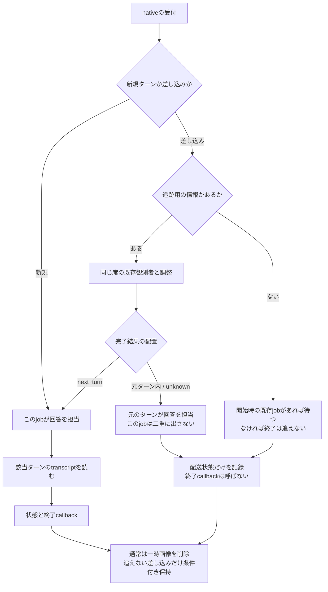
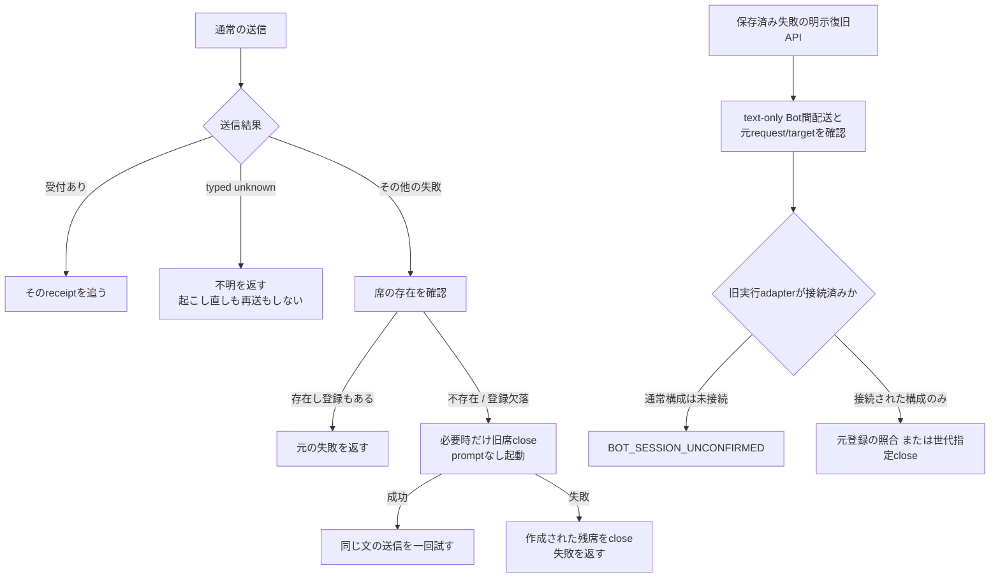
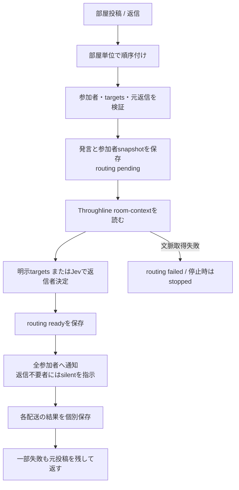

# 配送の受付・完了・回答の所有

固定source `546f232180515a2a8cd9098b943673170c49e3d4`。[会話の全体像](conversation-flow.md)から、一回の送信を詳しく追う。以下は実装を読んだ現状図であり、新しい配送や実席試験の結果ではない。

## 入口が違っても、受付と終了は別の時点

| 入口/caller | 会話側の実関数 | 受付後の仕事と失敗の返し先 |
| --- | --- | --- |
| HTTPの利用者送信・初期会話 | `prepareUserTurn → startUserTurn → enqueueUserTurn` | 利用者発言を先に保存。`completion.accepted`だけをHTTPへ返し、背景の`finishUserTurn`が回答を保存。後の失敗は状態記録とstderrであり、返却済みHTTPを変更しない |
| 完了まで必要なcaller | `userTurn` | 同じ準備後、completionと回答保存まで待つ。受付だけのAPIへ置換しない |
| MCP/内部HTTPのBot間送信・予定 | `sendmessage → notificationCallbacks → transport.notify` | direct記録を先に保存。通知の最終回答は送信元へ自動返信せず、宛先BotとOwnerの会話へ表示 |
| 通話bridge | `receiveCallBridge` | call session/event/seqを記録。失敗時も元記録を残しfailed/stoppedを追記。通話の戻り先は保存metadataで指定 |
| BotからOwnerへの送信 | `sendmessage`のtarget=user分岐 | native処理なし。画像はこの入口の一枚契約、直接記録と通知で完了 |
| 部屋 | `RoomMessenger.sendroommessage → sendRoomMessageInOrder` | 発言・参加者・返信者のsnapshotと各配送状態を部屋に保存。下図へ |

`recordUserReply`は、そのターンの間にBotが明示的にOwnerへ送った新しい記録を優先し、`knownReplyIds/claimedReplyIds`で二度の回答保存を避ける。空回答を新しい発言にしない。この処理は通知の単なる表示callbackとは責務が違う。

## 差し込みと画像の寿命

| 実関数/状態所有 | 正確な役割 |
| --- | --- |
| `AitermTransport.submit` / `DeliveryJob` | jobは受付前から`jobs`に登録。停止/設定待ちと検証後に`active`へ入る。キューの存在をnative受付済みの証拠にしない |
| `dispatchInOrder` / `SeatActivity.dispatches` | Bot別に直前のdispatchの返却まで順序付け。ターン終了まで直列化しない。先の拒否を次の独立入力へ伝播しない |
| `submit`のreceipt以後 → `followAcceptedDelivery` | receipt代入→停止結果適用→checkpoint→steer/follower判定→`job.follows`設定→running通知→checkpoint→accepted。最初のcheckpointは残す。follower判定と印の設定の間へawaitを入れない |
| `waitForTurnCompletion/followInterim` | nativeのwait processとevent cursorから待つ。途中経過は既存followerがあれば重ねて出さない。最後にも一度読む。途中経過の読取失敗はそのpollだけを止めstderrへ |
| `waitUntilDone` | timeout/runningは同じwaitを継続。error/rate_limited/stopped等は終了異常。これは本文の再送ではない |
| `transcriptText` | typed transcriptはturn_idを照合。不一致を別ターンの回答として保存しない。通知の表示読取失敗はstderrに残し配送完了を維持、利用者のtranscript取得失敗はcompletion失敗 |
| `imageFiles/imageFile` | 既存pathは借用し削除しない。data画像だけ0600の一時file。作成途中/dispatch途中の失敗も作成済み分を削除 |
| `submit`のfinally → `retainUntrackedImages` / `retainedImages` | 未停止・追跡情報なしのsteer・開始時の親jobなしの場合だけ一時画像を保持。他は削除。保持分は後の新規dispatch、明示close/restart、idle closeで除く。finallyの片付け失敗もPromiseの失敗になり得る |

`DeliveryJob.checkpoint/failure`は停止結論の所有者。受理済みreceiptがある時と、まだ入力を発行していない時を区別する。`finishExecution`の追跡記録失敗は`executionFinishUnconfirmed`に保持し、native受付済みの文を再送しない。

## 起動と明示復旧は別の経路

通常構成は`createApplicationServices → createManagedTransport`で**executionBridge=null**、直接`pty_send/agent_stop`を使う。`ExecutionBridge`の実装が存在することを、通常運転で全配送が登録されている意味にしない。`resumeDelivery/closeDeliveryLaunch`のHTTP入口は残るが、通常構成では`BotSessionState`のadapter条件で拒否される。

旧adapterを注入した構成では、`ExecutionBridge.reserve/ExecutionRequest.invoke`がrequest・source・target世代・入力境界を結び、`acceptBinding`が不完全な追跡とnative受付を分離する。明示resumeは元registerを再作成せず、元sendがnot_issuedと確認できる時だけ`reconcileLaunch`→同じ配送IDのnotifyへ進む。closeは元unknown launchの期待世代に対する管理操作であり、元配送のunknown記録は変更しない。通信断やstatus不一致を成功へ補完しない。

`AitermClient.call`がnativeの厳密な未入力拒否を`BOT_INPUT_NOT_READY/BOT_SEND_BUSY/AGENT_SESSION_REQUIRED`へ写す。`BOT_SEND_OUTCOME_UNKNOWN`は起動復旧より先に拒否する。認証/起動はtyped receiptと安全enumだけを残し、`captureMcpError`の通常本文記録の対象外。席側の短命起動でも`run-seat-aiterm-launch`が選別したエラーfieldsを返す。

## 部屋は全員への配送と返信担当を分ける

| 段階 | caller/実関数 | 保存と失敗 |
| --- | --- | --- |
| 投稿順序 | `sendroommessage` / `roomTasks` | 前投稿が失敗しても次の別投稿は処理。current PromiseだけをMapから除く |
| 投稿前 | `sendRoomMessageInOrder` | 自動選定無効でtargetsなしの新規投稿は409。既responseTo/fromの返信はalready_posted。検証と受付後にだけ画像/発言を保存 |
| 文脈 | `roomTurnsFromThroughline` | 現状は明示targetsでも呼ぶ。schema/room/latest messageを検証。不正は投稿後のrouting失敗になる。不要と決めつけて省略しない |
| 選定 | `chooseRoomResponder` | Jevへの入力は現発言・前会話・参加者。確率/所属を検証し0.6以上で一人。manual targetsが優先 |
| 通知 | `roomEnvelope` / `Promise.allSettled` | 配送対象と返信者のsnapshotを分ける。全員の受付結果を回収。各onStatusで部屋recordを更新、途中経過/最終回答は各BotのOwner会話へ |
| 返信 | `mcp-tools.mjs`の`respond_to_room` | 元発言/宛先/返信者に対応付ける。silentは制御応答、replyだけ新規部屋投稿。新投稿は新しい返信担当判定を持つ |

## 整理の単位

配送全体を汎用taskへ置換せず、`submit`の「受付確定」「回答所有の判定」「完了の記録」「画像片付け」を小関数にする余地がある。checkpointの位置、同期のfollower決定、例外の返し先を先に上表へ固定した。通常/旧adapterの状態と公開Map別名は互換callerを確認してから整理する。単なるMap名の変更や全callbackの一本化はしない。

実装：[messenger.mjs](../../src/messenger.mjs)、[aiterm-transport.mjs](../../src/aiterm-transport.mjs)、[delivery-job.mjs](../../src/delivery-job.mjs)、[room-messenger.mjs](../../src/room-messenger.mjs)、[execution-bridge.mjs](../../src/execution-bridge.mjs)。確認先はmessenger、aiterm-transport/send-rejection、delivery-job/recovery、room-messenger/routing、bot-session-state、execution-bridge、seat-aiterm-launch。既試験をここで再実行していない。

現branchでは追跡担当の同期決定を`followAcceptedDelivery`、回答取得を`readTurnAnswer`、画像保持の同期判定を`retainUntrackedImages`へ抽出した。全checkpoint、accepted/completionの所有、onTurnEnd/回答を出す分岐、削除awaitとactivity.releaseの位置はsubmitに残る。関連123件を局所確認し、本番/native再送はしていない。
