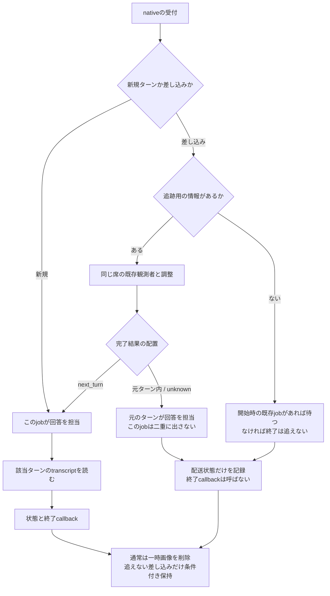
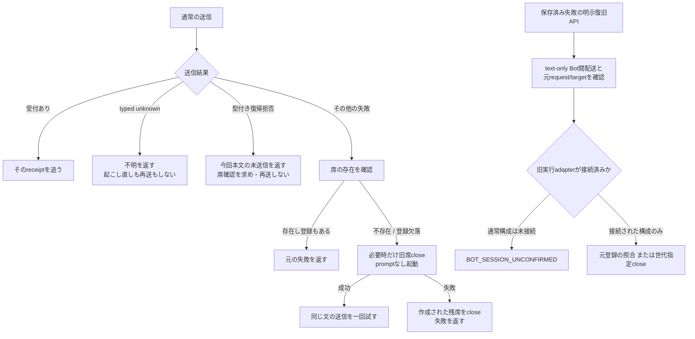

# 配送の受付・完了・回答の所有

対象sourceと確認範囲は[全体図](feature-map.md)に従う。[会話の全体像](conversation-flow.md)から、一回の送信を詳しく追う。以下は実装を読んだ現状図であり、新しい配送や実席試験の結果ではない。

## 入口が違っても、受付と終了は別の時点

正本を[会話・履歴module](modules/conversation/delivery.md#入口が違っても受付と終了は別の時点)へ移した。

## 会話の保存画像と、nativeへ渡す一時画像を分ける

正本を[会話・履歴module](modules/conversation/delivery.md#会話の保存画像とnativeへ渡す一時画像を分ける)へ移した。

## 差し込みと画像の寿命

| 実関数/状態所有 | 正確な役割 |
| --- | --- |
| `AitermTransport.submit` / `DeliveryJob` | jobは受付前から`jobs`に登録。停止/設定待ちと検証後に`active`へ入る。キューの存在をnative受付済みの証拠にしない |
| `dispatchInOrder` / `SeatActivity.dispatches` | Bot別に直前のdispatchの返却まで順序付け。ターン終了まで直列化しない。先の拒否を次の独立入力へ伝播しない |
| `submit`のreceipt以後 → `followAcceptedDelivery` | receipt代入→停止結果適用→checkpoint→steer/follower判定→`job.follows`設定→running通知→checkpoint→accepted。最初のcheckpointは残す。follower判定と印の設定の間へawaitを入れない |
| `waitForTurnCompletion/followInterim` | nativeのwait processとevent cursorから待つ。途中経過は既存followerがあれば重ねて出さない。最後にも一度読む。途中経過の読取失敗はそのpollだけを止めstderrへ |
| `waitUntilDone` | timeout/runningは同じwaitを継続。error/rate_limited/stopped等は終了異常。これは本文の再送ではない |
| `readTurnAnswer → transcriptText` | typed transcriptはturn_idを照合。不一致を別ターンの回答として保存しない。通知の表示読取失敗はstderrに残し配送完了を維持、利用者のtranscript取得失敗はcompletion失敗 |
| `imageFiles/imageFile` | 既存pathは借用し削除しない。data画像だけ0600/wxの一時file。席分離構成の作成と削除はSeatRuntimeのUID1000へ渡す。作成途中/dispatch途中の失敗も作成済み分を削除 |
| `submit`のfinally → `retainUntrackedImages` / `retainedImages` | 未停止・追跡情報なしのsteer・開始時の親jobなしの場合だけ一時画像を保持。他は削除。保持分は後の新規dispatch、明示close/restart、idle closeで除く。finallyの片付け失敗もPromiseの失敗になり得る |

`DeliveryJob.checkpoint/failure`は停止結論の所有者。受理済みreceiptがある時と、まだ入力を発行していない時を区別する。`finishExecution`の追跡記録失敗は`executionFinishUnconfirmed`に保持し、native受付済みの文を再送しない。

## 起動と明示復旧は別の経路

型付き復帰拒否は`pty_send`の`aiterm.agent-resume-error.v1`を同session・固定enum・ID型・未送信/席確認の契約で検証する。本文や旧版の文言から推測せず、相反するexecution errorを優先する。この分岐は新契約を返すAitermの正式供給が必要であり、席のlive世代や復旧成功の証明にはしない。

通常構成は`createApplicationServices → createManagedTransport`で**executionBridge=null**、直接`pty_send/agent_stop`を使う。`ExecutionBridge`の実装が存在することを、通常運転で全配送が登録されている意味にしない。`resumeDelivery/closeDeliveryLaunch`のHTTP入口は残るが、通常構成では`BotSessionState`のadapter条件で拒否される。

旧adapterを注入した構成では、`ExecutionBridge.reserve/ExecutionRequest.invoke`がrequest・source・target世代・入力境界を結び、`acceptBinding`が不完全な追跡とnative受付を分離する。明示resumeは元registerを再作成せず、元sendがnot_issuedと確認できる時だけ`reconcileLaunch`→同じ配送IDのnotifyへ進む。closeは元unknown launchの期待世代に対する管理操作であり、元配送のunknown記録は変更しない。通信断やstatus不一致を成功へ補完しない。

`AitermClient.call`がnativeの厳密な未入力拒否を`BOT_INPUT_NOT_READY/BOT_SEND_BUSY/AGENT_SESSION_REQUIRED`へ写す。`BOT_SEND_OUTCOME_UNKNOWN`は起動復旧より先に拒否する。認証/起動はtyped receiptと安全enumだけを残し、`captureMcpError`の通常本文記録の対象外。席側の短命起動でも`run-seat-aiterm-launch`が選別したエラーfieldsを返す。

## 部屋は全員への配送と返信担当を分ける

正本を[会話・履歴module](modules/conversation/delivery.md#部屋は全員への配送と返信担当を分ける)へ移した。

## 整理の単位

配送全体を汎用taskへ置換せず、同期追跡・回答取得・画像保持を小関数へ分けた。checkpointの位置、同期のfollower決定、例外の返し先は上表のまま。通常/旧adapterの状態と公開Map別名は互換callerを確認してから整理する。単なるMap名の変更や全callbackの一本化はしない。

実装：[messenger.mjs](../../src/messenger.mjs)、[aiterm-transport.mjs](../../src/aiterm-transport.mjs)、[delivery-job.mjs](../../src/delivery-job.mjs)、[room-messenger.mjs](../../src/room-messenger.mjs)、[execution-bridge.mjs](../../src/execution-bridge.mjs)。確認先はmessenger、aiterm-transport/send-rejection、delivery-job/recovery、room-messenger/routing、bot-session-state、execution-bridge、seat-aiterm-launch。局所検証と図の読取確認は[確認範囲](detail-status.md)で区別する。

現branchでは追跡担当の同期決定を`followAcceptedDelivery`、回答取得を`readTurnAnswer`、画像保持の同期判定を`retainUntrackedImages`へ抽出した。全checkpoint、accepted/completionの所有、onTurnEnd/回答を出す分岐、削除awaitとactivity.releaseの位置はsubmitに残る。関連123件を局所確認し、本番/native再送はしていない。
