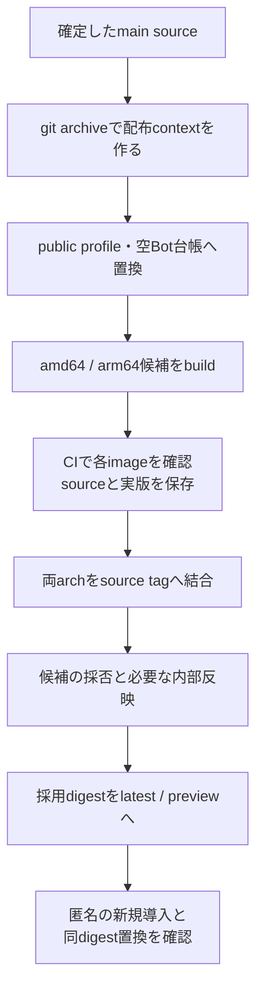
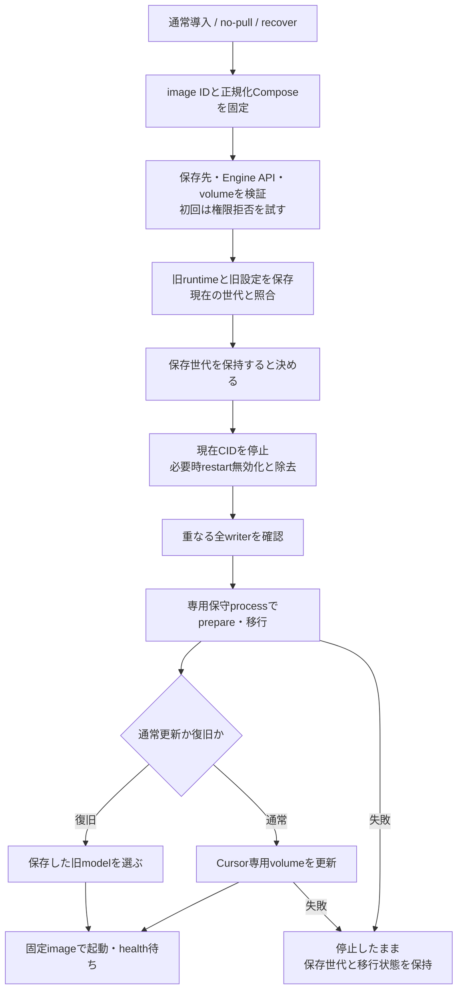
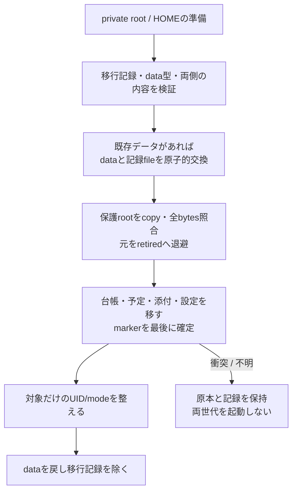
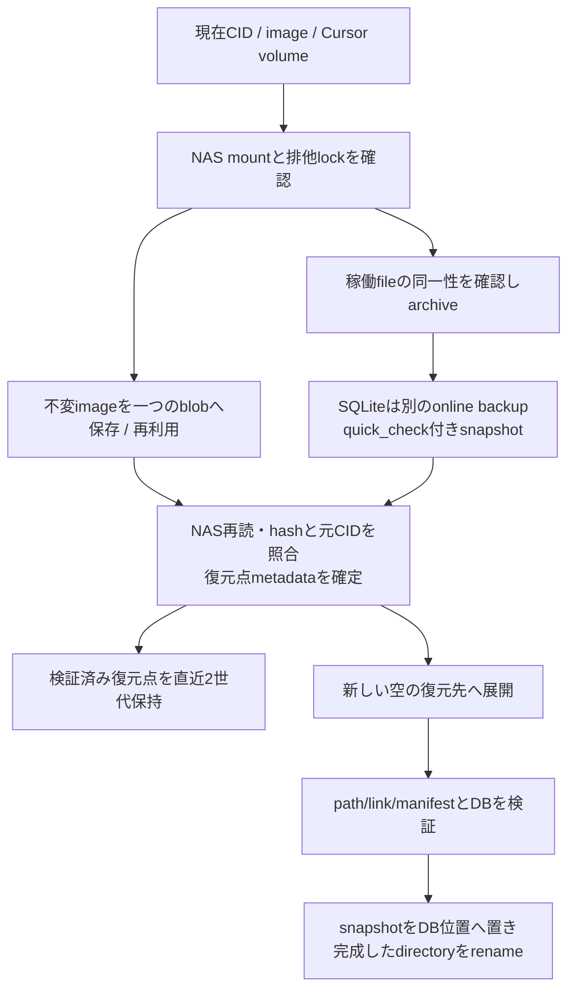

# 供給・設置・状態移行・控え

固定source `546f232180515a2a8cd9098b943673170c49e3d4`。本体の通常供給とオフライン保守の接続を読む。記載は手順の実装説明であり、今回の反映/停止を許可したものではない。

## 同じ候補を作り、採用した実物を配る

| 段階 | 実装/caller | 所有と限界 |
| --- | --- | --- |
| context作成 | `scripts/package-server.mjs` | HEADの明示pathだけgit archive。未commit・個人台帳・.envを含めず、public profileと空台帳へ置換。sourceCommitをdistribution.jsonへ記録 |
| 候補 | `publish-server-image.yml` | 対象pathのmain push/手動で両arch build。各arch検証後push→index job。latestを書き換える工程ではない |
| 実物照合 | `verifyCandidate` | 匿名registryのindex/manifest/config hash、両arch/source labelを検証。受入記録文字列を要求するが、人の採否をscript自体が代行するわけではない |
| promotion | `promoteCandidate` | 再buildせず同digestを二つのtagへ。raw tagのhashを再確認。sourceはorigin/mainの祖先確認 |
| 公開確認 | `verify-published-server.yml` | 空資格で設置file取得→latest導入→preview同digestでCID置換、Owner/HOME/data保持とhealth。旧版移行・全archの実導入の証明へ広げない |
| 内部通常入口 | `scripts/deploy.sh` | tracked変更拒否→main push→Host fetchとclean確認→旧runtime/model/profile保存→ff-only→queue保存→切離しdeploy起動→終端log/health/版読戻し |
| 内部差分 | `deploy-image.sh` | 指定imageならpull、未指定ならbuild。内部overlay/profileを指定して同じ公開installerへ渡す。終了codeをdeploy-exitに記録 |

旧modelは更新前に固定する。親umask077を保ち、Git fetch/mergeだけ022。旧profileのbytesとmount先、Compose hash、CID/image/開始時刻の再確認を持つ。ただしCompose hashだけではmount/寿命の全同一性を証明できない。Hostのdeploy終了と、呼出し元CLIが正常帰還したことも別である。

## installerは停止前の準備と、停止後の保守を分ける

| 機能 | 実関数/入口 | 失敗時に残るもの |
| --- | --- | --- |
| 設定固定 | `distribution/server/install.sh` | imageのIDを固定しimage内の保守/Cursor scriptを抽出。normal/maintenanceの同世代JSONはprivate。後から.envやtagが変わっても途中で選び直さない |
| 初回storage | installerのpermission probe/volume照合 | UID1000の実読取拒否が成立するHostはlocal bind volume、拒否されない共有folderはEngine内volume。既volumeのname/driver/labels/optionsが違えば停止 |
| 旧model回収 | `capture_previous` | 証明不能ならprevious-normalを作らず警告、原本保持。通常更新そのものは進め得るが、その世代のrecoverは拒否 |
| recover | installer `--recover` | 保存した旧model/旧imageが存在することを停止前に確認。現在データを旧配置へ戻す場合もあり、古いbackupへ巻き戻す操作ではない |
| writer確認 | `assert-state-writers-stopped.sh → stateWriterPlan/Volumes/Sources/assertStateWritersStopped` | 全containerの稼働/restart policyとRW mount、volume実体、Hostのcanonical pathを比較。Docker socketはreaderへ渡さず、env/資格内容を証拠へ複製しない |
| writerの限界 | `participates/volumePaths` | stoppedContainerのunless-stoppedだけを特例扱い。未知driver/metadata/aliasは成功へしない。snapshotだけでは保守中の新writerを防げないためlock/data sealと組合せる |
| maintenance | `compose.state-maintenance.json` | networkなし、固定entry、private rootの排他flock、runtimeとprivate volumeだけ。root処理はこのオフライン保守が所有 |
| Cursor更新 | `update-cursor.sh → cursor-update-entrypoint.sh` | normalized project/volume名で使い捨てcontainer。空envの固定入口から公式update。BellTeam本体の環境や資格fileを読み出さない |
| cleanup | installerのtrap | 一時staging/probeを除く。停止を試みる段階以後は保存世代を消さない。自動的に別imageを起こすrollbackはない |

Mac/Windowsのネイティブアプリ設置scriptは本体installerと別。`install-mac.sh`は署名build→既app控え→終了確認→copy/署名確認→起動、`install-windows.ps1`はOS arch別publish→接続先設定→copy/shortcut/uninstall登録。Appleの署名・審査・単独UIは担当の工程であり、この本体図から操作を始めない。

## 状態移行の三つの責任

上図はto-serverの順序。to-legacyは個別file移行後に保護rootを戻す。根の再配置、fileの配置、所有権の変更を同じcopy関数へまとめない。

| 責務 | 実関数 | データと不変条件 |
| --- | --- | --- |
| 準備と再開 | `prepareServerStateRuntime/migrateServerState/readTransaction` | private rootのdevice/inode、方向/id/時刻を検証。data=fileなら同記録とhidden directoryが必要。settled状態は不用な所有権再設定を省く |
| 使用中に見せない | `checkExchange/exchange` | 同filesystemでdirectoryとfileを交換する機能を先に確認。交換後inode対応を確認。途中失敗は記録を手で消して解除しない |
| 保護root移動 | `relocateServerRoots/copyTree/equalTrees` | state/rooms/owner/logs/settings/APNsだけ。別filesystemはcopy→bytes一致→公開→元retired。既存非空の内容不一致は上書きせず拒否。既知の古いsocketはcopyしない |
| file移行 | `transferServerState/moveFile/moveTree` | bot.json/schedule.json/assets、subscription/onboarding/AI停止/bridge/BugHub参照。全profile/schedule検証後に元を除く。AI停止は専用schema検証 |
| durableな公開 | `regular/equalFiles/syncAncestors/removeUnchangedSource/marker` | O_NOFOLLOW、inode/link/size/mtime、完成copyのsync→rename→元の不変確認→unlink。初期化markerは最後。異常終了後は同transactionの未公開tempだけを整理 |
| 所有権 | `prepareServerStateOwnership` | 保護rootだけを事前列挙しlink/特殊fileを拒否→開いたFDで本人性再検証→chown/chmod。seat project/HOME/記憶DBを一括chownしない |
| 終了 | `migrateServerState`末尾 | 所有権/残temp確認後にdataを戻しtransactionを除く。retiredは移行時点の原本で、その後の新しい会話のbackupではない |

## 稼働中の控えと、新しい場所への復元

`save-deploy-restore-point.py`の控えは**imageとCursor volume**。本体全state/HOMEの完全backupと呼ばない。`mount_guard`は所定NASがなければlocalへfallbackしない。`archive`はpartialへ帯域制限付き保存→再読hash→rename、producer異常ならpartial削除。`image_blob/checked_image_blob`は既保存のimage本人性を確認して再利用。`validated_points/prune_points`は控えの構成と参照を検証してから古い二世代外を除く。失敗世代はfailed.jsonを残す。

`archive-live-volume.py.create`は一般fileの変化を拒否し、SQLiteのrawは観測bytesとしてだけ保存、復元用DBはread-only接続のbackup APIから作る。DBごとに120秒とquick_checkを持つ。Throughlineの既知atomic JSONだけrename交替を許し記録する。全volumeが同一瞬間のsnapshotという意味ではない。

`restore`は既存destinationを拒否。manifest/重複member/相対path/type/SQLite family/hardlink/symlink祖先を検証し、仮directoryへ展開。生のSQLite/WAL群は復元に使わず、再検証したsnapshotを置く。symlinkは配置検証後に作り、最後に完成directoryをrenameする。復元したdirectoryを本番mountへ切替える操作はこの関数にない。

実装：[installer](../../distribution/server/install.sh)、[state transfer](../../src/server-state-transfer.mjs)、[writers](../../src/server-state-writers.mjs)、[ownership](../../src/server-state-ownership.mjs)、[volume archive](../../scripts/archive-live-volume.py)、[restore point](../../scripts/save-deploy-restore-point.py)。移行/復旧/CI/Host操作の再実行はしていない。実導入の受入範囲は各版の既存記録を参照する。
