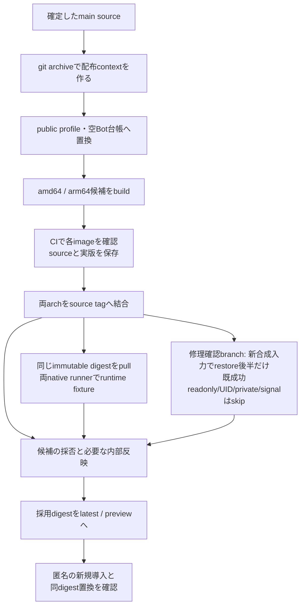

# 供給・設置・状態移行・控え

対象sourceと確認範囲は[全体図](feature-map.md)に従う。本体の通常供給とオフライン保守の接続を読む。記載は手順の実装説明であり、今回の反映/停止を許可したものではない。

## 同じ候補を作り、採用した実物を配る

| 段階 | 実装/caller | 所有と限界 |
| --- | --- | --- |
| context作成 | `scripts/package-server.mjs` | HEADの明示pathだけgit archive。未commit・個人台帳・.envを含めず、public profileと空台帳へ置換。sourceCommitをdistribution.jsonへ記録 |
| 候補 | `publish-server-image.yml` | 対象pathのmain push/手動で両arch build。各arch検証後push→index job。latestを書き換える工程ではない |
| 実物照合 | `verifyCandidate` | 匿名registryのindex/manifest/config hash、両arch/source labelを検証。受入記録文字列を要求するが、人の採否をscript自体が代行するわけではない |
| H1実runtime | `verify-h1-runtime-image.yml` → runtime所有 `scripts/verify-resume-runtime.py` | build無し。同digest/sourceを検証しnative amd64/arm64の固有fixtureだけ実行。alwaysでallocationの自己label/project/3volumeを清掃・原本保存。通常アプリ全体/vendor起動・本番・promotionは含まない |
| H1 restore限定確認 | 修理確認branchの `verify-h1-runtime-image.yml` → `verify-resume-runtime.py --restore-only` | 同digestの新合成入力でprebootstrap→採用→非再投入→不正拒否だけ。前回失敗原本を残し、全runtime成功へ自動延長せずEpiが採否を持つ。build/本番なし |
| promotion | `promoteCandidate` | 再buildせず同digestを二つのtagへ。raw tagのhashを再確認。sourceはorigin/mainの祖先確認 |
| 公開確認 | `verify-published-server.yml` | 空資格で設置file取得→latest導入→preview同digestでCID置換、Owner/HOME/data保持とhealth。旧版移行・全archの実導入の証明へ広げない |
| 内部通常入口 | `scripts/deploy.sh` | tracked変更拒否→main push→Host fetchとclean確認→旧runtime/model/profile保存→ff-only→queue保存→切離しdeploy起動→終端log/health/版読戻し |
| 内部差分 | `deploy-image.sh` | 指定imageならpull、未指定ならbuild。内部overlay/profileを指定して同じ公開installerへ渡す。終了codeをdeploy-exitに記録 |

旧modelは更新前に固定する。親umask077を保ち、Git fetch/mergeだけ022。旧profileのbytesとmount先、Compose hash、CID/image/開始時刻の再確認を持つ。ただしCompose hashだけではmount/寿命の全同一性を証明できない。Hostのdeploy終了と、呼出し元CLIが正常帰還したことも別である。

## installerは停止前の準備と、停止後の保守を分ける

[runtimeのinstaller図・固定対象・失敗の保持](modules/runtime/recovery.md#installerは停止前の準備と停止後の保守を分ける)。

Mac/Windowsのネイティブアプリ設置scriptは本体installerと別。`install-mac.sh`は署名build→既app控え→終了確認→copy/署名確認→起動、`install-windows.ps1`はOS arch別publish→接続先設定→copy/shortcut/uninstall登録。Appleの署名・審査・単独UIは担当の工程であり、この本体図から操作を始めない。

## 状態移行の三つの責任

[runtimeの状態移行図・元データと所有権](modules/runtime/recovery.md#状態移行の三つの責任)。

## 稼働中の控えと、新しい場所への復元

[runtimeのbackup/restore図・控えの範囲と復元先](modules/runtime/recovery.md#稼働中の控えと新しい場所への復元)。
