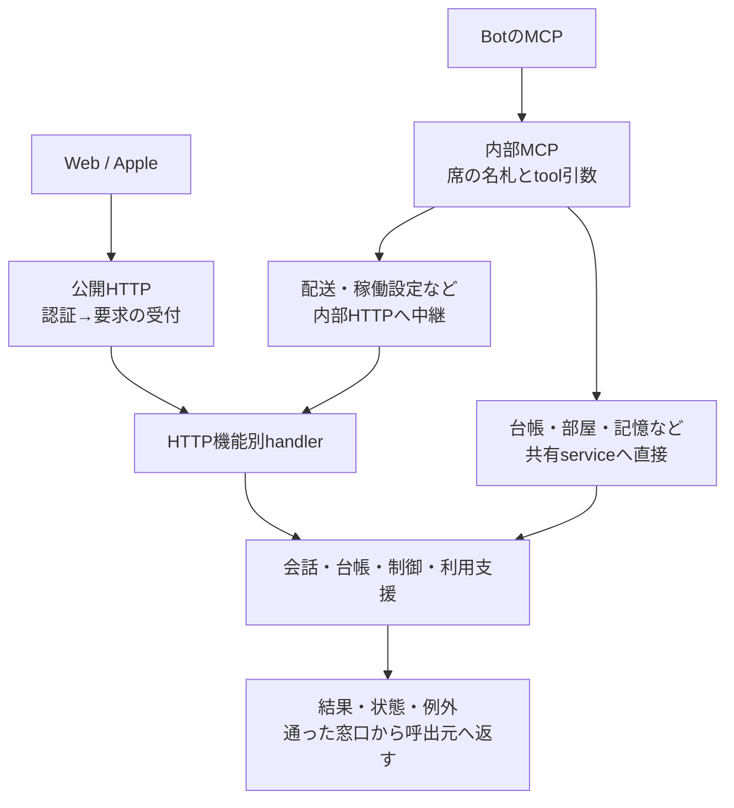

# 利用機能の入口と処理先

固定source `546f232180515a2a8cd9098b943673170c49e3d4` の入口索引。[全体図](feature-map.md)から具体的な操作へ降りるために使う。これは全関数の調査完了表ではない。下の各処理先を詳細図へ接続する進捗は[detail-status](detail-status.md)で管理する。

## どの入口でも同じ本体サービスへ届く

組立ては`createApplicationRuntime`。公開・内部HTTPは同じ`serverOptions`内のサービス実体を使う。公開認証は`createApplicationFeatures.authMode/authorize`、内部HTTPはloopbackで開く。内部MCPは`seatBotId`で既存Botを選び、`seatExecutionSource`はヘッダ由来の主張を記録する。これはnative実行本人性を検証済みとする値ではない。

HTTPでは`healthz`だけ先に返し、`session`は認証判定を返す。その他は認証後、control API→台帳refresh→各feature API→404の順。staticも認証後に配信する。tool側は`runBellTeamTool`がtool名・引数のキー・callerの存在・台帳を確認する。HTTPとMCPが同じ制限を全く同じ場所で検証するわけではないため、入口を一括置換しない。

## HTTPから辿る

`/api`を省略した表記。`:bot`、`:room`、`:id`は既存識別子。bodyの厳密な契約は各handlerと[現行設計](../current-design.md)を参照する。

| 利用機能 / 入口 | 処理先 | 書込・実行・観測の区別 |
| --- | --- | --- |
| GET `/session`、`/healthz`、Web static | `createBellTeamServer` / `staticFile` | 接続・認証・稼働応答。AI回答の成功を示さない |
| GET/PATCH `/ai-control` | `createControlApi` → `AiControl.snapshot/update` | 全体の受付抑止・停止意図と実行結果 |
| GET `/setup`、POST `/setup/{harness,auth/input,start,complete}` | `Onboarding` | 認証案内・案内Botの開始と完了。harness/inputは内部から拒否 |
| GET `/harness-auth`、GET `/:harness`、POST `/:harness/{start,input,cancel}` | `HarnessAuth` | 公式認証。内部はGETのみ |
| GET `/settings`、PATCH `/settings/:feature` | `FeatureSettings` → `application-features` | 設定保存と適用。内部は秘密直値を許さない |
| GET `/subscription`、POST `/subscription/{verify,refresh,setup-test}` | `Subscriptions` / `transport.setupTest` | 購読検証と旧初回動作確認。AI全体の利用制約にしない |
| GET `/notifications`、POST `/notifications/{devices,unregister}` | `PushNotifications` | 端末登録と通知providerの公開状態 |
| POST `/secret-requests`、GET `/:id`、POST `/:id/{submit,cancel}` | `SecretRequests` | 作成はinternal、提出はpublic、internal cancelは所有Botのwithdraw |
| POST `/owner-questions`、GET `/:id`、POST `/:id/answer` | `OwnerQuestions` | 作成はinternal、回答はpublic |
| POST `/diagnostics` | `Diagnostics.record` | IOS_診断を受付。観測の保存であり故障の回復ではない |
| GET `/models` | `LiveModelCatalog.list` | Aitermの現モデル一覧を取得。席は起動しない |
| GET/PATCH `/owner`、GET `/owner/avatar` | `OwnerProfile` → `refreshGlobalInstructions` | プロフィール正本とCLI向け指示の更新 |
| GET/PUT `/user-rules` | `UserRules` → `refreshGlobalInstructions` | 全文正本の更新 |
| GET `/events` | `createMessageEvents.connect` | SSEで変更箇所を通知。履歴本文は別GET |
| GET `/message-images/:owner/:file` | `MessageAssets.open` | 保存画像のstream。通常会話のファイルパスを外へ返さない |
| GET/POST `/bots` | `BotRegistry` / 一覧projection / `memory.ensureScope` | 作成時は台帳→personal記憶準備。一覧は稼働・履歴・設定反映を合成 |
| GET/PATCH/DELETE `/bots/:bot` | `BotAdministration` / `BotRegistry` | 設定保存、稼働反映、背景削除。DELETE202は削除完了ではない |
| POST `/bots/:bot/{stop,restart}` | `BotAdministration` → transport | 停止結果は確認して返す。restart202は背景開始 |
| GET `/bots/:bot/screen` | `transport.screen` | 既存席の観測。本文履歴と別 |
| GET `/bots/:bot/{avatar,avatar-large,avatar-source,avatar-large-source}` | `sendAvatar` | 保存画像・版とcache応答 |
| GET `/bots/:bot/character-sheet[/:file]` | `CharacterSheets`または席proxy | 正本の一覧・stream。HTTP切断時にreaderも止める |
| GET/POST `/bots/:bot/memory`、PATCH `/:id`、POST `/:id/pin`、POST `/consolidate-growth` | `BellTeamMemory`または席proxy | scope内の記憶・履歴・pin・統合 |
| GET/POST `/bots/:bot/knowledge` | `BellTeamMemory`または席proxy | scope内の知識と索引 |
| GET/POST `/bots/:bot/messages` | `messagePage` / `messenger.enqueueUserTurn` | ページ取得 / Owner発言の受付 |
| GET `/bots/:bot/queue` | `transport.queueItems` | 進行中作業の投影 |
| GET/POST `/rooms`、GET/PATCH/DELETE `/rooms/:room` | `RoomRegistry` | 部屋定義・参加者・削除。room DELETEは完了後204 |
| GET `/rooms/:room/avatar` | `sendAvatar` | 部屋画像 |
| GET/POST `/rooms/:room/messages`、GET `/rooms/:room/queue` | `messagePage/RoomMessenger/transport` | 部屋の投稿・参加者別配送と表示 |
| POST `/deliveries/{direct,room}` | `Messenger/RoomMessenger` | Bot/scheduler等の配送入口。Owner会話POSTとは異なる |
| POST `/deliveries/direct/:id/{resume,close-launch}` | `Messenger` | 保存済み配送を検証する明示操作。自動再送ではない |
| GET `/queue` | `transport.queueItems` | 全進行中配送の投影 |
| GET `/schedules`、GET/POST `/{bots,rooms}/:id/schedules`、PUT/DELETE `/:schedule` | 各Registry / `schedule-mutations` | 予定正本の一覧・変更・削除 |
| POST `/{bots,rooms}/:id/schedules/:schedule/run` | `BotScheduler.runBotSchedule/runRoomSchedule` | 手動発行。次回時刻・enabledは変えない |
| GET `/{bots,rooms}/:id/export` | `createConversationApi` → `timeline/webMessage` | 履歴projectionを書き出す。実行・原本変更なし |
| GET `/goals`、GET/POST `/bots/:bot/goal` | `BotGoals` → Aiterm | nativeが正本。内部HTTPからmutationを許さない |

制御系は[利用支援詳細](support-details.md)、台帳と予定は[台帳・予定詳細](registry-details.md)、会話画面は[Web詳細](web-details.md)へ続く。

## MCPから辿る

| tool群 | 実際の処理先 | HTTPとの違い / actor |
| --- | --- | --- |
| `list_models/get_settings/update_settings/complete_setup` | `internalApi` → control API | 設定/初期完了にはfromをbotIdとして確定 |
| `request_secret/get_secret_request/cancel_secret_request/ask_owner` | `internalApi` → 専用service | 依頼の所有を保持。取得時も元依頼Botを確認 |
| `sendmessage/send_user_message/sendroommessage` | 宛先名解決・画像path解決→`deliverMessage/deliverRoomMessage` | `send_user_message`はuser由来。実行sourceはHTTP ingressで付与。登録名を新IDへ置換しない |
| `respond_to_room` | queue/保存投稿から元発言特定→参加/返信資格→room配送 | silentは配送を作らない。assignedがsilentすること、非assignedのreplyを拒否 |
| `list_bots/get_bot/get_self` | registry / `administration.view` | MCP公開応答はアバター本体を除く |
| `create_bot/update_bot/update_self/delete_bot/restart_session/set_fast_mode/set_avatar` | registryまたは`internalApi.configure/remove/restart` | model/harness/effortはHTTPの稼働設定経路。プロフィールだけはregistry直通。set_avatarはファイルを読んで更新 |
| `get_owner_profile/get_user_rules` | 各正本service | 読取り。更新toolは通常MCPにない |
| `remember/recall_memory/revise_memory/pin_memory/consolidate_growth/record_knowledge/search_knowledge` | memory serviceまたは席proxy | 最終argsのscope/botIdを子へ渡す。検証は記憶側 |
| `set_schedule/list_schedules/remove_schedule` | BotRegistry | 省略botIdはfrom |
| `create_room/list_rooms/get_room/update_room/delete_room/invite_to_room/leave_room` | RoomRegistry + MCP権限関数 | 作成者を参加者/代表へ。一覧は参加部屋。更新/削除は代表資格。invite/leaveをその判定と一括化しない |
| `set_room_schedule/list_room_schedules/remove_room_schedule` | RoomRegistry + MCP権限関数 | 更新/削除は代表、一覧は参加者 |
| `list_messages/list_room_messages/list_queued_messages` | store / rooms / internalApi.queue | MCP直接履歴はHTTPのカード合成と同じではない |
| `bughub_*` | `createBugHubSecurity` | 既存BugHub APIへactor/credentialを付けて中継。SEC所見の正本は外部 |
| 別MCP `update_user_rules` | `callOwnerTool` → `UserRules` → 全体指示更新 | このowner MCPを登録した席だけの窓口。通常toolへ統合しない |

`callBellTeamTool`の整形、`runBellTeamTool`のdispatch、`resolveBotTarget/resolveBotImagePath/requireRoomMember/requireRepresentative`が接続点。[mcp-tools.mjs](../../src/mcp-tools.mjs)と[seat-mcp.mjs](../../src/seat-mcp.mjs)を参照。

## 会話以外の外部入口

| 入口 | 本体の窓口 | 正本 / 制御の持ち主 |
| --- | --- | --- |
| call-bridge → Unix socket | `createCallBridgeServer` → `receiveCallBridge` | 橋が通話配送、本体が会話保存とBot受付 |
| `/mcp/call-bridge` | `createSeatMcp` → `relayCallBridge` | 本体は席名と資格情報を付けてstream中継、橋がtool契約 |
| 診断管理listener | `createDiagnosticsAdminServer` | 本体診断行の読取・注記・状態更新。公開Webとは別 |
| supervisor起動/終了 | `bootstrap/createApplicationRuntime/start/close` | 組立て・serviceの開始終了。起動前のOS/UID状態検証は既存境界 |
| scheduler tick | `runDue` | 期限の発行、command実行、既存maintenance |
| 自主ターン・native進行・idle監視 | `SelfTurns/SeatTurns/IdleSessions` | 各観測sourceから会話・稼働表示・既存席整理へ |
| install/deploy/backup/restore | scriptsとdistribution/server | 本体停止を含む別操作。許可と既存保全手順を維持 |

読み方の注意：API名が似ているから同じ権限や完了時点とは限らない。新しい共通関数を作る際は、この表のcallerを全て確認してから置き換える。
