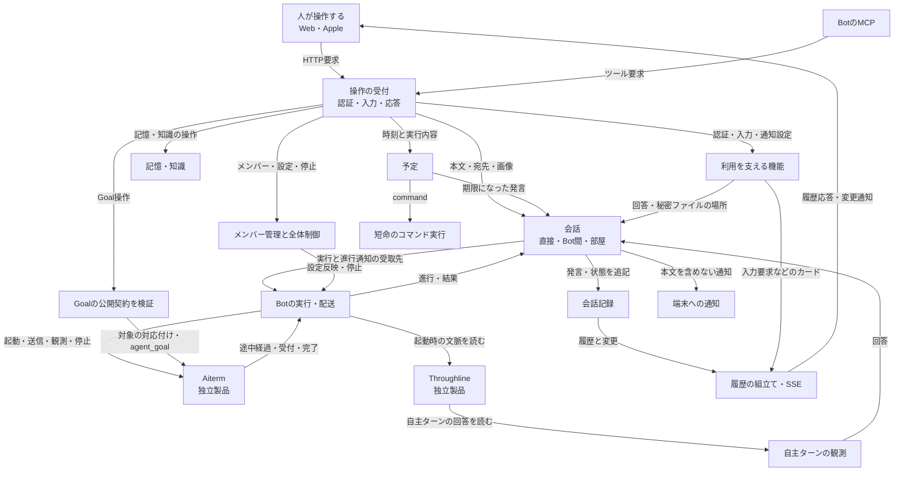

# BellTeamの機能とデータの流れ

対象は `5974fb7e401d995bb1ddd954508179344ce33cf1` を基底とする本体。2026-11-01にコードから起こし、同日の接続整理を反映した現状図である。全体の接続、会話・制御・記憶の主要分岐を確認した。Apple画面内部、各独立製品の内部、installer/backupの全分岐を精査した図ではない。改善予定と実装状況は[接続の整理計画](refactor-plan.md)へ分ける。

## アプリ全体で何が起きるか

人やBotの操作を受け、会話とメンバーを管理し、必要なAIの実行をAitermへ依頼する。途中経過と結果を記録し、その記録から画面を更新する。予定・記憶・設定・認証は、それぞれ別のデータと判断を持つ。

矢印は依頼またはデータの受渡し。保存データの所有者は後の表で定める。箱は機能であり、一つのファイルやプロセスとは限らない。

HTTP200は操作ごとの受付結果である。AIの回答完了、外部の副作用の成功、画面への表示をまとめて意味しない。

## 症状からどこを辿るか

| 症状 | 切り分ける順序 | 詳細 |
| --- | --- | --- |
| 送ったのに返事がない | 発言保存 → Aiterm受付 → 完了追跡 → 回答記録 → 履歴取得/表示 | [会話](conversation-flow.md) |
| 部屋で返事が来ない | 参加者snapshot → 返信者指定/選定 → 個別配送 → reply/silentの権限 | [部屋の会話](conversation-flow.md#部屋の会話) |
| 設定を変えても動作が変わらない | 保存値 → 反映待ち → CLIの受付結果 → 実際の動作観測 | [設定反映](control-and-state.md#設定を保存することと席へ反映すること) |
| 止めたのに処理が残る | 新規受付の抑止 → 停止要求 → native結果 → 配送job/commandの結論 | [停止](control-and-state.md#止める機能と状態の所有) |
| 記憶が見つからない | 最終botId/scope → 保存先 → DB/知識index → 検索 | [記憶](support-and-runtime.md#記憶と知識) |
| 入力要求に答えたが進まない | 入力状態の保存 → 通知結果 → Botの次の処理。秘密値を通常診断へ出さない | [入力支援](support-and-runtime.md#認証秘密入力質問通知) |

## 元データと判断の持ち主

| 機能・状態 | 所有者 | 他の機能へ渡すもの |
| --- | --- | --- |
| メンバー・設定・予定の台帳 | BotRegistry | 読取結果、更新/予定実行の操作窓口 |
| 部屋・参加者・部屋の履歴 | RoomRegistry / RoomMessenger | 部屋のsnapshot、発言、各参加者の配送状態 |
| 直接会話 | BellTeamMessenger | 保存した発言・配送状態・回答。保存直後の通知 |
| 直接会話の読取cacheと索引 | ConversationStore / TimelineIndex | 履歴のprojection、変更通知。writerではない |
| 一回の配送の受付・失敗・停止結論 | DeliveryJob | 受付結果と配送の状態 |
| 席の進行中操作とjob集合 | SeatActivity | 処理中/queue/停止対象の観測 |
| session対応・反映待ち・停止世代 | BotSessionState | transportを通じた操作と観測 |
| 保存設定を実行へ反映する順序 | BotAdministration + transport | pending/accepted/failedなどの反映結果 |
| AI全体の停止意図と受付抑止 | AiControl | enabled/stopping/stopped/unconfirmed |
| native session・実行・Goal | Aiterm | 公開APIのreceipt、観測、操作結果 |
| 会話から作る引継ぎ情報 | Throughline | 起動時の文脈と保存済みターン |
| 長期記憶・知識と検索 | BellTeamMemory | 指定scope内の記憶/検索結果 |
| 秘密入力・質問・認証状態 | 各専用サービス | 公開状態、カード、値を含めない通知 |
| Webの選択・入力・描画中の状態 | Webクライアント | HTTP操作。サーバーの元データを所有しない |

同じ「状態」という名前でも、全体の停止意図、配送の停止結論、nativeの実行状態、画面の表示状態を一つの値へ潰さない。

## 詳細図から実関数へ

- [会話・配送・履歴・画面更新](conversation-flow.md)
- [予定・設定・停止・Goal](control-and-state.md)
- [記憶・認証・入力支援・起動・配布・保全](support-and-runtime.md)
- [現状の接続をどう整理するか](refactor-plan.md)

各詳細図の表に実装と既存試験を対応させる。試験の列は確認対象の案内であり、今回その全試験を実行したという意味ではない。製品の契約は[現在の設計](../current-design.md)と併せて読む。古い説明と現コードの差は実装変更と混ぜず訂正する。
