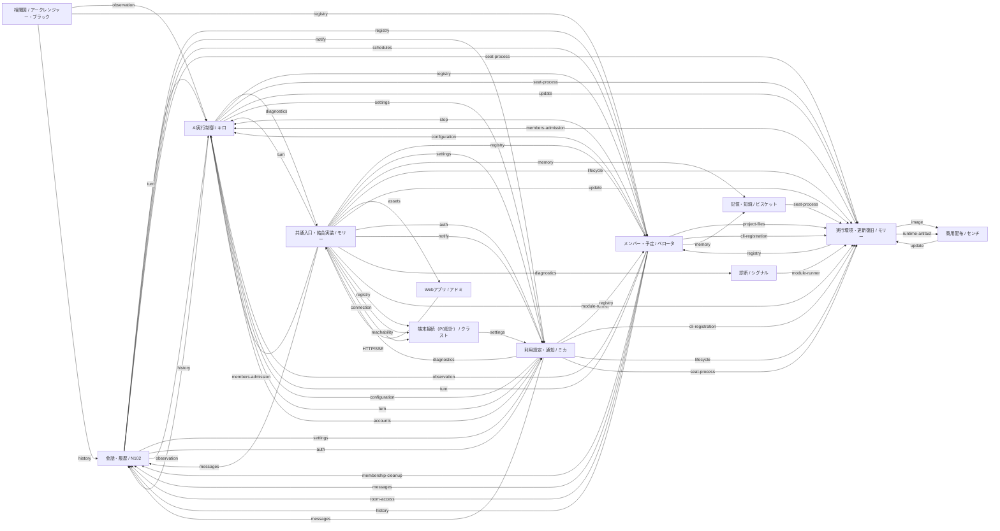
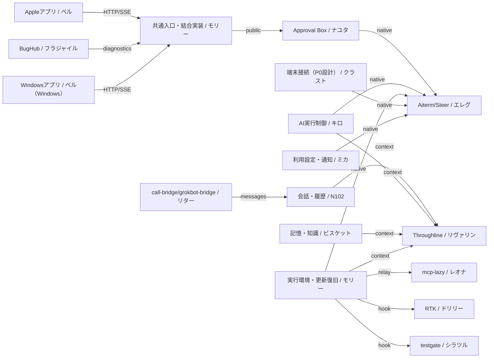

# BellTeamの全体機能図

<!-- Generated by scripts/render-feature-map.mjs. Edit modules/*/module.json instead. -->

各機能の接続情報から生成する。個別の内部図と公開契約は下表の正本を参照。[担当と変更手順](module-ownership.md)。

担当は設定済み。コード・詳細図の単独更新に向けた分離は各担当が実施中で、完了を意味しない。接続線は公開窓口への依存を示し、全てが直接の関数呼出しという意味ではない。

## 本体の接続

## アプリ・独立製品との接続

## 担当図と公開窓口

| 機能の正本 | 担当 | 公開窓口 |
| --- | --- | --- |
| [Aiterm/Steer](modules/aiterm/README.md) | エレグ | native |
| [Appleアプリ](modules/apple/README.md) | ベル |  |
| [Approval Box](modules/approval-box/README.md) | ナユタ | public |
| [call-bridge/grokbot-bridge](modules/bridge/README.md) | リター | public |
| [BugHub](modules/bughub/README.md) | フラジャイル | public |
| [Caveat](modules/caveat/README.md) | ノア | public |
| [会話・履歴](modules/conversation/README.md) | N102 | messages / history / membership-cleanup / room-access / durable-messages |
| [診断](modules/diagnostics/README.md) | シグナル | diagnostics |
| [商用配布](modules/distribution/README.md) | センチ | image / web-gateway-artifact / notifications-artifact / update-catalog / members-artifact / memory-artifact / conversation-artifact / runtime-artifact / work-graph-artifact |
| [AI実行制御](modules/execution/README.md) | キロ | turn / configuration / stop / observation / members-admission / accounts |
| [共通入口・結合実装](modules/integration/README.md) | モリー | HTTP/MCP / HTTP/SSE / diagnostics |
| [mcp-lazy](modules/mcp-lazy/README.md) | レオナ | relay |
| [メンバー・予定](modules/members/README.md) | ベロータ | registry / schedules / instructions |
| [記憶・知識](modules/memory/README.md) | ビスケット | memory |
| [RTK](modules/rtk/README.md) | ドリリー | hook |
| [実行環境・更新復旧](modules/runtime/README.md) | モリー | lifecycle / seat-process / project-files / cli-registration / module-runner / update / module-runner |
| [端末接続（P0設計）](modules/terminals/README.md) | クラスト | registry / reachability / connection / privilege |
| [testgate](modules/testgate/README.md) | シラツル | hook |
| [Throughline](modules/throughline/README.md) | リヴァリン | context |
| [利用設定・通知](modules/usage/README.md) | ミカ | settings / notify / auth |
| [Webアプリ](modules/web/README.md) | アドミ | ui / assets |
| [Windowsアプリ](modules/windows/README.md) | ベル（Windows） | public |
| [相関図](modules/work-graph/README.md) | アークレンジャー・ブラック | work-graph |

変更前に担当図と接続先の図を読み、図の変更要否と作業範囲を確認する。個別図・接続の変更後は `node scripts/render-feature-map.mjs` で再生成する。

[旧全体図（2026-11-01の履歴）](feature-map-legacy-20261101.md)。外部製品内部の図は各製品の正本へ接続する。
