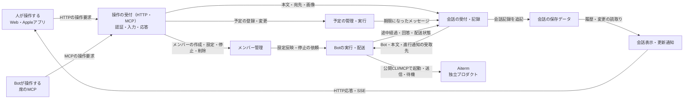
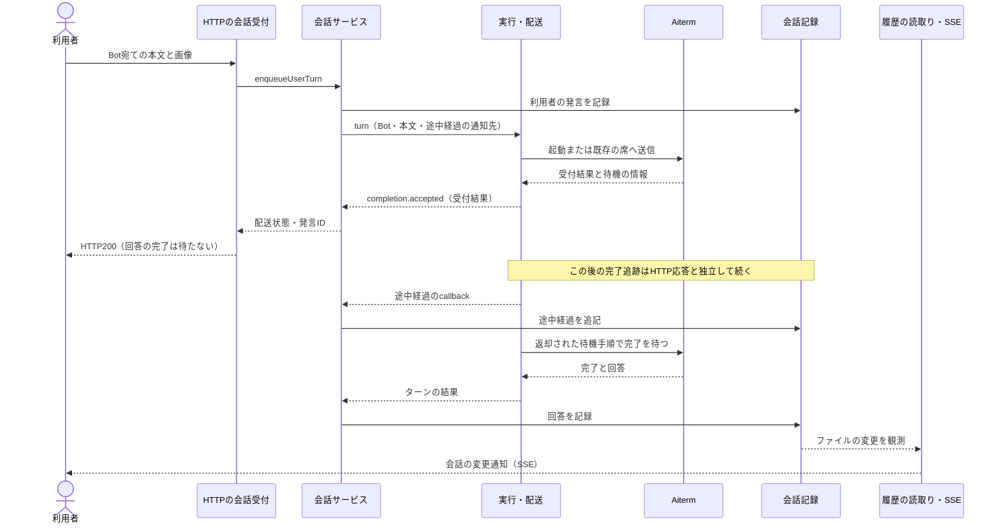

# BellTeamの機能とデータの流れ

現状図の初稿。対象sourceは `5974fb7e401d995bb1ddd954508179344ce33cf1`（2026-11-01）。起動時の組立てと直接会話・予定の入口を実コードで確認した。記憶・設定・認証などの内部と全callerはまだ調査中で、この初稿を完成した全機能図や採用済みの新設計とは扱わない。

## 何をするアプリか

利用者とBotからの操作を受け、メンバー・会話・予定を管理する。AIの起動と会話継続はAitermへ依頼し、返ってきた途中経過と結果を会話画面へ反映する。記憶、設定、通知はその操作を支える別の機能として組み立てられている。

矢印のラベルは、呼出し側が依頼する操作・渡すデータを表す。矢印先が元データを所有するとは限らない。所有者は後の表で分ける。

これは会話・予定・メンバー操作を中心にした全体像であり、認証・記憶・秘密入力・購読・配布・保全の詳細図は後続調査で加える。Web/Appleの画面内部もこの図の調査済み範囲には含めない。

## 人がBotへメッセージを送る時

HTTP200の受付とAIの回答完了は別である。画面による履歴再取得の詳細はクライアント調査で補う。MCPの一部操作は同じサービスを直接呼び、一部は内部HTTPへ接続するため、詳細図で入口ごとに分ける。

失敗・停止・差し込み・結果不明には別の分岐がある。この正常系だけでそれらの扱いを説明したとはしない。詳細図で各分岐の判断者と返却内容を照合する。

## どこが何を持っているか（確認済みの入口）

| 機能 | 現在の実装・入口 | 所有するデータ・判断 | 接続する相手 |
| --- | --- | --- | --- |
| アプリを組み立て、開始・終了する | `supervisor.mjs` → `application-runtime.mjs` → `application-services.mjs` | サービスの寿命と組立て順 | HTTP、MCP、各サービス、任意機能 |
| メンバーと部屋の台帳 | `BotRegistry`、`RoomRegistry` | メンバー設定・部屋・予定の保存と読取り | 会話、予定、管理API |
| メンバー操作の業務判断 | `BotAdministration` | 設定変更・停止・削除の実行順 | 台帳、部屋、実行・配送 |
| 直接会話の受付と記録 | `BellTeamMessenger` | 発言・配送状態・回答の追記 | 台帳、実行・配送、通知 |
| 部屋の会話 | `RoomMessenger` | 部屋の発言・返信者選択・各参加者の配送状態 | 部屋台帳、実行・配送、会話通知 |
| 予定の実行 | `BotScheduler` | 実行時刻・実行中command job・予定実行の進行 | 台帳、会話、Throughline、command実行 |
| Botの実行・配送 | `AitermTransport` | 配送進行、外部実行との対応付け | Aiterm、起動準備、Throughline |
| 席の変更状態 | `BotSessionState` | session対応・設定変更待ち・停止世代・結果不明 | transportから渡す操作窓口 |
| 席の活動 | `SeatActivity` | 配送job・処理中・自主ターン見張り・各Botの進行中操作 | transportと停止処理 |
| 履歴を読んで会話へ並べる | `ConversationStore`、`TimelineIndex`、HTTPのmessage view/event | 保存記録の読取り・索引・変更通知 | 会話の保存ファイル、HTTP/SSE |
| 記憶の保存と検索 | `BellTeamMemory`、`memory-search.mjs` | 記憶の記録・改訂・検索 | Bot台帳、SQLite、Markdown。内部の全経路は次に調査 |

ファイルはすべて `src/` 配下。これは現状の対応表であり、新しい責任分担の決定ではない。

## 整理を検討する接続（未確定）

1. `scheduler.mjs` がThroughlineの関数を `aiterm-transport.mjs` の再export経由で取得している。一方、組立て側は `throughline-context.mjs` から直接取得する。機能の所有者と依存先が読み手に同じ形で見えるようにできるか調べる。
2. 直接会話・通話受信・再開・部屋会話には、配送metadata、途中経過、回答、最終報告を接続する似た処理がある。同じ意味の重複と、動作が違うため分ける処理を、分岐図と既存試験から区別する。
3. transportは `BotSessionState` と `SeatActivity` を持ちつつ、内部Mapを別名のpropertyでも公開する。外部callerがそのMapへ直接触る範囲を列挙し、操作の窓口へ置き換える必要があるか判断する。
4. 同じ会話ファイルについて、組立て側と会話サービス内部に別の `ConversationStore` がある。別の読取りcacheとして必要か、参照と通知を不要に重複させていないか、callerを確認する。現在の重複を直ちに保存不良とは判断しない。

## 次の詳細図

直接会話／Bot間配送／部屋会話／予定／停止と設定反映／履歴と画面更新／記憶・知識／認証・秘密入力・購読／起動・配布・バックアップを順に追う。各図に機能の入口、処理段階、共通関数、データの持ち主、失敗の返却先を付ける。実装の分割は、この現状図と改善する接続の根拠を揃えてから行う。
