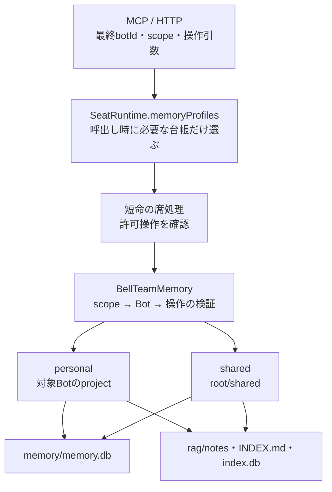
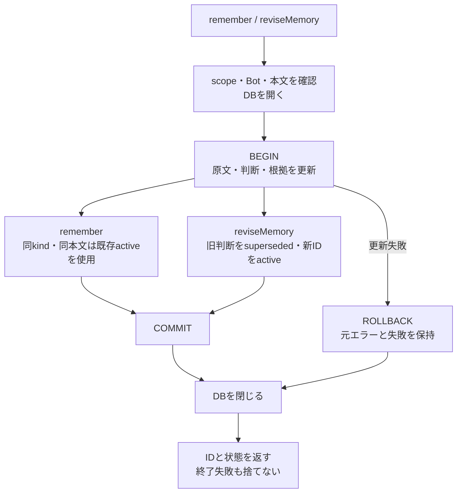
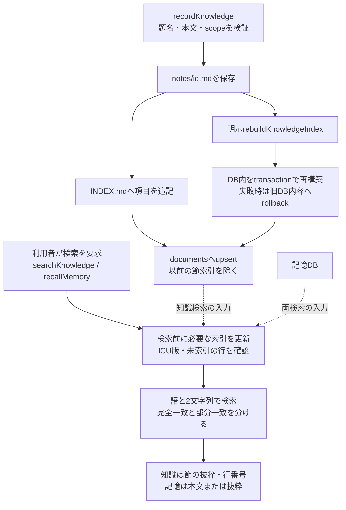

# 記憶・知識の保存と検索

本branchの実装を説明する。調査起点と確認範囲は[全体図](feature-map.md)を参照。[機能図](feature-map.md)から、入力のscopeがどの保存先を選び、どこまで更新された時に結果を返すかを辿る。記憶と知識の責任所有者は既存どおりで、今回DBを移動・変更していない。

## 入力から保存先まで

MCPの`runBellTeamTool`とHTTPの`createBotApi`が入口。席分離構成では`SeatRuntime.memory → call → run-seat-runtime.operate → BellTeamMemory`、分離しない構成では同じBellTeamMemoryへ直接接続する。前者も親でDBやscope検証を複製しない。

| 窓口 | 渡す台帳・検証 | 保存/返却 |
| --- | --- | --- |
| `initialize` | 全Botのid/project | sharedと各personalへ`ensureScope`。通常操作ごとには呼ばない |
| `ensureScope(botId, scope)` | sharedは0件、それ以外は対象1件 | `scopeRoot`を直接使用。独自にnormalizeScopeを追加しない |
| 通常メソッド | sharedは0件、それ以外は最終引数botIdの対象1件。未知Botは空配列 | `normalizeScope → requireBot`と各メソッドの検証順を子で保持 |
| `scopeRoot` | sharedはroot/shared、personalは台帳のproject | APIの文字列をそのままpathへ連結しない |
| `ensureMemory/ensureRag` | 検証済みscopeのdirectory | 記憶directory、知識raw/notes、INDEX初期値とDBschemaを用意 |

通常scopeの省略/nullはpersonal、不正値は拒否する。MCP/HTTPの最終引数の優先、新Botを呼出し時に見つける性質は第一段で保持した。ここをactorやURLのIDで固定する変更は認可の変更になるため、転送量整理とは分ける。

## 記憶：原文・判断・根拠を一緒に保存する

| 操作 | 実関数と内部の処理 | データ所有・失敗境界 |
| --- | --- | --- |
| 保存 | `remember` | raw_eventsを追加。同kind/本文のactiveがあればimportance最大値と時刻を更新し、そのIDへevidenceを追加。なければ新assertion |
| 改訂 | `reviseMemory` | 対象activeの存在とkindを確認。旧行をsuperseded、新行のmetadataにsupersedesId、revision原文と根拠を同transactionへ |
| 固定 | `pinMemory` | active行のmetadata.pinnedだけ更新。新記憶や新原文を作る操作ではない |
| 成長へまとめる | `consolidateGrowth` | まずrememberでgrowthを保存。その後、同じDBの元IDを順にconsolidatedへ。無いIDとpinnedは飛ばす |
| 記憶を探す | `recallMemory` → `searchMemories` | activeだけを返し、本文・kind・importance・metadataを公開。superseded/consolidatedは検索候補から外す |
| DB接続 | `openMemory/closeDatabases` | SQLite WALとschema/索引を準備。初期化・実処理・rollback・closeの失敗を保持しAggregateErrorへ結合 |

`consolidateGrowth`全体は一つのtransactionではない。growth保存後に元記憶の整理で失敗しても、growthが未保存とは言えない。`remember/reviseMemory`のtransaction境界と同じ図へ潰さない。将来ここを変更するなら、重複記憶と原文/根拠の保持を記憶担当と合わせる。

## 知識：本文と検索用の索引を分ける

`recordKnowledge`はMarkdown→INDEX.md→documentsの順で、複数ファイル/DBをまたぐtransactionではない。途中の失敗を全て未保存と呼ばない。`rebuildKnowledgeIndex`はnotesを読んでDBだけを作り直す。MarkdownとINDEX.mdを削除する修復ではない。

| 責務 | 関数 | 処理内容 |
| --- | --- | --- |
| 保存形式 | `knowledgeMarkdown/parseKnowledgeMarkdown/appendIndex` | JSON値のfrontmatterと本文を往復、INDEXは人が辿るリンク。書込順序を所有するのはservice |
| 知識DB | `openKnowledgeDb/upsertKnowledge` | documentsが検索入力。更新時は該当documentsのsections/section_indexを無効化 |
| 索引同期 | `syncMemoryIndex/syncSectionIndex` | ICU版を含むINDEX_VERSIONを確認し、版変更時は索引再生成、通常は未索引の行/文書だけ追加 |
| 原子的な索引変更 | `inOneTransaction/indexIsCurrent/markIndexCurrent` | BEGIN IMMEDIATE→内容と版→COMMIT、rollback失敗も元例外と保持 |
| 語の作成 | `wordTokens/pairTokens/queryTokens` | NFKC/小文字化、ICUの日本語単語と2文字列、短いひらがな語の除外。外部AIやembeddingは呼ばない |
| 検索式 | `splitQuery/matchExpression` | 空query拒否、FTS式をescapeして構成。空白なしの番号/filenameはliteralとして後段判定 |
| 並びと一致 | `searchMemories/searchSections/markNearMatches/capNearMatches` | BM25と補助順、文書内は最良節1件、部分一致は最大5件。literal完全一致があれば部分を落とす |
| 節と結果 | `markdownSections/knowledgeItem/memoryItem/excerpt` | code fence内の見出しを分割に使わず、見出しの道筋・行・抜粋を作る |
| 統合検索 | `searchKnowledgeItems` | 同scopeの知識を先、長期記憶を後に結合してlimit。recallMemoryは記憶のみ |

検索は完全な読取専用ではなく、欠けた索引を同じscope内で作る。HTTP/MCPの呼出元へDB接続を渡さず、検索moduleには既に開いたDBだけを渡す。旧trigram索引は互換の残存物で、現検索が使うのはmemory_index/section_index。この整理で勝手に旧索引を消さない。

実装：[memory-service.mjs](../../src/memory-service.mjs)、[memory-search.mjs](../../src/memory-search.mjs)、[seat-runtime.mjs](../../src/seat-runtime.mjs)。参照する局所試験はmemory-service、memory-search、memory-search-integration、各database-init/write/close/transaction-error、seat-memory、knowledge-rebuild-retention。今回これらを再実行したという意味ではない。
