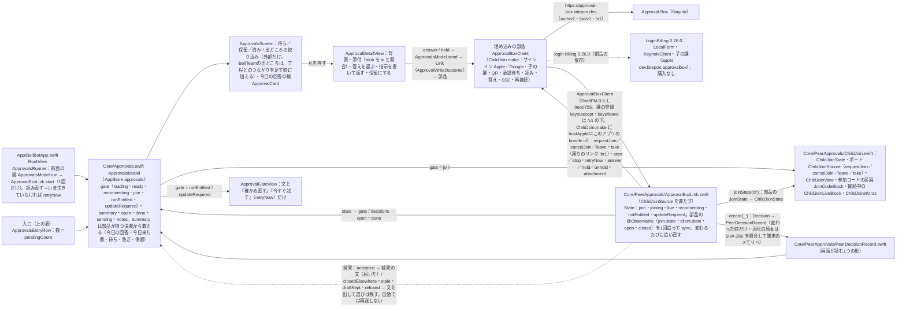

# 決裁箱（Approval Box拡張）の描画

[全体図](overview.md) / [機能索引](function-index.md)。この窓は、オーナーの決裁箱（Approval Box）の**子の端末**として、埋め込みの部品 ApprovalBoxClient 0.8.1 で決裁を読み、答える（abx-child-join-apple。契約は [child-join.md](../approval-box-extension/child-join.md)・部品の面は client-component.md 0.5 の9章）。サインイン・端末の承認・決裁の読み書き・SSE・再接続は部品が持ち、この窓は部品の状態を描くだけ。BellTeam のホストは親にならない（どの席も、ほかの端末のつなぎを始めない）。BellTeam のサーバーは、決裁の中身・子の鍵・パスを見ない（工程表とのつながりの口 [/api/approvals/by-*](../approval-box-extension/contract/approvals-contract.md) は ID と状態だけ）。画面・導線・失敗の表示・文言は [screen-spec](../approval-box-extension/screen-spec.md) が正本で、ここでは Apple 側の部品と状態の持ち主だけを書く。部品は login-billing 0.26.0 のローカルの形（LocalForm・KeyholeClient、appId dev.kitepon.approvalbox）の上で子の鍵を持ち、運営のパスは使わない。IDは通信にだけ使い、画面に出さない。

## 入口と置き場所（Owner 2026-11-16：MacとiPhoneで決裁箱が見つからない）

| 端末 | 入口（案A：左メニューの先頭の固定行） | 画面 |
| --- | --- | --- |
| iPhone | 「会話」タブのメンバー見出しの下、最初の行（`HomeView`の`ApprovalsEntryRow`）。タブは5つのまま | `store.approvalsScreenOpen`で押し込む画面（`navigationDestination`）。詳細はsheet（大） |
| iPad | サイドバーの検索の下に固定（`DesktopWorkspaceView.sidebar`）→ `selectedTab = 6` | 詳細の列（`NavigationStack`）。幅1360pt未満はiPhoneの流れ（一覧＋sheet） |
| Mac | 同じ固定行 → `MainWindow.bringToFront("approvals")`。窓は1つだけ、1360×860 | 窓（`WindowGroup id: "approvals"`）。1360pt以上で3列（一覧500｜詳細520｜工程とのつながり） |
| 工程表の詳細（指揮官の札） | 「決裁」ブロックの「決裁を開く」→ `AppStore.openApprovals(decision:)`（iPhoneは`approvalsScreenOpen`、iPad・Macは`approvalsRequest`を各コンテナが受ける） | その決裁の詳細を選んで開く（`ApprovalsModel.openRequest`） |
| 決裁の「工程表の工程を開く」 | `AppStore.openLatticeCard(project:card:)` → `latticeOpenRequest`＋`latticeOpenCard` | 工程表をその札の詳細で開く（`LatticeHomeView`が`.card`で受ける。iPhoneは相関図タブの工程表側、Macは工程表の窓を前へ） |

## 部品と流れ（子の端末として部品が読み答える）

**何がどこへ移ったか（#2615）**：サインイン（Apple／Google の Web サインイン・Approval Box のパス）、端末の承認（genesis・レジストリ・承認待ちのコードと QR）、`/v1` の読み書きと SSE、peer-channel の端末の核は、すべて部品の中にある。アプリから消えたもの：`ApprovalBoxServer`・`PeerDevice`・`PeerDeviceStore`・`PeerDecisionHistory`・`ApprovalBoxLiveTests`・`ApprovalBoxServerTests`、状態 SignedOut・SigningIn・NeedsApproval・Waiting、`signIn`・`signOut`・`askForApproval`・`cancelApproval`・`cancelSignIn`、`/v1` と端末の経路の切り替え（`GET /v1/auth/config` の `peer_channel`）。`ApprovalBoxLink` の `start`・`retryNow`・`answer`・`hold` は async throws ではなくなった（答えと保留は `ApprovalWriteOutcome` を返し、投げない）。

**データの持ち主**：子の鍵と接続の記録は部品が自分の Keychain（service `dev.kitepon.loginbilling.keyholes.approvalbox`・`dev.kitepon.loginbilling.local.approvalbox`）に持ち、BellTeam のサインインの置き場とは別。アプリ側のコードは鍵・パス・レジストリを持たない。この窓の決裁（`decisions`）と添付の原本（`blobs`）は、部品の `open`・`closed` から作った端末のメモリの写しだけで、ファイルには書かない（履歴のフォルダは無い）。画面が読むのは `PeerDecisionRecord` 1つの形。「アカウントを削除」の1段目 `removePass` は `leave()`（この端末が親のつなぎ一覧から外れる）、2段目 `deleteLocalData` は決裁と添付の写しを捨てる（[account-deletion.md](account-deletion.md)）。BellTeam のサインインは別の形で、どちらにも触れない。

**状態**（child-join.md）：`join`＝つなぎ前（`joinState` が notJoined〔reason removed を含む〕・signingIn・waitingForParent〔QR・期限・参加コード〕・failed〔コードと、ある時は部品の文〕のどれかで、`ChildJoinView` が描く）。つないだ後は `joining`（まだ決裁を受け取っていない。部品は retryNow・引っ張る更新・待ち行列の再開のたびに `joining` へ戻るが、手元に決裁があるあいだ gate は `reconnecting` として最後の一覧を薄く出し続け、スピナーだけにはしない。カードが無い時だけ `loading`＝スピナー）・`live`・`reconnecting`（部品の再接続。待ち間隔は部品が持ち（1秒から2倍で60秒まで、ゆらぎ20%）、回数の上限は無い。「今すぐ試す」は `retryNow` で待っている次の1回を直ちに実行する）・`notEntitled`（「Approval Boxの契約が必要です。契約はApproval Boxのアプリで行います。」価格もボタンも無し、「確かめ直す」）・`updateRequired`（「この版では、決裁箱をまだ使えません。アプリを更新してください。」）。つなぎを外す（`leave`）と `join` に戻り、部品は stop する。BellTeam の host は子としてだけつながる：親の承認は決裁箱の親の端末が行い、この窓には承認の画面が無い（`ChildJoinView` の QR を親が読むか、参加コードを親へ貼る）。Approval Box が完成したとナユタが言うまで公開しない。

**参加コード（login-billing 1.60、同じ電話が親の時）**：`waitingForParent` の QR の下に、ラベル「参加コード」・コードの文字（3行で省略）・「コードをコピー」（コピーは10分で消える）を出す。コードはサインインの証を含むので、打たせず、画面とクリップボードだけに置く。iPhone・iPad は先頭に「決裁箱で開く」（コードのリンクを開く）と電話向けの文、貼り付け欄「決裁箱でコピーしたリンクを、ここに貼り付けてください」＋「このリンクでつなぐ」を出し、QR の案内文は出さない（Android #2714 と同じ文）。Mac は QR の案内文を残し、開くボタンも貼り付け欄も無い。部品がコードを返さない時は、今まで通り QR の案内文だけ。戻りのリンク（lbr1）は、貼り付けたものも、このアプリで開いたものも `take` へ渡す（[login-billing.md](login-billing.md)「開いたリンク」）。貼ったリンクを受けない時は「このリンクではつなげませんでした。決裁箱でリンクをコピーし直して、貼り付けてください。」を出し、待ちは続く。`failed` は `other_account` が自分の文、部品の文（`local_network_denied`・`not_answering`・`unreachable_same_wifi`）があればそのまま、ほかは「つなげませんでした。もう一度つないでください。」。決裁箱の「開く」ボタンは戻りのリンクで BellTeam を開く（部品へ `hostAppId` を渡し、参加コードの戻り先をこのアプリにする。QR とコードの宛先は決裁箱のまま）。コピーと貼り付けでも戻せる。つながったかどうかは部品が返事の結果（login-billing 1.63 の `joined`＝親がこの端末を足したか）だけで決める。アプリはエラーコードから読み替えない（親の購入の証明が断られても、足されていればつながる）。

**区画「決裁箱につなぐ」（`SeatLinkSection`）は廃止する（Owner 2026-11-27、Delta の図の改め）**：つながった後の画面に、同じ名前の2つ目の欄を置かない。本体は席の接続も QR も持たない（Owner 2026-11-28、Tronie 経由：決裁箱は単体のまま、各ホストの決裁箱が自分でつながる。approval-box-extension/decision-port.md）。本体の `/api/approvals/seat-link` 系は外した。アプリは呼ばない。アプリのコード（`SeatLinkSection.swift`・`SeatLink.swift`・その試験・配線）は削除済み（Rapi、次の版から出る）。版 204 までは残るが、その区画は出ない。

出どころ（BellTeam／外部／不明）は、決裁の `source.requester_bot_id`・`requester` を、アプリが持つメンバー表（`store.bots`）の id・名前と突き合わせて端末で決める（`ApprovalOrigin.classify`、fixtures は origin-cases.json の7例）。答えが stale（409）の時は、いまの決裁に置き換えて「内容が直されました。もう一度確かめてください。」を1行出し、書いた文字は残す。`/api/approvals` の一覧・答え・保留・イベントの口は呼ばない（by-decision・by-task だけ使う）。済みの一覧の長さは部品が決める。

工程表とのつながり（a490h2r、`Core/PeerApprovals/ApprovalLinks.swift` の `ApprovalLinkResolver`）：決裁の中身は端末だけにあり、BellTeam のサーバーに聞くのは ID と状態だけ。`GET /api/approvals/by-decision?id=` が {project, plan, task, state} を返せば BellTeam の決裁（出どころ bellteam、つながりあり）、404 なら外部または未接続（破線の「つながっていません」）、それ以外の失敗は何も足さない。工程の名前と前後は、アプリが読める工程表（`/api/lattice/charts/:project`、20秒の写し）の札とエッジから描く。見つかったつながりは30秒ごとに読み直し、404は30秒後にもう一度聞く（サーバーのつなぎ込みは自分の間隔で動く）。つながりの状態は3つに分ける：まだ聞いていない（BellTeamの出どころは「工程表につなげています」。外部は「工程表とはつながっていません」）、聞いて404（BellTeamの出どころは「この決裁に合う工程は、工程表に見つかっていません」、淡い色。30秒ごとの聞き直しで見つかれば線になる）、つながり（「工程表「…」が、この回答を待っています」）。聞けなかった（404以外の失敗）時は状態を変えない（`ApprovalsModel.links`に入っているか、が「聞いた」の印で、`ApprovalDecision.linkMissing`として画面へ渡る）。工程表の詳細の「決裁を開く」は `by-task`（ID と状態だけ。件名が無い時は「決裁（待ち）」）から同じ決裁の詳細を開く。

答えたあとの文（`ApprovalText.answerBanner`）は、答えの応答で受け取った決裁の`delivery`（`/v1`の応答の値をそのまま`PeerDecisionRecord.delivery`に持つ。端末の経路はコネクタのackで`delivered`）から、画面を描く時に毎回作る（答えた時の決裁から作って保存しない）。`delivered`・`fetched`＝「答えました。◯◯に届きました。」（緑）、`waiting`＝「◯◯が会話に戻ると受け取ります。」（紫、SSEの`delivery`更新で`delivered`に変わる）、`unknown`だけ「確かめられませんでした…再開の文を貼ってください」（橙。再開の文は応答の`resume_phrase`）、まだ値が無い（無い・`pending`）時は「答えました。◯◯への届きを確かめています。」（灰色。`delivered`に変わると置き換わる）。契約は [screen-spec](../approval-box-extension/screen-spec.md) の Answer outcomes（Delta PR #2480）。届いた答えに貼る文を頼まない。

プッシュ通知は無い（Nayuta 2026-11-23）：決裁箱の画面は、開いている間に部品が受ける決裁を描く。Approval Box のサーバーは BellTeam アプリの通知トークンを登録も起こしもしない（送り先の topic が Approval Box のアプリ1つに固定のため）ので、通知拡張（NSE）も共有 Keychain グループも作らない。通知は Approval Box 自身のアプリが出す。

この版に入れていないもの：実機 iPhone での確認（TestFlight のビルドと Owner の Apple ID が要る）。
