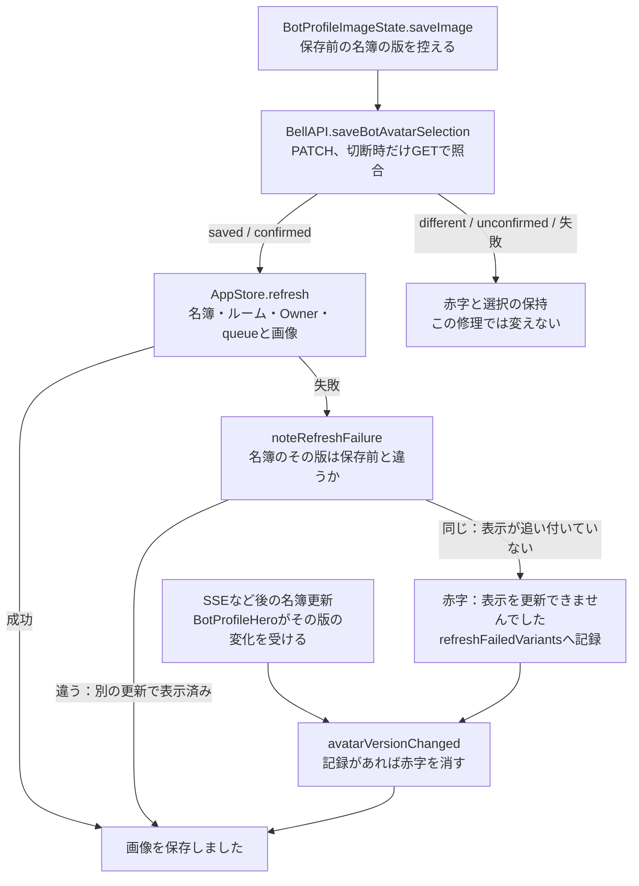

# メンバー画像の保存と表示の更新

[担当の正本](README.md)。Apple全体の図ではなく、修理の範囲だけを示す。

対応版：base `4f850855` に対する修理。配布済みの1.0.4 (98)以前は、再取得の失敗の赤字が残る。

## 流れ

## 責任と受渡し

| 段階 | 所有者と場所 | 契約 |
| --- | --- | --- |
| 版の控え | `BotProfileImageState.saveImage`・`confirmImageSave`（`Views/BotProfileComponents.swift`） | 保存前の`store.bots`のvariant別の版（小は`avatarVersion`、大は`avatarLargeVersion`）を控える |
| 保存結果 | `BellAPI.saveBotAvatarSelection`・`confirmBotAvatarSelection` | saved / confirmed / different / unconfirmed の判定、PATCH回数、照合GET、診断は変えない |
| 再取得の失敗 | `noteRefreshFailure` | 名簿の版が保存前と違えば成功の文言。同じなら赤字を出し、そのvariantを記録する |
| 後の更新 | `BotProfileHero`の`onChange(of: avatarVersion / avatarLargeVersion)` → `avatarVersionChanged` | 記録したvariantだけ赤字を消して成功の文言にする。記録の無いvariantや別の赤字は消さない |
| 記録の消去 | 保存の開始、確認の開始、選択の破棄 | 次の操作で古い記録が別の赤字を消さないようにする |

`confirmImageSave`の再取得の失敗は、これまで「保存結果を確認できませんでした」と出ていた。修理後は保存と同じ扱いにする。認証の失敗は従来どおり外側のcatchへ渡す。

## 確認済みと未確認

確認済み（ソースと直接試験）：再取得の失敗時に名簿が既に新しい版なら赤字にしない。古い版なら赤字を出し、後でその版が変われば消える。別variantの版の変化では消えない。

未確認：Mac・iPhone・iPadの実画面での表示。`MEMBERS_NOT_ACCEPTED`の原因（本体側の別件）。同じ画像を保存し直して版が変わらない時は、赤字が次の保存まで残る。
