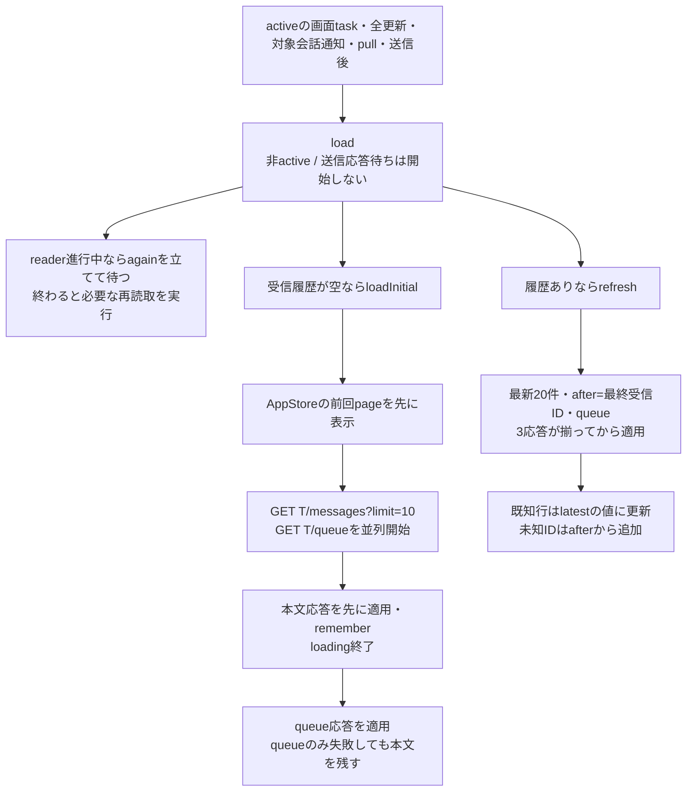
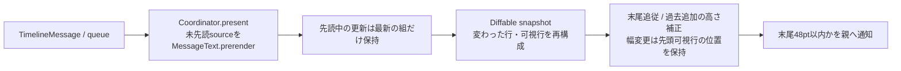
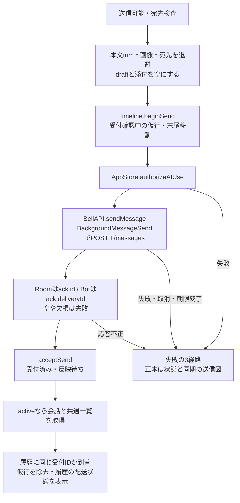

# 会話・入力・履歴表示

[全体図](overview.md) / [共通状態と同期](state-and-sync.md) / [質問と認証](requests-and-auth.md) / [goal](goals.md) / [試験](tests.md)。

調査source：HEAD `afda9477bba4aaa7c8a6905100d3bacf26e47c90`（detached）。実コードの静的読取。以下のパスは`ios/BellBot/BellBot/`から。`T`は`/api/bots/:id`または`/api/rooms/:id`。本体内部と実行結果は扱わない。

## 状態と呼出し元

| 所有者 | 入力・保持・返却先 |
| --- | --- |
| `ConversationView` | HomeViewのnavigationDestination、DesktopWorkspaceView、DebugのRootViewからChatTargetを受け、`ConversationContent(target:).id(target)`を生成 |
| `ConversationContent` | timeline、queue、読取task、hasMore、送信待ち、停止結果、添付の表示用配列、選択宛先、エラー、sheet/gallery、書出し、末尾/新着を所有。名簿・routing設定・API・draftはAppStoreから取得 |
| `AppStore.draft(for:)` → `ConversationDraft` | 宛先別の同じ参照を返す。本文、添付、宛先集合をメモリ保持。画面復帰時に添付と宛先を画面へ複製。添付代入と宛先変更は辞書内draftへ返す |
| `ConversationTimelineState` | 受信履歴とローカル送信を別に保持。可視行は受信履歴＋未照合送信。受付IDが履歴に現れるとローカル送信を除去。本文の一致では照合しない |
| `ConversationList.Coordinator` | 行ID、前回本文/queue、実高、既に表示した行、Markdown先読済みsource、読書位置、過去取得要求の状態。表から親へ更新・過去取得・末尾状態をcallback |
| `ConversationCardStates` | message ID別の質問/秘密カード状態を保持。UITableViewの行が画面外になっても保持。会話画面終了後まで保存する処理はない |

主な根拠：[ConversationContent](../../../../ios/BellBot/BellBot/Views/ConversationView.swift#L49)、[draft](../../../../ios/BellBot/BellBot/Core/ConversationDraft.swift#L6)、[timeline](../../../../ios/BellBot/BellBot/Core/ConversationTimelineState.swift#L4)、[表](../../../../ios/BellBot/BellBot/Views/ConversationList.swift#L17)。共通一覧・SSEからの通知の生成は[状態と同期](state-and-sync.md#sseの適用)を参照。

入力部品は`Views/ConversationInput.swift`（`ConversationInput:5`、privateな`MessageInput:69`とそのcoordinator、internalの`MessageTextView:135`）に置く。添付値`PendingImage`は`Core/ConversationDraft.swift:51`にあり、二つのinitializerは同`:56,63`。画像は`Views/ConversationImages.swift`の`ConversationGallery:5`、`MessageImages:11`、`MessageImageGallery:59`、privateな`AuthenticatedImage:146`・`conversationImageOrigin:186`・`ConversationImageCache:198`に置く。`ConversationContent`、reader、カード状態、sheet、履歴page、`MessageRow`、`PeerMessageSheet`と送信失敗の観測型は`ConversationView.swift`に残す。

## 初回・更新・過去の取得

[load以降](../../../../ios/BellBot/BellBot/Views/ConversationView.swift#L557)を確認した。初回のrememberは取得開始時の`conversationGeneration`が同じ時だけ書く。logout/接続先変更後の初回応答は成功・失敗とも捨てる。更新で受信履歴末尾が無い経路は最新20件とqueueを適用し、hasMoreと末尾移動を更新する。通常の差分更新はhasMoreや保存pageを更新しない。

| 取得 | 成功・失敗・取消 |
| --- | --- |
| 初回 | 本文が取れればerror/初回失敗を消す。queue失敗はerrorと診断を出し本文保持。本文失敗は初回失敗を立て、空画面なら再読込ボタン。前回pageがあれば残す |
| 更新 | 新着件数を返し、過去閲覧中なら新着ボタンを表示。3取得の途中失敗では併合せず前回値とerrorを表示 |
| 過去 | active・hasMore・初回/過去取得中でない・先頭IDありの時に`GET T/messages?limit=25&before=:oldest`。ID重複を除いて先頭へ追加しhasMore更新。失敗は既存行保持・error/診断。deferでloadingOlder解除 |
| 認証失敗 | 各取得からAppStore.requireLoginへ返す |
| 非active・画面終了 | reader/olderTaskをcancel、reader参照とagainを消し世代を増加。非activeではloading/loadingOlderも解除。reader世代は古いtaskによるreader参照の消去を防ぐ。取消は表示・診断しない |
| loadの戻り値 | skippedSceneInactive / skippedAwaitingSend / joinedReaderReturned / startedReaderReturned。HTTP成功を示す値ではない |

過去取得は表を上へ操作し、先頭可視行が25行以内になった時に要求する。下向き操作で次の要求を許可する。Macは表示域を埋めるまで追加要求も行う。失敗だけでは自動で同じfill要求を繰り返さない。

## 本文と表への反映

[MessageText](../../../../ios/BellBot/BellBot/Views/MessageText.swift#L4)はEnrichedMarkdownを使用し、改行保持、末尾余白除去、選択・通常コピー/Markdownコピー、openURL、チェック項目の変更無効を設定する。[SelectableText](../../../../ios/BellBot/BellBot/Views/SelectableText.swift#L4)はプロフィール・要求本文等の編集不可UITextView。同一本文では再代入せず選択範囲を保持し、本文/幅/displayScaleに応じて寸法をcacheする。

表は初回配置後にrise/fadeで1回表示し、後から入る行にも同じ方式を適用する。行再利用時はalpha/transform/animationを戻す。末尾追従はcontentSize・inset・layoutで更新し、過去閲覧中は上へ追加した高さ分をoffsetへ足す。Macの離散ホイールはWheelScrollSmoother、連続スクロールは標準処理。pull完了時にrefreshControlを終了する。表への反映とHTTPの取得完了は別段階である。

## 下書き・添付・宛先

| 入口 | 受渡しと途中失敗・後始末 |
| --- | --- |
| 文字入力 | UIKitが文字ごとの編集を所有し`setTextFromInput`へ。空/非空、空白以外あり/なしの変化だけrevisionを発行。外部clear/送信失敗復元は同じ文字列でなければrevisionを発行しUIKitへ戻す。入力高さは1〜5行 |
| 写真 | iPhone/iPadはPhotosPicker。各itemを順にDataへ読みJPEG化し、成功分をその都度添付。途中失敗は先の成功分を残しerror。deferでselectedPhotosを空にする |
| ファイル | MacのfileImporterはimage・複数選択。全URLをmapで読み終えてから一括追加。途中失敗ならこの一括分を追加しない。取消を含む失敗は画像読込エラー表示 |
| ドロップ | 全platformでURLを受け同じ一括読取。空URL配列はfalse、読取失敗もfalseとerror |
| 貼付け | MessageTextViewはfile URLを画像より先に読む。ファイルは一括、画像itemsは復号できたものを追加し、全て失敗ならcallbackでerror。どちらも無ければ標準の文字貼付け。pasteboard状態はchangeCountでcache |
| PendingImage | file URLだけ受理。security scopeは読取後deferで解放。UIImageへ復号後、品質0.85のJPEG Dataとpreviewを保持。一般ファイルをメッセージへ送る経路はない |
| 添付除去 | previewの×でID指定削除。画面とdraftの配列へ反映 |
| ルーム宛先 | selectedTargetsをdraftへ保持。memberIdsから複数toggle。空ならroutingEnabled時にtargets=nilで自動選択。routing無効かつ空なら送信前にerror。1人表示はBot.name、複数は人数 |
| キーボード | Mac/iPad外付けはReturn送信、Shift/Option+Return改行。iPhoneは標準keyCommands |

## 送信・受付・配送

失敗の経路は[状態と同期の送信図](state-and-sync.md#送信停止取消途中失敗)を正本とし、ここでは複製しない。要点は3つに分かれる。`authorizeAIUse`の認証失敗は入力を戻して`requireLogin`し、loadしない（[send](../../../../ios/BellBot/BellBot/Views/ConversationView.swift#L764)）。その他の事前失敗は入力を戻し、結果不明かどうかを問わずactiveならloadしてエラーを表示する（同772行）。POSTとackの失敗だけが`SendFailureReconcileObservation`を通り、activeかつ結果不明の時にloadする（同792行）。

本文は元の送信文＋送信中の新しい入力、画像は元の画像＋新しい画像の順に復元する。宛先は送信前に消さない。`SendFailureReconcileObservation`はload呼出しと実HTTP成功を区別して記録する。自動POST再送はない。

[BackgroundMessageSend](../../../../ios/BellBot/BellBot/Core/BackgroundMessageSend.swift#L5)はOSの実行時間が取れなければoperation taskをcancelしbackgroundSendUnavailable。期限通知ではexpiredを立ててcancelし即時finish、エラーをbackgroundSendExpiredにする。caller取消も子taskへ伝える。通常終了・失敗のdeferもfinishを通り、identifierをinvalidにして二重終了を避ける。

表示するstatusはoutgoingだけ：submitting=受付確認中、accepted=受付済み・反映待ち、queued=送信待ち、running=処理中、stopped=中断、delivered=配達済み、failed=配達失敗（赤）。これらの履歴値からAIの依頼全体の完了は判定しない。status集約はrouting.failedを最優先、直接deliveryがあればその値、複数deliveriesはfailed→running→queued→stoppedの順、それ以外の非空集合はdeliveredとなる。queueは`QueueItem.displayItems`の表示用整理を通し（差し込まれた配送`steered:true`は実行中ターンの「処理中」1行にまとめる）、ルームのrouting pending/failed/readyは返信者判定文言へ変換する。

## 画像・gallery・cache

| 部品 | 処理と返却先 |
| --- | --- |
| MessageRow / MessageImages | displayedImageURLs（複数形式優先、旧imageUrlも利用）を受ける。1枚は本文の吹き出し内、複数は先頭3枚を重ね全枚数を表示。URL無しでimage=trueなら枚数label。peer行は連絡sheetへ |
| MessageImageGallery | 会話の根またはpeer sheetからfullScreenCover。paths全件、選択index、原寸表示・192px thumbnail、前後循環ボタン/矢印キー・page swipe・閉じる操作を所有 |
| AuthenticatedImage | originとpathをtask IDにしてcacheから取得。待機/画像/失敗labelを表示。catchでfailedと診断。認証失敗・取消もこのcatchを通り、この部品からrequireLoginは呼ばない |
| ConversationImageCache actor | origin＋pathでDataと進行中Taskを共有し、origin＋path＋maxPixelSizeでUIImageをcache。各NSCacheは64MiB。Data取得成功後cacheへ、失敗は進行中辞書を消してthrow。ImageIOの復号はdetached task。表示側の取消から共有取得taskをcancelする処理はない |
| 表示寸法 | 単独画像/gallery本文はnil（元画像最大辺）、重ね表示は1024、thumbnailは192。復号画像のcostはbytesPerRow×height |

メンバープロフィールの大画像とvariant編集は[設定・プロフィール](settings-and-profile.md#メンバー画像の共通部品)を参照。会話の画像cacheとは別の状態である。

## 個別停止・再起動・端末画面・書出し

| 操作 | 受付・完了・失敗・後始末 |
| --- | --- |
| 個別停止 | Bot会話は対象queueにrunning/queuedがある時。ルームは参加者だけ、表示queueの同じBotの最初の該当行だけにボタン。stoppingBotIDがある間は次の停止を抑止。`POST /api/bots/:id/stop`の202/stop_sentは送付済み、200/interruptedかつsessionPreserved=trueは確認済み。Bot IDも照合する |
| 停止後 | 成功は通知文言を分け、load→共通一覧refresh。認証失敗はrequireLogin。他失敗は取消/結果不明なら未確認、その他は失敗文言、診断後load。deferで停止中を解除。再POSTなし |
| 再起動 | [ConversationDetailView.swiftの詳細](../../../../ios/BellBot/BellBot/Views/ConversationDetailView.swift#L43)とDesktopInspector.profileのonRestartが[AppStore.restartConversation(target:)](../../../../ios/BellBot/BellBot/Core/AppStore.swift#L401)を呼ぶ。共通操作はauthorizeAIUse→`POST T/restart`→APIAcknowledgement受領だけ。空要求の[EmptyBody](../../../../ios/BellBot/BellBot/Core/Models.swift#L533)はCore/Models.swiftに置く。ack後、詳細はdismiss、inspectorはerrorを消す。refresh・再送・稼働完了を待つ照会はない。詳細catchはlocalizedDescription、inspectorはoperationFailureMessageと`T/restart`・POST・`.write`の診断。Errorは共通操作で変換しない |
| 端末画面 | 詳細sheetまたはinspector内の[BotScreenView（Views/BotScreenView.swift）](../../../../ios/BellBot/BellBot/Views/BotScreenView.swift#L47)。bot ID/activeをtask IDにし、Bot切替時にscreen/online/errorを消す。activeで`GET /api/bots/:id/screen?history=1`を、前の取得の開始から1秒ごとに1本ずつ（重ねない。応答が1秒を超えたら待たずに次へ）、変更した値だけ反映。取消・URLError.cancelledは終了、認証失敗はrequireLogin、それ以外は画面を残しerror/診断を表示してloop終了 |
| 端末本文 | [BotTerminalTextView（Views/BotScreenView.swift）](../../../../ios/BellBot/BellBot/Views/BotScreenView.swift#L32)は選択可・編集不可。末尾28pt以内なら置換後末尾追従、過去閲覧中なら旧offsetを上限内で保持。同じ文字列は置換しない |
| 書出し | exportingでボタンを無効化、`GET T/export`のDataをConversationDocumentへ渡しJSON fileExporterを表示。取得失敗はerror/診断、deferでexporting解除。保存失敗もerrorへ。FileDocumentはregularFileContentsだけ読取り、DataをFileWrapperに包む。書出し後に文書状態を消す処理はない |

## 整理候補

- **A-C1**：`ios/BellBot/BellBot/Views/ConversationView.swift:71,75,236,237,240`。添付はdraftとvisibleAttachments、宛先はdraftとselectedTargetsで保持し、表示開始と変更時に相互受渡ししている。
- **A-C2**：`ios/BellBot/BellBot/Views/ConversationView.swift:301,305`。書出しは`T/export`をGETするが、失敗診断には`T/messages`を渡している。
- **A-C3**：`ios/BellBot/BellBot/Views/ConversationView.swift:649,680,699`。AppStoreの会話page保存は初回取得の経路にあり、通常更新・過去取得は画面のtimelineを更新する。

## 未調査

- 本体の履歴保存・routing・配送・停止/再起動・export生成の内部。HTTPの応答後に実際に完了した時点。
- 実端末の背景期限、競合、画像メモリ、貼付け・drop・選択・スクロール・書出しの実動作。ビルドと試験は未実行。
- Mermaid描画結果。ラベルと参照先を静的確認した。
