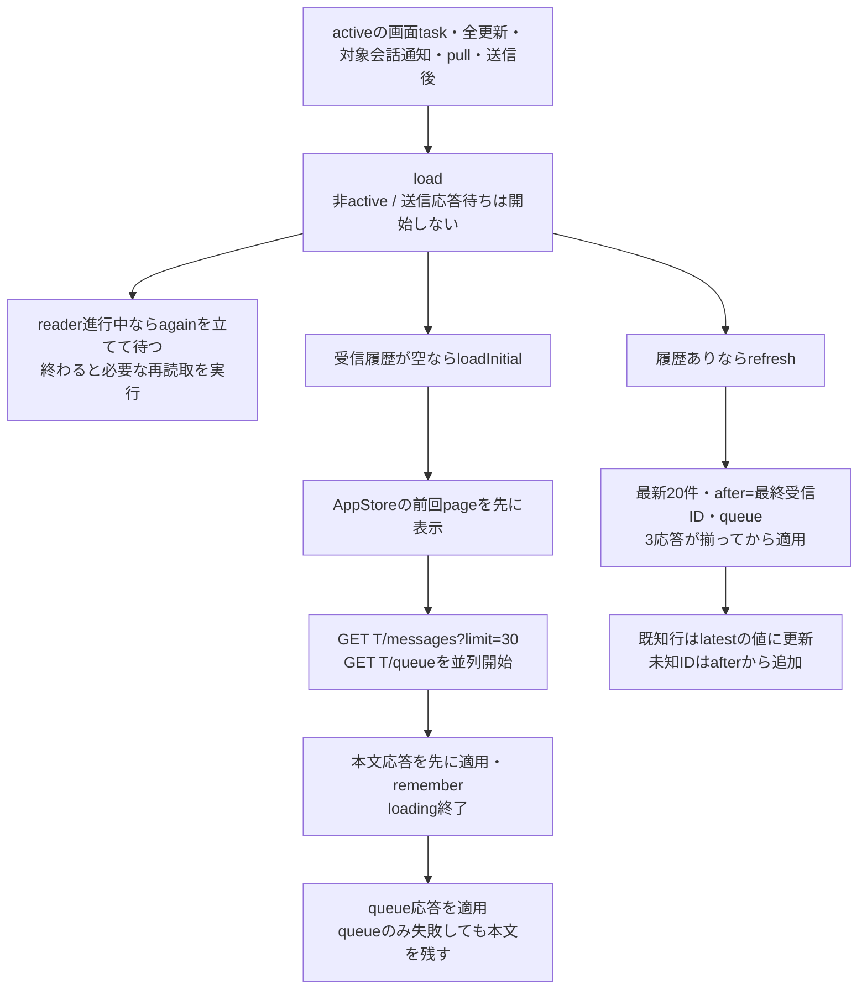
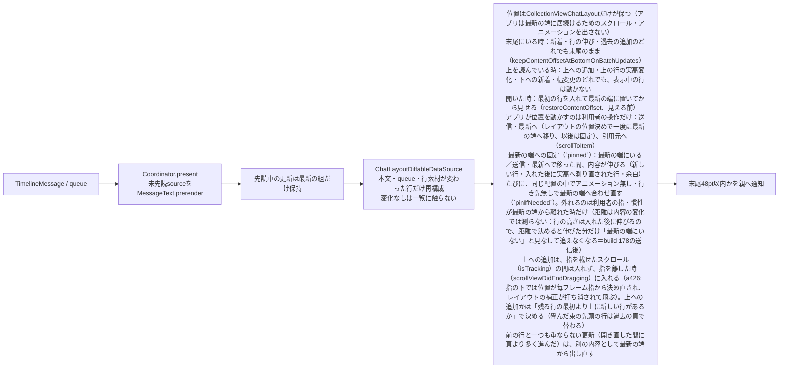
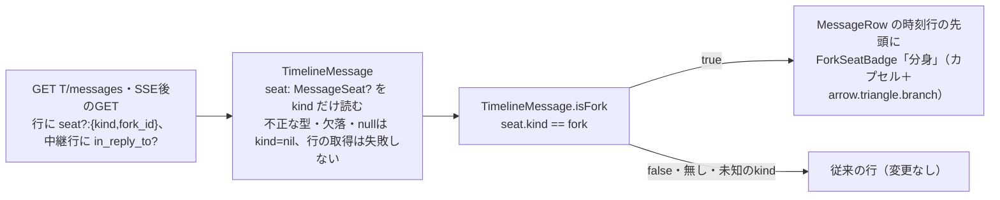
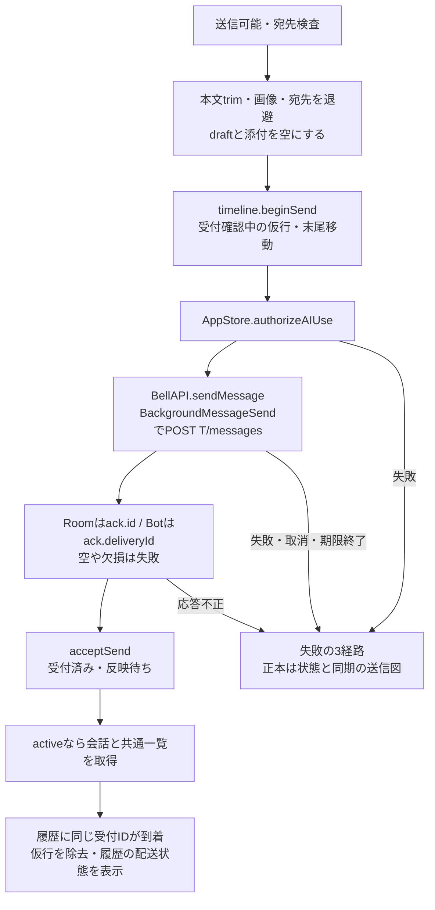
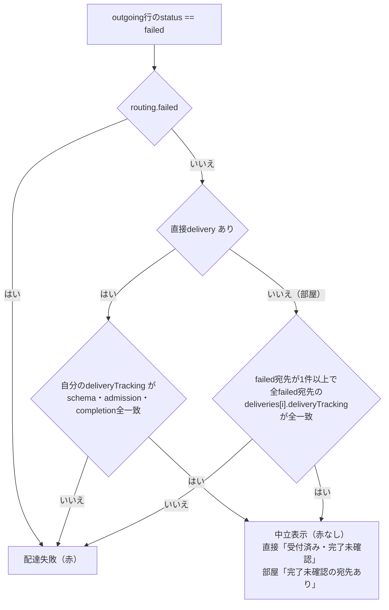
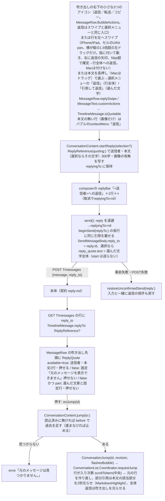
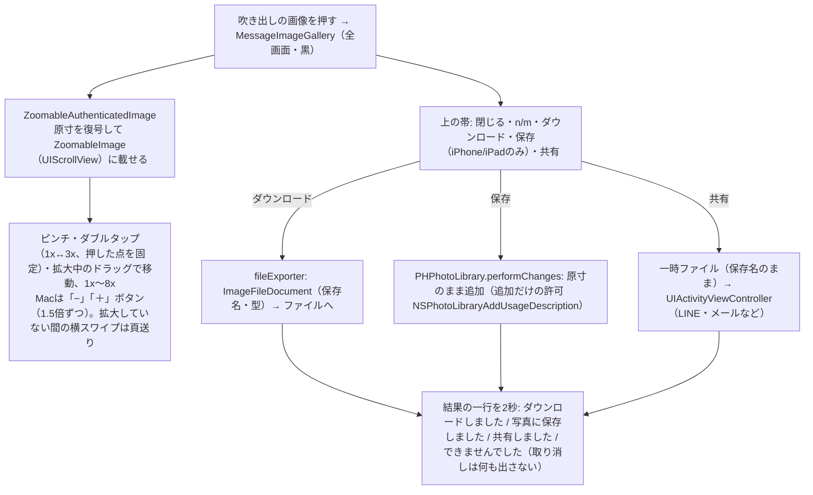
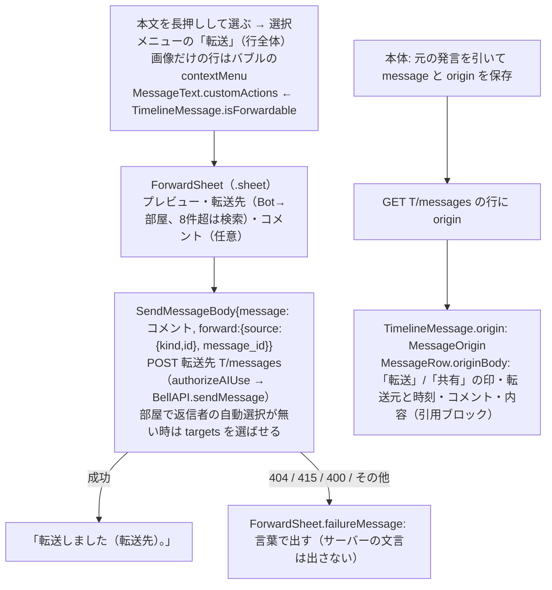
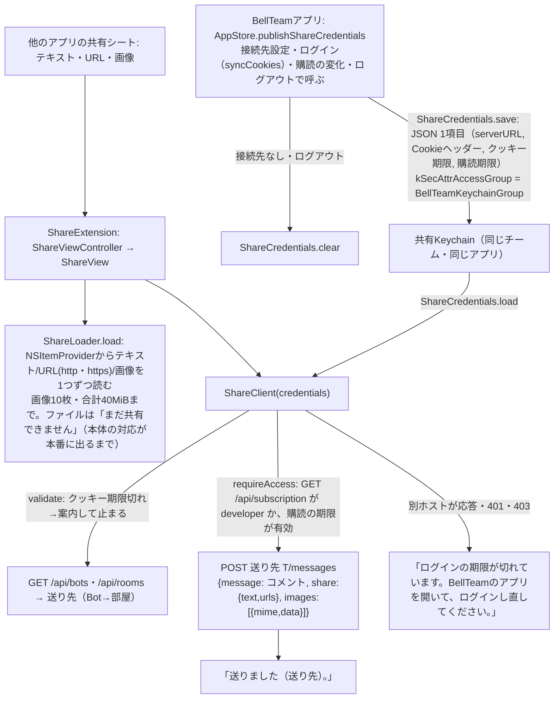

# 会話・入力・履歴表示

[全体図](overview.md) / [共通状態と同期](state-and-sync.md) / [質問と認証](requests-and-auth.md) / [goal](goals.md) / [試験](tests.md)。

調査source：HEAD `afda9477bba4aaa7c8a6905100d3bacf26e47c90`（detached）。実コードの静的読取。以下のパスは`ios/BellBot/BellBot/`から。`T`は`/api/bots/:id`または`/api/rooms/:id`。本体内部と実行結果は扱わない。

## 状態と呼出し元

| 所有者 | 入力・保持・返却先 |
| --- | --- |
| `ConversationView` | HomeViewのnavigationDestination、DesktopWorkspaceView、DebugのRootViewからChatTargetを受け、`ConversationContent(target:).id(target)`を生成 |
| `ConversationContent` | timeline、queue、読取task、hasMore、送信待ち、停止結果、添付の表示用配列、選択宛先、エラー、sheet/gallery、書出し、末尾/新着を所有。名簿・routing設定・API・draftはAppStoreから取得 |
| ヘッダー（`ConversationContent`のtoolbar principal） | 名前・fastバッジ・副題。副題はRoomなら「N人のルーム」、Botなら「オンライン/オフライン」。Botの`seatLaunch.line`があれば、ナビゲーションバーの直下（上端のsafeAreaInset）に赤い1行（「端末で起動できません：…」、最大3行で折り返す。バーの幅では理由が切れるため）を足す。出どころと規則は[一覧とメンバー](members-and-rooms.md)の「起動できない理由」 |
| `AppStore.draft(for:)` → `ConversationDraft` | 宛先別の同じ参照を返す。本文、添付、宛先集合をメモリ保持。画面復帰時に添付と宛先を画面へ複製。添付代入と宛先変更は辞書内draftへ返す |
| `ConversationTimelineState` | 受信履歴とローカル送信を別に保持。可視行は受信履歴＋未照合送信。受付IDが履歴に現れるとローカル送信を除去。本文の一致では照合しない |
| `ConversationList.Coordinator` | 行ID、前回本文/queue/行素材（Botの名前・色・画像版）、既に表示した行、Markdown先読済みsource、末尾にいるか、過去取得要求の状態。一覧から親へ更新・過去取得・末尾状態をcallback。読んでいる位置は持たない（ChatLayoutの役目） |
| `ConversationCardStates` | message ID別の質問/秘密カード状態を保持。一覧の行が画面外になっても保持。会話画面終了後まで保存する処理はない |

主な根拠：[ConversationContent](../../../../ios/BellBot/BellBot/Views/ConversationView.swift#L49)、[draft](../../../../ios/BellBot/BellBot/Core/ConversationDraft.swift#L6)、[timeline](../../../../ios/BellBot/BellBot/Core/ConversationTimelineState.swift#L4)、[表](../../../../ios/BellBot/BellBot/Views/ConversationList.swift#L17)。共通一覧・SSEからの通知の生成は[状態と同期](state-and-sync.md#sseの適用)を参照。

入力部品は`Views/ConversationInput.swift`（`ConversationInput:5`、privateな`MessageInput:69`とそのcoordinator、internalの`MessageTextView:135`）に置く。添付値`PendingImage`は`Core/ConversationDraft.swift:51`にあり、二つのinitializerは同`:56,63`。画像は`Views/ConversationImages.swift`の`ConversationGallery:5`、`MessageImages:11`、`MessageImageGallery:59`、privateな`AuthenticatedImage:146`・`conversationImageOrigin:186`・`ConversationImageCache:198`に置く。`ConversationContent`、reader、カード状態、sheet、履歴page、`MessageRow`、`PeerMessageSheet`と送信失敗の観測型は`ConversationView.swift`に残す。

## 初回・更新・過去の取得

[load以降](../../../../ios/BellBot/BellBot/Views/ConversationView.swift#L557)を確認した。初回のrememberは取得開始時の`conversationGeneration`が同じ時だけ書く。logout/接続先変更後の初回応答は成功・失敗とも捨てる。更新で受信履歴末尾が無い経路は最新20件とqueueを適用し、hasMoreと末尾移動を更新する。通常の差分更新はhasMoreや保存pageを更新しない。

| 取得 | 成功・失敗・取消 |
| --- | --- |
| 初回 | 本文が取れればerror/初回失敗を消す。queue失敗はerrorと診断を出し本文保持。本文失敗は初回失敗を立て、空画面なら再読込ボタン。前回pageがあれば残す |
| 更新 | 新着件数を返し、過去閲覧中なら新着ボタンを表示。3取得の途中失敗では併合せず前回値とerrorを表示 |
| 過去 | active・hasMore・初回/過去取得中でない・先頭IDありの時に`GET T/messages?limit=25&before=:oldest`。ID重複を除いて先頭へ追加しhasMore更新。失敗は既存行保持・error/診断。deferでloadingOlder解除 |
| 認証失敗 | 各取得からAppStore.requireLoginへ返す |
| 非active・画面終了 | reader/olderTaskをcancel、reader参照とagainを消し世代を増加。非activeではloading/loadingOlderも解除。reader世代は古いtaskによるreader参照の消去を防ぐ。取消は表示・診断しない |
| loadの戻り値 | skippedSceneInactive / skippedAwaitingSend / joinedReaderReturned / startedReaderReturned。HTTP成功を示す値ではない |

過去取得（machine-stream.md「History pages of a long stream」「Fill rule」、オーナー 2026-11-21「過去の頁は上へスクロールした時だけ」）：最初の頁も過去の頁も`limit=1000`（本体の上限。更新は`refreshPage`の30件とafter）で、持っている最古の行の`id`と`at`を`before`と`before_at`（URLエンコード）で送る。過去の頁を頼むのは二つの時だけ（`ConversationList.Coordinator.prefetchIfLow`）：(1) 利用者が動かしている間に、見ている行より上の読込済みが`max(3画面, 150行, 2秒分のスクロール速度)`に満たなくなった時（`ConversationHistoryPage.needsOlder`）。(2) 描いた中身が表示域に満たず動かせない時（畳んだ行ばかりの頁。頁が読めるたびに`olderPagesRead`が増えて判定をやり直し、満たすまで読み続ける）。開いただけ・止まっているだけでは読まない。同時に頼むのは一つで、失敗は次のスクロールの動きまで繰り返さない。指を離すのを待っている間（上の位置の節）は頼まない。`hasMore`が偽で止まる。

送信（a471-send-follow-apple）：送った吹き出しは直ちに一覧の末尾へ入り（受付前の本人発言、`ConversationTimelineState.beginSend`）、送る操作で最新の端へ移って固定する（`scrollToBottom`）。受付後に履歴の行へ置き換わり、席の答え（思考・道具・フック・言葉の行）が届き続けても、固定が内容の伸びごとに最新の端へ合わせ直すので追い続ける。上を読んでいる位置から送っても同じ。

開き直し（a471-iphone-flash-jump-177）：`AppStore.conversationPages`の控えは「いま持っている最新の側」（最大`firstPage`行。`rememberPage`が最初の頁を読めた時と会話を出る時に書く）。開き直すと控えをすぐ出し、届いた最初の頁は差し替えずに`ConversationTimelineState.mergeLatestPage`で重なる所から後ろだけを足す（持っている行を消さない）。一つも重ならない時だけ頁へ入れ替え、一覧は最新の端から出し直す。控えを最初に読んだ時の頁のままにすると、開き直すたびに過去だけが出て、頁が届いてから最新へ入れ替わる（オーナー実機「12:04の行が先に出て、そこから末尾へ動く」）。更新（最新の頁の読み直し・afterの読み足し・再接続・前面復帰）も持っている行を消さない（`mergeRefresh`はidで直し、足すだけ）。

## 本文と一覧への反映

[MessageText](../../../../ios/BellBot/BellBot/Views/MessageText.swift#L4)はEnrichedMarkdown（quolu/enriched-markdown-iosのフォーク。md4cを修正し、GFMと同じく段落の直後の行からでも表が始まる。その段落の最後の行が表の見出しになる）を使用し、改行保持、末尾余白除去、選択・通常コピー/Markdownコピー、openURL、チェック項目の変更無効を設定する。[SelectableText](../../../../ios/BellBot/BellBot/Views/SelectableText.swift#L4)はプロフィール・要求本文等の編集不可UITextView。同一本文では再代入せず選択範囲を保持し、本文/幅/displayScaleに応じて寸法をcacheする。

一覧はUICollectionViewと[ChatLayout](https://github.com/ekazaev/ChatLayout)（MIT、revision固定、ライセンスは`Resources/ChatLayout-LICENSE.txt`）の`CollectionViewChatLayout`。チャットの定番のスクロール・アンカリングで、読んでいる位置の補正はすべてレイアウトが行い、アプリは位置を計算しない（`keepContentOffsetAtBottomOnBatchUpdates`、`supportSelfSizingInvalidation`）。行の高さはセルが幅固定で中身から測る。初回は最後の行を下端に合わせる。下の余白（キーボード・入力欄）が変わった時だけ、末尾にいれば末尾へ寄せ直す。初回配置後にrise/fadeで1回表示し、後から入る行にも同じ方式を適用する。動きはセルのcontentViewに付ける（セル本体の位置・透明度はレイアウトが当て直すため）。行再利用時はcontentViewのalpha/transform/animationを戻す。Macの離散ホイールはWheelScrollSmoother、連続スクロールは標準処理。pull完了時にrefreshControlを終了する。表への反映とHTTPの取得完了は別段階である。

## 分身の行の表示

Botの直接会話の行は、読取専用の分身への問い合わせ（[契約](../conversation/fork-inquiry.md#records-and-display-spec-items-56)「Records and display」）の問い合わせ・途中の言葉・答え・中継のとき、任意の`seat:{kind:'fork',fork_id}`を持つ（中継行はさらに`in_reply_to`）。`seat`の無い行は本席の行で、表示は従来と同じ。旧本体は両方のキーを送らない。

| 項目 | 規則 |
| --- | --- |
| 読む値 | `seat.kind`だけ。`seat.fork_id`と`in_reply_to`は表示に使わないので読まない（キーは無視される）。`seat`が文字列・数値・配列、`kind`が文字列でない、は`kind`なしとして扱い、行を落とさない（`seatLaunch`と同じ寛容な読み方） |
| 表示 | Bot会話の吹き出しの下の時刻行（`MessageRow`）の先頭に、紫のカプセル「分身」を出す。向き（左右）は時刻行に従う。VoiceOverは「分身」。ルーム行は`seat`を持たない |
| 行の同一判定 | `MessageRow ==`は`TimelineMessage`全体を比べるので、`seat`の違いは再構成になる。履歴の併合・照合の規則は変わらない |
| 対象外 | 一覧の副題（`RecentMessage`）、相関図の分身（Black担当）、スレッド表示 |

## 下書き・添付・宛先

| 入口 | 受渡しと途中失敗・後始末 |
| --- | --- |
| 文字入力 | UIKitが文字ごとの編集を所有し`setTextFromInput`へ。空/非空、空白以外あり/なしの変化だけrevisionを発行。外部clear/送信失敗復元は同じ文字列でなければrevisionを発行しUIKitへ戻す。入力高さは1〜5行 |
| 写真 | iPhone/iPadはPhotosPicker。各itemを順にDataへ読みJPEG化し、成功分をその都度添付。途中失敗は先の成功分を残しerror。deferでselectedPhotosを空にする |
| ファイル | MacのfileImporterはimage・複数選択。全URLをmapで読み終えてから一括追加。途中失敗ならこの一括分を追加しない。取消を含む失敗は画像読込エラー表示 |
| ドロップ | 全platformでURLを受け同じ一括読取。空URL配列はfalse、読取失敗もfalseとerror |
| 貼付け | MessageTextViewはfile URLを画像より先に読む。ファイルは一括、画像itemsは復号できたものを追加し、全て失敗ならcallbackでerror。どちらも無ければ標準の文字貼付け。pasteboard状態はchangeCountでcache |
| PendingImage | file URLだけ受理。security scopeは読取後deferで解放。UIImageへ復号後、品質0.85のJPEG Dataとpreviewを保持。一般ファイルをメッセージへ送る経路はない |
| 添付除去 | previewの×でID指定削除。画面とdraftの配列へ反映 |
| ルーム宛先 | selectedTargetsをdraftへ保持。memberIdsから複数toggle。空ならroutingEnabled時にtargets=nilで自動選択。routing無効かつ空なら送信前にerror。1人表示はBot.name、複数は人数 |
| キーボード | Mac/iPad外付けはReturn送信、Shift/Option+Return改行。iPhoneは標準keyCommands |

## 送信・受付・配送

失敗の経路は[状態と同期の送信図](state-and-sync.md#送信停止取消途中失敗)を正本とし、ここでは複製しない。要点は3つに分かれる。`authorizeAIUse`の認証失敗は入力を戻して`requireLogin`し、loadしない（[send](../../../../ios/BellBot/BellBot/Views/ConversationView.swift#L764)）。その他の事前失敗は入力を戻し、結果不明かどうかを問わずactiveならloadしてエラーを表示する（同772行）。POSTとackの失敗だけが`SendFailureReconcileObservation`を通り、activeかつ結果不明の時にloadする（同792行）。

本文は元の送信文＋送信中の新しい入力、画像は元の画像＋新しい画像の順に復元する。宛先は送信前に消さない。`SendFailureReconcileObservation`はload呼出しと実HTTP成功を区別して記録する。自動POST再送はない。

[BackgroundMessageSend](../../../../ios/BellBot/BellBot/Core/BackgroundMessageSend.swift#L5)はOSの実行時間が取れなければoperation taskをcancelしbackgroundSendUnavailable。期限通知ではexpiredを立ててcancelし即時finish、エラーをbackgroundSendExpiredにする。caller取消も子taskへ伝える。通常終了・失敗のdeferもfinishを通り、identifierをinvalidにして二重終了を避ける。

表示するstatusはoutgoingだけ：submitting=受付確認中、accepted=受付済み・反映待ち、queued=送信待ち、running=処理中、stopped=中断、delivered=配達済み、failed=配達失敗（赤）。ただし`TimelineMessage.completionUnknown`が真のfailedは中立表示（下の「受付後の追跡故障」）。これらの履歴値からAIの依頼全体の完了は判定しない。status集約はrouting.failedを最優先、直接deliveryがあればその値、複数deliveriesはfailed→running→queued→stoppedの順、それ以外の非空集合はdeliveredとなる。queueは`QueueItem.displayItems`の表示用整理を通し（差し込まれた配送`steered:true`は実行中ターンの「処理中」1行にまとめる）、ルームのrouting pending/failed/readyは返信者判定文言へ変換する。会話の処理中の行（`queueStrip`）は、runningの行が持つ`workingWord`（本体が選ぶClaude Codeの言葉、…なし。契約は conversation/working-word.md）を`QueueItem.workingLabel`で「Mulling…」と描く。`workingWord`の無い旧本体は従来の「処理中」。アプリは言葉の一覧も選択も持たない。機械席の答えの吹き出し（`machine_event`で`bubble: true`）は、通常の吹き出しと同じく返信・引用・転送・コピーを出す（conversation machine-stream.md「Reply, forward, quote and copy of a bubble」）：`TimelineMessage.isStreamBubble`が`isQuotable`/`isForwardable`を通し、`ConversationView.timelineRow`は全文へ差し替えた行（`me-<seq>-<part>`のid、`machine_event.text`）を返信元・引用・転送へ渡す。`bubble`でない言葉・思考・道具・カードは従来どおり操作なし。

### 受付後の追跡故障を未達へ読み替えない

契約は[Web](../web/conversation.md#受付後の追跡故障を未達へ読み替えない)と[配送](../conversation/delivery.md)に同じ。Appleは`Delivery.deliveryTracking`と直接行の`TimelineMessage.deliveryTracking`を任意で読む。`DeliveryTracking`の復号は失敗せず、型違い・欠落はfieldなしになる。

| 関数 | 入力→出力 |
| --- | --- |
| `DeliveryTracking.init(from:)` / `isAcceptedCompletionUnknown`（`Core/Models.swift`） | 不正な値でも失敗せずnil fieldになる。3値が`bellteam.delivery-tracking.v1`・`accepted`・`unknown`のときだけ真 |
| `TimelineMessage.completionUnknown`（同） | 上の図の判定。routing.failedは偽、直接は自分のtuple、部屋は`deliveries[]`のfailed宛先全員のtuple。部屋のトップレベル`deliveryTracking`は読まない。`status`は変えない |
| `MessageRow.statusLabel`・時刻行の色（`Views/ConversationView.swift`） ← `ConversationContent` | statusがfailedで`completionUnknown`なら、`isRoom`（会話対象が部屋）に応じて上の文言にし、赤にしない。running/queued/delivered/stoppedの扱いは変えない |

Appleには失敗理由の行がなく、他にfailedを配達失敗として読む所もない（Macも同じ`ConversationView`）。呼び出し元は`PendingSend.message`だけが`TimelineMessage`を直接組み、新fieldは既定nilのまま。

## 返信（reply_to）

契約・サーバー側の図は[reply.md](../conversation/reply.md)が正本。Appleは「選んだ1行へ返信する」「引用を描く」「引用を押して元へ移る」だけを持ち、引用は`item.reply_to`の保存済みsnapshotからだけ描く（読込済みの行から組み直さない）。範囲選択の引用は同ページ「Quoting a selected part」（a273）の契約に従う。

| 関数・値 | 規則 |
| --- | --- |
| `ReplyReference.init(from:)`（`Core/Models.swift`） | `id`必須。`available`・`sender`・`text`・`truncated`・`image`の型違い・欠落は既定値になり、行は落ちない。`reply_to`の無い行・旧本体は`replyTo == nil`で従来どおり |
| `ReplyReference.init(quoting:senderName:)` | 本文のCRLFをLFにし、Unicodeスカラー300字で切る（超えたら`truncated`）。サーバーのsnapshotと同じ規則で、入力欄の帯と仮行にだけ使う |
| `TimelineMessage.isQuotable` | peer行・秘密/質問カード・受付前の仮行（`local-pending-`）は引用できない。kindが無いか message / interim / schedule だけ |
| `SendMessageBody.replyTo` | JSONキーは`reply_to`。返信でない送信は鍵を送らない |
| 返信の相手の寿命 | 画面のstateだけ（`draft`へは置かない）。送信で空になり、送信が確認できなかった時だけ戻す。会話を閉じると消える |
| 仮行 | `ConversationTimelineState.beginSend(replyTo:)`の仮行が同じ引用を持ち、履歴の同じ受付IDが届くと本物に替わる |
| `ConversationJump` / `Coordinator.requestJump` | `revision`が変わった時だけ動く。行がまだ入っていなければ`apply`の後に動く。強調は元の行のcontentViewを一度だけ薄く塗って消す（再構成を起こさない） |
| 選択メニュー | 本文はMarkdown（EnrichedMarkdown）で、長押しは文字の選択に使う。バブルに`contextMenu`を付けると選択が奪われるので付けない（画像だけの行を除く）。項目はフォーク`quolu/enriched-markdown-ios`の`MarkdownSelectionMenuConfig.customActions`（選んだ文字を渡す）。メニューは幅に入らない項目を次ページへ送る |
| 部分引用の送受 | `ReplyReference.part`/`rangeStart`を読む（`range`は生の本文の位置なので、強調の探索開始の目安にだけ使う）。送る`reply_quote.text`は選んだ文字全体。空白だけの選択は送らない |
| 強調 | `MarkdownHighlight(text, fromUTF16, token)`をフォークの`markdownHighlight`で渡し、表示中の本文から最初の一致（目安以降を先）を塗る。一致しなければ何もしない。数秒後に`jumpHighlight`を外し、行が作り直されても再び塗らない |
| 吹き出しのアイコン行（a301） | `BubbleActions`。吹き出し（画像だけの行は画像）の下に、右端をそろえて返信・転送・コピーの小さなアイコンを並べる（重ねる配置はChatLayoutの高さ計算を乱し、過去へ引くと位置が飛ぶので使わない）。返信は`onReply`、転送は`onForward`（既存の`ForwardSheet`。アイコンは箱から真上に出る矢印`square.and.arrow.up`で、返信の矢印と向きが対称にならない）、コピーは本文全体を`UIPasteboard`へ（2秒チェックに変わる）。各項目は動作がある行だけ（`onReply`/`onForward`が無い仮行・カードは出ない、本文が無ければコピーは出ない）。識別子`message-reply-/forward-/copy-<id>`。長押しの選択メニューと「引用して返信」はそのまま |
| 左スワイプ（a300） | `MessageRow`の`replySwipe`。`onReply`がある行（`isQuotable`）だけ。受けは行のセル（`ConversationCell`）に付けるUIKitの`UIPanGestureRecognizer`（`LeftSwipe`）で、横が縦の1.5倍超の左ドラッグの時だけ始まる。それ以外のドラッグでは始まらないので、ログの縦スクロール・文字選択・iOS標準の右スワイプでの「戻る」はOSの判定のまま動く。行が指に付いて最大約48pt動き、56pt超で離すと`onReply`（長押しメニューの「返信」と同じ`startReply`）を一度呼んで戻る。SwiftUIの`DragGesture`は使わない（行に付けると、ログの縦スクロールが始まる角度が縦から約50°へ狭まり、右スワイプの「戻る」も止まった。a424）。Mac Catalystには付けない（マウスのドラッグが文字選択になるため） |
| 対象外 | Botからの返信、Bot間の行への返信、引用の連鎖 |

試験：`BellBotTests/ReplyReferenceTests`（復号・snapshot・送信本文・仮行）、`BellBotUITests/ConversationReplyUITests`（吹き出しのアイコン行の返信・転送・コピー、左スワイプで帯が出る、長押しで選択→メニュー→帯→取消→送信→引用→古い元へ移動、部分引用の送信と強調。fixtureは`test/helpers/conversation-reply-server.mjs`、環境変数`BELLTEAM_REPLY_FIXTURE_URL`）。

## 画像・gallery・cache

| 部品 | 処理と返却先 |
| --- | --- |
| MessageRow / MessageImages | displayedImageURLs（複数形式優先、旧imageUrlも利用）を受ける。1枚は本文の吹き出し内、複数は先頭3枚を重ね全枚数を表示。URL無しでimage=trueなら枚数label。peer行は連絡sheetへ |
| MessageImageGallery | 会話の根またはpeer sheetからfullScreenCover。paths全件、選択index、原寸表示・192px thumbnail、前後循環ボタン/矢印キー・page swipe・閉じる操作を所有。拡大・保存・共有は下の「画像ビューア」 |
| AuthenticatedImage | originとpathをtask IDにしてcacheから取得。待機/画像/失敗labelを表示。catchでfailedと診断。認証失敗・取消もこのcatchを通り、この部品からrequireLoginは呼ばない |
| ConversationImageCache actor | origin＋pathでDataと進行中Taskを共有し、origin＋path＋maxPixelSizeでUIImageをcache。各NSCacheは64MiB。Data取得成功後cacheへ、失敗は進行中辞書を消してthrow。ImageIOの復号はdetached task。表示側の取消から共有取得taskをcancelする処理はない |
| 表示寸法 | 単独画像/gallery本文はnil（元画像最大辺）、重ね表示は1024、thumbnailは192。復号画像のcostはbytesPerRow×height |

メンバープロフィールの大画像とvariant編集は[設定・プロフィール](settings-and-profile.md#メンバー画像の共通部品)を参照。会話の画像cacheとは別の状態である。

## 画像ビューア

契約は[image-original](../conversation/image-original.md)。履歴の`image_urls[i]`が原寸のバイト列で、保存名は`{id}.{ext}`（URLの末尾）、型は拡張子から決める。新しい保存や取得の経路は持たず、表示で取得済みのバイト列（`ConversationImageCache`）を使う。

| 項目 | 規則 |
| --- | --- |
| 保存名・型 | `ImageFileInfo.name(forPath:)`はURL末尾（クエリを除く）。`contentType(forName:)`は拡張子から。契約外の拡張子・拡張子なしはjpeg扱い |
| 原寸のバイト列 | `ConversationImageCache.data(path:origin:api:)`。表示と同じ取得を共有し、取得済みなら取り直さない。失敗は`できませんでした`と診断 |
| 操作中 | 帯のボタンは操作が終わるまで無効（二重実行しない） |
| 一覧の識別子 | `image-gallery-image-N`は画像本体（`UIImageView`）に付く。読み込み失敗の表示にも同じ識別子 |
| 対象外 | 画像の寸法は履歴に無く、復号した画像から読む。画像でないファイルの転送は[a279/a281](../conversation/image-original.md) |

試験：`BellBotTests/ImageViewerPartsTests`、`BellBotUITests/ConversationImageViewerUITests`（拡大→写真へ保存→ダウンロード→共有。fixtureは`test/helpers/conversation-images-server.mjs`、環境変数`BELLTEAM_IMAGE_SMOKE_URL`）。

## 転送（forward）

契約は[forward](../conversation/forward.md)。クライアントは「どの発言か」の識別子だけを送り、本文はサーバーが元の発言から組む。他のアプリからの共有拡張（`share`）は次の節。

| 項目 | 規則 |
| --- | --- |
| 対象 | `isForwardable`: kindが無い/message/interim/peer/schedule。カード・受付前の仮行（`local-pending-`）は不可 |
| 送る内容 | `forward.source.kind`はbot/room（今開いている会話）、`message_id`は行の`id`。コメントは`message`（空でもよい）。画像・元の本文は送らない |
| 失敗の言葉 | 404「転送する発言が見つかりません。会話を読み直してから、もう一度お試しください。」415「画像やファイルを含む発言は、まだ転送できません。」（a291まで）400「転送できませんでした。内容を確かめてください。」 |
| 行の表示 | `origin.contentStart`（Unicodeスカラー数）で`message`をコメントと内容に分ける。`origin`が無い行は従来どおり。`MessageOrigin.init(from:)`は型違い・欠落でも行を落とさない |
| サーバー対応 | 検知しない（Web・Linuxと同じ）。古いサーバーではコメントだけの通常メッセージになるので、配布は転送のサーバーが本番に出た後 |
| 対象外 | 共有拡張（別PR、承認待ち）、返信との併用、ファイルを含む発言の転送（サーバーが415） |

試験：`BellBotTests/ForwardTests`（origin復号・分割・送信本文のキー・失敗文言）、`BellBotUITests/ConversationReplyUITests`の転送2本（シート→識別子だけ送る、転送された行の印）。fixtureは`test/helpers/conversation-reply-server.mjs`。

## 共有拡張（BellTeamへ共有）

他のアプリの共有シートに「BellTeam」を出す（テキスト・URL・画像）。契約は[forward](../conversation/forward.md)の`share`。拡張は別プロセスなので、アプリの接続先とログインを、共有Keychainの1項目で受け取る（オーナー承認済み。標準のApp Group/共有Keychain方式で、中身はCloudflare Accessのクッキーと接続先URL）。拡張からはログインしない。

| 項目 | 規則 |
| --- | --- |
| 書く側 | アプリだけ。`publishShareCredentials`が`CF_Authorization`クッキー（期限切れを除く）・接続先・購読期限を書く。書けなければ診断へ報告（拡張は案内して止まる）。`BellTeamKeychainGroup`は`$(AppIdentifierPrefix)<アプリID>.share`（Info.plistとentitlementsの`keychain-access-groups`）。Mac(Catalyst)はdata protection keychain |
| 読む側 | 拡張だけ。未ログイン・Keychainを読めない・クッキー期限切れは、アプリを開いてログインし直す案内。拡張はクッキーの更新も購読の確認もしない |
| 購読 | アプリの`authorizeAIUse`と同じ規則（サーバーが開発者モード、またはAppleの購読が有効な期限）。期限はアプリが書いた値 |
| 送らないもの | `share.app`（iOSは送信元アプリ名を渡さない）、ファイル（a289が本番に出るまで。20MiB/5個の上限は本体） |
| 部屋 | 返信者の自動選択が無い部屋の`targets`は拡張では選ばせない（アプリから送る） |
| 追加の権限 | 新Bundle ID `<アプリID>.ShareExtension`、Keychain共有（署名時に作られる） |

試験：`BellBotTests/ShareClientTests`（本文・期限・購読・別ホスト・送り先・言葉。URLProtocolで）。未確認：拡張の通し動作（共有シートに出る・送る）と署名後のKeychain共有、Mac(Catalyst)の共有メニュー、実機。

## 個別停止・再起動・端末画面・書出し

| 操作 | 受付・完了・失敗・後始末 |
| --- | --- |
| 個別停止 | Bot会話は対象queueにrunning/queuedがある時。ルームは参加者だけ、表示queueの同じBotの最初の該当行だけにボタン。stoppingBotIDがある間は次の停止を抑止。`POST /api/bots/:id/stop`の202/stop_sentは送付済み、200/interruptedかつsessionPreserved=trueは確認済み。Bot IDも照合する |
| 停止後 | 成功は通知文言を分け、load→共通一覧refresh。認証失敗はrequireLogin。他失敗は取消/結果不明なら未確認、その他は失敗文言、診断後load。deferで停止中を解除。再POSTなし |
| 再起動 | [ConversationDetailView.swiftの詳細](../../../../ios/BellBot/BellBot/Views/ConversationDetailView.swift#L43)とDesktopInspector.profileのonRestartが[AppStore.restartConversation(target:)](../../../../ios/BellBot/BellBot/Core/AppStore.swift#L401)を呼ぶ。共通操作はauthorizeAIUse→`POST T/restart`→APIAcknowledgement受領だけ。空要求の[EmptyBody](../../../../ios/BellBot/BellBot/Core/Models.swift#L533)はCore/Models.swiftに置く。サーバーは新しい席が立ってから200 `{restarted, session}`を返す（遠隔席は数十秒）ので、この1要求だけ要求の`timeoutInterval`を180秒にして待つ（`BellAPI.post(timeout:)`。旧本体の202 `{restarting}`も成功）。待つ間は`BotProfileAISection`のボタンが「再起動しています…」で無効（失敗とは見せない）、成功は「会話を再起動しました。」の一行（詳細もdismissしない）、失敗はサーバーのmessageを従来どおり出す。refresh・再送・稼働完了を待つ照会はない。詳細catchはlocalizedDescription、inspectorはoperationFailureMessageと`T/restart`・POST・`.write`の診断。Errorは共通操作で変換しない |
| 端末画面 | 詳細sheetまたはinspector内の[BotScreenView（Views/BotScreenView.swift）](../../../../ios/BellBot/BellBot/Views/BotScreenView.swift#L47)。bot ID/activeをtask IDにし、Bot切替時にscreen/online/errorを消す。activeで、開いた最初の1回だけ`GET /api/bots/:id/screen?history=1`（全履歴）、以後は`GET /api/bots/:id/screen`（画面末尾）を、前の取得の開始から1秒ごとに1本ずつ（重ねない。応答が1秒を超えたら待たずに次へ）取る。`ScreenScrollback`が全履歴から最初の末尾と同じ行数を外した前半に、毎回の末尾をつなぎ、変更した値だけ反映。開き直すと全履歴から取り直す。取消・URLError.cancelledは終了、認証失敗はrequireLoginで終了。それ以外は画面を残してerrorを表示し、loopは続ける（次の200でerrorを消して画面を戻す）。診断は失敗が続く間に1回だけ送り、200で次の失敗の報告を許す |
| 端末本文 | [BotTerminalTextView（Views/BotScreenView.swift）](../../../../ios/BellBot/BellBot/Views/BotScreenView.swift#L32)は選択可・編集不可。末尾28pt以内なら置換後末尾追従、過去閲覧中なら旧offsetを上限内で保持。同じ文字列は置換しない |
| 端末キー入力 | [ScreenKeyBar／ScreenInputModel（Views/BotScreenKeyBar.swift）](../../../../ios/BellBot/BellBot/Views/BotScreenKeyBar.swift)を端末の下に常時出す（契約は[screen-input](../execution/screen-input.md)）。黒い端末上のダーク配色で、決定(Enter)・取消(Escape)・Tab・中断(Ctrl-C、赤)・矢印4方向と、数字0-9を開閉する行をSF Symbol付きで並べる。1タップ＝`POST /api/bots/:id/screen/key {key}`を1回（自動再試行なし）。送信中は押したキーがスピナー、成功は1.2秒のチェックと触覚、失敗は1行の日本語（409 SCREEN_SEAT_ABSENT=席が起動していません、403=オーナーとしてログインしていません、502/その他=送れませんでした。想定外は診断へ報告）。画面の1秒更新ごとに、前回の答えに関係なく`GET …/screen/approval`を1回取り、`approval_required`の間だけ画面の上に承認バナーを出す。止まる状態は持たない（出口は次の200）：想定外の失敗は連続中1回だけ診断へ報告し次の更新でも取り、次の200で報告の印を戻す。ボタンはサーバーが返す`choices`のlabel（approve_once／deny）で、押すと`POST …/screen/approval {decision,promptDigest}`。409 SCREEN_APPROVAL_CHANGEDは通知して再GET、422 SCREEN_APPROVAL_UNSUPPORTEDはバナーを出さずキーで答えるよう案内、永続許可と自由入力は出さない。503 SCREEN_INPUT_UNAVAILABLE（旧サーバー）はバー全体を黙って隠し、承認GETは続け、次の200でバーを戻す。422は承認ボタンだけ隠し、次の200で戻す。Bot切替でModelを初期化する |
| 書出し | exportingでボタンを無効化、`GET T/export`のDataをConversationDocumentへ渡しJSON fileExporterを表示。取得失敗はerror/診断、deferでexporting解除。保存失敗もerrorへ。FileDocumentはregularFileContentsだけ読取り、DataをFileWrapperに包む。書出し後に文書状態を消す処理はない |

## 整理候補

- **A-C1**：`ios/BellBot/BellBot/Views/ConversationView.swift:71,75,236,237,240`。添付はdraftとvisibleAttachments、宛先はdraftとselectedTargetsで保持し、表示開始と変更時に相互受渡ししている。
- **A-C2**：`ios/BellBot/BellBot/Views/ConversationView.swift:301,305`。書出しは`T/export`をGETするが、失敗診断には`T/messages`を渡している。
- **A-C3**：`ios/BellBot/BellBot/Views/ConversationView.swift:649,680,699`。AppStoreの会話page保存は初回取得の経路にあり、通常更新・過去取得は画面のtimelineを更新する。

## 未調査

- 本体の履歴保存・routing・配送・停止/再起動・export生成の内部。HTTPの応答後に実際に完了した時点。
- 実端末の背景期限、競合、画像メモリ、貼付け・drop・選択・スクロール・書出しの実動作。ビルドと試験は未実行。
- Mermaid描画結果。ラベルと参照先を静的確認した。
