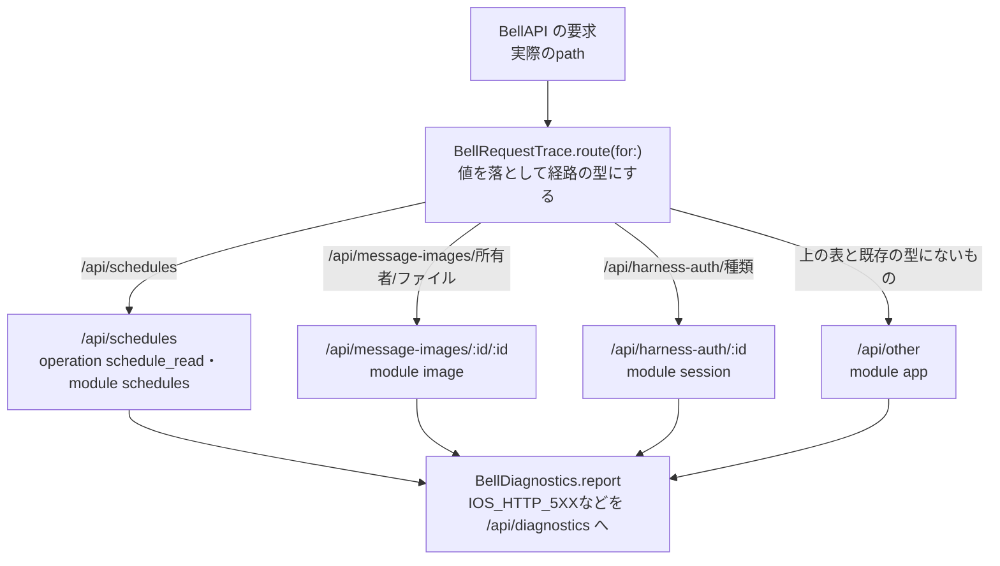

# 通信失敗の診断で残す経路の型

[担当の正本](README.md)。Apple全体の図ではなく、修理の範囲だけを示す。

対応版：base `19e739e5` に対する修理。1.0.5 (100)以前は、予定の一括取得、会話の画像、ハーネス認証の個別状態のGETが失敗すると、どれも `/api/other`・`operation=unknown`・module `app` として送られ、記録から見分けられない。

## 流れ

## 責任と受渡し

| 段階 | 所有者と場所 | 契約 |
| --- | --- | --- |
| 経路の型 | `BellRequestTrace.route(for:)`（`Core/BellDiagnostics.swift`） | 所有者・ファイル名・認証の種類などの値は残さない。既存の型（bots・rooms・settingsなど）は変えない |
| 操作名 | `BellDiagnostics.requestContextLog` | 経路の型から決める。`/api/schedules` は既存の `/schedules` 末尾の規則で `schedule_read` になる |
| module | `BellDiagnostics.module(for:)` | 経路の型から決める。`/api/harness-auth/:id` は `/api/harness-auth` と同じ session |

サーバー側の分類（`src/diagnostic-request-context.mjs`、担当モリー）も同じ3本を `/api/other` にしている。名前の揃え方はモリーと合わせる。

## 確認済みと未確認

確認済み（直接試験）：3本のGETの失敗が、値を含まない経路の型・module・操作名で送られる。`/api/harness-auth/<種類>/input` など、表にない経路は従来どおり `/api/other`。

未確認：過去の記録（f6c057c6・88564ff5）の原因や経路は、この修理で後から決めない。iPhone・iPad・Macの実画面。
