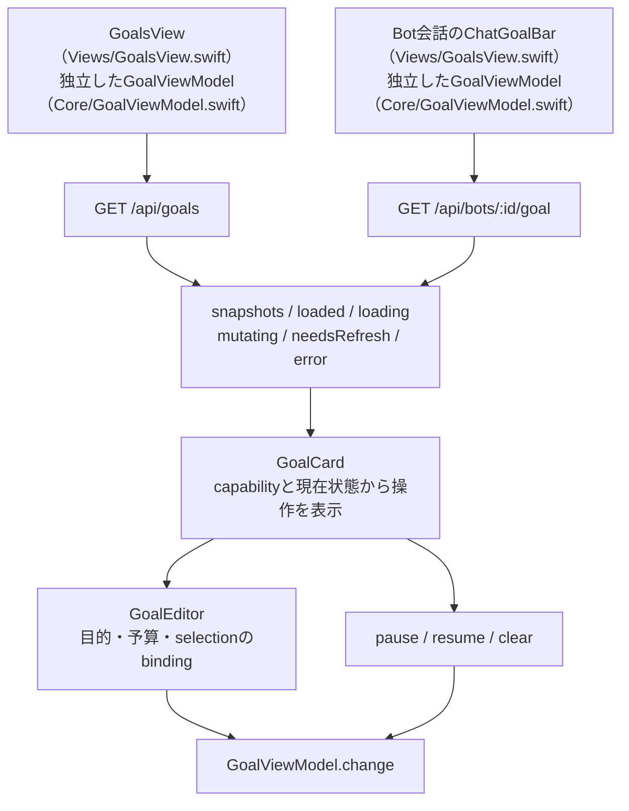
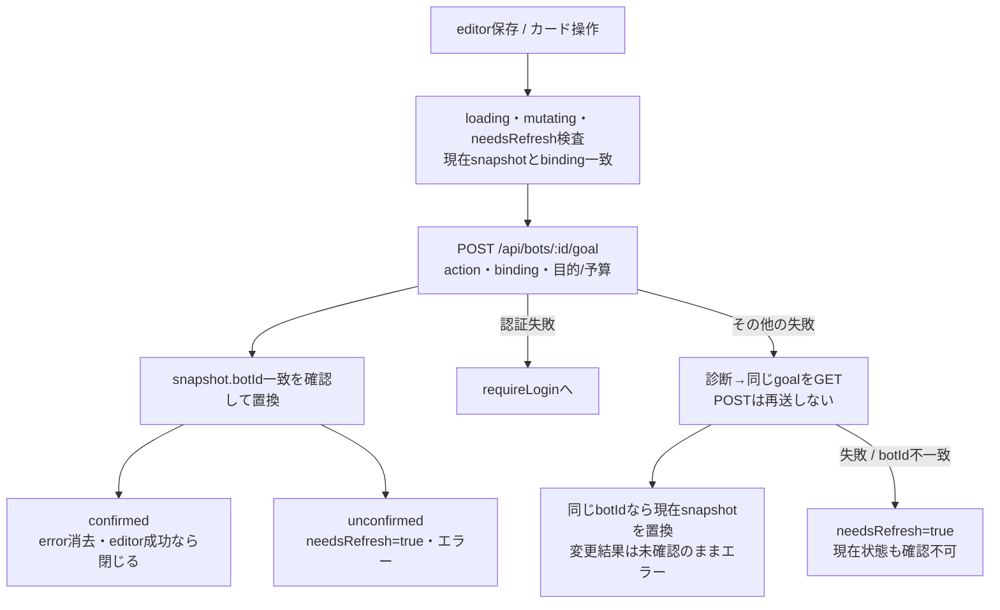

# goal一覧・会話内goal・操作

[全体図](overview.md) / [会話](conversation.md) / [共通同期](state-and-sync.md) / [試験](tests.md)。予定は[予定一覧](schedule-list.md)と[全体図](overview.md)を参照。

調査source：HEAD `afda9477bba4aaa7c8a6905100d3bacf26e47c90`（detached）。goal実装を静的に読んだ結果。PR5で値型を`Core/GoalModels.swift`、取得・変更状態を`Core/GoalViewModel.swift`へ移し、画面は`Views/GoalsView.swift`に残した。以下の所在は移動後を示す。サーバー内部は扱わない。

## 状態・取得・画面

| 所有者・入口 | 契約と返却先 |
| --- | --- |
| GoalsView | ready時のゴールtab（selectedTab=3）。availableかつgoalありだけ一覧表示。goal無しでcreate/objective可のsnapshotは＋の候補。候補1人は直接、複数はMenu |
| ChatGoalBar | ConversationContentのBot宛てcomposerだけに配置。status/経過時間のpill、展開したカード、更新ボタン、editorを所有。ルームにgoal barはない |
| GoalViewModel | 一覧と会話で共有参照しない。loading/mutatingなら読取を開始しない。詳細はbotId一致検査。成功はsnapshots置換・loaded=true・needsRefresh/error解除。取消は保持してreturn、認証失敗はrequireLogin。他失敗はneedsRefresh=trueとerror/診断 |
| 失敗表示 | snapshotsの配列自体は保持するがcurrentSnapshotsはneedsRefresh時に空。既存goalを最新として出さず、一覧は確認不可表示、chatは取得不可pill。unsupported/unavailableも未設定と分ける。失敗の文は1か所だけ（`GoalFailureNotice`：アイコン・平易な1文・主ボタン「状態を更新」）。読取のerrorTextとsnapshotのmessageを重ねて出さない。errorTextは変更（pause/resume/clear/作成/編集）の平易な文だけを持つ。読取の失敗はerrorTextに書かず（原因は診断だけ）、残っている変更の文（結果不明など）も消さない。読取の成功だけがerrorTextを消す |
| 休止中 | `GoalSnapshot.seatIdle`（availability=unavailableかつreason=seat_idle）は失敗ではない。席が動いていない間は動いているgoalが無いので、chatのpillは「ゴールは設定されていません」（goal無しのavailableと同じ文）。展開するとサーバーのmessage（休止中です…）。一覧は失敗の数に入れない |
| pillの文 | 言い切りの文だけ（オーナー指摘 2026-11-12）：確認中は「ゴールを確認しています」、goal無し・休止中は「ゴールは設定されていません」、読めない時は「ゴールの状態を確認できません」、goalありはstatusTitle |
| 未対応 | unsupportedのBotにはchatのpillを出さない |
| GoalForegroundLoad | start時に前taskをcancelし、その終了を待って新load。view task取消を子taskへ伝える。非active/非表示でcancel |
| 更新契機 | 一覧はtab task・active復帰（tab=3）・eventRevision（tab=3）・pull/手動更新。chatはbotId task・active復帰・active時eventRevision・手動更新。GoalViewModel.load自身にはscene検査がない。専用goal topic購読はない |
| 診断 | GoalLoadCallContextはtrigger、viewPhase、連続時計、AppStore診断snapshotを順に採る。同時の原子的観測とは扱わない |

根拠：[GoalLoadCallContext](../../../../ios/BellBot/BellBot/Core/GoalViewModel.swift#L4)、[GoalForegroundLoad](../../../../ios/BellBot/BellBot/Core/GoalViewModel.swift#L28)、[GoalViewModel](../../../../ios/BellBot/BellBot/Core/GoalViewModel.swift#L89)、[GoalsView](../../../../ios/BellBot/BellBot/Views/GoalsView.swift#L11)、[ChatGoalBar](../../../../ios/BellBot/BellBot/Views/GoalsView.swift#L149)。

## 応答の型と操作可否

値型16個は`Core/GoalModels.swift:3–248`に置く。[GoalSnapshot](../../../../ios/BellBot/BellBot/Core/GoalModels.swift#L236)、[NativeGoal](../../../../ios/BellBot/BellBot/Core/GoalModels.swift#L145)、[GrokCurrentStatus](../../../../ios/BellBot/BellBot/Core/GoalModels.swift#L64)が応答の解釈と表示用算出値を持つ。通信専用の応答・要求・結果型とGoalViewErrorは`Core/GoalViewModel.swift:57–86`内のprivate型のまま。

| 応答 | Appleが解釈するもの |
| --- | --- |
| GoalSnapshot | botId、availability（available/unsupported/unavailable）、reason（unavailableの時だけ：seat_idle＝席が今動いていない／read_failed＝読取の失敗。無い・未知の値はread_failedとして扱う。execution PR #1106で追加）、capabilities、create/edit各fieldCapabilities、binding、goal、nativeHistory、observedAt、message |
| binding | sessionId/launchId/threadId。editorを開いた時のsnapshotと現在値を比較して、会話が変わった時の保存を拒否 |
| Codex | kind無しまたはcodex-cli。objective/status/tokenBudget/tokensUsed/timeUsedSeconds。active/paused/blocked/usageLimited/budgetLimited/completeを文言へ |
| Claude | kind=claude-code、phase=active、native.type=goal_statusかつmet=falseを検査。conditionを目的へ、tokens/durationMs/iterations/reportedTurnsを取得した分だけ表示 |
| Grok | kind=grok-cli。currentStatus.sourceで`/goal status`と`goal detail`をdecodeし、経過表示の空を拒否。型に応じstatus/phase/usageを表示 |
| nativeHistory | claude-code、terminal=cleared/achievedで「前のゴール」を表示。現在goalとは別項目 |
| 不正応答 | 未知kind/status等はdecodeエラー、詳細botId不一致はinvalidResponse。別harnessの既定goalへ置き換える処理はない |

GoalCardはcreate、edit、pause（activeだけ）、resume（pausedだけ）、clearをcapabilityで出し分ける。busy中は無効。pageは使用量・目的・操作説明、chatは目的を高さ最大180のScrollViewへ表示し、pillに経過時間。goalのpause/clear後に今の処理が止まることを示す表示はなく、処理中断には会話の停止ボタンを案内する。

## 変更・結果不明・取消

[change](../../../../ios/BellBot/BellBot/Core/GoalViewModel.swift#L159)はdeferでmutating解除。変更POSTが通ってもsnapshot不一致ならneedsRefreshを立てる。GET照合で現在値が取れた時はreadbackAfterUnknownをthrowし、操作の成立をconfirmedへ読み替えない。カードrunはerrorへ、editor保存はerrorを残して閉じない。変更POSTの取消も認証以外の失敗catchを通り、同じGET照合を試みる。GET照合の失敗は認証エラーもこの内側catchでunknownOutcomeとなり、needsRefreshと診断へ返す。

| editor | 入力検査・保持 |
| --- | --- |
| 初期値 | selection.snapshotの目的/予算を@Stateへ。snapshots/loadingはBindingで現在値を参照 |
| 保存可否 | 非保存中・非更新中・同binding・available・対象capability。目的はtrim後1〜4000文字。予算だけなら変更済みかつ正整数 |
| 項目 | objective/tokenBudget両方可でcombined=falseなら一項目ずつ選択。保存時も選択項目だけ送る |
| 予算 | 変更済みで空でない場合だけInt>0検査。空はnilとなり、編集時は現在指定を変更しない案内 |
| 成功・失敗 | onSave正常終了でdismiss、認証はrequireLogin、他はeditor error。deferでsaving解除。入力値は保持 |
| 取消・閉じる | 「閉じる」はdismiss。独立のcancel routeなし。保存中に閉じる操作やinteractiveDismissを抑える指定はこのeditorにはない。変更taskを保持して取消する処理もない |

## 整理候補

- **A-G1**：値型とharness別decodeは`ios/BellBot/BellBot/Core/GoalModels.swift:3`、取得・変更状態と通信専用型は`Core/GoalViewModel.swift:4`へ配置した。一覧・会話bar・カード・編集フォームは`Views/GoalsView.swift:11,149,262,386`に残す。
- **A-G2**：`ios/BellBot/BellBot/Views/GoalsView.swift:111,227`。一覧と会話barがそれぞれGoalEditorへsnapshots/loadingのBindingとchange callbackを接続し、独立したGoalViewModelを持つ。

## 未調査

- 本体でのnative goal操作・binding生成・outcome判定とCLI状態。予定は既存図の参照だけ。
- goal変更中の画面終了、scene/GETの競合、harness実機表示。ビルド・試験未実行。
- Mermaid描画結果。
