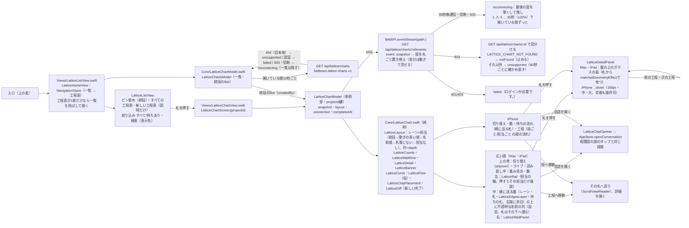

# 工程表（Lattice）の描画

[全体図](overview.md) / [機能索引](function-index.md)。データの契約は [lattice module](../lattice/README.md#public-contract-apps)、画面・導線・失敗の表示・動きは [screen-spec](../lattice/screen-spec.md) が正本で、ここではApple側の部品と状態の持ち主だけを書く。数値（時間・大きさ・色）は仕様から写し、ここへ複製しない。以下のファイル名は`ios/BellBot/BellBot/`からの相対名。

## 入口

| 端末 | 入口 | 会話を開いた後の戻り先 |
| --- | --- | --- |
| iPhone | 「相関図」タブの上の切り替え「相関図 / 工程表」（`App/BellBotApp.swift` `TeamBoardTab`。タブを6つにしない） | タブ4（切り替えの状態は`@SceneStorage`で残る） |
| iPad | サイドバー下の「工程表」（⌘5）→ `selectedTab = 5`（`Views/DesktopWorkspaceView.swift`） | タブ5 |
| Mac | サイドバー下の「工程表」（⌘5）→ `openWindow(id: "lattice")`。窓は1360×860で開く | 工程表の窓を残し、本体の窓を前へ（`MainWindow.bringToFront`） |

## 部品と流れ

## 工程表の名前

一覧の札・切り替え・読み上げの名前は`LatticeChartName.of`（`AppStore.latticeChartName`）：`name`、無ければ「<作った人の名簿の名前>の工程表」（`createdBy`をアプリの名簿で引く）、それも分からなければ「名前のない工程表」。`projectId`はAPIの宛先と試験の識別子（`accessibilityIdentifier`）だけで、画面と読み上げに出さない（[Display name rule](../lattice/README.md#get-apilatticecharts)）。一覧の「統括 <顔> <名前>」の行は`coordinator: true`の工程表だけに出す。

## 状態の持ち主

| 状態 | 持ち主 | 寿命 |
| --- | --- | --- |
| 一覧・統括のBot・一覧の接続 | `LatticeChartsModel`（`LatticeHomeView`の`@StateObject`） | 入口の画面がある間。背景へ回ると止め、戻ると読み直す |
| 1枚の図（最後に読めたsnapshot）・配置・接続・新しい完了の時刻 | `LatticeChartModel`（`LatticeChartScreen`の`@StateObject`） | その工程表を開いている間。背景へ回ると接続を閉じ、戻ると最新の一枚から描く |
| 選んだ札・強調した担当・送り先・iPhoneの並べ方と詳細の高さ | `LatticeChartScreen`の`@State` | 画面の間 |
| 担当の顔 | `AppStore.bots`の画像（`LatticeAvatar`）。名簿にないBotは「?」、担当なしは「–」 | アプリの名簿に従う |

## 失敗と端の表示

screen-specの表をそのまま描く。図がある間は消さない（帯と薄さで伝える）。

| 条件 | 表示 | 自分で抜ける道 |
| --- | --- | --- |
| `state: unverified` | 琥珀の帯・「統括と話す」 | 次のsnapshot |
| `state: last_verified` | 青灰の帯（verifiedAtのJST）・図を薄く・「統括と話す」 | 次のsnapshot |
| `state: unavailable` | 閉じたつぼみの面・「一覧へ戻る」 | 次のsnapshot |
| `degraded` | 上の帯に「最新の記録を読み直しています…」「メンバー情報を読み直しています…」 | 次のsnapshot |
| 切断・503・35秒無通信 | 「工程表に再接続しています…」・図を薄く | 上の再接続 |
| 404（見つからない） | 「この工程表は見つかりません。」・「一覧へ戻る」 | 利用者が戻る |
| 404（旧本体） | 「このサーバーではまだ工程表を使えません。」・「閉じる」 | 60秒ごとに確かめ直す（一覧は10秒ごと） |
| 名簿にない担当 | 「?」と「名簿にないメンバー」。線と状態は消さない。会話を開くは押せない（Webの`canChat`と同じ） | 名簿に入れば次のsnapshotで名前になる |

## 動き

`screen-spec.md`「Motion」の数値を使う。札の状態の変化・新しい札・一覧の更新は`spring(response: 0.45, dampingFraction: 0.82)`（`LatticeChartModel.apply`と盤の`.animation(value: snapshot)`）。待ちの粒は`LatticeEdgesLayer`の`TimelineView(.animation)`＋`Canvas`（止まりの辺は半分の速さ、接続中でない時と動きを減らす設定では止める）。作業中の弧は`LatticeWorkingArc`、止まりの脈は`symbolEffect(.pulse)`、完了は`symbolEffect(.bounce)`＋`LatticeBloom`、着手可のレールの輪は`phaseAnimator`。動きを減らす設定では粒・回転・脈・花を出さず、0.2秒の切り替えだけにする。

## 色

`LatticePalette`はライトとダークの両方を持つ。アプリ全体は`UIUserInterfaceStyle=Light`で固定（[iOS README](../../../../ios/BellBot/README.md)）なので、実機では今はライトで出る。DEBUGの`-bellbot-color-scheme dark`は写真用。

## 試験

- `BellBotTests/LatticeChartTests.swift`：数（取り下げを母数から除く）・レーンの順・列・待ちの文・詳細・帯・粒・札の置き場所・時刻・新しい完了・一覧の読み取り。
- `BellBotUITests/LatticeChartUITests.swift`（iPhone実機、`test/helpers/lattice-ui-server.mjs`＝`BELLTEAM_LATTICE_FIXTURE_URL`）：一覧・工程表・待ちの流れ・詳細のライト/ダークの写真と、未検証・最後に確認できた状態・名簿にない担当・再接続・読めない工程表。
- Macの写真は使い捨ての自己描画のコピーで撮る（repoに入れない）。

## 未対応（契約にデータが無いもの）

一覧の札の「いちばん長い待ち」と縮小図、工程ごとの起票者は、`bellteam.lattice-charts.v1`・`lattice-chart.v1`に項目が無いため描かない。
