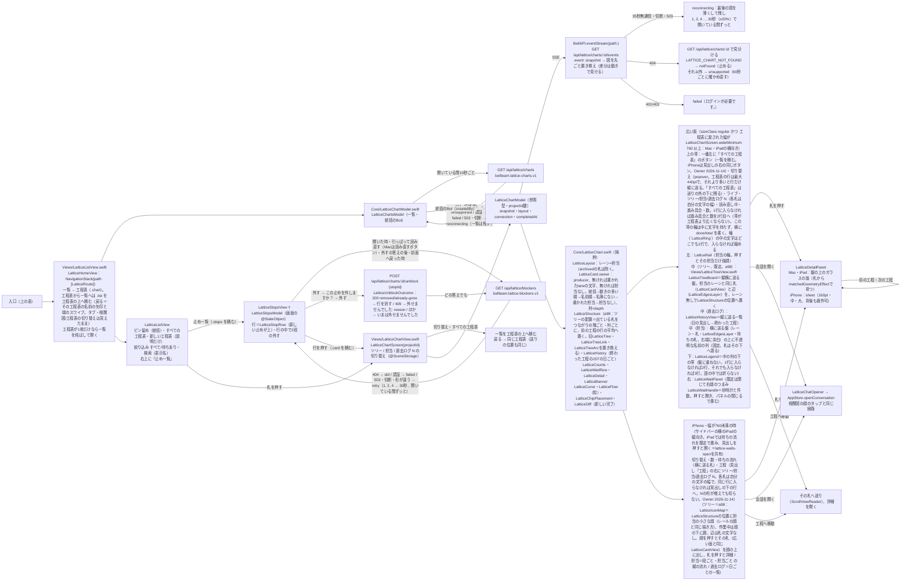

# 工程表（Lattice）の描画

[全体図](overview.md) / [機能索引](function-index.md)。データの契約は [lattice module](../lattice/README.md#public-contract-apps)、画面・導線・失敗の表示・動きは [screen-spec](../lattice/screen-spec.md) が正本で、ここではApple側の部品と状態の持ち主だけを書く。数値（時間・大きさ・色）は仕様から写し、ここへ複製しない。以下のファイル名は`ios/BellBot/BellBot/`からの相対名。

## 入口

| 端末 | 入口 | 会話を開いた後の戻り先 |
| --- | --- | --- |
| iPhone | 「相関図」タブの上の切り替え「相関図 / 工程表」（`App/BellBotApp.swift` `TeamBoardTab`。タブを6つにしない） | タブ4（切り替えの状態は`@SceneStorage`で残る） |
| iPad | サイドバー下の「工程表」（⌘5）→ `selectedTab = 5`（`Views/DesktopWorkspaceView.swift`）。工程表のstackは詳細の列のstackになるので、ほかの画面もそれぞれ自分のstackで列を置き換える（相関図・会話は`stacklessDetail`を包む） | タブ5 |
| Mac | サイドバー下の「工程表」（⌘5）→ `openWindow(id: "lattice")`。窓は1360×860で開く | 工程表の窓を残し、本体の窓を前へ（`MainWindow.bringToFront`） |
| iPad・Mac：会話の右の「AIと操作」 | そのメンバーが作った工程表（一覧の`createdBy`がそのBot）ごとのボタン（Owner 2026-11-14）。押すと`AppStore.openLatticeChart(id)`が`latticeOpenRequest`に置き、iPadは`selectedTab = 5`、Macは`openWindow(id: "lattice")`。`LatticeHomeView`が`latticeOpenRequest`を受けて`path = [.chart(id)]`にし、要求を消す。一覧の読み取りは`DesktopInspector`が開いたメンバーごとに1回（`AppStore.latticeCharts(createdBy:)`）。読めない時はボタンを出さず診断へ送る。iPhoneの詳細には出さない | 上と同じ |

## 部品と流れ

## 広い面と縦の流れの選び方

`LatticeChartScreen`は`GeometryReader`で、列から渡された幅（工程表自身の幅ではない）を測り、760未満なら縦の流れにする。工程表はその幅に左寄せで置くので、それでも広い時は右の端（画面の端）へはみ出し、サイドバーの側へは出ない。広い面がその列より広いと、SwiftUIははみ出した工程表を中央に置き、iPadでは左のレールと上の帯がサイドバーの下へ入り込んで、サイドバー（メンバー・予定・相関図・工程表）へのタッチを受け取っていた（Owner 2026-11-14。凡例が1文字ずつ折れたのも、中央の列が潰れた同じ原因）。

## 工程表の名前

一覧の札・切り替え・読み上げの名前は`LatticeChartName.of`（`AppStore.latticeChartName`）：`name`、無ければ「<作った人の名簿の名前>の工程表」（`createdBy`をアプリの名簿で引く）、それも分からなければ「名前のない工程表」。`projectId`はAPIの宛先と試験の識別子（`accessibilityIdentifier`）だけで、画面と読み上げに出さない（[Display name rule](../lattice/README.md#get-apilatticecharts)）。一覧の「統括 <顔> <名前>」の行は`coordinator: true`の工程表だけに出す。

## 止め一覧

[screen-spec「止め一覧」](../lattice/screen-spec.md)と[Stops契約](../lattice/README.md)をそのまま描く。入口は一覧の右上の「止め一覧」（Owner用のアプリなので常に出す）。戻るは端末の戻る（一覧の名前「工程表」の矢印と端のスワイプ）とEsc。

- 行（`LatticeStopRow.rows`、純粋）：`blockedAt`の新しい順。止まりの赤の八角形・題（2行）・工程表の名前（`LatticeChartName`、`projectId`は出さない）・担当と止めた人（`LatticePerson.stopFace`：名簿のBot→顔と名前、`owner`→指揮官のプロフィール、`bot-…`で名簿に無い→名簿にないメンバー、ほかの文字→その文字と頭文字、無し→担当なし）・理由（3行、読み上げは全文）・止めた時刻（`LatticeTime.stopTime`：今日 HH:mm / 昨日 HH:mm / M月d日 HH:mm、JST）。
- 行を押す（外す以外）：`.card(projectId, cardId)`を積み、その工程表をその札の詳細を開いた状態で出す（`LatticeChartScreen(initialCard:)`）。戻ると止め一覧。
- 外す：行の中で「この止めを外しますか？」・外す（`.bellPrimary`）・やめる。やめる・Esc・行の外を押すと戻る。確認に入ると読み上げの焦点は確認の外すへ移り、やめるで行の外すへ戻る（`@AccessibilityFocusState`）。送信中は外すが回る印になり、行は残る。答え（`LatticeUnblockOutcome`）：外れた・もう無い→行を0.2秒で消す（動きを減らす設定では消すだけ）、409→行の下に「外せませんでした: <reason>」、それ以外→「いまは外せませんでした。…」。どの答えでもすぐ読み直す。409の`reason`は`BellAPI`の失敗の本文（`message`→`reason`→`error`の順）から取る。
- 読み直しはタイマーで行わない（読める間）。読めない間だけ1, 2, 4 … 30秒（±20%）。読み直しは`readRequest`を変えて画面の読み取りtaskを入れ替えるので、同時に2本は走らない。
- 表示：初回は「止めを読んでいます…」、空は「止まっている工程はありません。」、`unreadCharts`があれば琥珀の1行「一部の工程表を読めませんでした。…」、retryは行を薄くして「止め一覧を読み直しています…」と読み直すボタン、404は「このサーバーではまだ止め一覧を使えません。」。識別子は`lattice-open-stops`・`lattice-stops`・`lattice-stop-<stopId>`・`lattice-stop-remove-<stopId>`・`lattice-stop-confirm-<stopId>`。

## 状態の持ち主

| 状態 | 持ち主 | 寿命 |
| --- | --- | --- |
| 一覧・統括のBot・一覧の接続 | `LatticeChartsModel`（`LatticeHomeView`の`@StateObject`） | 入口の画面がある間。背景へ回ると止め、戻ると読み直す |
| 1枚の図（最後に読めたsnapshot）・配置・接続・新しい完了の時刻 | `LatticeChartModel`（`LatticeChartScreen`の`@StateObject`） | その工程表を開いている間。背景へ回ると接続を閉じ、戻ると最新の一枚から描く |
| 選んだ札・強調した担当・送り先・iPhoneの並べ方と詳細の高さ・iPhoneのツリーで顔の上に出している札（a98） | `LatticeChartScreen`の`@State`（ツリーと担当で同じものを使う＝切り替えても引き継ぐ） | 画面の間 |
| ツリー / 担当 / 過去ログ | `LatticeChartScreen`の`@SceneStorage("lattice-center")`（既定はツリー） | アプリ（シーン）を開いている間 |
| 待ちの流れを開いているか（Mac・iPad） | `LatticeChartScreen`の`@SceneStorage("lattice-waits-open")`（既定は閉じる。Owner 2026-11-14） | アプリ（シーン）を開いている間 |
| 一覧を工程表の上へ積んだか・止め一覧と、そこから開いた工程表（`.stops`・`.card`） | `LatticeHomeView`の`path`（`LatticeRoute`の列） | 入口の画面がある間 |
| 会話の右から開く工程表（まだ開いていない要求） | `AppStore.latticeOpenRequest`（`String?`）。`openLatticeChart`が置き、`LatticeHomeView`が受けて消す | 受け取られるまで |
| 止め一覧の止め・読み取りの状態・確認中の行・送信中の行・行の下の知らせ | `LatticeStopsModel`（`LatticeStopsView`の`@StateObject`） | 止め一覧を開いている間。背景へ回ると止め、戻ると読み直す |
| 担当の顔 | `AppStore.bots`の画像（`LatticeAvatar`）。名簿にないBotは「?」、担当なしは「–」 | アプリの名簿に従う |

## 過去ログ

`LatticeHistory`（純粋）：終わった工程（`done` / `retired`、archivedかどうかに関わらず）を`doneAt`の新しい順に、JSTの日の見出し（今日 / 昨日 / M月d日）の下へ。`doneAt`が無い・読めない工程は「日時の分からない工程」として最後。行（`LatticeHistoryView`）：状態の記号・題・担当の顔と名前（owner rule）・HH:mm（JST）。押すと詳細（ツリー・担当と同じ`select`、強調は薄くするだけ引き継ぐ）。空は「まだ終わった工程はありません。」。切り替えの表示は「過去ログ N」（Nは終わった工程の数）。識別子は`lattice-view-history`・`lattice-history-row-<札のid>`・`lattice-history-empty`。

## 待ちの流れの行

1行でその行だけが読める（`LatticeWaitRow`・`LatticeWaitRowView`、広い面のパネルもiPhoneの横に送る札も同じ）：待っている工程の題＋その担当の顔＋待ち N、「担当 ◯◯」（`card.owner`、無ければ担当なし）、「この工程が終わるのを待っています」と待たれている工程の題、「つくっている」＋作り手の顔・名前＋状態、ボタン。読み上げは「「<待っている工程>」（担当 <名前>）は、「<待たれている工程>」が終わるのを待っています。つくっているのは<作り手>、<状態>」。待ちの辺の札は、待つ側に担当がいなければ「次の工程が待っています」。

## 失敗と端の表示

screen-specの表をそのまま描く。図がある間は消さない（帯と薄さで伝える）。

| 条件 | 表示 | 自分で抜ける道 |
| --- | --- | --- |
| `state: unverified` | 琥珀の帯・「統括と話す」 | 次のsnapshot |
| `state: last_verified` | 青灰の帯（verifiedAtのJST）・図を薄く・「統括と話す」 | 次のsnapshot |
| `state: unavailable` | 閉じたつぼみの面・「一覧へ戻る」（`leave`） | 次のsnapshot |
| `degraded` | 上の帯に「最新の記録を読み直しています…」「メンバー情報を読み直しています…」 | 次のsnapshot |
| 切断・503・35秒無通信 | 「工程表に再接続しています…」・図を薄く | 上の再接続 |
| 404（見つからない） | 「この工程表は見つかりません。」・「一覧へ戻る」（`leave`：経路を空にして根の一覧へ。戻るでこの画面へは戻らない） | 利用者が戻る |
| 404（旧本体） | 「このサーバーではまだ工程表を使えません。」・「閉じる」（`leave`） | 60秒ごとに確かめ直す（一覧は10秒ごと） |
| 書かれた担当（producerが無くlaneがある） | lane の文字そのままと頭文字の顔。メンバーのレーンの後ろに自分のレーン。会話は開けない。左のレールには出さない。待ちの流れと待ちの札も同じ決まり（待つ側＝待っている札の担当、つくる側＝待たれている札の担当）。[Owner on screen](../lattice/README.md#projection-rules-projectionmjs) | 本人が着手すると producer になり顔へ変わる |
| 指揮官が担当（producer/waiter が予約値 `owner`） | アプリの指揮官のプロフィール（`AppStore.owner` の名前と写真。分からない間は「指揮官」と頭文字）。生の語は出さない。会話は開けない。左のレールには出さない。メンバーと同じく自分のレーン。[Owner as an owner](../lattice/screen-spec.md) | 指揮官の名前が読めれば次の描画で名前になる |
| 名簿にない担当 | 「?」と「名簿にないメンバー」。線と状態は消さない。会話を開くは押せない（Webの`canChat`と同じ） | 名簿に入れば次のsnapshotで名前になる |

## ツリー

**a98（Owner 2026-11-14 OK「よし進めろ。」、a99で作る）。** 正本は[screen-spec「ツリー」「Structure layout」](../lattice/screen-spec.md)。ここではApple側の部品だけを書く。

- 配置：`LatticeStructure`（`Core/LatticeChart.swift`、純粋）。入力はsnapshotだけ。出ている札（`archived`でない＝担当のレーンと同じ札）を、辺でつながった塊ごとに上から（塊の最初の札のsnapshotの順。辺の無い札は最後）、列＝depth（担当と同じ）、行＝前の工程の行の平均（丸め）とその列の次の空き行の大きい方。出力は札のid → 列・行と、描く辺（両端が出ている札の`edges`）。広い面とiPhoneは同じ結果を、大きさだけ変えて描く。
- 広い面（Mac・iPad）：`LatticeTreeBoard`が、担当のレーンと同じ`LatticeCardView`・`LatticeEdgesLayer`（線・待ちの粒・札の文字）を、レーンの帯と名札なしで置く。根・まとまり・親子の箱と肘の線は描かない。押すと詳細、強調は担当と同じ。
- iPhone（と幅が760未満の時）：`LatticeIconMap`が、同じ位置に担当の小さな顔（`LatticeAvatar`、レールの顔と同じく作業中は回る弧、止まりは赤い点。担当なしは点線の丸）を置き、作業中の札は顔の下に題（2行まで）。辺は同じ線で、札の文字は出さない。顔を押すと、その札を広い面と同じ`LatticeCardView`で顔の上に出す（`LatticeChartScreen`の`@State`）。その札を押すと詳細のsheet、ほかを押すと閉じ、別の顔を押すとそちらへ移る。
- 出す札：`archived`でない札（サーバーが付ける。一つの木＝依存か親子でつながった札が全部終わった時だけarchived。Owner 2026-11-14「木（一つの改良計画）ごとに消そう。」）。アプリは印をそのまま使い、自分で決めない。
- 数：分数は出ている札だけを数える（a96）。
- 置き換えで消える物：`LatticeTree`・`LatticeTreeLink`・`LatticeTreeArc`・`LatticeTreeCardBox`、識別子`lattice-tree-phase-*`・`lattice-tree-root`。残す識別子：`lattice-view-tree`・`lattice-center-picker`。札は`lattice-tree-box-<札のid>`（広い面）・`lattice-tree-icon-<札のid>`（iPhone）。
- 試験（a99で書く）：`LatticeStructure`の列・塊の順・行（一本道はまっすぐ、合流は間、辺の無い札は最後）・描く辺、iPhoneの顔を押す→札→詳細の流れ。

## 札の中身

上から状態の行、題（2行まで、続きは…）、1行の注記（止まり＝理由、作業中＝◯◯がつくっています、ほか＝担当 ◯◯／担当なし）。札の高さ（`LatticeLayout.cardHeight` 116）は3つが重ならない高さ（screen-spec「Card body」）。

## 動き

`screen-spec.md`「Motion」の数値を使う。札の状態の変化・新しい札・一覧の更新は`spring(response: 0.45, dampingFraction: 0.82)`（`LatticeChartModel.apply`と盤の`.animation(value: snapshot)`）。待ちの粒は`LatticeEdgesLayer`の`TimelineView(.animation)`＋`Canvas`（止まりの辺は半分の速さ、接続中でない時と動きを減らす設定では止める）。作業中の弧は`LatticeWorkingArc`、止まりの脈は`symbolEffect(.pulse)`、完了は`symbolEffect(.bounce)`＋`LatticeBloom`、着手可のレールの輪は`phaseAnimator`。動きを減らす設定では粒・回転・脈・花を出さず、0.2秒の切り替えだけにする。

## 色

`LatticePalette`はライトとダークの両方を持つ。アプリ全体は`UIUserInterfaceStyle=Light`で固定（[iOS README](../../../../ios/BellBot/README.md)）なので、実機では今はライトで出る。DEBUGの`-bellbot-color-scheme dark`は写真用。

## 試験

- `BellBotTests/LatticeChartTests.swift`：ツリーの配置（a98の後はLatticeStructure。上の「ツリー」の試験の行）・archived（描かないが数える）・過去ログの日ごとの並び・数（取り下げを母数から除く）・レーンの順・列・待ちの文・詳細・帯・粒・札の置き場所・時刻・新しい完了・一覧の読み取り・止め一覧の行（並び・時刻・担当の決まり・読み上げ）と外すの答え。
- `BellBotUITests/LatticeChartUITests.swift`（iPhone実機、`test/helpers/lattice-ui-server.mjs`＝`BELLTEAM_LATTICE_FIXTURE_URL`）：一覧・工程表・待ちの流れ・詳細のライト/ダークの写真と、未検証・最後に確認できた状態・名簿にない担当・再接続・読めない工程表。
- `BellBotUITests/LatticeTabletUITests.swift`（iPad実機、同じfixture）：縦・横で、工程表（ツリー・担当・過去ログ）を開いたままサイドバーの予定・メンバー・相関図が本物のタッチで効くこと、待ちの流れが既定で畳まれ、開いて畳めること。
- Macの写真は使い捨ての自己描画のコピーで撮る（repoに入れない）。

## 未対応（契約にデータが無いもの）

一覧の札の「いちばん長い待ち」と縮小図、工程ごとの起票者は、`bellteam.lattice-charts.v1`・`lattice-chart.v1`に項目が無いため描かない。
