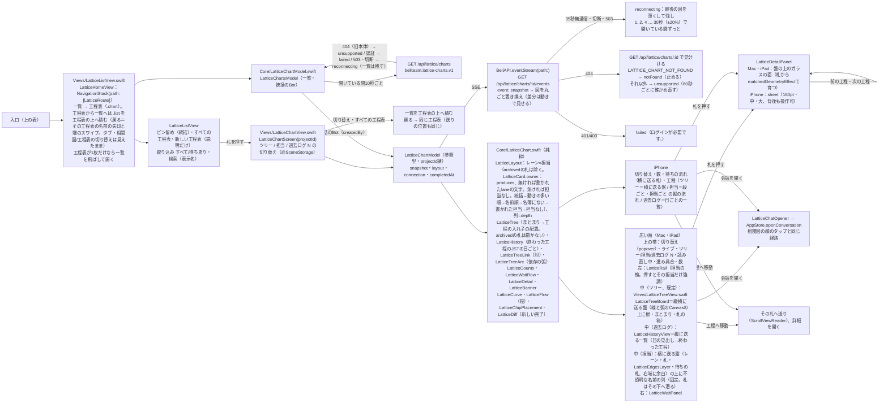

# 工程表（Lattice）の描画

[全体図](overview.md) / [機能索引](function-index.md)。データの契約は [lattice module](../lattice/README.md#public-contract-apps)、画面・導線・失敗の表示・動きは [screen-spec](../lattice/screen-spec.md) が正本で、ここではApple側の部品と状態の持ち主だけを書く。数値（時間・大きさ・色）は仕様から写し、ここへ複製しない。以下のファイル名は`ios/BellBot/BellBot/`からの相対名。

## 入口

| 端末 | 入口 | 会話を開いた後の戻り先 |
| --- | --- | --- |
| iPhone | 「相関図」タブの上の切り替え「相関図 / 工程表」（`App/BellBotApp.swift` `TeamBoardTab`。タブを6つにしない） | タブ4（切り替えの状態は`@SceneStorage`で残る） |
| iPad | サイドバー下の「工程表」（⌘5）→ `selectedTab = 5`（`Views/DesktopWorkspaceView.swift`） | タブ5 |
| Mac | サイドバー下の「工程表」（⌘5）→ `openWindow(id: "lattice")`。窓は1360×860で開く | 工程表の窓を残し、本体の窓を前へ（`MainWindow.bringToFront`） |

## 部品と流れ

## 工程表の名前

一覧の札・切り替え・読み上げの名前は`LatticeChartName.of`（`AppStore.latticeChartName`）：`name`、無ければ「<作った人の名簿の名前>の工程表」（`createdBy`をアプリの名簿で引く）、それも分からなければ「名前のない工程表」。`projectId`はAPIの宛先と試験の識別子（`accessibilityIdentifier`）だけで、画面と読み上げに出さない（[Display name rule](../lattice/README.md#get-apilatticecharts)）。一覧の「統括 <顔> <名前>」の行は`coordinator: true`の工程表だけに出す。

## 状態の持ち主

| 状態 | 持ち主 | 寿命 |
| --- | --- | --- |
| 一覧・統括のBot・一覧の接続 | `LatticeChartsModel`（`LatticeHomeView`の`@StateObject`） | 入口の画面がある間。背景へ回ると止め、戻ると読み直す |
| 1枚の図（最後に読めたsnapshot）・配置・接続・新しい完了の時刻 | `LatticeChartModel`（`LatticeChartScreen`の`@StateObject`） | その工程表を開いている間。背景へ回ると接続を閉じ、戻ると最新の一枚から描く |
| 選んだ札・強調した担当・送り先・iPhoneの並べ方と詳細の高さ | `LatticeChartScreen`の`@State`（ツリーと担当で同じものを使う＝切り替えても引き継ぐ） | 画面の間 |
| ツリー / 担当 / 過去ログ | `LatticeChartScreen`の`@SceneStorage("lattice-center")`（既定はツリー） | アプリ（シーン）を開いている間 |
| 一覧を工程表の上へ積んだか | `LatticeHomeView`の`path`（`LatticeRoute`の列） | 入口の画面がある間 |
| 担当の顔 | `AppStore.bots`の画像（`LatticeAvatar`）。名簿にないBotは「?」、担当なしは「–」 | アプリの名簿に従う |

## 過去ログ

`LatticeHistory`（純粋）：終わった工程（`done` / `retired`、archivedかどうかに関わらず）を`doneAt`の新しい順に、JSTの日の見出し（今日 / 昨日 / M月d日）の下へ。`doneAt`が無い・読めない工程は「日時の分からない工程」として最後。行（`LatticeHistoryView`）：状態の記号・題・担当の顔と名前（owner rule）・HH:mm（JST）。押すと詳細（ツリー・担当と同じ`select`、強調は薄くするだけ引き継ぐ）。空は「まだ終わった工程はありません。」。切り替えの表示は「過去ログ N」（Nは終わった工程の数）。識別子は`lattice-view-history`・`lattice-history-row-<札のid>`・`lattice-history-empty`。

## 待ちの流れの行

1行でその行だけが読める（`LatticeWaitRow`・`LatticeWaitRowView`、広い面のパネルもiPhoneの横に送る札も同じ）：待っている工程の題＋その担当の顔＋待ち N、「担当 ◯◯」（`card.owner`、無ければ担当なし）、「この工程が終わるのを待っています」と待たれている工程の題、「つくっている」＋作り手の顔・名前＋状態、ボタン。読み上げは「「<待っている工程>」（担当 <名前>）は、「<待たれている工程>」が終わるのを待っています。つくっているのは<作り手>、<状態>」。待ちの辺の札は、待つ側に担当がいなければ「次の工程が待っています」。

## 失敗と端の表示

screen-specの表をそのまま描く。図がある間は消さない（帯と薄さで伝える）。

| 条件 | 表示 | 自分で抜ける道 |
| --- | --- | --- |
| `state: unverified` | 琥珀の帯・「統括と話す」 | 次のsnapshot |
| `state: last_verified` | 青灰の帯（verifiedAtのJST）・図を薄く・「統括と話す」 | 次のsnapshot |
| `state: unavailable` | 閉じたつぼみの面・「一覧へ戻る」（`leave`） | 次のsnapshot |
| `degraded` | 上の帯に「最新の記録を読み直しています…」「メンバー情報を読み直しています…」 | 次のsnapshot |
| 切断・503・35秒無通信 | 「工程表に再接続しています…」・図を薄く | 上の再接続 |
| 404（見つからない） | 「この工程表は見つかりません。」・「一覧へ戻る」（`leave`：経路を空にして根の一覧へ。戻るでこの画面へは戻らない） | 利用者が戻る |
| 404（旧本体） | 「このサーバーではまだ工程表を使えません。」・「閉じる」（`leave`） | 60秒ごとに確かめ直す（一覧は10秒ごと） |
| 書かれた担当（producerが無くlaneがある） | lane の文字そのままと頭文字の顔。メンバーのレーンの後ろに自分のレーン。会話は開けない。左のレールには出さない。待ちの流れと待ちの札も同じ決まり（待つ側＝待っている札の担当、つくる側＝待たれている札の担当）。[Owner on screen](../lattice/README.md#projection-rules-projectionmjs) | 本人が着手すると producer になり顔へ変わる |
| 名簿にない担当 | 「?」と「名簿にないメンバー」。線と状態は消さない。会話を開くは押せない（Webの`canChat`と同じ） | 名簿に入れば次のsnapshotで名前になる |

## ツリー

`LatticeTree`（`Core/LatticeChart.swift`、純粋）が配置する：チャート（根）→ まとまり（`phases`の順）→ 工程（`parent`の下へ1段ずつ右へ入れ子）。まとまりの無い工程（`phase`が無い・知らないまとまり）は、まとまりの後ろに根からぶら下げる。親が無い・別のまとまりにある・自分自身の工程は、そのまとまりの先頭の段の工程として扱い、親の循環は、循環の中で図の並びが最初の工程で切る（どの工程も1回だけ出る）。兄弟は図の並び（snapshotの`cards`の順）のまま。`phases`・`phase`・`parent`が無い図（古い子）は、根の下に平らに並ぶ。

- まとまりの状態の記号：止まり（1枚でも止まり）> 作業中（1枚でも作業中）> 完了（全部が完了か取り下げ。札が0枚なら未着手）> 未着手。名前が無いまとまりは「名前のないまとまり」。`done/total`は上の輪と同じ数え方（完了 / 取り下げを除く札）。
- 線：親の右端から子の左端へやわらかいS字（`LatticeCurve`）。工程の下の工程は、親の左寄りから下へ下ろして丸い角で子へ入る（`LatticeTreeLink`）。依存（`edges`）は札の右側の弧（`LatticeTreeArc`）：待ち＝強調色（作り手が止まりなら赤）で待つ側へ矢じり、満たされた＝淡い線。線と弧は1枚の`Canvas`、強調中は札・弧を薄くする（担当のレーンと同じ）。
- 札（`LatticeTreeCardBox`）：状態の記号・題1行（続きは…）・担当の顔（`LatticeCard.owner`＋`LatticePerson.lookup`＋`LatticeAvatar`）。押すと詳細（担当のレーンと同じ`select`。広い面は札から育つ面、iPhoneはsheet）。識別子は`lattice-view-tree`・`lattice-tree-box-<札のid>`・`lattice-tree-phase-<まとまりの鍵>`・`lattice-tree-root`・`lattice-center-picker`。
- 終わった仕事は図から消える：`archived == true`の札（契約の決まりは[README](../lattice/README.md)）はツリーにも担当にも描かない。札が全部archivedのまとまりも描かない。archivedな親の子は、そのまとまりの先頭の段にぶら下がる。輪・数・根とまとまりの`done/total`は全部の札（archived込み）を数える。archivedな札に触れる辺・弧・待ちの流れの行は出さない（担当のレーンも同じ。全札がarchivedな担当のレーンは出ない）。
- iPhoneは縦を画面全体が送り、木は横に送る。初めはまとまりの列の左端に合わせる。送り先（工程へ移動）は盤の横位置と画面の縦位置の両方を動かす。

## 札の中身

上から状態の行、題（2行まで、続きは…）、1行の注記（止まり＝理由、作業中＝◯◯がつくっています、ほか＝担当 ◯◯／担当なし）。札の高さ（`LatticeLayout.cardHeight` 116）は3つが重ならない高さ（screen-spec「Card body」）。

## 動き

`screen-spec.md`「Motion」の数値を使う。札の状態の変化・新しい札・一覧の更新は`spring(response: 0.45, dampingFraction: 0.82)`（`LatticeChartModel.apply`と盤の`.animation(value: snapshot)`）。待ちの粒は`LatticeEdgesLayer`の`TimelineView(.animation)`＋`Canvas`（止まりの辺は半分の速さ、接続中でない時と動きを減らす設定では止める）。作業中の弧は`LatticeWorkingArc`、止まりの脈は`symbolEffect(.pulse)`、完了は`symbolEffect(.bounce)`＋`LatticeBloom`、着手可のレールの輪は`phaseAnimator`。動きを減らす設定では粒・回転・脈・花を出さず、0.2秒の切り替えだけにする。

## 色

`LatticePalette`はライトとダークの両方を持つ。アプリ全体は`UIUserInterfaceStyle=Light`で固定（[iOS README](../../../../ios/BellBot/README.md)）なので、実機では今はライトで出る。DEBUGの`-bellbot-color-scheme dark`は写真用。

## 試験

- `BellBotTests/LatticeChartTests.swift`：ツリーの配置（まとまりの状態の記号・done/total・入れ子の順・まとまりの無い工程・phases/parentが無い図・循環）・archived（描かないが数える）・過去ログの日ごとの並び・数（取り下げを母数から除く）・レーンの順・列・待ちの文・詳細・帯・粒・札の置き場所・時刻・新しい完了・一覧の読み取り。
- `BellBotUITests/LatticeChartUITests.swift`（iPhone実機、`test/helpers/lattice-ui-server.mjs`＝`BELLTEAM_LATTICE_FIXTURE_URL`）：一覧・工程表・待ちの流れ・詳細のライト/ダークの写真と、未検証・最後に確認できた状態・名簿にない担当・再接続・読めない工程表。
- Macの写真は使い捨ての自己描画のコピーで撮る（repoに入れない）。

## 未対応（契約にデータが無いもの）

一覧の札の「いちばん長い待ち」と縮小図、工程ごとの起票者は、`bellteam.lattice-charts.v1`・`lattice-chart.v1`に項目が無いため描かない。
