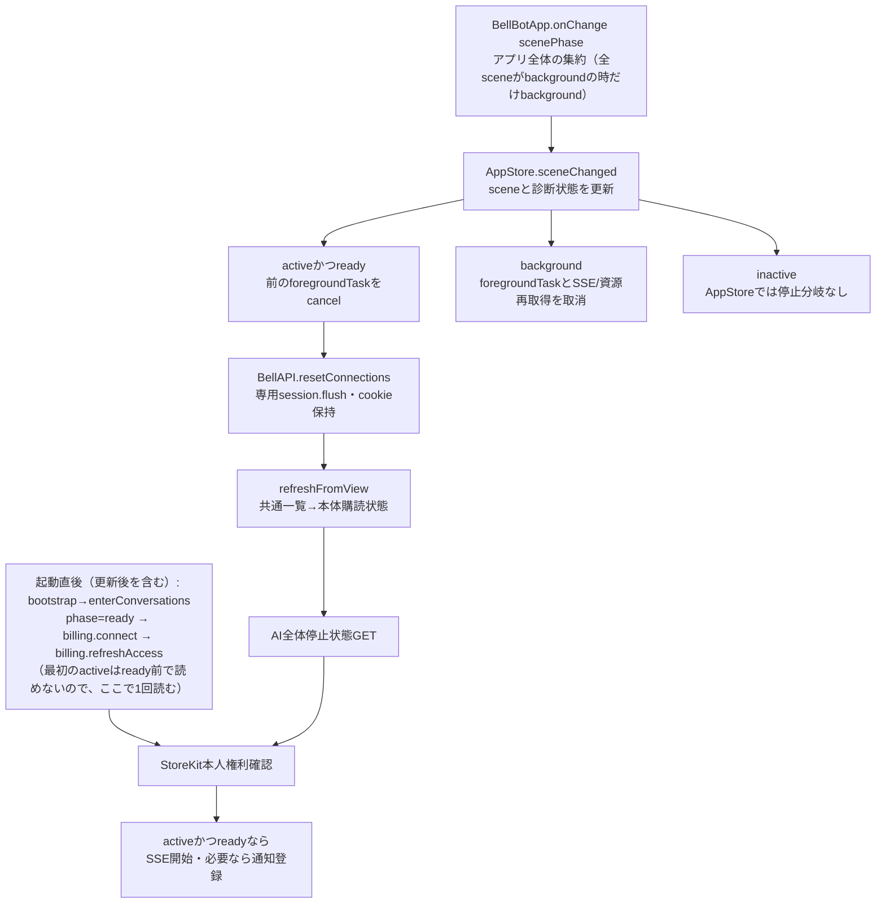
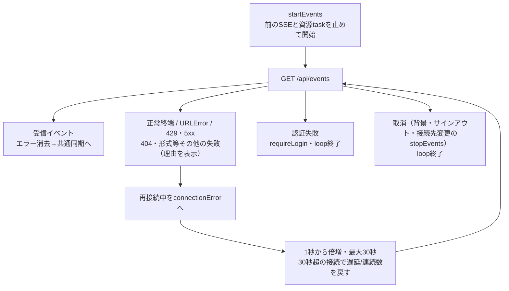
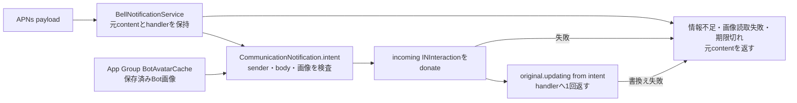
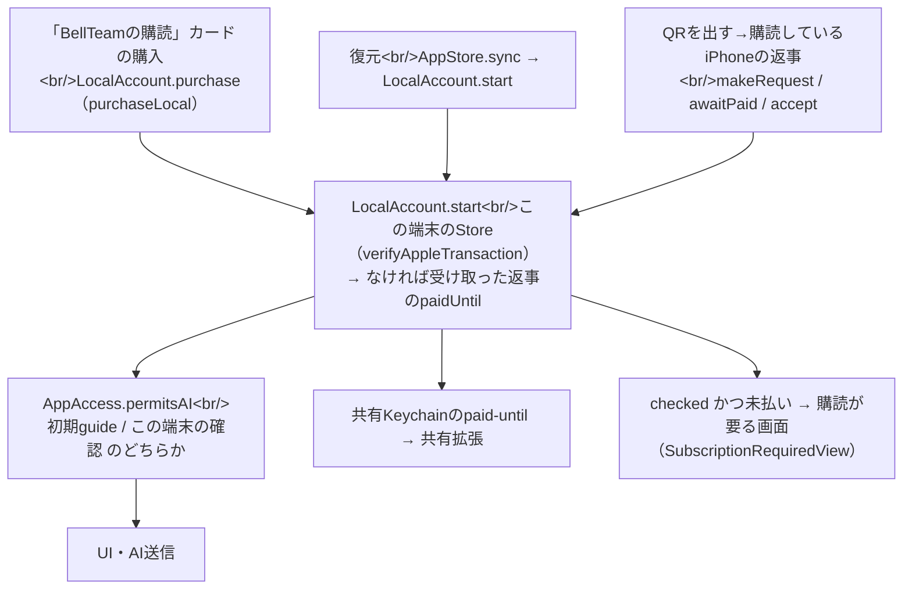

# 背景復帰・通知・購読・端末別配置

[全体図](overview.md) / [状態と同期](state-and-sync.md) / [会話](conversation.md) / [認証](requests-and-auth.md) / [試験](tests.md)。

調査source：HEAD `afda9477bba4aaa7c8a6905100d3bacf26e47c90`（detached）。静的読取。パスは`ios/BellBot/`から。共通一覧の適用、SSEのtopic振分け、保存物の全表は[状態と同期](state-and-sync.md)を参照し、ここでは再掲しない。

## scene遷移とSSE再接続

StoreKit本人権利確認は`LocalAccount.start`で、起動直後（ready到達時）・前面復帰に加え、Storeが後から届ける更新（`Transaction.updates`：更新後の初回起動で端末の写しが遅れている時の更新・復元）でも読み直す。読んだ件数・各購入の拒否コード（`ended`など）・`paid`は`Logger(app.bellteam.bellbot, billing)`に残す。

根拠：[AppStore.sceneChanged](../../../../ios/BellBot/BellBot/Core/AppStore.swift#L650)。各待機後にTask.isCancelledを検査する。refreshFromViewは失敗をthrowせずエラー表示へ返すため、次の停止状態/本人権利照会は取消されていなければ進む。sceneChangedはアプリ全体のscenePhaseだけから呼ぶ。窓ごとのscenePhaseで呼ぶと、Macで本体の窓を1枚閉じた時のbackgroundでSSEが止まり、残った窓はactiveのまま変わらないので再接続されない（2026-11-13、起動中のMacにアバターの変更が届かなかった実被弾）。Debug preview引数ではsceneChangedの呼出しを省く。各画面のtask取消は別にあり、会話は非activeでreader/過去取得を止める。

URLError連続5回目で診断し、429/5xxは各回診断する。404・読めない応答などその他の失敗も止めず、「更新を受け取れませんでした（理由）。再接続しています。」を出して同じ間隔で再接続し、失敗の連続の初回だけ診断する（Windows #677と同じ。止めるのは取消と認証拒否だけ）。取消は終了、stopEventsはeventsTask/eventRefreshTaskをcancelして保留資源集合も消す。接続が切れたことと再接続、イベント後のHTTP再取得、画面の再取得完了は別段階。[詳細](state-and-sync.md#sseの適用)へ接続する。

## push登録・受信・画面移動

| 所有者 | 入出力・副作用・失敗 |
| --- | --- |
| BellNotificationAppDelegate | 起動時にUNUserNotificationCenter.delegateをsingletonへ。APNs token/登録失敗をBellNotificationsへ返す |
| BellNotifications.shared | api/token/署名取引/attached/activating/registrationTask/pendingRoute/visibleConversation、statusText/errorTextを所有 |
| activate | `GET /api/notifications`でconfigured/environment照合→OS権限確認/初回要求→APNs登録。attachedを途中で確認。未設定/権限拒否は状態文言、例外はerrorとstage別診断。API呼出しの成功だけでは端末登録済みにしない |
| registerToken | tokenを16進化し、server/環境/previousToken/署名取引と`POST /api/notifications/devices`。応答後UserDefaultsへtoken、成功文言。失敗は保持状態にerror/診断。署名取引更新時もattachedなら登録 |
| 前面通知 | payloadをrouteへ変換、接続先一致かつattachedだけ表示対象。表示中会話と同じなら抑止、別ならbanner/list/sound |
| タップ | routeをonOpenへ。callback未設置ならpendingRouteに保持し、設置時に一度配送。AppStoreはreadyまで保留、server照合後selectedTab=0/chatPath置換/eventRevision増加 |
| 秘密通知 | `GET /api/secret-requests/:id`のpendingだけsheetへ。認証失敗はrouteを戻してrequireLogin、その他はconnectionErrorへ。秘密の登録処理は[要求図](requests-and-auth.md) |
| detach | attached=false、APNs解除・配信済み通知削除→registrationTask終了待ち→保存tokenで`POST /api/notifications/unregister`。成功時だけ保存token削除、失敗は診断。api/token/署名/route/表示会話を消しstatusを未設定へ |

`kind=update`は別の`BellUpdateRoute`（[BellNotifications.swift](../../../../ios/BellBot/BellBot/Core/BellNotifications.swift#L28)）が、`bellteam`の`server`・`kind`・`messageId`の3key完全一致の時だけ受け、`onOpenUpdate`→`AppStore.openPendingUpdateNotification`でUpdate画面を開く。既存3種の解析・移動は変えない。詳細は[Update画面](update.md)。

根拠：[BellNotifications.swift](../../../../ios/BellBot/BellBot/Core/BellNotifications.swift#L28)。routeはServerOriginを通したserver、reply/secret_request/owner_questionと空でないbotIdが必要。roomIdがあればルーム、秘密だけrequestIdを持つ。通知タップは現在の会話へpush追加せずchatPathを置換する。

[通知拡張](../../../../ios/BellBot/NotificationService/BellNotificationService.swift#L5)はNSLockでhandlerを取り出してnilにし、多重返却を抑える。途中失敗と期限切れはログを残して元の通知へ戻す。ネットワーク取得・SSE・診断POSTは行わない。

[CommunicationNotification](../../../../ios/BellBot/Shared/CommunicationNotification.swift#L5)はsender ID/name、server、空白除去後の非空body、画像復号成功を要求。Bot IDまたはroom IDからorigin込みconversationIdentifierを作り、ルーム名があればgroup名と送り主画像を設定する。ルーム名だけありID無しなら`origin/rooms`。通知の開く先はbellteam payloadのrouteを使う。

## 通知アバターcache

[BotAvatarCache](../../../../ios/BellBot/Shared/BotAvatarCache.swift#L6)はApp Groupの`avatars/<percent-encoded origin>/`へID別画像とversions.jsonを保存する。AppStoreの名簿適用後にBotAvatarCacheAccess actorへ渡し、変化したserver/entriesだけ保存する。成功前は保存済みentriesを更新せず、失敗は診断へ。

| 処理 | 成功・失敗・後始末 |
| --- | --- |
| storeVersioned | 同version・既存file・image data URLなら再書込しない。画像はatomic write、無効画像は既存file削除。今回保持しない有効IDのfileを整理し、version辞書変更時だけatomic保存 |
| dataURL | serverの正規化、version一致、画像読取/復号、MIME取得後にdata URLを返す。version不一致や未保存はnil |
| imageData | 不正ID/未保存はnil、読取失敗/不正画像はthrow。IDは1〜64文字、先頭ハイフン不可、小文字英数字とハイフンだけ |
| 途中失敗 | 複数fileとversionsを一括rollbackする処理はない。呼出元は失敗を受ける。通知拡張はその時の読取結果で元通知へ戻す |

## 購読・復元とAI利用（a540：この端末の確認だけ。サーバーは課金を判断しない）

根拠：[BillingStore](../../../../ios/BellBot/BellBot/Core/BillingStore.swift)、[LocalAccount](../../../../ios/BellBot/BellBot/Core/LocalAccount.swift)、[login-billing.md](login-billing.md)。

| 操作・状態 | 契約 |
| --- | --- |
| 状態所有 | 有効かどうかは`LocalAccount.paid`（商品・期限・どのストアか）と`checked`（最初の読み取りが済んだか）。BillingStoreは本体の`setupComplete`と操作中の表示だけを持つ。checking/active/inactiveを区別する |
| 有効判定 | この端末のStoreの購入（`verifyAppleTransaction`：署名・bundle・商品・取消なし・期限・Sandbox許可）が有効、または受け取った返事（`paidUntil`）が期限内。サーバーの`accessMode`・`entitlementState`・`entitled`は読まない |
| AI利用の呼出し | AppStore.authorizeAIUseがBot ID・guide ID・setup.completeを判定。初期guideは免除。それ以外は`LocalAccount.paid`が有効な時だけ許可。無ければ購読案内 |
| purchase | `purchaseLocal`（印なし。ライブラリが検証済みの取引を終える）。pendingはApple承認待ちの文言、cancelledは何も出さない |
| restore | `AppStore.sync`のあと`start`で確かめ直す。有効なら「購読を確認しました。」、無ければ有効な購読が無い文言 |
| 管理・解約 | 「購読を管理・解約」＝`apps.apple.com/account/subscriptions`を開く（サーバー呼出し無し） |
| 購読の壁 | `LocalAccount.checked`かつ未払いの時だけ、準備のできた画面（`ReadyGate`）をアプリの代わりに「このアプリは購読が必要です」の画面（SubscriptionRequiredView：文＋「BellTeamの購読」カード＋SubscriptionCard＋接続先の変更）にする。読み取りの前は壁を出さない。壁の判定はこの端末の値だけ |
| recheck | `LocalAccount.start`だけ（サーバーを呼ばない） |
| 共有拡張 | `LocalAccount.paid`が変わるたびに、共有Keychainの接続情報へ`paidUntil`（期限なしは遠い未来）を書き直す。拡張は期限が今より先の時だけ送信を許す |
| stop/logout | 端末の購入は消えない。「アカウントを削除」は`signOutLocal`（この端末のサインインと受け取った返事を消す）と決裁箱の削除（[account-deletion.md](account-deletion.md)） |

## 端末保存とlogout

[保存物の表](state-and-sync.md#端末保存と後始末)を正本として参照する。今回確認した実コードでも、signOutはdraft参照をclearして辞書削除、会話page世代更新、編集/画像draft・削除待ち・通知要求/route・HTTP/WK cookieを削除する。接続先URL、conversationOpening、App Group画像、static画像cacheを全消去する呼出しはsignOutにない。changeServerはsignOut後にURL/baseURL・名簿/Owner/setup/settings等を消す。requireLoginは再認証のためdraftを残す。

## iPhone・iPad・Mac配置

| 入口・所有 | 配置・受渡し・後始末 |
| --- | --- |
| BellBotApp | App単位のStateObject AppStoreを全画面へ注入。Macは主WindowGroupとmember-editor WindowGroupで共有。RootViewはphaseからsetup/login/onboarding/ready/failureを選択 |
| iPhone BellTabs / HomeView | 会話/予定/goal/設定。会話はNavigationStack(path: chatPath)→ConversationView。プロフィールは[Views/ConversationDetailView.swift](../../../../ios/BellBot/BellBot/Views/ConversationDetailView.swift#L4)、端末は[Views/BotScreenView.swift](../../../../ios/BellBot/BellBot/Views/BotScreenView.swift#L47)のsheet。接続errorは上部。通知秘密sheetはtabsの根 |
| iPad DesktopWorkspaceView | NavigationSplitViewの一覧/詳細＋inspector。compactColumnは選択とtabで変わり、compact幅でinspectorを閉じる。bot選択時に端末表示を戻す。編集は共通sheet |
| Mac DesktopWorkspaceView | 同じ選択・画面部品。Bot会話は会話/inspectorを等幅、roomはinspector固定280。主window最小1100×640。Bot編集は別window、roomはsheet |
| DesktopInspector | showingScreenは親のBinding、画像状態はStateObject。端末表示をembedded [BotScreenView（Views/BotScreenView.swift）](../../../../ios/BellBot/BellBot/Views/BotScreenView.swift#L47)へ切替え、戻るとプロフィール。ルーム参加者からchatPathを書き換える |
| MemberEditorWindow | Botを共有名簿から解決してBotEditor、見つからなければ不存在表示。geometry要求失敗は上部error。close callbackはdismissWindow |
| TabletWorkspace | このHEADで同名の製品Swift型/ファイルは無い。iPad配置はDesktopWorkspaceViewが持ち、TabletWorkspaceUITestsがその契約を確認する |

一覧の検索・並び・作成編集への接続は[メンバーとルーム](members-and-rooms.md)、詳細画像は[プロフィール](settings-and-profile.md)を参照。

## 整理候補

- **A-L1**：`ios/BellBot/BellBot/Views/ConversationImages.swift:186`の`conversationImageOrigin`と`ios/BellBot/Shared/BotAvatarCache.swift:94`。会話画像cacheは専用のorigin正規化、通知画像cacheはServerOrigin.urlを経由したorigin正規化を持つ。
- **A-L2**：`ios/BellBot/BellBot/App/BellBotApp.swift:201`と`ios/BellBot/BellBot/Views/DesktopWorkspaceView.swift:92`。通知秘密sheetと完了時eventRevision増加をtabsとworkspaceがそれぞれ接続している。

## 未調査

- APNs送付、通知登録台帳、購読verify/refreshとAI権限のサーバー内部。
- 実端末のSSE背景復帰・通知拡張期限・StoreKit購入/復元・複数window・App Group保存の動作と署名の実効値。ビルド・試験未実行。
- Mermaid描画結果。
