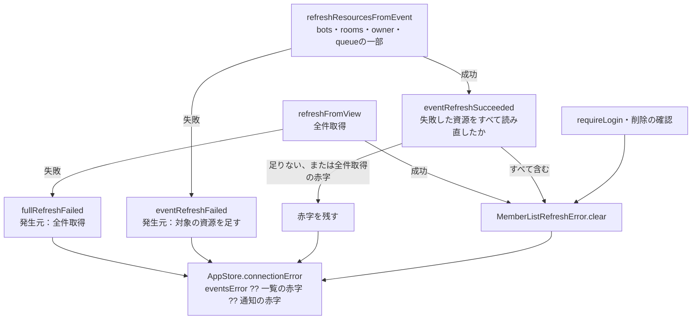

# 一覧の再取得の赤字と、消える条件

[担当の正本](README.md)。Apple全体の図ではなく、修理の範囲だけを示す。

対応版：base `226626ab` に対する修理。1.0.5 (99)以前は、SSEで対象を絞った再取得が一度失敗すると、その後に同じ対象の再取得が成功しても、会話の上の赤字が全件取得の成功まで残る。

## 流れ

## 責任と受渡し

| 段階 | 所有者と場所 | 契約 |
| --- | --- | --- |
| 赤字と発生元 | `MemberListRefreshError`（`Core/AppStore.swift`） | 文言と、対象を絞った再取得が立てた時の資源の集合。集合が無ければ全件取得などが立てた赤字 |
| 全件取得 | `AppStore.refreshFromView` | 成功で消す。失敗で発生元を全件取得にする |
| 対象の再取得 | `AppStore.refreshResourcesFromEvent` | 失敗で資源を足す（全件取得の赤字があれば発生元は変えない）。成功で、失敗した資源をすべて読み直した時だけ消す |
| 重なりと遅着 | `requestRefreshFromEvent` | 対象の再取得は一本ずつ順に走る（既存）。全件取得と重なっても、全件取得の赤字は部分の成功で消えない |
| 表示 | `AppStore.updateConnectionError` | `eventsError`、一覧の赤字、通知の赤字の順。文言と診断は変えない |

会話の入力欄の上の赤字（`ConversationView`の`errorText`）は別の経路で、次の会話の再取得の成功で消える。この修理では変えない。

## 確認済みと未確認

確認済み（ソースと直接試験）：対象の再取得の成功は、自分が立てた赤字だけを消す。失敗した資源を含まない成功では消えない。全件取得が立てた赤字は部分の成功で消えない。

未確認：Owner画面 2026-11-03 22:30 JST の赤字が、その時点の本体の拒否か、残留かは確定していない（当時の本体ログとApple診断の照合はMollyへ依頼）。現物画像は取得できなかった。Mac・iPhone・iPadの実画面。

## 赤字の文言（サーバーの符号を出さない）

会話の上（`AppStore.connectionError`）と下（`ConversationView.errorText`）の赤字は、どちらも`BellAPIError.errorDescription`の文を使う。サーバーが固定の符号だけ（`MEMBERS_NOT_ACCEPTED`のような英大文字・数字・`_`だけの文字列）を返した時は、符号の代わりに`BellAPIError.guidance(status)`の文を出す。503は「BellTeamが一時的に受付を止めています。少し待つと自動で読み直します。」。人向けの文が返った時は「BellTeam: <文>」のまま出す。符号は診断（`http_error_code`）に残る。

赤字が出たり消えたりするのは、サーバーが受付と拒否を交互に返している間の実際の状態をそのまま映しているため。Appleは時間で赤字を引き延ばしたり隠したりしない。拒否の連続はサーバー側（members・conversationの受付）で直す。
