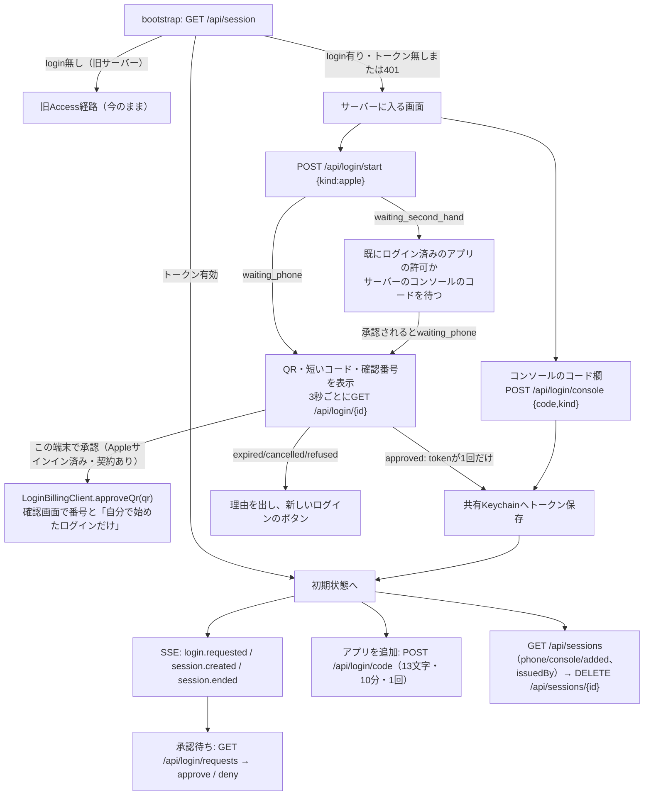
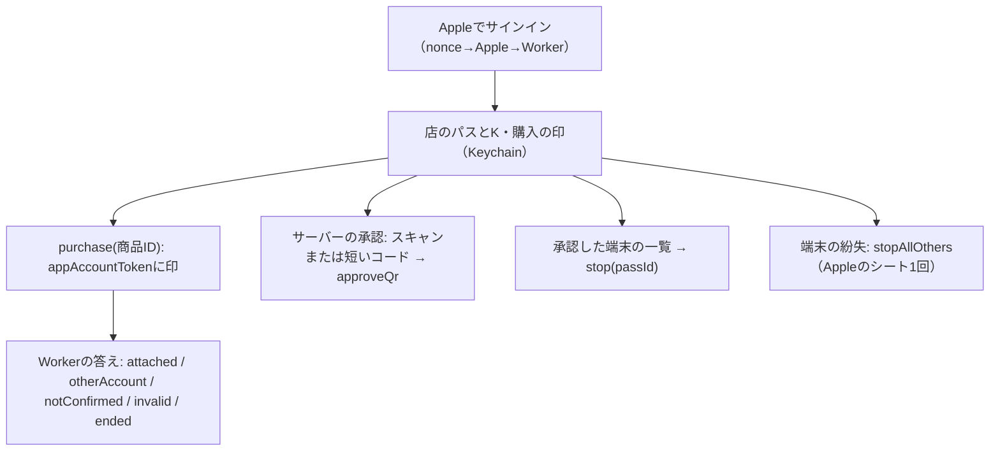
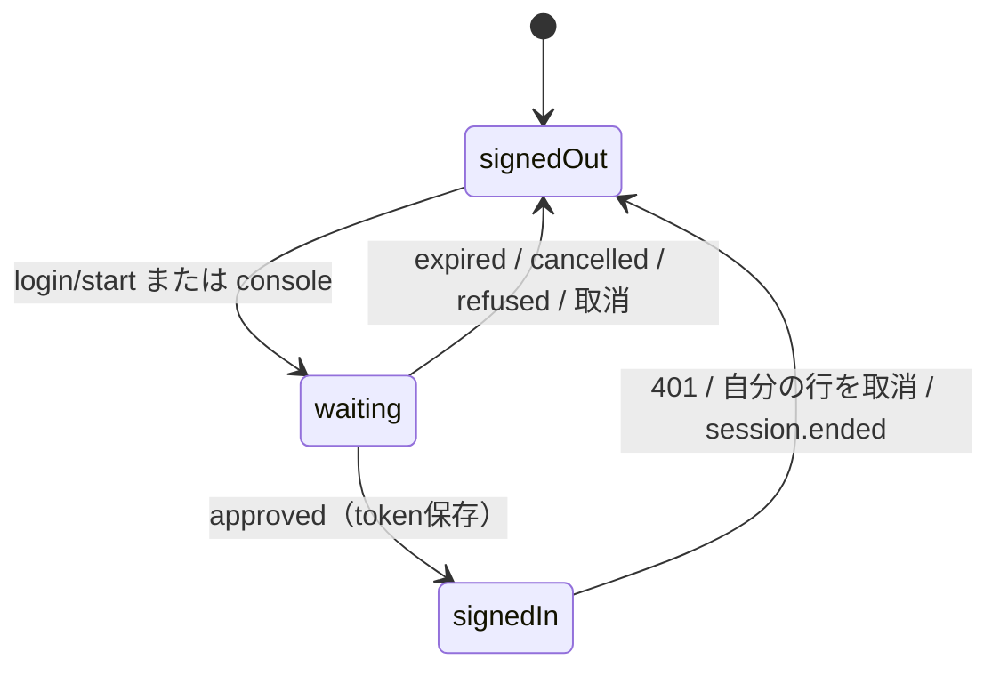

# ログインと購読の共通基盤への切替（a485-lb-apple）

[全体図](overview.md) / [接続とAI認証](requests-and-auth.md) / [購読と復元](lifecycle-and-platform.md)。正本の契約：Mint `login-billing/rulings/bellteam.md`（計画）、ライブラリ契約1.17（v0.7.2を版指定、Swift package `kitepon/login-billing`）、サーバー側の契約は[app-sessions.md](../usage/app-sessions.md)の7章（PR #2206）。Apple（iPhone・iPad・Mac Catalyst）は同じコード・同じ仕様。状態：設計。コードはこの文書の後。

## 責務（機能図）

| 部品 | 持つもの | すること | 担当 |
| --- | --- | --- | --- |
| LoginBillingClient（ライブラリ、そのまま） | 店のパス、K、購入の印、承認した端末の一覧（Keychain） | Appleでサインイン、購入、レシート送信、QRの承認、端末の一覧と停止、サインアウト。運営のWorkerだけと話す | Purika（変更しない） |
| StoreAccount（アプリ、新規） | LoginBillingClientを1つ。Workerの接続先 | 画面へ「購読中か」「承認済み端末」を渡す。ライブラリの上に再実装を置かない | Rapi |
| ServerSession（アプリ、新規） | サーバーのセッショントークン（共有Keychainの1項目、共有拡張も読む） | 探査、ログイン開始・ポーリング・取消・コンソールコード、承認待ちの一覧と許可/拒否、「アプリを追加」のコード、セッション一覧と取消 | Rapi（契約はMika） |
| BellAPI | 要求の組立 | セッションがあれば`Authorization: Bearer`を付ける。401でトークンを消して接続画面へ | Rapi |
| 旧Access経路（残す） | CF_Authorizationのクッキー | 探査の`login`が無いサーバー（古い本体）だけが使う。切替日の版で外す | Rapi |
| ユーザーのBellTeamサーバー | セッション、サーバー自身の店のパス | アプリはパスを持たず渡さない。パスは運営のWorkerだけへ行く | Mika / Bready |

## データの流れ

## 店の側（Appleのレシートとパス）

- Workerの接続先（https、1つのorigin）と「このパスで何が使えるか」の経路はBready（a485-lb-worker）が決める。決まるまで接続先は`product.json`の1項目で、未定の間は店の側の画面は動かさない。
- パスは運営のWorkerのoriginにだけ行く。ユーザーのサーバーへは行かない。
- 購入の画面からStripeの行・Google Playの行・サーバー側の購読状態の読取りを外す（「Stripeは無くなる」）。購入はApp Storeだけ。
- ログ・診断にK・パス・パスのidを書かない。

## 失敗と回復

- 探査・ログイン開始・ポーリングの一時失敗は、理由と再試行の状態を出して上限付きバックオフで続ける（回数で打ち切らない）。手動の再試行は待機中の次の試行を直ちに実行し、並列に増やさない。キャンセル・接続先変更で旧処理を終える。
- 429 `LOGIN_RATE_LIMITED`は`Retry-After`だけ待つ。503 `LOGIN_OPERATOR_UNREACHABLE`は「運営に届かない」と出し、コンソールのコードを案内する。
- `approved`の応答を取りこぼしたら新しいログインを始める（契約）。
- 非冪等なPOST（承認・拒否・コード発行）は自動で再送しない。結果を読み直して確かめる。

## 状態（セッション）

## 開いている問い

- 契約の無い人は電話から承認できない（契約の下限）。コンソールのコード経路だけが入口になる。無料利用との関係はミントが未裁定。トロニーに確認してから、契約なしの画面の状態を固定する。
- SEC-070の方向（既存アプリが1回限りのコードを出す）は「アプリを追加」の画面として入れる。`origin: added`のセッションは発行元が終わると終わる。
