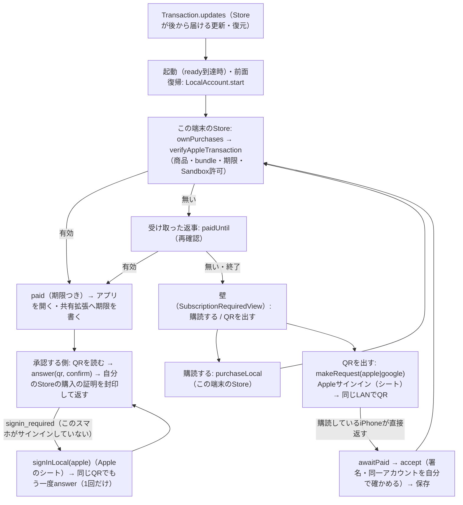
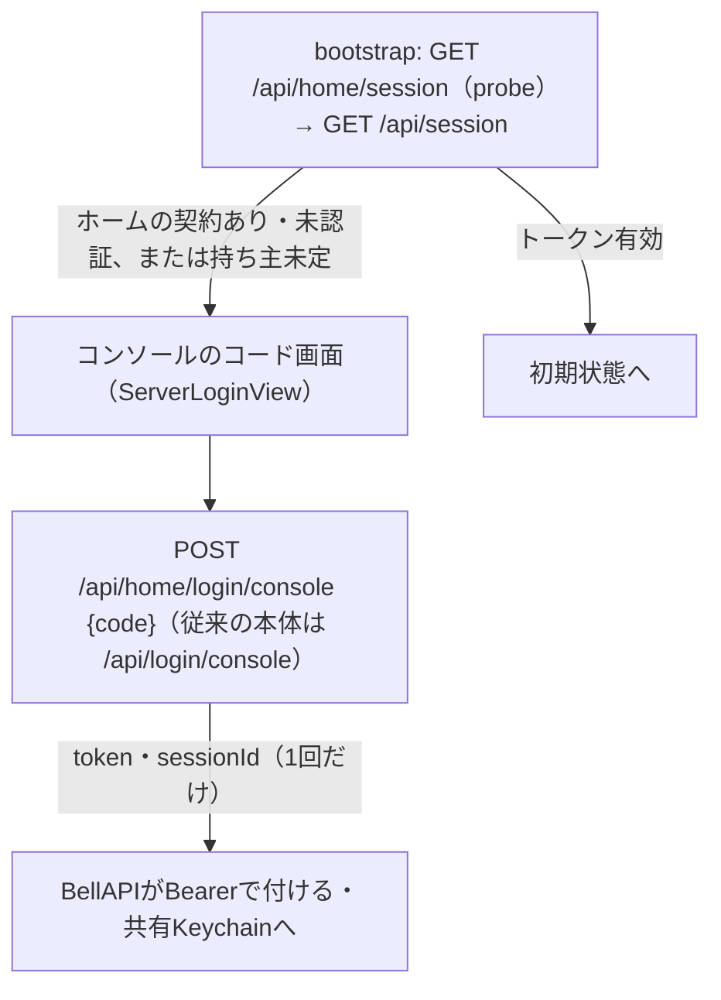

# ログインと購読：ローカルの形への切替（a540）

[全体図](overview.md) / [接続とAI認証](requests-and-auth.md) / [購読と復元](lifecycle-and-platform.md) / [アカウントを削除](account-deletion.md)。正本の契約：Mint `login-billing/library-contract.md` 1.36 10章「ローカルの形」とライブラリの`docs/local-form.md`（Swift package `kitepon/login-billing` 0.22.2（契約1.51。0.22.1からの違いは、プライベートアドレスが5つ以上ある時もQRの先頭が既定経路のアドレスのままになること。契約1.50 11.12。QRは`https://login-billing.kitepon.dev/join/dev.kitepon.bellbot#lbq4…`のリンクで、スマホ自身のカメラがアプリを開く。LocalRulesの`appId`・associated domain `applinks:login-billing.kitepon.dev`・開いたリンクをそのまま`answer`へ渡す入口`LocalAccount.open(link:)`（`onOpenURL`・`onContinueUserActivity`、確認シートは根の`LocalLinkHost`が持つ）。案内文はBellTeam自身の2文（`LocalAccount.signInGuidance`＝「QRを出す」ボタンの前、`qrGuidance`＝QRの横。全クライアントで同文）。両端末が0.22.xでなければQRは読めない）。0.21.1はMintが受け入れ済み（タグv0.21.1、契約1.48。両端末が0.21.1でなければQRのやり取りは`request_invalid`で終わる。0.20.5〜：`answer`はサインインのシートを開かず、サインインしていないスマホは`signin_required`を返す。ハッシュ不一致は`request_invalid`（以前は`other_request`）、相手の切断は`connection_closed`、証明の欠落は`proof_invalid`。BellTeamは`freeAccounts`・keyholesを設定しない（裁定なし）。0.20.4は受け入れ済みの前版：契約は変わらない。0.20.3は契約1.40：サインインが残っていない端末では`paidUntil`は何も返さない）。0.20.4で`QRScannerView`が、ローカルの形のQR（`lbq4:`、WindowsのQRを出すが出す形）も通す（0.20.3は`lbq1:`・`lbq2:`だけを通し、他のQRは黙って無視していたため、WindowsのQRを読み取れなかった）。1.37のsecret対応・監査の修理・Apple Root CA G3の内蔵を含む）。Tronieの裁定（2026-11-23、オーナーの言葉）：課金はクライアントだけで確かめる。サーバーも運営も課金に関わらない。Apple（iPhone・iPad・Mac Catalyst）は同じコード・同じ仕様。状態：コードあり、build 189をTestFlightへ上げる（行 a540-apple）。App Reviewへは別途。

## 形

出てくるのは2台だけ。**払っている端末は自分のStoreで確かめて開く**。払っていない端末は**QR**（要求のid・自分のローカルアドレスとポート・1回限りの鍵）を出し、**購読しているiPhone**がそれを読んで、同じアカウントか・自分のStoreの購入があるかをその場で確かめ、鍵で封をした返事を**同じLANの中で直接**送る。受けた端末が返事を自分で確かめる（Appleの署名つき取引、またはPlayの署名と、サインインの証）。期間が終わったら、新しいQR（自動更新はしない）。運営のサーバー・BellTeam本体による中継・AppleのWebページ・ホームのローカルモードは無い。

## 責務（機能図）

| 部品 | 持つもの | すること | 担当 |
| --- | --- | --- | --- |
| LocalForm（ライブラリ、そのまま） | この端末のサインイン（provider・subject）と受け取った返事（Keychainの専用サービス） | `makeRequest`（QRを出して待つ）、`accept`、`paidUntil`、`answer`（QRを読んで返す）、`ownPurchases`、`purchaseLocal`、`signOutLocal`。Apple署名の検証・トークンの検証・封印・LAN通信 | Purika（変更しない） |
| LocalAccount（アプリ、`Core/LocalAccount.swift`） | `paid`（この端末のStoreの購入、または受け取った返事の期間）、`checked`、QR表示中の要求、確認シートの継続 | `start`（前面復帰・起動：自分のStoreを`verifyAppleTransaction`で確かめ、なければ`paidUntil`）、購入・復元、QRを出す／読む、`removeLocal`。ライブラリの規則（`LocalRules`）を設定する：Appleのbundle id・商品ID・Sandbox許可、Playの公開鍵（Sielo、a540-play-license-key）、Googleのクライアントid（Pinocchio、a540-google-clients） | Rapi |
| BillingStore / AppAccess | 本体の`GET /api/subscription`の`setupComplete`だけ | AI利用はこの端末の確認（`LocalAccount.paid`）か初期案内だけで開く。サーバーの`accessMode`・`entitlementState`は読まない（本体は課金を判断しない、a540-server）。壁（`ReadyGate`）は、この端末のStoreを読み終えて何も払われていない時だけ | Rapi |
| 共有拡張 | 共有Keychainの`paidUntil` | アプリが`LocalAccount.paid`の変化ごとに書いた期限が今より先の時だけ送信を許す（サーバーに聞かない） | Rapi |
| ServerLogin | サーバーのセッショントークン | 本体に入る入口は**コンソールのコード**だけ：ホームの契約を持つ本体は`POST /api/home/login/console`、従来の本体は`/api/login/console`。電話の承認・運営のパス・ホームの`connectHome`は使わない（運営が無い） | Rapi |

## データの流れ

## 入口（本体に入る）

- 設定の「接続」：ホームの本体は端末の一覧（`GET /api/home/sessions`）と「ログアウトさせる」（DELETE）。パスを止める「締め出す」は無い。
- 失敗と回復：503 `SESSION_STORE_UNAVAILABLE`はトークンを残して1・2・4…30秒で再試行。トークンを消すのは確定した401だけ。コードの送信は非冪等なので自動では再送しない。

## 失敗の言葉（`LocalAccount.words`）

スマホからこの端末に届きませんでした。2台を同じネットワーク（同じLAN）につないでから、もう一度お試しください（`unreachable_same_wifi`。コード名はそのまま）／設定でローカルネットワークを許可して新しいQR（`local_network_denied`）／別のアカウントです（`other_account`）／QRの待ち時間（10分）が過ぎました（`request_expired`・`request_gone`）／相手が返事を受け取りませんでした（`device_refused`）／購読の期間が終わっています（`ended`）／QRが正しくないか相手のBellTeamが古い（`request_invalid`・`other_request`。0.21.1では版の違う2台はここで終わるので、両方を最新版にするよう言う）／相手との接続が途中で切れました（`connection_closed`）／サインインしてからもう一度お試しください（`signin_required`、承認でサインインをやり直した後にもう一度出た時だけ。やめた時（`signin_cancelled`）は何も出さない：本人の選択）／サインインできませんでした（`signin_failed`）。コードの文字列はそのまま見せない。

## 権限と設定

- `LocalRules.audiences`：バンドルIDと、BellTeamのGoogleクライアントID7つ全部（Web・iOS・Android・Desktop。`LocalAccount.googleAudiences`、Windowsの`LocalFormIds.GoogleClientIds`と同じ並び）。Playの購入の公開鍵（Sielo `a540-play-license-key`）はパッケージ名`dev.kitepon.bellbot`で`PlayRules`に入る。
- Info.plist：`NSLocalNetworkUsageDescription`（LANのBellTeam＋同じLANの端末との購読の確認）、`BellTeamGoogleClientID`と、そのクライアントの逆順のURLスキーム（`CFBundleURLTypes`）。Mac Catalystのサンドボックスは`com.apple.security.network.server`を足した（QRの受け手がLANで待つため）。`com.apple.developer.applesignin`は今までどおり。
- 一つの設定：`LocalRules.apple.sandbox = true`。TestFlight・App Reviewの購入はSandboxで、出荷版でも通すため（shortcut：本番だけのビルドができたら外す）。

## 外したもの（運営が無くなったため。Mintの裁定、Tronie経由 2026-11-23）

`StoreAccount`（店のパス・K・購入の印・承認した端末の一覧）、`approveQr`の承認画面、`HomeLoginModel`／`HomeLoginView`／`connectHome`／`reproveHome`／`endHome`、運営のWorkerの接続先（`BellTeamLoginBillingURL`）、旧StoreKit経路、`entitlementState`の壁・`accessMode: developer`の読取り、ServerLoginの電話の承認（`/api/login/start`・ポーリング）。`pass_changed`の扱いもコードごと消えた（ライブラリ0.20.0にパスは無い）。決裁箱の2つ目のパス（`ApprovalBoxLink`）は別製品の接続で、そのまま残る。

## まだ実機で確かめていないこと（ライブラリの未実証と同じ）

実際のSandbox取引を別の種類の端末が受け入れること、Googleのサインイン（iOSクライアントの設定の反映待ち）、ローカルネットワークの許可の初回の挙動、Macのサンドボックスでの待ち受け。カメラが無いシミュレーターではQRの読み取りは動かさない。
