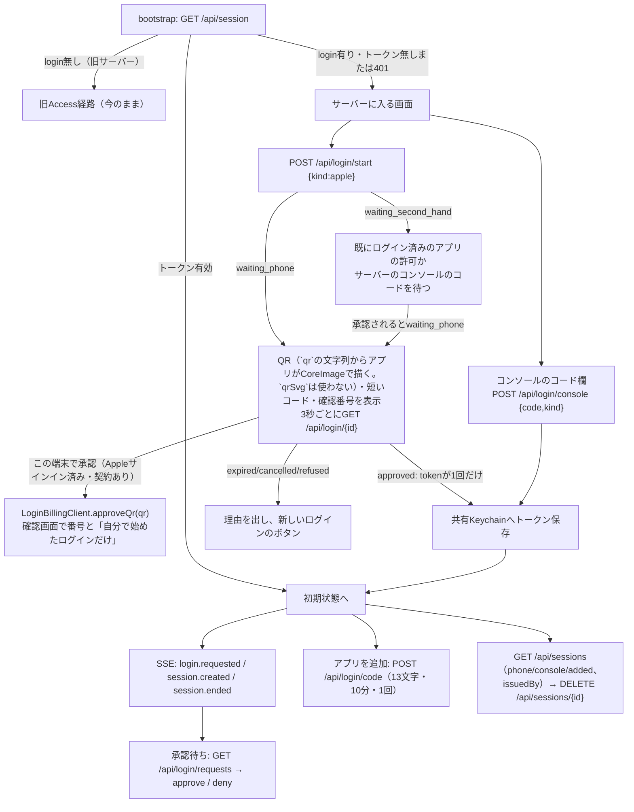
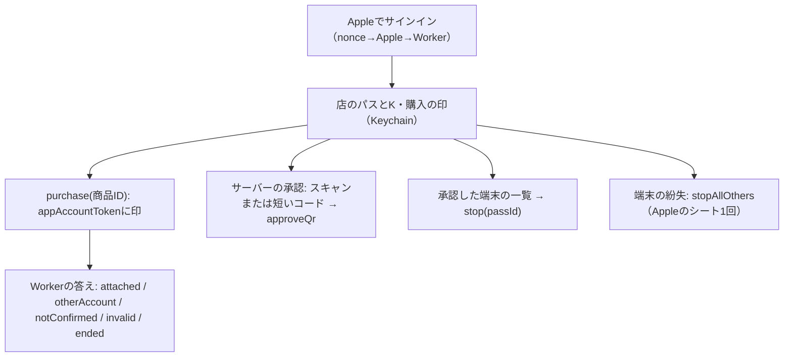
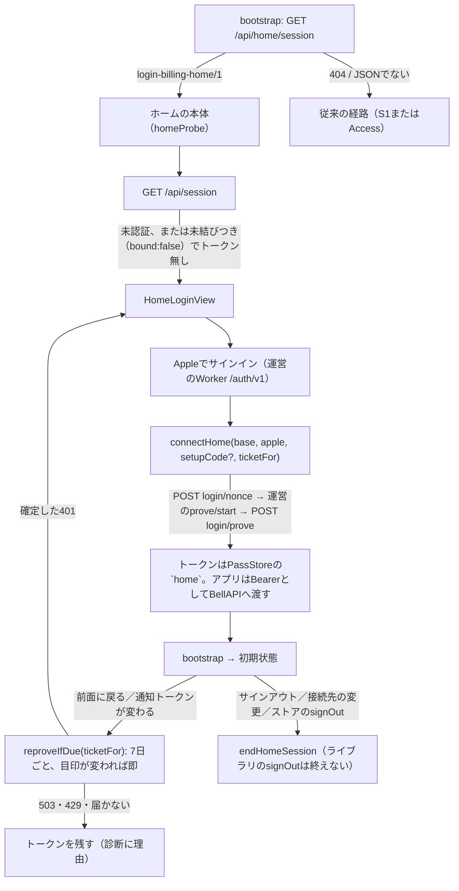
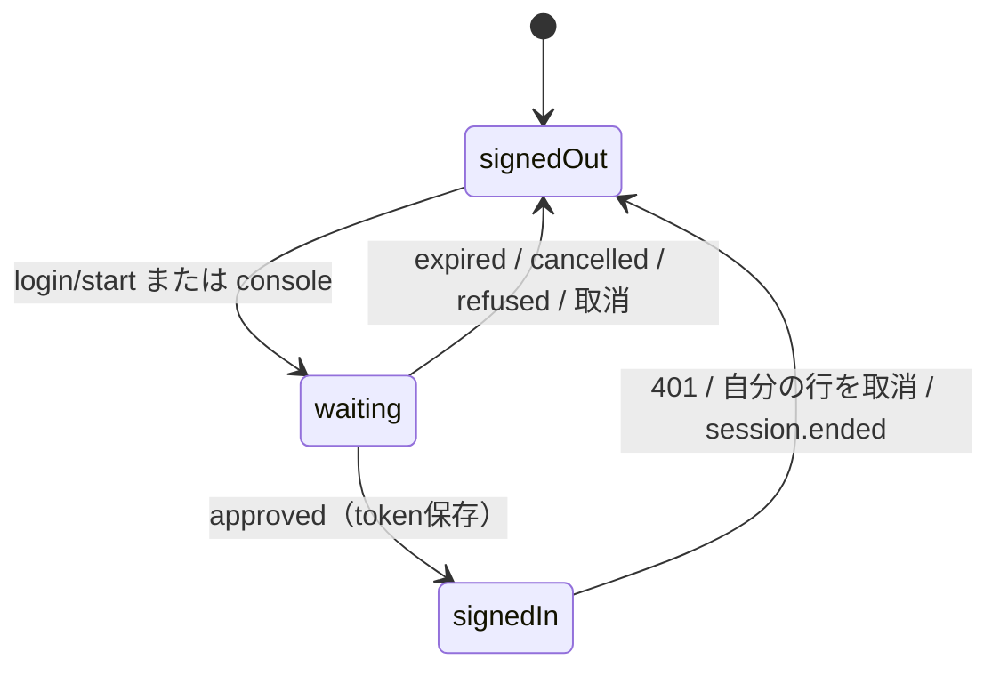

# ログインと購読の共通基盤への切替（a485-lb-apple）

[全体図](overview.md) / [接続とAI認証](requests-and-auth.md) / [購読と復元](lifecycle-and-platform.md)。正本の契約：Mint `login-billing/rulings/bellteam.md`（計画）、ライブラリ契約1.17（Swift package `kitepon/login-billing`、a492でv0.17.0（開発版。0.16.0の監査指摘の修理版、契約1.22）へ上げた。Mintの受け入れまで出荷しない）、サーバー側の契約は[app-sessions.md](../usage/app-sessions.md)の7章（PR #2206）。Apple（iPhone・iPad・Mac Catalyst）は同じコード・同じ仕様。状態：設計。コードはこの文書の後。

## 責務（機能図）

| 部品 | 持つもの | すること | 担当 |
| --- | --- | --- | --- |
| LoginBillingClient（ライブラリ、そのまま） | 店のパス、K、購入の印、承認した端末の一覧（Keychain） | Appleでサインイン、購入、レシート送信、QRの承認、端末の一覧と停止、サインアウト。運営のWorkerだけと話す | Purika（変更しない） |
| StoreAccount（アプリ、新規） | LoginBillingClientを1つ。Workerの接続先 | 画面へ「購読中か」「承認済み端末」を渡す。ライブラリの上に再実装を置かない | Rapi |
| ServerSession（アプリ、新規） | サーバーのセッショントークン（共有Keychainの1項目、共有拡張も読む） | 探査、ログイン開始・ポーリング・取消・コンソールコード、承認待ちの一覧と許可/拒否、「アプリを追加」のコード、セッション一覧と取消 | Rapi（契約はMika） |
| BellAPI | 要求の組立 | セッションがあれば`Authorization: Bearer`を付ける。401でトークンを消して接続画面へ | Rapi |
| 旧Access経路（残す） | CF_Authorizationのクッキー | 探査の`login`が無いサーバー（古い本体）だけが使う。切替日の版で外す | Rapi |
| ユーザーのBellTeamサーバー | セッション、サーバー自身の店のパス | アプリはパスを持たず渡さない。パスは運営のWorkerだけへ行く | Mika / Bready |

## データの流れ

## 店の側（Appleのレシートとパス）

- Workerの接続先（https、1つのorigin）と「このパスで何が使えるか」の経路はBready（a485-lb-worker）が決める。決まるまで接続先は`product.json`の1項目で、未定の間は店の側の画面は動かさない。
- パスは運営のWorkerのoriginにだけ行く。ユーザーのサーバーへは行かない。
- 購入の画面からStripeの行・Google Playの行・サーバー側の購読状態の読取りを外す（「Stripeは無くなる」）。購入はApp Storeだけ。
- ログ・診断にK・パス・パスのidを書かない。

## 入っているアプリ側（S2）

- 承認待ち：SSEの`login.requested`／`session.created`／`session.ended`（と`ready`）で`ServerSessionsModel.refresh`が`GET /api/login/requests`と`GET /api/sessions`を読む。承認待ちは準備ができた画面の上の帯（`LoginRequestBanner`）に出し、「許可」「拒否」の下に「自分で始めたログインだけ許可してください。」を添える。ネットワークの種類は`lan`なら「同じネットワークから」、`unknown`は「ネットワークは確認できません」とだけ言う。
- 「アプリを追加」：設定の接続に置く。`POST /api/login/code`のコード（13文字・10分・1回）を出し、閉じたら捨てる。文は7eのとおり。
- セッション一覧：`GET /api/sessions`（`origin` phone／console／added、`issuedBy`）。自分の行は「ログアウト」（`signOut`が自分のセッションをDELETEしてトークンを捨てる）、他は「取り消す」（`DELETE /api/sessions/{id}`）。
- 許可・拒否・コード発行・取消は非冪等なので自動では再送しない。失敗したら理由を出して読み直す（理由は読み直しで消さない）。

## 店の側の実装（B1）

- `Core/StoreAccount.swift`がライブラリのLoginBillingClientを1つ持つ。画面は`Views/StoreAccountView.swift`（設定の「利用と課金」の先頭のカード）：Appleでサインイン、購読（`purchase`、印つき）、QRまたは短いコードでサーバー・アプリを承認（確認番号と「自分で始めたログインだけ許可してください」の確認シート）、承認した端末の一覧と「止める」、「端末をなくした時」は`stopAllOthers`、サインアウト。QRの読み取りはライブラリの`QRScannerView`（iPhone・iPadでカメラが使える時）、Macは短いコードだけ。
- 運営のWorkerの接続先は`Info.plist`の`BellTeamLoginBillingURL`（ビルド設定`BELLTEAM_LOGIN_BILLING_URL`）。空の間はカードを出さない（ブレディのWorkerが決まるまで）。
- 契約の無いまま承認しようとするとライブラリが`no_entitlement`を返し、画面は7eの文（「先に購読してください。…」）を出す。
- 権限：`com.apple.developer.applesignin`（アプリ本体のentitlements、Macは`BellBot-Mac.entitlements`）。Apple側のアプリID（dev.kitepon.bellbot）のSign in with Appleは有効（ASC APIの実測、capability APPLE_ID_AUTH、2026-11-22 JST）。
- 購入の読み戻し（a493）：購入のあと、サーバーの答え（attached / other_account / not_confirmed / invalid / ended）と、返った権利（商品・ストア・期限）を「BellTeamのアカウント」のカードにそのまま出す（`purchaseWord`・`entitlements`）。Mintの適合確認で「見つかって有効」を読み戻した証拠にする。
- この版では従来の購入（StoreKit直接・`/api/subscription/verify`・Stripe・Google Playの行）を残す。外すのは切替の版（サーバーが契約をパスで確かめる時）で、トロニーの出荷順に従う。旧サーバーはこの版のアプリでも今までの証明の送信が要るため。

## ホームサーバーへの接続（a492、login-billing 0.17.0）

正本の契約：ライブラリ`docs/home-wire-v1.md`（Swift tag v0.17.0、これは開発版で、Mintの受け入れまで出荷しない）。ホームサーバーは接続先の`/api/home`にライブラリのホーム部品を置く。この契約を持つ本体では、上のS1（`/api/login/*`・電話の承認）は使わない。

| 部品 | すること | 担当 |
| --- | --- | --- |
| HomeConnection（ライブラリ、そのまま） | `connectHome`／`homeHeader`／`reproveIfDue`／`endHomeSession`。トークンは自分のPassStore（Keychain）の1項目`home`。オリジンだけへ付け、リダイレクトは辿らず、確定した401だけがトークンを消す | Purika |
| StoreAccount（アプリ） | LoginBillingClientと同じPassStoreでHomeConnectionを1つ持つ。接続先は`HomeServer.base`（接続先の`/api/home`）、種類は`apple`、チケットの目印は通知トークン（64バイト超はSHA-256の16進） | Rapi |
| HomeProbe（アプリ） | `GET /api/home/session`が`login-billing-home/1`なら家の本体。404とJSONでない応答だけが「家ではない」（旧経路）。接続の失敗は探査の失敗として出し、旧経路へ流さない | Rapi |
| HomeLoginModel／HomeLoginView | Appleでサインイン（パス）→ 未結びつきならセットアップコード → 「サーバーに入る」。接続は非冪等（コードは1回きり）なので自動では再送せず、理由を出す | Rapi |
| BellAPI | 接続後はトークンを`Authorization: Bearer`で付ける（接続先のオリジンだけ）。リダイレクトは辿らない。**401だけ**が認証切れ。セッションを持つ時の403（FORBIDDEN）はトークンを残し、通常の拒否として扱う（Accessの旧経路でトークンが無い時だけ403も認証切れ） | Rapi |

- 失敗の言葉：503 `SESSION_STORE_UNAVAILABLE`は「サーバーの準備中です」、429はしばらく待つ、届かない時は「つながりません」（「ログインし直してください」にはしない）。`AUDIENCE_UNKNOWN`・`PROOF_REFUSED`・`NOT_OWNER_ACCOUNT`は理由を出す。
- 最初の結びつけで運営の確認が通らなかった時（PROOF_REFUSED・届かない）は、セットアップコードは使われている（契約1.22のsetup.needed）ので、新しいコードを出すよう言う。
- 接続できたのに本体の画面を読めない時（ホームの契約だけを持つ試験用サーバーなど）は、「ホームサーバーにはつながっています（状態）が、画面を読み込めませんでした」を出す。
- 家の本体では`/api/login/*`と`/api/sessions`が無いので、承認待ちの帯・「アプリを追加」・セッション一覧は出さない（`usesServerSessions`）。
- ATS：家のサーバーへの平文httpは、`Info.plist`の`NSAllowsLocalNetworking`と私的アドレス帯の例外（10/8、172.16/12、192.168/16、169.254/16、::1、fc00::/7、fe80::/10）で通る（製品の務め）。公開ホスト名のhttpは通らない。
- F5（noteResponse）：アプリは`passHeader`／`noteResponse`でBellTeam自身のURLSessionを包まない。運営のWorkerへはライブラリのクライアントだけが話し、ホームへはhomeHeaderで付けたトークンをBellAPI（リダイレクトを辿らない）が送る。

## 失敗と回復

- 探査・ログイン開始・ポーリングの一時失敗は、理由と再試行の状態を出して上限付きバックオフで続ける（回数で打ち切らない）。手動の再試行は待機中の次の試行を直ちに実行し、並列に増やさない。キャンセル・接続先変更で旧処理を終える。
- 503 `SESSION_STORE_UNAVAILABLE`（サーバーが今は判断できない：再起動・巻き戻し）は、Keychainのトークンを残し「サーバーの準備中です」を出して1・2・4…30秒のバックオフで再試行する。トークンを消すのは確定した401 `UNAUTHORIZED`と探査の`authenticated:false`だけ。
- 429 `LOGIN_RATE_LIMITED`は`Retry-After`だけ待つ。503 `LOGIN_OPERATOR_UNREACHABLE`は「運営に届かない」と出し、コンソールのコードを案内する。
- `approved`の応答を取りこぼしたら新しいログインを始める（契約）。
- 非冪等なPOST（承認・拒否・コード発行）は自動で再送しない。結果を読み直して確かめる。

## 状態（セッション）

## 開いている問い

- 契約の無い人（Ownerの事実、Mint・Tronie経由、2026-11-21、app-sessions.md 7e）：無料なのはブラウザー版だけで、ネイティブのアプリ（iPhone・iPad・Mac・Windows・Linux・Android）は購読が要る。契約の無い人は、最初はサーバーのコンソールのコード、あとは既に入っているセッションの「アプリを追加」のコード（電話も契約も要らない）で**ブラウザー版**に入る。電話での承認は有効な契約が要るので、契約なしで試すと電話は「先に購読してください。購読しないで使うには、ブラウザー版を、サーバーのコンソールのコード、またはすでに入っているアプリの「アプリを追加」のコードで開いてください。」と出す。サーバーは「アプリは有料」を強制しない。関所は本体自身の契約の値で決まる（Tronie裁定）：ログイン後に`GET /api/subscription`の`entitlementState`を読み、'none'の時だけアプリの代わりに購読の壁（lifecycle-and-platform.mdの「購読の壁」）、'active'・'unknown'・項目なしはアプリ。サーバーに入る画面のコード欄は常に出す。文言は7eのとおり、全プラットフォームで同じ。
- SEC-070の方向（既存アプリが1回限りのコードを出す）は「アプリを追加」の画面として入れる。`origin: added`のセッションは発行元が終わると終わる。
- Real-path build (a523f, build 182): the iOS and Mac entitlements list applinks and webcredentials for `bellteam-login-real.kitepon.dev` (its apple-app-site-association names `TPWX489GV4.dev.kitepon.bellbot`, confirmed by Bready), and the build passes `BELLTEAM_LOGIN_BILLING_URL=https://bellteam-login-real.kitepon.dev/auth/v1`. Function and data flow are unchanged; only the host the existing login-billing client already talks to, and the entitlement that lets its return links open the app.
