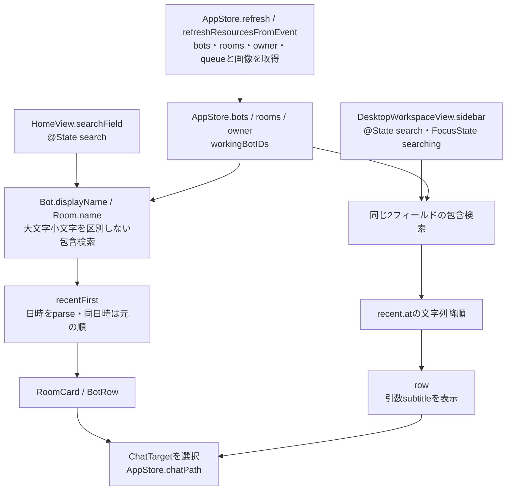
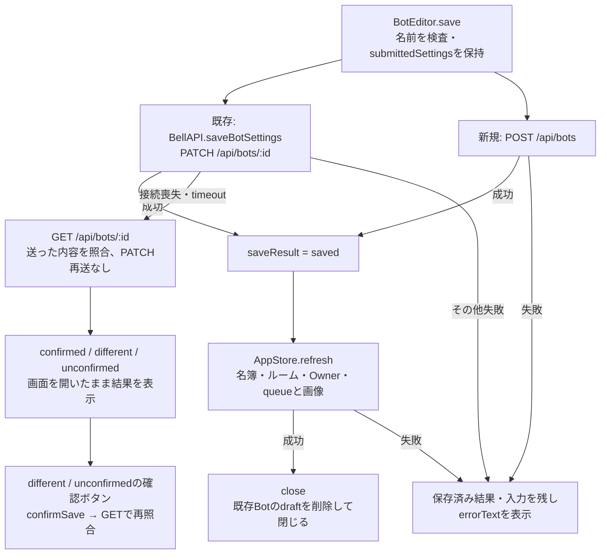
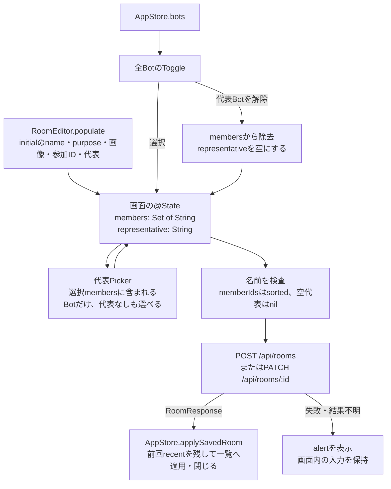

# 一覧・検索とメンバー・ルーム編集

[全体図](overview.md) / [同期](state-and-sync.md) / [プロフィール画像](settings-and-profile.md) / [関数索引](function-index.md)。固定sourceは全体図に記載。以下の実装名は`ios/BellBot/BellBot/`からの相対名。

## 一覧の素材と検索語の所有

| 表示 | タイトル・副題と補助表示の出どころ |
| --- | --- |
| iPhoneのBotRow | 名前は`displayName`。副題は`CurrentWork.label(currentWork)`（下の現在の仕事）を最大2行（幅80まで全文）で表示。カード外寸は不変（高さ87、アバター57固定）で、文字11.5pt・内側余白11・chevronを名前行へ移す文字配置だけで収める |
| iPhoneのRoomCard | 名前はname。副題は`recent.preview`、recent無しならpurpose、purpose空なら「チームで話す」。memberIds.countを人数表示 |
| iPad/MacのBot行 | `SidebarRowLabel`へ`displayName`と`CurrentWork.label(currentWork)`を渡し、副題を最大2行で表示（Roomは1行のまま）。アバターは従来の1.2倍（iPad 40→48、Mac 48→57.6）。副題11pt。一覧の列幅はiPadもMacと同じ320〜420（既定340）で、幅80の全文が2行に収まる |
| 現在の仕事 | `GET /api/bots`の`currentWork`。working+currentは本人の要約、working+staleは「作業中・要約期限切れ」、他のworkingは「作業中・要約未設定」、idleは「待機中」、unknown・欠落は「仕事状況を未取得」。文言はWebの`workLabel`と同じ。直近発言や予定promptは副題に使わない |
| iPad/MacのRoom行 | rowへ`name`と`recent.preview ?? purpose`を渡す。purpose空時の固定文は無い |
| RecentMessage.preview | messageの前後空白・改行を除き、空なら「画像」、本文の改行は半角空白へ置換。副題専用の追加HTTPなし |
| 稼働丸・ファスト表示 | BotPresenceDotは`workingBotIDs.contains(id)`なら赤点滅、onlineなら緑、それ以外は灰色。fastModeはBotFastModeBadge。BotRowの日時は`BellDate.short(recent.at)` |
| 画像の項目 | 一覧の`avatar`（Bot・Room・Owner）は省略可で、無ければ空として読む。画像は`avatarVersion`付きの個別URLから取る。他の画像本体の項目（avatarLarge等）は一覧から読まない |
| 一覧上部・下部 | オンライン人数は`store.bots.filter(online).count`、ルーム件数はstore.rooms.count。iPhoneはOwnerの名前・画像、iPad/MacはOwner名も表示 |

`HomeView.search`と`DesktopWorkspaceView.search`は別々の画面内状態。検索はサーバーへ送信しない。name（Botの内部名）、id、position、role、purpose、会話本文は検索条件に含まない。空検索で全件、大文字小文字を区別せず`localizedCaseInsensitiveContains`を使う。検索語のtrimは行わない。iPhoneは消去ボタン、iPad/Macは消去と検索focus、⌘Kを持つ。

HomeViewの並びは`BellDate.parse`で日時へ変換し、欠損・不正日時はdistantPast。同じ日時は元の配列順を保つ。DesktopWorkspaceViewは`recent.at ?? ""`の文字列比較を使う。

## 開く場所と共通編集画面

| 入口 | 行先・選択状態 |
| --- | --- |
| HomeViewの＋ | BotEditor(initial:nil) / RoomEditor(initial:nil)のsheet |
| DesktopWorkspaceViewの＋ | 同じ2つのsheet |
| iPhone/iPadの会話詳細 | [Views/ConversationDetailView.swiftのConversationDetailView](../../../../ios/BellBot/BellBot/Views/ConversationDetailView.swift#L4)からBotEditor / RoomEditorのsheet（同64行） |
| DesktopInspector | Roomはsheet。MacのBotは`openWindow(id: member-editor, value: target.id)`、iPadのBotはsheet |
| MacのMemberEditorWindow | AppStore.botsでIDからBotを求め、共通BotEditorへcloseWindow callbackを渡す |

デスクトップの会話選択は`chatPath.last`を読む。行を押すとselectedTab=0、chatPath=[target]、compactColumn=detail。詳細欄からルーム参加者のBotへ移る操作もchatPathを書き換える。

## メンバーdraft・モデル候補・画像

| 所有者 | 入力と更新 |
| --- | --- |
| BotEditorの@State | name/position/role/profileText/personality/speechStyle、harness/model/customModel/effort/fastMode/color、画像一式、保存結果・エラー、削除結果未確認 |
| 初期値 | initでinitialの保存済みプロフィール・モデル等を代入。既存Botでも候補GETを待たずフォーム値を持つ |
| AppStore.botEditorDrafts | 既存Botだけ、Bot IDをキーにBotEditorDraftを保存。settings変化や画像選択からpersistDraft。loadで復元。新規Botのdraftはこの辞書に書かない |
| 端末とフォルダ | `terminalId`・`projectRoot`の@State。対応サーバー（端末一覧200かつメンバー応答に項目あり）の時だけ送り、保存前に組の規則を検査する。端末を選ぶとフォルダ欄を`/Users/<端末のユーザー>/BellTeam/<名前のslug>`で埋め、保存の`FOLDER_*`拒否（`{error: code}`だけ）は符号ごとの文とフォームのフォルダで出し、`FOLDER_MISSING`だけ「このフォルダを作って保存」（同じ保存＋`createFolder:true`、保存済みの設定には入れない）を出す。詳細は[端末](terminals.md#メンバー編集端末とフォルダ) |
| モデル候補 | loadで`GET /api/models`、catalogとmodelErrorText。候補に無い保存済みmodelはcustomModelに保持して「その他」へ。Pickerの表示名は`ModelChoice.label`（`display_name`を前後空白除去し、null・欠落・空ならid）。選択値・tag・保存値・customModel判定は常にid |
| CLI・モデル変更 | CLI変更でmodel/effortを空にする。モデル変更で候補に無いeffortを空にする。保存済みの非候補effortは現在値としてPickerへ追加 |
| ファストモード | HarnessModels.fastModeUnavailableReasonがcatalog error、fastUnavailable、既定モデル/選択モデルのfastを参照。未知の非空モデルIDの可否は本体へ渡す。理由は赤字で出すが、モデル候補の読込中は進捗表示だけにして赤字を出さない |
| 画像 | BotEditor内の画像UIは新規作成時に表示。小/大のrender/source/cropと変更flagを持つ。既存Botの画像操作はBotProfileComponentsを使用 |
| 画像schema状態 | 新規ではappearanceLoaded=true、store.botsにavatarLargeVersion付きBotがいればappearanceSchemaAvailable=true。既存ではappearanceLoadedをdraftから復元する経路がある。loadのHTTPはモデル候補GETであり、Bot画像情報のGETではない |

BotSettingsRequestは小/大画像を変更flagに応じて送る。fastModeはinitial.fastMode（新規はfalse）から変えた時だけ送る。name/position/model/reasoningEffortはnormalizedで前後空白を除く。画像保存の詳細は[設定・プロフィール](settings-and-profile.md#メンバー画像の共通部品)へ接続する。

## メンバー保存：受付・照合・再取得

`saveBotSettings`のGET照合はBotSettings.normalizedと応答を比較する。変更していない小/大画像は応答の現在値をexpectedへ採用する。照合GETの認証失敗はthrow、それ以外はunconfirmedを返す。BotEditor.saveは戻り値がsavedの時だけ後続refreshへ進むため、confirmedから自動で閉じる経路は無い。`confirmSave`自身も結果表示までで、一覧refreshやcloseは呼ばない。

保存中はフォームと明示close/saveを無効にする。settingsが変われば保存結果とsubmittedSettingsを消してdraftを更新する。BotEditorの明示「キャンセル/閉じる」はcloseでdraftを削除する。未保存変更の確認ダイアログはこの画面に定義されていない。認証失敗時はrequireLoginへ渡し、既存BotのAppStore内draftは保持する。sheetやwindowのOS操作で閉じた時の実効挙動は未調査。

## ルーム編集とメンバー選択

代表は自動選出しない。Pickerの「代表なし」は空文字、保存時nilへ変換する。参加者を外す時、それが代表なら代表も空にする。選択IDはRoomEditorだけが保持し、AppStoreへ保存前に書かない。選択候補はstore.botsの全件で、deletingを除外する条件はこのToggle列には無い。

ルーム保存は一覧GETを待たずRoomResponseからapplySavedRoomしてdismissする。recentは既存roomの値を保持し、応答のavatarVersionを新しいRoomへ渡す処理はapplySavedRoom内に無い。その後のSSE/共通一覧GETは別経路。保存失敗時は入力と画面を残し、invalidResponseやURLErrorでは結果未確認の案内を出す。再送・照合GETを自動では行わない。認証失敗はrequireLoginへ渡す。RoomEditorのdraftをAppStoreへ退避する処理は無い。

キャンセルはdismissのみ。未保存変更の確認、AppStoreへの保存前適用は無い。画像の切り抜き結果もRoomEditor.avatarに留まり、保存ボタンでRoomRequestへ含める。

## 削除：受付と完了を分ける

| 段階 | メンバー | ルーム |
| --- | --- | --- |
| 確認 | AI停止、設定・会話・予定・記憶とルームからの除去を説明するalert | ルームの設定・履歴・予定を削除し、参加メンバーは残すと説明するalert |
| 要求 | BotEditor.deleteMember → AppStore.requestBotDeletion → DELETE /api/bots/:id | RoomEditor.deleteRoom → AppStore.deleteRoom → DELETE /api/rooms/:id |
| API成功 | 現在一覧にいるIDをpendingBotDeletionIDsへ。フォーム編集・再削除を止め、結果確認を表示 | applyDeletedRoomで一覧、chatPath、そのルームのConversationDraftをclearして除去しdismiss |
| 完了の観測 | confirmBotDeletionのrefreshまたはSSE後の一覧GETでID消失。applyFetchedBotsがdraft・選択等を整理。BotEditorはstore.bots.map(id)の変化でclose | DELETE成功後にAppleの状態を整理。追加の一覧消失確認を挟まない |
| 拒否・結果不明 | errorText。結果不明ならdeletionResultUnconfirmedを立てる。入力・一覧・選択を残し、確認GETを案内 | errorTextのalert。一覧・選択・draftを残す |
| 確認操作の失敗 | 「削除結果を確認できませんでした」、IDがまだあるなら未完を表示 | 独立した確認操作なし |

削除の意味は画面とAPI境界から確認した範囲。本体内の削除手順の証明には使わない。

## 整理候補

- **A-M1**：`ios/BellBot/BellBot/Views/HomeView.swift:9, 19, 206, 245`と`ios/BellBot/BellBot/Views/DesktopWorkspaceView.swift:16, 151, 156`。両画面が名前検索・recentによる並び・副題の決定をそれぞれ持つ。日時比較方式、peer置換、空副題の固定文が異なる。

## 未調査

- 本体のメンバー/ルーム保存・削除、モデルの実適用、代表の本体検証、削除完了の内部条件。
- 実UIの未保存状態、sheetのスワイプ終了、Mac windowの閉じる操作、再認証後の画面再生成、複数windowの同時編集。ビルド・試験は未実行。
- BotSave/MemberDeletion/RoomDeletion/ProfileTerminal等のXCTest本文・fixture。索引には宣言で確認した対象だけ記載。
