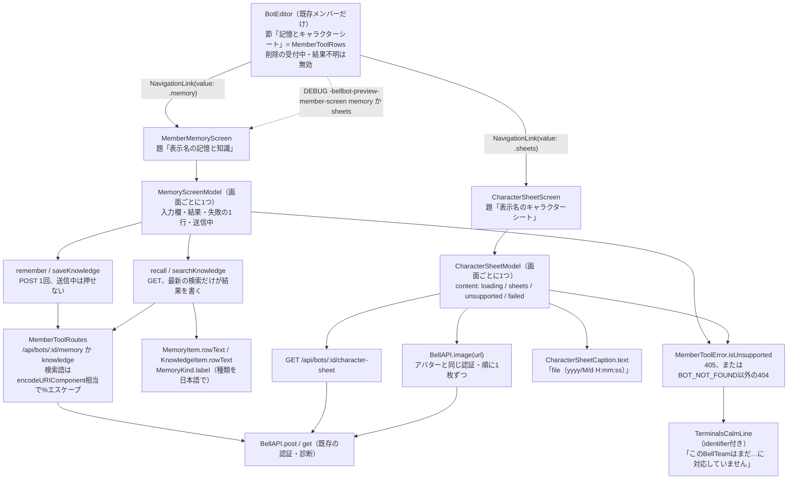
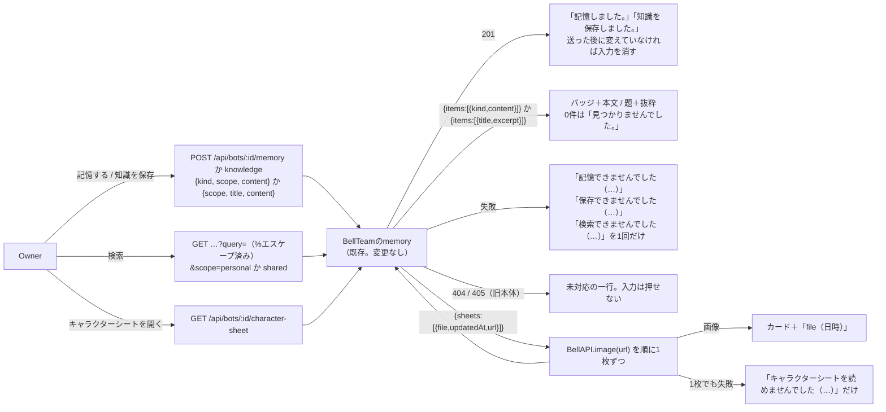

# メンバーの記憶と知識・キャラクターシート

[全体図](overview.md) / [メンバー・ルーム編集](members-and-rooms.md) / [端末](terminals.md)（未対応の一行の型） / [関数索引](function-index.md) / [試験](tests.md)。以下の実装名は`ios/BellBot/BellBot/`からの相対名。

Webにある二つの画面をAppleにも置く。メンバー編集の「記憶とキャラクターシート」節から開く。使う契約は変えない。

- 記憶と知識：[Web](../web/apple-parity.md)の`web/memory-view.js`と同じ。`POST`と`GET /api/bots/:id/memory`、`POST`と`GET /api/bots/:id/knowledge`（`src/http-bot-api.mjs`、[memory](../memory/README.md)）。
- キャラクターシート：`web/bot-read-views.js`の`createCharacterSheetView`と同じ。`GET /api/bots/:id/character-sheet`と、一覧の`url`の画像（`src/members/profiles-http.mjs`、[members profiles](../members/profiles.md)）。
- Appleは利用側で、HTTPの契約もMCPも変えない。固定・改訂・まとめ（`PATCH …/memory/:id`、`…/pin`、`…/consolidate-growth`）はWebも呼ばないため、Appleにも置かない。

## 機能図

## 機能の所有と呼び出し元

| 部品 | 所有する機能 | 呼ぶ側 |
| --- | --- | --- |
| `MemberToolRows`・`MemberToolScreen`（`Views/MemoryKnowledgeView.swift`） | 二つの入口の行（アイコン・題・一行の説明）。`BotEditor`の`NavigationStack(path:)`へ値で積む。新規メンバーには出さない（Webも既存メンバーだけ） | `BotEditor`（`Views/ManagementView.swift`）。iPhone・iPadのsheetとMacの編集窓の三つが同じ`BotEditor`を使う |
| `MemberMemoryScreen` | 四つの節（長期記憶を追加・長期記憶を検索・知識を追加・知識を検索）の表示。種類は日本語の小さなバッジ。成功は節の中に1行、失敗は押した節に赤の1行 | `MemberToolDestination` |
| `MemoryScreenModel`（`Core/MemoryKnowledge.swift`） | 入力欄、送信規則、結果、失敗の1行、未対応の判定。画面を閉じるか別のメンバーを開くと、モデルごと捨てて結果を残さない | `MemberMemoryScreen`が`@StateObject`で持つ |
| `MemoryKind`・`MemoryScope` | Webの選択肢と同じ9種類と2つの保存先（`fact`…`growth`、`personal`＝このBot、`shared`＝BellTeam共通）。種類ごとにアイコンと色。知らない種類はサーバーの語のまま出す | 画面とモデル |
| `MemberToolRoutes` | 経路と検索語の%エスケープ。`encodeURIComponent`と同じ（ASCIIの英数と`- _ . ! ~ * ' ( )`以外は全部エスケープ。日本語・`&`・`#`・`+`も） | モデル |
| `MemberToolError.isUnsupported` | 旧い本体の判定。405、または`BOT_NOT_FOUND`以外の404。メンバーが居ない404は未対応にしない | 二つのモデル |
| `CharacterSheetScreen`・`CharacterSheetModel`（`Core/CharacterSheets.swift`） | 一覧を読み、画像を1枚ずつ取る。1枚でも失敗したら一覧ごと1行に替える（Webと同じ）。画面を閉じると読みを取り消す | `MemberToolDestination` |
| `CharacterSheetCaption` | 「file（日時）」。日時は`ja-JP`の既定（`2026/11/10 9:05:03`）。読めない日時はfile名だけ。空の文「まだ置かれていない。」と失敗の文 | モデルと画面 |

## データの流れ

読みの結果は画面のモデルだけが持ち、`AppStore`や永続層へ書かない。サーバーの項目のうちWebが使わない`id`・`importance`・`metadata`・`match`・`path`・`tags`などは読まず、固定・改訂の操作も持たない。

## Webと同じにした動き

- 記憶を送る：種類・保存先・内容 → 1回の`POST`。送信中はボタンを押せず（進捗の輪を出す）、同じ操作は2回目を送らない。成功で「記憶しました。」を出し、内容は送った後に変えていなければ空にする。
- 長期記憶を検索：検索語・保存先 → `GET`。結果は「[種類] 内容」（Appleは種類を日本語のバッジで出し、読み上げと試験用の文は`[事実] 内容`）。0件は「見つかりませんでした。」。
- 知識を保存：保存先・タイトル・内容 → 「知識を保存しました。」。成功して変えていなければ、保存先も含めて初期に戻す。
- 知識を検索：タイトル＋抜粋の行。
- 失敗の1行は、押した節に1つだけ。次の操作を始めると消える。同じ検索を重ねた時は、最後に押した検索の結果だけが出る。
- 書き込みの失敗の中の「結果を確認できませんでした」は既存の`BellAPIError.operationFailureMessage`の文で、保存されたか分からない時に再送を促さない。
- 認証の失敗は既存の`requireLogin`へ渡す。診断は`/api/bots/:id/memory`など型の経路だけで送る。

## Webと違うところ

- 入力が空（空文字）の間は、ブラウザの`required`と同じく送れないようボタンを押せなくする。空白だけは送る（サーバーが拒否したら、その文を出す）。
- 「記憶しました。」「知識を保存しました。」は、Webでは検索結果の欄に出る。Appleは押した節の中に出し、検索結果を消さない。
- 画面の入口は、Webの「記憶と知識」「キャラクターシート」の2つのボタン（Webは編集のダイアログを閉じてから開く）に対し、Appleは編集画面の中へ積む。編集中の入力は残る。
- キャラクターシートの画像は、Webと同じく拡大表示を持たない。

## 旧い本体との互換

| 状況 | 画面 |
| --- | --- |
| 記憶・知識の経路が404（`BOT_NOT_FOUND`以外）または405 | 画面の上に「このBellTeamはまだ記憶と知識に対応していません」の1行（`memory-unsupported`）。記録する・検索するのボタンは押せない |
| キャラクターシートの一覧が404（`BOT_NOT_FOUND`以外）または405 | 「このBellTeamはまだキャラクターシートに対応していません」の1行（`sheets-unsupported`） |
| 404の`BOT_NOT_FOUND`（メンバーが消えた） | 未対応にせず、通常の失敗の1行 |
| 503・接続失敗など | 通常の失敗の1行。再送はしない |

## 試験

[tests.md](tests.md)の`MemoryKnowledgeTests`（単体）と`MemoryKnowledgeUITests`（iPhone 17 Pro、`test/helpers/memory-ui-server.mjs`）。画面写真は添付。

## 未調査

- 実機の画面とVoiceOverの読み上げ。Mac Catalyst・iPadの実画面は使い捨ての自己描画で確かめたもので、操作の通し試験は行っていない。
- 本体のmemory・character-sheetの内部。Appleは契約の利用側としてだけ扱う。
