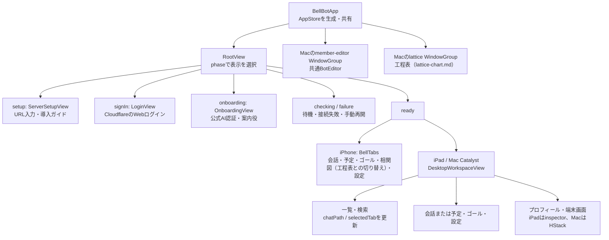
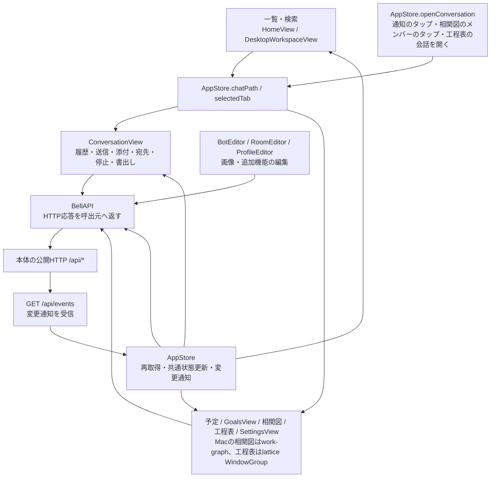
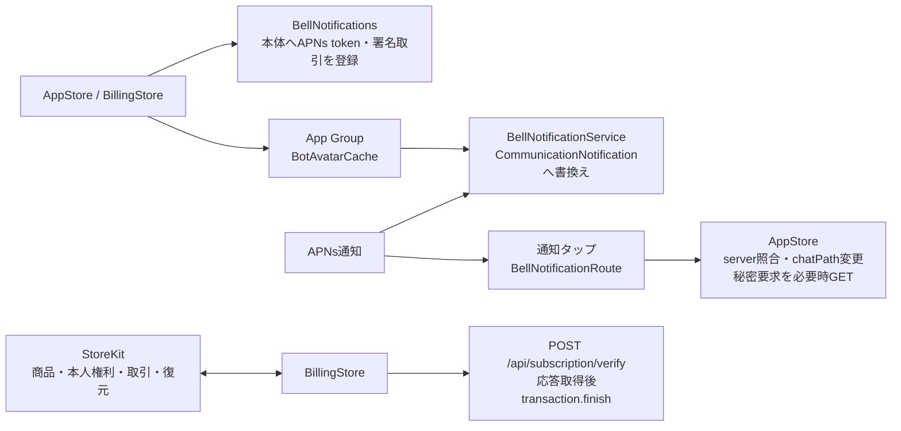

# Appleアプリの全体機能図

[担当の正本](README.md) / [状態と同期](state-and-sync.md) / [ファイル・関数索引](function-index.md)。

調査source：`refactor/apple-feature-map-20261103`、HEAD `4e01fadcb5edcaa74c010436a47be9cb26eabeec`。以下はこの版のApple実装を静的に読んだ結果。図のHTTPはAppleが呼ぶ公開route、SSEはAppleが解釈するイベント名・topicを示す。本体内部の処理完了をAppleのHTTP成功から補っていない。

## 入口と画面配置

入口は [BellBotApp.swift](../../../../ios/BellBot/BellBot/App/BellBotApp.swift#L4)、配置は [DesktopWorkspaceView.swift](../../../../ios/BellBot/BellBot/Views/DesktopWorkspaceView.swift#L25)。iPadのcompact幅では一覧・詳細を切替え、詳細パネルを閉じる。Macは個別Botの会話とプロフィールを等幅にし、ルーム詳細は固定幅。iPhoneの詳細はシート。全画面が同じ`AppStore`、通信・編集部品を使う。

## 機能と状態の接続

SSE本文をそのまま名簿や会話の正本にしない。`AppStore`が必要な資源のHTTP再取得、`eventRevision`、`conversationChanges`、`scheduleChanges`へ振り分け、画面も自分の履歴・予定・goalを読み直す。詳細は[状態と同期](state-and-sync.md#sseの適用)を参照。

## 機能一覧と公開窓口

ファイル欄は`ios/BellBot/`からの相対名。関数へのリンクは[索引](function-index.md)に集約する。`T`は`/api/bots/:id`または`/api/rooms/:id`。SSE欄の`全更新`は`ready`・非対象指定の`messages`・未知イベント等による`eventRevision`と再取得を指す。topicは`messages`イベントの`topics`内の値。

| 機能 | 所有する状態・主な実装 | 本体のHTTP公開窓口 | SSEの接点 |
| --- | --- | --- | --- |
| 入口・platform配置 | `BellBot/App/BellBotApp.swift`、`Views/HomeView.swift`、`Views/DesktopWorkspaceView.swift`。phase・タブ・会話選択はAppStore | 起動時`GET /api/session`、`/api/settings`、`/api/setup` | ready後に接続開始 |
| 共通状態と同期 | `Core/Models.swift`、`AppStore.swift`、`BellAPI.swift`。名簿・Owner・稼働ID・設定・初回状態・AI停止状態 | `GET /api/bots?avatar=omit`、`/api/rooms?avatar=omit`、`/api/owner?avatar=omit`、`/api/queue`、`/api/events` | `ready`、`settings`、`setup`、`ai-control`、`bots`、`messages`。全topicの表は[詳細](state-and-sync.md) |
| 一覧と検索 | `Views/HomeView.swift`、`DesktopWorkspaceView.swift`。検索語は各画面の`@State`。Bot.displayName、Room.nameを検索 | 共通状態のGETを利用。検索専用HTTPなし | topic `bots`、`rooms`、`timeline`、`requests`、`questions`等から一覧再取得 |
| 会話・下書き・配送表示 | `Views/ConversationView.swift`、`Views/ConversationInput.swift`、`Core/ConversationDraft.swift`、`ConversationTimelineState.swift`、`BackgroundMessageSend.swift`。下書きは宛先別、履歴・pending送信・queueは会話画面 | `GET T/messages?limit=10`、`?limit=20`、`?limit=25&before=:id`、`?after=:id`、`GET T/queue`、`POST T/messages` | 全更新、topic `timeline`、`queue`、`requests`、`questions`で対象会話を再取得 |
| 会話行・本文・画像 | `Views/ConversationList.swift`、`MessageText.swift`、`SelectableText.swift`、`ConversationImages.swift`の画像gallery/cache、`Design/AvatarTone.swift`。UITableViewの行・Markdown先読み・末尾追従 | 画像は履歴の`imageUrls / imageUrl`を`BellAPI.image`でGET。routeをAppleで組み立てない | 履歴更新経由 |
| 添付とルーム宛先 | `ConversationView.swift`の写真・Macファイル選択とURLドロップ、`Views/ConversationInput.swift`の入力・画像貼付け、`Core/ConversationDraft.swift`のPendingImage（JPEG化）。宛先は会話の`selectedTargets`。未選択の自動選択はrouting設定を参照 | `POST T/messages`の`images`と`targets` | topic `settings`でrouting設定更新、`rooms`で参加者更新 |
| 会話書き出し | `ConversationView.swift`、`Core/ConversationDocument.swift`。FileDocumentでJSON出力 | `GET T/export` | 直接の専用購読なし |
| 個別停止・再起動・端末画面 | `ConversationView.swift`内の`stopBot`、`Views/ConversationDetailView.swift`の詳細プロフィールと再起動、`Views/BotScreenView.swift`の`BotScreenView`・`BotTerminalTextView`、`DesktopInspector`。再起動の`EmptyBody`は`Core/Models.swift` | `POST /api/bots/:id/stop`、`POST /api/bots/:id/restart`、`GET /api/bots/:id/screen?history=1`。画面はactive時に1秒ごと、失敗で停止 | 停止後は履歴・名簿再取得。端末画面はSSEでなく照会 |
| メンバー・ルームの作成編集削除 | `Views/ManagementView.swift`、`Core/BotSettings.swift`。draft・選択ID・保存照合は[詳細](members-and-rooms.md) | `GET /api/models`、`GET /api/bots/:id`、`POST /api/bots`、`PATCH /api/bots/:id`、`DELETE /api/bots/:id`、`POST /api/rooms`、`PATCH /api/rooms/:id`、`DELETE /api/rooms/:id` | `bots`または全更新、topic `bots`・`rooms`。Bot削除完了はGET一覧で確認 |
| Owner・規範・メンバー画像 | `Views/SettingsView.swift`、`BotProfileComponents.swift`、`AvatarImagePicker.swift`、`AvatarCropEditor.swift`、`Core/AvatarImage.swift`。編集状態は[詳細](settings-and-profile.md) | `GET /api/user-rules`、`PATCH /api/owner`、`PUT /api/user-rules`、`GET /api/bots/:id/avatar?v=:version`、`GET /api/rooms/:id/avatar?v=:version`、`GET /api/owner/avatar?v=:version`、`GET /api/bots/:id/avatar-large?v=:version`、`GET/PATCH /api/bots/:id` | topic `owner`・`bots`、全更新 |
| 設定・全体停止・会話の開き方 | 導線の正本は[設定の機能図と状態遷移](settings-user-flow.md)。`SettingsView.swift`、`FeatureSettingsView.swift`。会話の開き方は端末のAppStorage | `GET /api/settings`、`PATCH /api/settings/:id`、`GET /api/session`、`GET/PATCH /api/ai-control` | イベント/ topic `settings`・`ai-control` |
| 予定一覧・作成・編集・削除・手動実行 | `Views/SchedulesView.swift`、`Core/Models.swift`。取得詳細は既存の[予定一覧図](schedule-list.md) | `GET /api/schedules`、`GET/POST T/schedules`、`PUT/DELETE T/schedules/:scheduleId`、`POST T/schedules/:scheduleId/run` | 全更新、topic `schedules`。activeかつ予定タブで再取得 |
| goal一覧・会話内goal・操作 | `Views/GoalsView.swift:11,149`の各画面が`Core/GoalViewModel.swift:89`のGoalViewModelを所有。値型とharness別decodeは`Core/GoalModels.swift:3`、取得・変更状態と通信専用型は`Core/GoalViewModel.swift:4`。capabilities・fieldCapabilities・binding・outcomeを解釈 | `GET /api/goals`、`GET/POST /api/bots/:id/goal`。actionはcreate/edit/pause/resume/clear | `eventRevision`を購読。専用goal topicの列挙なし |
| 質問・選択回答 | `Views/OwnerQuestionView.swift`、`ConversationView.swift`。カード状態は会話が保持 | `POST /api/owner-questions/:id/answer` | topic `questions`、全更新、通知の`owner_question` |
| 秘密入力・拒否 | `Views/SecretRequestView.swift`、`BellAPI.finishSecretRequest`。値は入力画面だけに保持し、送信前・非active・閉じる時に消去 | `GET /api/secret-requests/:id`、`POST /api/secret-requests/:id/submit`または`/cancel` | topic `requests`、全更新、通知の`secret_request` |
| 接続認証・初回利用・AI再認証 | `LoginView.swift`、`OnboardingView.swift`、`HarnessAuthenticationView.swift`、`AuthenticationInstructions.swift`、`Core/HarnessAuthenticationFlow.swift`、`Shared/ServerOrigin.swift` | `GET /api/session`、`GET /api/setup`、`POST /api/setup/harness`、`POST /api/setup/start`、`POST /api/setup/auth/input`。`GET /api/harness-auth`、`GET /api/harness-auth/:harness`、`POST /api/harness-auth/:harness/start`、`POST /api/harness-auth/:harness/input`、`POST /api/harness-auth/:harness/cancel` | `setup`イベント/topic。認証waitingは3秒照会、入力失敗後は明示更新待ち |
| サーバー導入ガイド | `Views/ServerInstallationGuide.swift`。同梱Markdown表示、依頼文のコピー・共有、導入URLへのLink | ガイド表示自体の本体HTTPなし | なし |
| Update画面（商用更新） | `Core/UpdateModels.swift`、`Core/UpdateStore.swift`、`Views/UpdateView.swift`。`AppStore.updates`・`updatePresented`、`HomeView`・`DesktopWorkspaceView`のロゴ右の印、`BellNotifications`の`BellUpdateRoute`。詳細は[Update画面](update.md) | `GET /api/updates`、`POST /api/updates/plans`、`POST /api/updates/operations`、`GET /api/updates/operations/:requestId` | `type=updates`と`ready`でGET。push `kind=update`はタップで画面を開くだけ |
| push登録・受信・通知から移動 | `Core/BellNotifications.swift`、`AppStore.openPendingNotification`（会話の移動は`AppStore.openConversation`。相関図のメンバーのタップも同じ経路を使う。[相関図](work-graph.md)）、`NotificationService/BellNotificationService.swift`、`Shared/CommunicationNotification.swift`・`BotAvatarCache.swift` | `GET /api/notifications`、`POST /api/notifications/devices`、`POST /api/notifications/unregister`。秘密要求は個別GET | 通知拡張はSSE・HTTPを使わずApp Groupの画像を読む |
| 購読と復元・AI利用判定 | `Core/BillingStore.swift`、`AppleSubscriptionAccess.swift`、`Views/SubscriptionView.swift`。StoreKit本人権利と本体状態を別に保持 | `GET /api/subscription`、`POST /api/subscription/verify`、`POST /api/subscription/refresh`。AppleのStoreKit商品・取引・復元も利用 | 専用購読なし。前面復帰で再確認 |
| 端末保存とlogout削除 | `AppStore.swift`、`BellNotifications.swift`、`BotAvatarCache.swift`、`ConversationList.swift`。保存物・残存物は[状態の詳細](state-and-sync.md#端末保存と後始末) | 通知解除は`POST /api/notifications/unregister`。logout専用HTTPなし | logoutでSSE停止 |
| 診断 | `Core/BellDiagnostics.swift`、`BellAPI.swift`。呼出元が影響と入力保持を渡す。MetricKitのhang/crashも送る | `POST /api/diagnostics`。BellAPIを介さずURLSession.sharedから送信、202を確認 | SSEの失敗もAppStoreから診断 |
| 試験とpack構成 | `BellBotTests/`、`BellBotUITests/`、`Tests/`、`Core/PreviewFixtures.swift`、`project.yml`、Xcode schemeとPackage.resolved | Debug fixtureまたは試験用接続先。製品機能のHTTP窓口なし | preview引数でSSE開始する経路あり |

Appleソースで独立したApproval Box用の型・route・画面は確認していない。確認できた選択要求は`OwnerQuestionCard`であり、上表では質問・選択回答として扱う。

## 通知・購読・端末保存

通知拡張は送り主・アバター不足、画像読取・Intent寄付・書換え失敗、期限切れではログを出して元の通知を返す。購読画面は購入のpendingと取消、権利の未確認と失効を別に表示する。`deliver`はverify応答を得て`status`を更新し、取引をfinishした後で`subscription.error`を検査する。

## 試験とpackの範囲

[project.yml](../../../../ios/BellBot/project.yml)はアプリ、通知拡張、単体試験、UI試験のtargetを定義する。アプリに`Shared`、`services/subscriptions/product.json`、`docs/server-installation.md`を組込み、通知拡張も`Shared`を使う。EnrichedMarkdownをSwift Packageとして登録し、通知拡張をembedする。Bundle IDから通知拡張IDとApp Group IDを導く。schemeの試験設定はDebug、`-bellbot-preview`を指定する。

[scripts/install-mac.sh](../../../../scripts/install-mac.sh)はMac Catalyst Releaseビルド、署名検査、既存アプリのバックアップ・終了、コピー、再検査、起動確認を記述している。今回は実行していない。Xcode project全体と配布物の中身を照合していないので、構成の読取をpack成功とは扱わない。

## 整理候補

- **A-O1**：会話の取得送信は`ios/BellBot/BellBot/Views/ConversationView.swift:49`に残す。PR3で入力部品を`Views/ConversationInput.swift:5, 69, 135`、添付値を`Core/ConversationDraft.swift:51`、画像gallery/cacheを`Views/ConversationImages.swift:5, 11, 59, 146, 186, 198`へ配置した。PR2のプロフィール詳細（`Views/ConversationDetailView.swift:4`）、端末画面（`Views/BotScreenView.swift:4, 9, 32, 47`）、`EmptyBody`（`Core/Models.swift:533`）の配置は同じ。行位置と型名は[索引](function-index.md)を参照。

## 未調査

- 本体`src/`・`web/`の内部と、routeの受信後の実行・保存・配送。
- 実端末・Simulatorでの画面、通信、APNs、StoreKit、復旧、配布物の動作。ビルド・試験は未実行。
- XCTest45ファイルの本文・fixture・assertion、Xcode生成物全体、署名・配布設定の実効値。試験対応は宣言の読取まで。[調査目録](function-index.md#読取範囲と本文未読のswiftファイル)を参照。
- Mermaidの描画結果。ローカルのMermaid描画CLIは未導入で、今回の確認はラベル形式とリンク先・行番号の静的照合まで。
