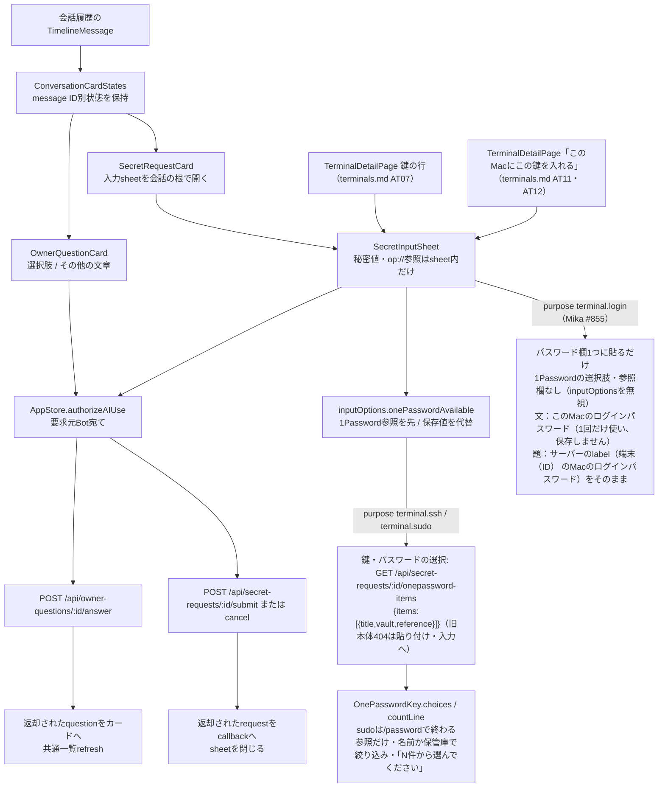
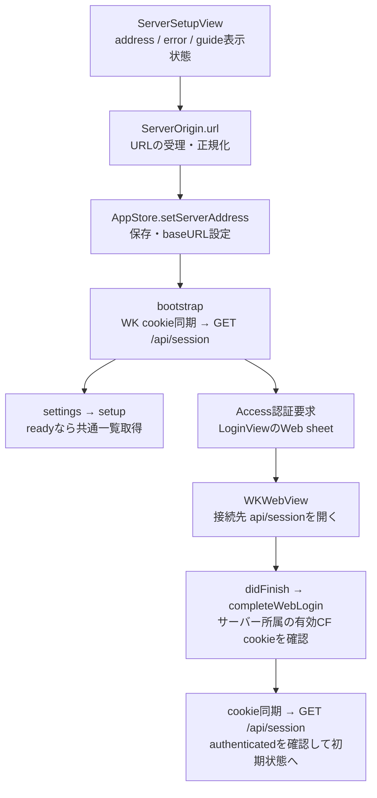
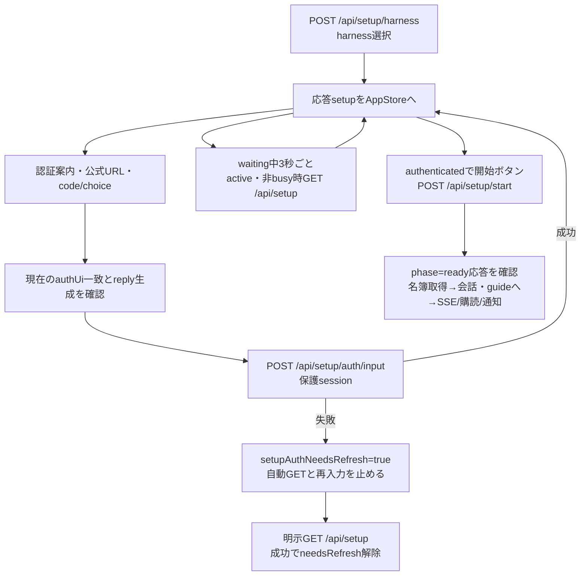
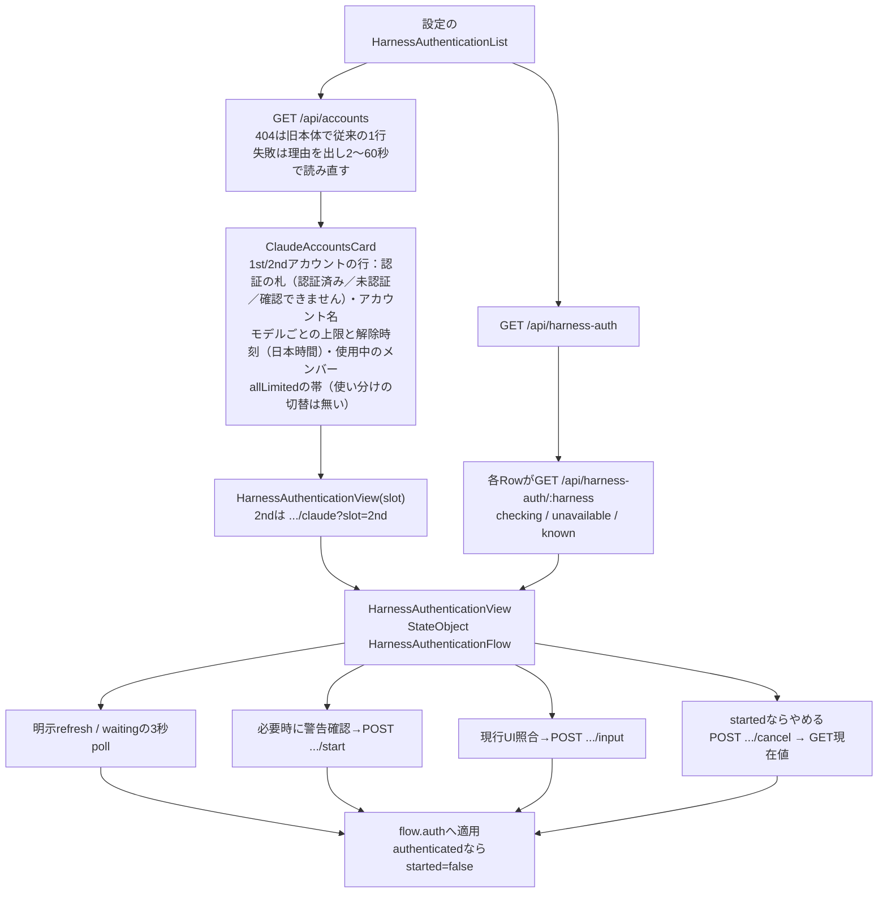

# 質問・秘密要求・接続とAI認証

[全体図](overview.md) / [会話](conversation.md) / [状態と同期](state-and-sync.md) / [試験](tests.md)。

調査source：HEAD `afda9477bba4aaa7c8a6905100d3bacf26e47c90`（detached）。静的読取。パスは`ios/BellBot/`から。サーバー内部は対象外。

## 会話内の質問と秘密要求

| 所有者・操作 | 入出力・成功・失敗 |
| --- | --- |
| OwnerQuestionCardState | result/other/sending/error。ConversationCardStatesがID別に保持し、行の再利用をまたぐ。currentはresult優先。表示本文と選択肢は引数question |
| 選択回答 | choice、その他はtextをOwnerAnswerBodyへ。その他はtrim後が空ならボタン無効。送信中はボタン/入力を無効化。authorizeAIUse後にPOSTしresultへ応答question、error消去→refreshFromView。受付応答からBotの回答処理完了を判定しない |
| 回答失敗 | 認証はrequireLogin。他はoperationFailureMessageとwrite診断、otherは残す。deferでsending解除。自動POST再送・個別質問GETによる照合はこのカードにはない |
| SecretRequestCardState | 応答requestだけ保持。pendingなら入力を開く、それ以外はsubmitted=登録済み、その他=取消。notification=failedならAIへの通知失敗の案内を表示 |
| SecretInputSheet | requestとonCompleteを受け、value/reference/useOnePassword/sending/errorを所有。`inputOptions.onePasswordAvailable`の時だけ入力方法を出し、1Passwordの参照を上・既定（`preferred:'stored'`の時は保存値を既定）、保存値を代替にする。欠落（旧本体）は保存値だけ。`purpose:'terminal.ssh'`は改行を保つ複数行欄、他はSecureField。すべてprivacySensitive。`purpose:'terminal.login'`（Mac上のSSHへ1回だけ使うログインパスワード、保存しない）は、`inputOptions`が何を言っても1Passwordの選択肢も参照欄も出さず、SecureField1つ（題は呼び出し側が渡したサーバーのlabel。無ければ「ログインパスワード」）と上の文、ボタン「パスワードを渡す」。判定は`SecretRequest.isLoginPassword`・`onePasswordOffered`。`oneTime:true`（usage #1025、1回だけ使い保存しない値）も1Passwordの選択肢を出さず、文は「1回だけ使い、使い終わったら消します。保存せず、会話にも送られません。」、ボタンは「渡して続ける」（判定は`SecretRequest.isOneTime`）。SSH鍵（`terminal.ssh`）とsudo（`terminal.sudo`）で1Password接続済みの時は、選択肢をSSH鍵なら「1Passwordから選ぶ」/「ここに貼り付ける」、sudoなら「1Passwordから選ぶ」/「ここに入力する」とし（一覧の無い`op://`参照欄は「1Passwordから読み出す」/「ここに入力する」。どちらも値の出どころを言い、保存するかどうかは下の文だけが言う）、前者は`onePasswordKeys`（`GET /api/secret-requests/:id/onepassword-items`、同じ`{items:[{title,vault,reference}]}`を1つの復号器で読む）の`title`と`vault`の一覧から選ぶ（参照は送信まで画面に出さない・提出は従来どおり`{source:'onepassword',reference}`）。sudoは`/password`で終わる参照だけを残す（旧本体はどの用途にもSSH鍵を返すので、SSH鍵の参照がsudoKeyRefにならない）。一覧の上に検索欄「名前や保管庫で絞り込む」と1行「N件から選んでください」（合うものが無ければ「「…」に合うパスワードがありません」/「…鍵がありません」）を出し、名前か保管庫に入力を含むものへ大文字小文字を区別せず絞る。絞り込みで見えなくなった選択は外す。検索語は秘密でなく送らない。sudoの貼り付け側はSecureField1つ。一覧が404（旧本体）なら選択肢を隠して貼り付け（sudoは入力）だけにし静かな一行を出す。他の失敗は「読めませんでした」と再読込、貼り付けの選択は残る。未接続の貼り付けにはWebと同じ短い案内（設定の「1Password連携」で一覧から選べる）。入力方法を替えると両方の欄を消す。通常会話draftに渡さない。閉じる操作はdismissだけでcancel POSTを呼ばない |
| 秘密の送信body | 保存値`{value}`、1Password`{source:'onepassword', reference}`（`op://`で始まらなければ送らず案内）、拒否`{}`。形の最終検査はサーバー（`SECRET_REFERENCE_INVALID`） |
| 秘密登録/拒否 | Botの依頼（`botId`あり）はauthorizeAIUse成功後、端末の鍵（`botId:null`）はAI利用でないので許可判定なしで、submitなら`SecretSubmission`・拒否ならnilを退避し画面の欄を消す。nilはcancel、それ以外はsubmitへ。応答requestをonCompleteしてdismiss。AIへの通知成否はrequest.notificationの別項目 |
| 秘密の失敗 | 許可判定失敗はerrorでreturn（この時点ではvalue消去前）。POSTの認証失敗はdismiss→requireLogin。他失敗は登録結果未確認の案内とsecretWrite診断、valueを復元しない。deferでsending解除 |
| 終了と背景 | 秘密sheetは送信中の閉じる/interactiveDismissを無効化。非active/終了でvalueを消す。専用のHTTP取消task・自動再送はない |
| 通知から開く秘密 | AppStoreが個別GETしpendingだけnotificationSecretへ。BellTabs/DesktopWorkspaceViewのsheet callbackはeventRevisionを増加。会話カードから開く経路は対応カードのresultを更新 |

根拠：[OwnerQuestionView.swift](../../../../ios/BellBot/BellBot/Views/OwnerQuestionView.swift#L3)、[SecretRequestView.swift](../../../../ios/BellBot/BellBot/Views/SecretRequestView.swift#L45)。秘密POSTは[BellAPI.finishSecretRequest](../../../../ios/BellBot/BellBot/Core/BellAPI.swift#L133)が保護sessionを生成し、redirect拒否・ephemeral・session cookie storage無し・no-cacheを設定する。要求cookieはBellAPIのrequestから付与。終了はdeferのinvalidateAndCancel。通常メッセージ送信へ値を渡す経路はない。

## 接続先とWeb認証

[LoginView.swift](../../../../ios/BellBot/BellBot/Views/LoginView.swift#L4)にはServerSetupViewも定義される。addressは画面内、導入ガイドsheetを閉じても同じaddressを保持。導入ガイドは同梱文書の表示・コピー/共有であり、接続処理は行わない。setServerAddressは接続先が変わると編集draft・会話page・画像draft・削除待ち・AI停止状態を整理し、UserDefaultsへURLを書いてbootstrapする。bootstrap内部の接続失敗はphase.failureへ入り、入力画面へthrowで返す検証エラーと区別される。

| 境界 | 確認した契約 |
| --- | --- |
| ServerOrigin | trim、scheme/host小文字化、空path化。HTTPS、またはlocal HTTPのみ。userinfo/password/query/fragmentとルート以外のpathを拒否 |
| local判定 | localhost、.local、単一ホスト名（数字だけを除く）、IPv4の10/127/192.168/172.16〜31/169.254、IPv6のloopback・fc/fd・fe8〜febをコードの条件で受理 |
| LoginView | showingLoginを所有。openLoginAutomaticallyを一度消費してsheet表示。閉じる操作はsheetを閉じるだけ。WKWebViewはAppStore.webDataStoreを使い、navigation didFinishごとにcompleteWebLogin |
| completeWebLogin | checkingLoginで重複を抑止。期限内CF_Authorizationが接続先domainに属する時だけHTTP cookieへ同期。session未認証/認証エラーならreturn、その他はfailureと診断。Webの読み込み完了そのものはログイン成功ではない |
| requireLogin | CloudflareならsignInと自動sheet、local拒否なら設定失敗表示。draftは保持。SSE/foreground停止等は[共通図](state-and-sync.md#送信停止取消途中失敗)参照 |

ServerOriginの定義は[Shared/ServerOrigin.swift](../../../../ios/BellBot/Shared/ServerOrigin.swift#L4)。サーバー到達性・TLS/Accessの外部設定をこの静的図では判定しない。

## 初回利用とtyped認証操作

| 所有者 | 状態・受渡し |
| --- | --- |
| AppStore | setup、setupAuthNeedsRefresh、revision/readSequence/updating。GETの旧応答・旧失敗を採用しない。画面はsetupを読む |
| OnboardingView | input/busy/error。select_harnessはAI選択ボタン、以降はAuthenticationInstructionsと開始・明示更新・AI変更を表示 |
| AuthenticationInstructions | authUiのschema/stage/inputを読む。CLIの表示文字列から種別を推測しない。公式HTTPS URLをLink、userCodeは選択可能テキスト、authorizationCodeはSecureField、choiceはID付きボタン |
| AuthenticationUI.reply | bindingと空でないpromptDigest、対応するstage/input、HTTPS公式URLまたはchoicesを確認。空コードや候補外choiceはreplyを作らない |
| AuthenticationReply | binding、prompt_digest、responseをencode。bindingはsession/launch/metadata/native/paneとprocess情報を送る |

入力は送信callback前、scene非active、auth変更で消す。busyはdeferで解除。performの認証失敗はrequireLogin、それ以外は画面errorとGETならread/変更ならsecretWrite診断。poll失敗はエラーを表示しloop終了。pollは非activeでもsleepのloopを続けるがGETは開始しない。startGuideはsetup応答がreadyでない場合throwし、続く共通一覧取得の失敗でも会話への移動を完了しない。HTTP受付と初回利用ready、案内役の処理完了は別段階。

## 初回設定後のAI再認証

[HarnessAuthenticationFlow](../../../../ios/BellBot/BellBot/Core/HarnessAuthenticationFlow.swift#L6)がauth/started/busy/needsRefresh/requestSequenceを所有する。Claudeの2ndアカウントはflowの`slot`で、GET・start・input・cancelのすべてに`?slot=2nd`を付ける（1stは付けず従来どおり）。アカウントの形・文言は[harness-accounts](../execution/harness-accounts.md)が正本で、表示は`Core/HarnessAccounts.swift`の`AccountText`（上限中 (HH:MMに解除)／Fableのみ上限中 (23:00に解除)／解除時刻不明、日本時間・今日以外は日付付き）。使い分けの規則・切替は無い（Owner裁定 2026-11-09）：1stが上限のモデルだけ2ndで動き、解除か上限でないモデルで1stへ戻るのは本体が決め、アプリは表示だけ。`rules`と`preferredSlot`は読まない。SSEの変化（eventRevision）でアカウントを読み直す。404は旧本体で従来の1行、それ以外の失敗は前に読めた行を残して理由を出し、2・4・8…秒（上限60秒）で読み直し続ける（「一覧を更新」は待たずに読む）。行の下に使用中のメンバーを名簿の名前で出す。メンバーのプロフィールのAI欄は、Bot項目に`account`がある時だけ「アカウント」行（いま動いているアカウント）を出す。Rowの失敗はunavailable（未認証とは表示しない）、認証失敗はrequireLogin。開始可否と警告はHarnessAuthenticationOptionのreloginSupported/startWarningと現在statusから決める。

- refreshはbusyならthrow。sequenceを進め、成功でneedsRefreshを消す。pollはbusy/needsRefresh中はreturnし、GET後に取消とsequenceを確認。古い成功/失敗は採用しない。
- start/respond/cancelはperformがbusyを立て、mutationでsequenceを進める。start応答でstartedを決定。respondは失敗でneedsRefreshを立て、明示更新まで操作を止める。
- cancelはPOST応答をauthへ直接適用せず、started=falseにした後GETをperformの戻り値にする。GETが失敗すると画面errorとなる。
- viewのpollingはactive・waiting・error無し・非busyだけ。view task/scene変更でpoll taskが取消され、inputはscene非active/auth変更/終了/run開始で消える。画面を閉じるだけではcancel POSTを呼ばない。
- 変更の結果不明はoperationFailureMessage。自動POST再送はない。公式のauthenticatedは取得応答の状態であり、AppleがCLIの認証を自ら判定した値ではない。

## 整理候補

- **A-R1**：`ios/BellBot/BellBot/Views/SecretRequestView.swift:97,98,105`。AI利用許可判定のcatchはerror表示とreturnで、後続の秘密POSTのcatchだけがrequireLoginへ接続する。
- **A-R2**：`ios/BellBot/BellBot/Core/AppStore.swift:337,363`と`ios/BellBot/BellBot/Core/HarnessAuthenticationFlow.swift:29,55`。初回認証と再認証は、それぞれ読取順序・変更中状態・入力失敗後の明示更新待ちを保持している。

## 未調査

- route受信後の質問配送、秘密保存/AI通知、Access、初回案内、公式認証端末の内部。
- Web認証の実遷移、scene/閉じる/通信中操作の実行時挙動。ビルド・試験未実行。
- Mermaidの描画結果。
