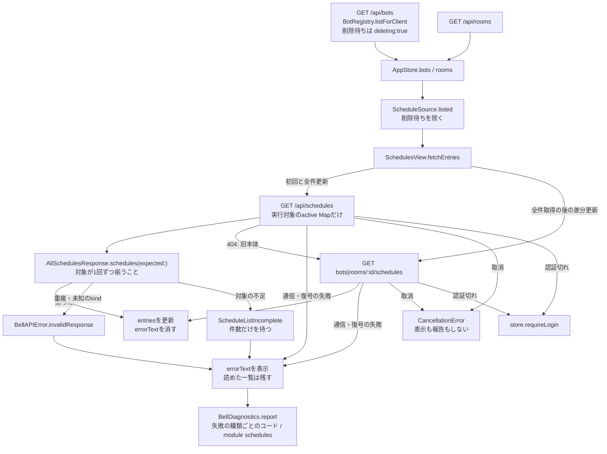

# 予定一覧の取得

[担当の正本](README.md)。本体の予定は[members](../members/schedules.md)、削除待ちの一覧は[削除](../members/deletion.md)。Apple全体の図ではなく、修理の範囲だけを示す。

対応版：PR #258の候補（base `e15795b`）。配布済みの1.0.4 (98)以前には、`deleting`の除外と`ScheduleListIncomplete`は無い。

## 流れ

## 責任と受渡し

| 段階 | 所有者と場所 | 契約 |
| --- | --- | --- |
| 名簿の読取 | `AppStore`、`Bot` | `deleting`は本体の一覧だけが返す任意項目。名簿からは消さない。会話や下書きは削除の受付と完了に従う |
| 取得対象の選択 | `ScheduleSource.listed`（`Core/Models.swift`） | 削除待ちのBotを除く。部屋は全件 |
| 取得 | `SchedulesView.fetchEntries` | `hasLoadedAll`が立つまで全件取得。全件取得の成功だけが立てる |
| 応答の検査 | `AllSchedulesResponse.schedules(expected:)` | 対象が欠けた応答を成功にしない。除外は検査の前の選択で行い、検査は緩めない |
| 表示 | `SchedulesView` | 失敗は`errorText`。一覧が空なら再読み込みの案内を出す |
| 診断 | `SchedulesView`の読取失敗の`report` | `.read`の観測。不足の時だけ`schedule_expected`、`schedule_received`、`schedule_missing_bots`、`schedule_missing_rooms`を載せる。IDは載せない |

## 失敗と後始末

| 場面 | 動作 |
| --- | --- |
| 削除待ちがある | 取得対象から除くので、一覧は残りの全員で成功する |
| 名簿より先に本体で削除が完了した | 不足になる。`bots`イベントの全更新か再読み込みで解消する |
| 本体の削除が途中で止まった | Appleは待たない。残りの予定は読める。削除の完了はmembersの責任 |
| 取得の取消 | `CancellationError`は表示も報告もしない |
| 認証切れ | `requireLogin`へ渡す |
| 全件取得の失敗 | `hasLoadedAll`は立たず、次回も全件取得する |
| 全件・個別取得の通信や復号の失敗 | `errorText`を表示して報告する。検査の失敗と同じ`catch`を通る |

## 確認済みと未確認

確認済み（ソース）：`/api/bots`は削除待ちを含み、`/api/schedules`はactive Mapだけを返す。不足の検査は版89から同じ。`BellAPIError.invalidResponse`と`DecodingError`には通信の記録が付かないので、既存の報告では発生箇所を分けられない。

未確認：BugHub `c019fbe9`の6件が不足の検査で落ちたことは個別に確定していない。本体の応答がJSONでない時も同じ`InvalidResponse`になる。`ScheduleListIncomplete`のログで今後は分かれる。

予定の作成画面の宛先一覧（`SchedulesView.swift`の`store.bots.map`）は、この修理の対象外。

`deleting`の参照はmembersの公開一覧に依存するので、[members](../members/README.md)の担当へ接続する。

`operation`は、通信の記録が無い時に`report`のpathから推定しない（`testRequestContextDoesNotInferOperationFromFallbackPath`の契約）。
