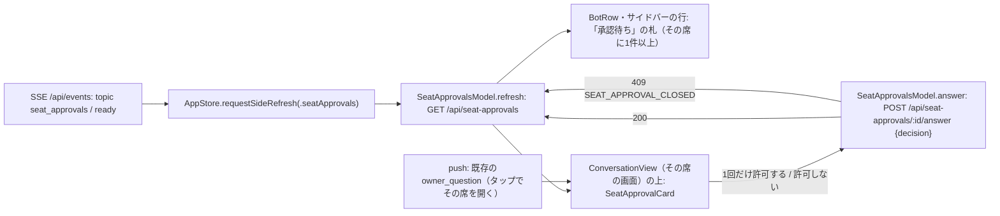
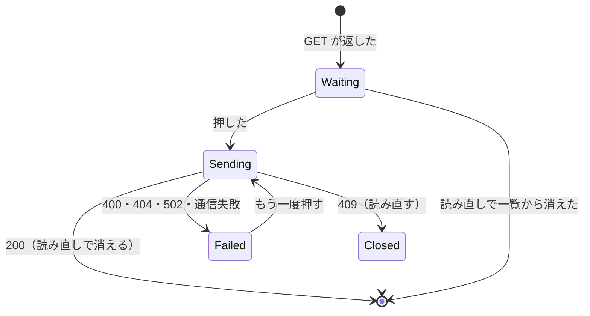

# 席の許可待ち（seat-approvals）：Appleの画面

担当：Rapi（seat-approval-clients）。サーバー側の契約は [execution/seat-approvals.md](../execution/seat-approvals.md)（Kiro、#2511）。言葉はWindows・Linux・Androidと同じ（Anisの共有Core `SeatApprovals.cs`）。iPhone・iPad・Mac（Catalyst）は同じコード。

席がツールの許可画面で止まった時、利用者が決裁箱を使っていなくても、BellTeamの中で答えられるようにする。

## 機能図

## データの流れと状態

- `SeatApprovalsModel.items`：サーバーの答えをそのまま持つ（古い順）。持ち主はこのモデルだけ。端末に保存しない。
- 各カードの状態：待ち → 送信中 → （200）消える／（409）読み直して消え「別の場所で答えられたか、もう承認待ちではありません。」を出す／（400・404・502・つながらない）カードを残して「いまは送れませんでした。もう一度押してください。」。送信中は2つのボタンを押せない。同じ答えを自動で再送しない（非冪等）。
- 読み直しの失敗は、次のSSEか次の前面復帰で取り直す。サーバーがまだ路を持たない（404）時は、空として扱い、診断には出さない。それ以外の失敗は一覧を保ち、診断へ1件送る。

## 画面

- カード：見出し「承認を待っています」、道具名、コマンド（等幅・選択できる・折り返す。そのまま）、理由、「1回だけ許可する」「許可しない」（サーバーの`choices`の順とラベル）。`command`が無い（TUIのClaude席）時は「Botの画面を見てください」。`card: "filed"`でも一覧の項目は残す。
- 一覧：その席の行に「承認待ち」の札（BotRow、iPad・Macのサイドバーの行）。

## 接続（製品の境界）

BellTeam本体の公開API `/api/seat-approvals`・SSE `/api/events`だけを使う。他製品の内部は読まない。決裁箱のカードの面倒は本体（Kiro・Delta）が見る。
