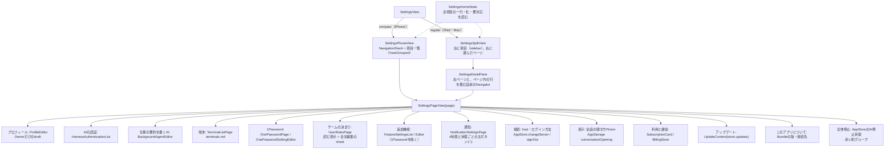
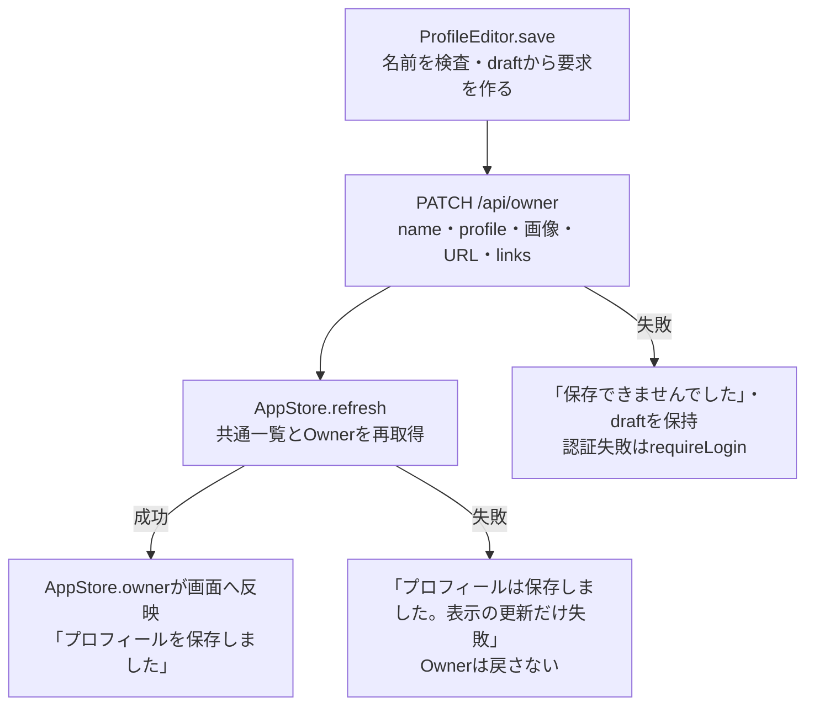
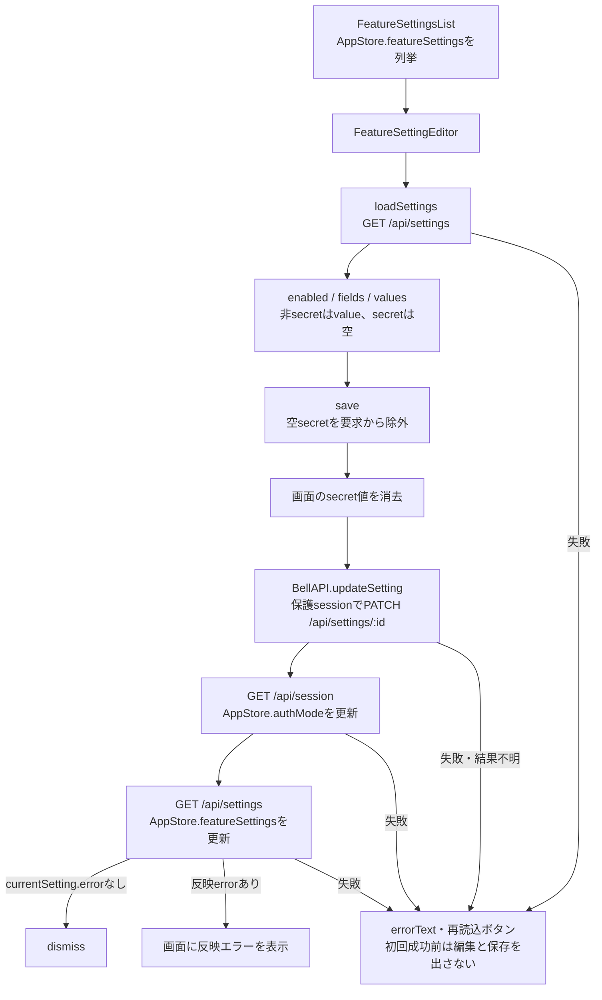
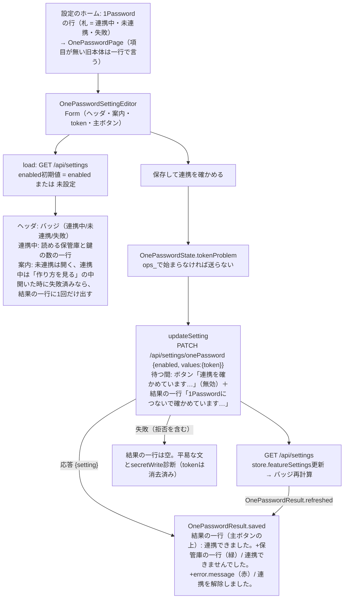
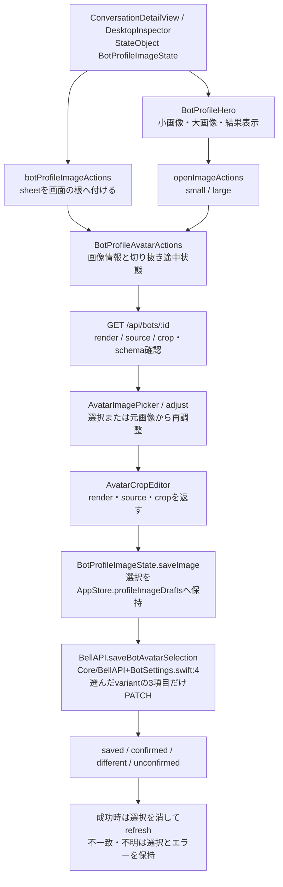
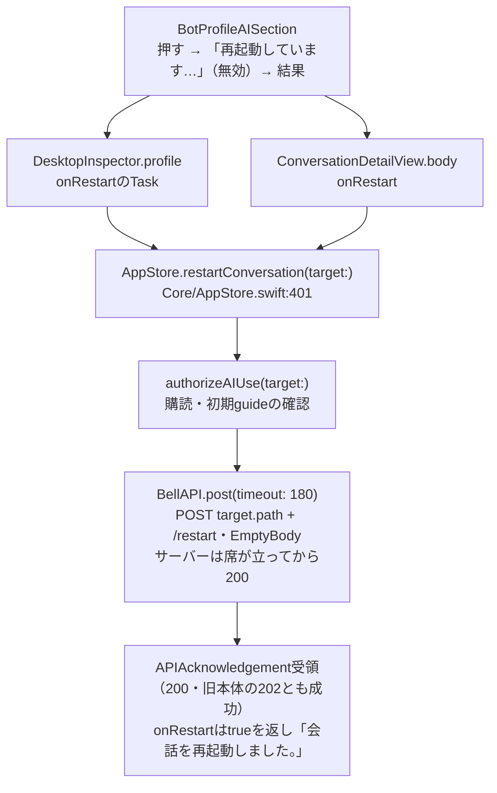

# 設定・Ownerプロフィール・メンバー画像

[全体図](overview.md) / [設定の機能図と利用者の導線（正本）](settings-user-flow.md) / [状態と同期](state-and-sync.md) / [メンバー・ルーム編集](members-and-rooms.md) / [関数索引](function-index.md)。固定sourceは全体図に記載。以下のファイル名は`ios/BellBot/BellBot/`からの相対名。

## 設定画面の責任

項目は`SettingsPage`（題名・旧来の一行・SF Symbol・色・`accessibilityID`）が一か所で持つ。一覧の各行はアイコン・題名・いまの状態の一行・札で、一行と札は`SettingsSummary`（純関数）が`SettingsHomeState`の読んだ値から決める（旧来の一行は、まだ読めていない時・データを返さない旧本体の時だけ）。一覧の最上段に要対応の帯（失敗・ログインし直す・確認できません・更新あり・停止中、`settings-attention-<項目>`）。各ページの先頭は`SettingsPageHeader`（札・状態の一文・主ボタン。Mac/iPadはページの題も）。Mac/iPadでページ内の行は右ページの`SettingsPageNavigator`へ積み（窓の詳細列の自前のNavigationStackへ積むと設定の列ごと置き換わるため）、iPhoneは従来のNavigationLink（`SettingsNavLink`が両方を受け持つ）。失敗は`SettingsBanner`で平易な文を出し、生の文は「詳細」の中だけに置く。全体停止は一覧の最下部の単独グループで赤く表示する。プロフィールはsheetでなくページとして開き、保存ボタンはフォームの中で、結果はそのすぐ下に出す。通知の状態は`BellNotifications`の`authorization`（OS）・`registered`・`failure`と、サーバーの機能設定から`NotificationState.decide`が決める。会話の開き方はrise/fadeの端末設定で、HTTPへ保存しない。Cloudflareの時だけ接続ページにログアウトを出す。UI試験は`settings-profile`と`settings-row-<page>`で入る。DEBUGの`-bellbot-preview-settings <page>`は試料データ（`AppStore.prepareSettingsPreview`）でそのページを開く。認証・購読・通知の実装全体は[全体図](overview.md)と[索引](function-index.md)へ接続する。

## Ownerと規範のdraft

| 所有と操作 | 確認した処理 |
| --- | --- |
| ProfileEditorの@State | name/profile/xUrl/githubUrl/avatar、links配列、cropSource、saving/errorText/saved（決まりは持たない） |
| load | name/profile/URL/avatar/linksをstore.ownerから複製。Ownerを別GETする処理はここには無い（決まりのGETは`SettingsHomeState.loadRules`） |
| リンク | LinkDraftのlabel/urlを編集。追加は空の要素、削除は配列index。送信時OwnerLinkRequestへmap |
| 画像 | AvatarImagePicker → AvatarCropEditorの既存形式callback → avatarへrender文字列。写真選択自体は本体へ保存しない |
| 検査 | saveでnameの空白除去後が空ならerrorText。保存ボタンはsavingで無効 |
| 取消・未保存 | 明示キャンセルはdismiss。Owner/規範へ書き込まない。未保存変更を確認する状態・dialog、AppStoreへのdraft退避は定義されていない |
| エラー | 認証失敗はrequireLogin。Owner PATCHの失敗は「プロフィールを保存できませんでした。入力は残っています」＋operationFailureMessageでdraftを保持。PATCH成功後の一覧refreshの失敗は「プロフィールは保存しました。画面の表示を更新できませんでした」 |

OwnerResponseを受けても、その戻り値を直接store.ownerへ適用しない。通常の画面反映は後続refreshから。refreshの失敗時にOwner PATCHを取り消す呼出しは無い。

### チームの決まり（規範）

`Views/UserRulesView.swift`。テキストの正本はサーバーの`/api/user-rules`で、`SettingsHomeState.rulesText`が一か所で持つ（ホームの行・ページ・編集sheetが共有）。ページは`UserRulesDocument.parse`（`Core/UserRules.swift`）でRULES形式を読む：`SECTION <topic>`の見出し、`RULE <id>`の項目、`PURPOSE/FACT/WHEN/DO/MAY/NEVER/WHY/DEFAULT/YOU ARE`の節の行（字下げした続きの行は直前の節へ連結、`FORMAT`の説明と`RULES … v1`の行は決まりでない）。形式でない行（普通の箇条書き）はそのまま出す。「編集する」は全文エディタのsheetを開き、保存は`PUT /api/user-rules`（診断pathは`/api/user-rules`、PUT）。失敗は「決まりを保存できませんでした。入力は残っています。プロフィールには影響しません」とボタンの下に出す。節の複数が1行に並ぶ書き方は1つの節として出す（形式が区切りを定めるまで）。

## AIControlCard

状態の所有者はAppStore。表示部品は`control.state`の4値をstatus(for:)で文言化し、Toggleを`setAIControlPaused`へ渡す。更新中はToggleを無効化する。stopping/unconfirmedは状態更新ボタン、aiControlが無く未読込中でもなければ再確認ボタンを表示する。unconfirmedの未確認Bot IDは件数だけを画面へ出す。

初回taskは`refreshAIControl`。PATCH失敗からのGET、readの順序とepoch、SSE `ai-control`、背景停止は[状態図](state-and-sync.md)を参照。画面が独自に停止済み値を作る処理は無い。

## 追加機能のdraft・秘密値・保存

| 状態・操作 | 返却先と保持 |
| --- | --- |
| 一覧（`onePassword`） | 行は題名と状態バッジ（アイコン付き）。反映errorはcodeを付けずサーバーの平易な文だけ。行は`FeatureSettingDestination`が`OnePasswordSettingEditor`へ渡す。項目が無い旧本体の一覧には何も増えない |
| 一覧 | taskでrefreshSettings。読み取れない時はerrorText。各settingのstatusText、error.code/messageを表示 |
| 初回読取 | loaded=falseではフォーム項目を出さず、保存も無効。成功したsettingsに編集対象IDが無ければinvalidResponse |
| currentSetting | AppStore.featureSettingsから同IDを検索し、無ければ引数setting。反映error表示はこの現在値、編集中のenabled/valuesは別の@State |
| loadSettings成功 | fields/enabled/valuesを置き換え、loaded=true、errorText=nil。再読込成功も入力をこの読取値で置換 |
| 後続読取失敗 | loadedや既存fields/valuesを消す処理なし。errorTextを表示 |
| save | 秘密項目の空文字を送らない。他の項目は空でも送る。画面の秘密値はHTTP前に消す。PATCH応答のsettingは直接適用せず、sessionとsettingsを再取得 |
| 保存失敗 | 非秘密のdraftは残る。秘密値は既に消去済み。operationFailureMessageとsecretWrite診断。認証失敗はrequireLogin |
| 非active・画面終了 | clearSecrets。非秘密draftをAppStoreへ退避する経路は無い |
| 取消・未保存 | navigationで戻る。専用取消ボタンや未保存確認dialogは定義されていない |

### 1Password連携（`onePassword`、usage #838）

契約は[secret credentials「Settings 1Password連携 token field」](../usage/secret-credentials.md#settings-1password連携-token-field-2026-11-09-owner-ask-trony-un-hold)。Webの設定画面（`web/onboarding.js`）と同じ文・同じ状態にする。`FeatureSetting`は`guide`と`connection`を省略可・読めなければnilで読み、旧本体や崩れた本体でも一覧の読込を失敗させない。

| 状態・部品 | 内容 |
| --- | --- |
| `OnePasswordState` | `error`があれば失敗、無くて`status=='enabled'`なら連携中、他は未連携。バッジは連携中=緑・未連携=灰・失敗=赤。接続の一行は連携中だけ（`connection`が無ければ「1Passwordにつながっています。」、鍵0件はWebと同じ次の一手の文） |
| 案内 | `guide.steps`を順に表示し、`link`は`https`の時だけ開く（`FeatureGuide.openableLink`）。連携の状態が変わった時だけ開閉し、読んでいる途中の案内は閉じない |
| token欄 | `SecureField`、`privacySensitive`、保存後も画面に返さない（一覧のtokenは空）。非active・画面終了で消す。空のまま保存できるのは、設定済みで連携の切替だけの時 |
| 保存 | `ops_`の検査（前後の空白は除く）→ PATCH → 一覧を読み直してバッジを更新。PATCH成功後に読み直しだけ失敗した時は「保存しました。表示を更新できませんでした」。非冪等の自動再送なし |
| 結果の一行（`OnePasswordResult`、Webの`showOnePasswordResult`と同じ） | 主ボタンの上、空の時は高さを取らない。確かめる間は`checking`で、一覧の再取得は上書きしない。確かめた後はPATCH応答の`setting`だけで決める（連携できました。+`connection`があれば保管庫の一行 / 連携できませんでした。+`error.message` / 連携を解除しました。）。拒否された要求（HTTPエラー）は空にし、理由はフォームのerror。失敗の理由はこの一行にだけ出し、ヘッダには出さない。画面を開いた時と一覧の再取得では、失敗なら出し、消えた失敗は隠し、他は変えない（`refreshed(by:)`）。旧本体は`{setting}`の形が同じなので変化なし |
| 旧本体 | `onePassword`項目が無い一覧は従来のまま（行も編集も増えない） |

試験は`TerminalsTests`（読込・バッジ・`ops_`・https・結果の一行）と`TerminalsUITests.testOnePasswordSettingBadgeGuideAndTokenCheck`。

## 仕事の要約を書くAI

`Views/BackgroundAgentSettingsView.swift`。ミカの公開契約v1（`/srv/bellteam/bots/bot-203444ca/docs/background-agent-settings-20261105.md`）を使う。追加機能の`FeatureSetting`には混ぜず、設定画面の独立した項目「仕事の要約を書くAI」（`SettingsPage.summary`、ページ本体は`BackgroundAgentEditor`）にする。AIの認証ページのカードは無い。ホームの一行は選択（「Claude · haiku · CLIの既定」）か未設定。

| 段階 | 入出力 |
| --- | --- |
| 読取 | `GET /api/settings`のトップ`backgroundAgent`を`AppStore.backgroundAgent`へ。キーが無い応答は旧版として編集不可、`{revision:null,selection:null}`は未設定 |
| 候補 | `GET /api/models`。モデルは対象harnessの`models`（Pickerの表示名は`ModelChoice.label`＝`display_name`、null・欠落・空ならid。tagと保存値はid）、エフォートはそのモデル個別の`efforts`。個別effortsが空の時だけ`""`（CLIの既定）。候補に無い保存値は「現在の候補にありません」と出し、選び直すまで保存不可。別の値で埋めない |
| 保存 | `PATCH /api/settings/backgroundAgent`へ`expectedRevision`（初回null）と`harness`・`model`・`reasoningEffort`の4キー。200の`backgroundAgent`で保存値とrevisionを更新。自動の再送はしない |
| 失敗 | 案内文を出し、入力中の選択は残す。409と500は`GET /api/settings`で保存値とrevisionを読み直し、保存済みの値を並べて見せる |
| 通知 | SSE `settings`で`refreshSettings`。編集中の選択は上書きしない |

保存の成功は、要約が作られたことを示さない。要約の状態はメンバー一覧の現在の仕事で見る。試験は`BackgroundAgentSettingsTests`。

## メンバー画像の共通部品

| 部品・関数 | 責任と戻り先 |
| --- | --- |
| BotProfileImageState | imageAction、cropSource/cropSettings、loadedLargeAvatar、保存中、variant別errorとpendingSelectionsを所有。AppStoreのID別draftをload/persist |
| BotProfileHero | 小画像はbot.avatar。大画像版が無い/空/小画像版と同じなら小画像を使う。それ以外は`GET /api/bots/:id/avatar-large?v=:version`。taskの版が変わると表示を読み直す |
| BotProfileImageActionsModifier | 同じimages参照を使いsheetへ渡す。保存中は操作とinteractiveDismissを無効化 |
| BotProfileAvatarActions.loadSettings | GET BotProfileResponse（`Core/BotSettings.swift:3`）。avatarLarge/avatarSource/avatarLargeSourceが欠けた旧schemaは独立画像編集を無効にし理由表示。loadは選択前prepareと調整操作で使う |
| cancelOperations / AvatarActionLifetime | 閉じる・非表示・busyでgenerationを無効化し調整taskをcancel。古い画像情報応答が状態を書き換えないようacceptsで照合 |
| adjust / adjustmentImage | pending選択があればそのsource/crop。無ければvariantの保存済みsource、source無しならrender。大画像が無ければ小画像。読めない時はerrorText |
| AvatarImagePicker | iPhone/iPadはPhotosPicker、Macはimage fileImporter。prepareがあれば成功後に選択を開く。非表示等でprepare taskをcancel。失敗はcallerのonFailure |
| AvatarCropEditor | 拡大・drag、crop範囲を保持。小512角/大1024角。画像選択用callbackはrender/source/crop、Owner/ルームの既存形式callbackはrenderだけを返す。キャンセルはdismissでcallbackしない |
| AvatarImage | 画像decode・file読取、表示寸法、offset制限、render JPEG、正規化cropの計算と復元、source画像のJPEG化。sourceは長辺1600以下・文字列300万以下 |
| BotSettingsRequest（`Core/BotSettings.swift:102`） | imageOnlyVariantでは対象render/source/cropだけencodeしてreturn。プロフィールや他方の画像を要求に入れない |
| saveBotAvatarSelection / confirmBotAvatarSelection（`Core/BellAPI+BotSettings.swift:4,24`） | PATCH成功はsaved。networkConnectionLost/timedOutだけGET照合へ。確認は対象3項目だけ。GET認証以外の失敗はunconfirmed |
| saveImage / confirmImageSave | 選択の一致をfinishで検査。saved/confirmedなら選択を除去し名簿refresh。不一致・不明は選択を保持して結果確認/破棄を表示。確認操作自体はPATCHしない |
| discardImageSelection | 対象variantだけdraftとerrorを消す。サーバー変更はしない |
| BotProfileAISection / BotProfileDetails | 共通のAI表示・操作callbackとプロフィール本文。再起動callbackは各画面が持ち、利用権限確認とPOSTはAppStore.restartConversationへ渡す |

`saveImage`は成功結果を受けてpending選択を除去した後に一覧をrefreshする。refreshだけ失敗した場合は「画像を保存しましたが、表示を更新できませんでした」と別表示する。認証失敗では選択を保持してrequireLogin。`confirmImageSave`も確認成功と表示更新を別段階で扱う。

プロフィール本文・AI設定のメンバー編集は[BotEditor](members-and-rooms.md#メンバーdraftモデル候補画像)へ接続する。Owner/ルーム画像のdraftと、メンバー画像のvariant別未確認選択を同じ保存方式とは記述しない。

## 再起動の共有操作

利用権限確認またはPOSTのErrorはそのまま画面へ返す。Desktopは成功時に`errorText=nil`、失敗時に`operationFailureMessage`と`target.path + "/restart"`・POST・`.write`の診断を一回送る。詳細は失敗時に`localizedDescription`だけを表示する（成功でdismissしない。待つ間にsheetが閉じると結果が見えないため）。両画面とも`onRestart`は成功でtrueを返し、`BotProfileAISection`が待つ間のボタン（「再起動しています…」・無効）と成功の一行を持つ。共通操作はUI状態・画面遷移・診断・refresh・再送を持たない。サーバーの200は席が立った後なので、待ちの長さは要求のtimeoutだけが決める。

直接試験は[BillingStoreTestsの再起動6関数](tests.md#billingstoretestsswift)に対応する。Mac実画面用の`profile-terminal-ui-server.mjs`には購読・再起動の503/200応答・要求と診断の記録・resetを追加済み。`DesktopWorkspaceUITests.testMacInspectorRestartFailureReportsOnceAndSuccessKeepsInspector`は失敗文言・診断一回・POST一回、再操作成功時のerror消去・inspector保持とPOST計二回・診断計一回を検査し、[親のMac確認記録](refactor-progress.md#次の作業)で通過している。

## 整理候補

- **A-P1（解消）**：ProfileEditor.saveはOwner PATCHと共通一覧refreshだけを持ち、規範は`UserRulesPage`が別のGET/PUTと診断path（`/api/user-rules`）で持つ。
- **A-P2（PR4反映済み）**：`ios/BellBot/BellBot/Views/DesktopWorkspaceView.swift:323`と`ios/BellBot/BellBot/Views/ConversationDetailView.swift:43`。同じBotProfileAISectionの再起動callbackから`AppStore.restartConversation(target:)`を呼ぶ。成功・失敗後の画面処理は各callbackに残す。
- **A-P3**：`ios/BellBot/BellBot/Views/BotProfileComponents.swift:16,22,34`と`ios/BellBot/BellBot/Core/AppStore.swift:86`。variant別の画像選択をBotProfileImageState.pendingSelectionsとAppStore.profileImageDraftsの両方で保持し、loadDrafts/persistImageSelectionsで受け渡す。

## 未調査

- Owner・規範・追加機能の本体保存と反映、画像schemaの本体での生成・migration、AI再起動の内部実行。
- 実UIでの画像選択・前面復帰・切り抜き途中状態、未保存フォームのsheet/window終了、同時保存中の操作。PR4実装時の文書更新ではビルド・試験は未実行だった。後続のMacでの画像保存・再起動の確認結果は[親の確認記録](refactor-progress.md#次の作業)を参照し、その範囲外は未確認。
- AvatarCrop/ProfileTerminal/NetworkLifecycleProbe/BotSave等のXCTest本文・fixture。試験との対応は宣言で確認した範囲。
