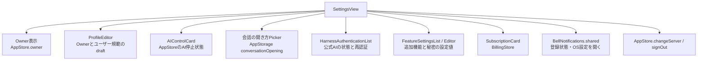
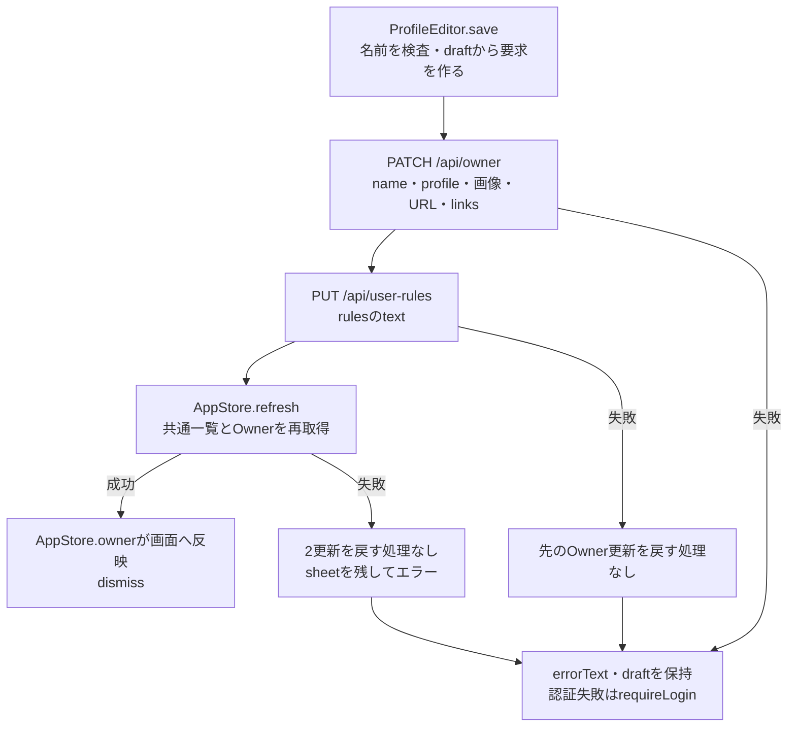
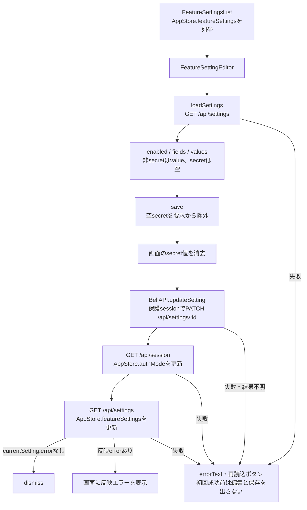
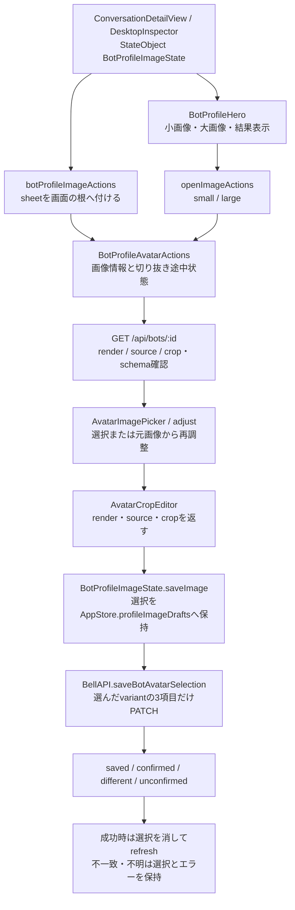

# 設定・Ownerプロフィール・メンバー画像

[全体図](overview.md) / [状態と同期](state-and-sync.md) / [メンバー・ルーム編集](members-and-rooms.md) / [関数索引](function-index.md)。固定sourceは全体図に記載。以下のファイル名は`ios/BellBot/BellBot/`からの相対名。

## 設定画面の責任

SettingsViewは編集用Owner draftを持たず、ProfileEditorをsheetで開く。通知のエラーはsingletonのerrorText。会話の開き方はrise/fadeの端末設定で、HTTPへ保存しない。Cloudflareの時だけlogoutボタンを表示する。認証・購読・通知の実装全体は[全体図](overview.md)と[索引](function-index.md)へ接続する。

## Ownerと規範のdraft

| 所有と操作 | 確認した処理 |
| --- | --- |
| ProfileEditorの@State | name/profile/xUrl/githubUrl/rules/avatar、links配列、cropSource、loading/saving/errorText |
| load | name/profile/URL/avatar/linksをstore.ownerから複製。その後`GET /api/user-rules`のtextをrulesへ。Ownerを別GETする処理はここには無い |
| リンク | LinkDraftのlabel/urlを編集。追加は空の要素、削除は配列index。送信時OwnerLinkRequestへmap |
| 画像 | AvatarImagePicker → AvatarCropEditorの既存形式callback → avatarへrender文字列。写真選択自体は本体へ保存しない |
| 検査 | saveでnameの空白除去後が空ならerrorText。保存ボタンはloadingまたはsavingで無効 |
| 取消・未保存 | 明示キャンセルはdismiss。Owner/規範へ書き込まない。未保存変更を確認する状態・dialog、AppStoreへのdraft退避は定義されていない |
| エラー | 読込失敗はerrorText、認証失敗はrequireLogin。loadingは最後にfalse。save失敗はoperationFailureMessageを表示してdraftを保持 |

OwnerResponseとUserRulesResponseを受けても、その戻り値を直接store.owner/rulesへ適用しない。通常の画面反映は後続refreshから。規範PUTやrefreshの失敗時にOwner PATCHを取り消す呼出しは無い。キャンセルボタンとフォームはsave中も全体disabledにはしていない。通信中の画面操作の実効結果は未調査。

## AIControlCard

状態の所有者はAppStore。表示部品は`control.state`の4値をstatus(for:)で文言化し、Toggleを`setAIControlPaused`へ渡す。更新中はToggleを無効化する。stopping/unconfirmedは状態更新ボタン、aiControlが無く未読込中でもなければ再確認ボタンを表示する。unconfirmedの未確認Bot IDは件数だけを画面へ出す。

初回taskは`refreshAIControl`。PATCH失敗からのGET、readの順序とepoch、SSE `ai-control`、背景停止は[状態図](state-and-sync.md)を参照。画面が独自に停止済み値を作る処理は無い。

## 追加機能のdraft・秘密値・保存

| 状態・操作 | 返却先と保持 |
| --- | --- |
| 一覧 | taskでrefreshSettings。読み取れない時はerrorText。各settingのstatusText、error.code/messageを表示 |
| 初回読取 | loaded=falseではフォーム項目を出さず、保存も無効。成功したsettingsに編集対象IDが無ければinvalidResponse |
| currentSetting | AppStore.featureSettingsから同IDを検索し、無ければ引数setting。反映error表示はこの現在値、編集中のenabled/valuesは別の@State |
| loadSettings成功 | fields/enabled/valuesを置き換え、loaded=true、errorText=nil。再読込成功も入力をこの読取値で置換 |
| 後続読取失敗 | loadedや既存fields/valuesを消す処理なし。errorTextを表示 |
| save | 秘密項目の空文字を送らない。他の項目は空でも送る。画面の秘密値はHTTP前に消す。PATCH応答のsettingは直接適用せず、sessionとsettingsを再取得 |
| 保存失敗 | 非秘密のdraftは残る。秘密値は既に消去済み。operationFailureMessageとsecretWrite診断。認証失敗はrequireLogin |
| 非active・画面終了 | clearSecrets。非秘密draftをAppStoreへ退避する経路は無い |
| 取消・未保存 | navigationで戻る。専用取消ボタンや未保存確認dialogは定義されていない |

## メンバー画像の共通部品

| 部品・関数 | 責任と戻り先 |
| --- | --- |
| BotProfileImageState | imageAction、cropSource/cropSettings、loadedLargeAvatar、保存中、variant別errorとpendingSelectionsを所有。AppStoreのID別draftをload/persist |
| BotProfileHero | 小画像はbot.avatar。大画像版が無い/空/小画像版と同じなら小画像を使う。それ以外は`GET /api/bots/:id/avatar-large?v=:version`。taskの版が変わると表示を読み直す |
| BotProfileImageActionsModifier | 同じimages参照を使いsheetへ渡す。保存中は操作とinteractiveDismissを無効化 |
| BotProfileAvatarActions.loadSettings | GET BotProfileResponse。avatarLarge/avatarSource/avatarLargeSourceが欠けた旧schemaは独立画像編集を無効にし理由表示。loadは選択前prepareと調整操作で使う |
| cancelOperations / AvatarActionLifetime | 閉じる・非表示・busyでgenerationを無効化し調整taskをcancel。古い画像情報応答が状態を書き換えないようacceptsで照合 |
| adjust / adjustmentImage | pending選択があればそのsource/crop。無ければvariantの保存済みsource、source無しならrender。大画像が無ければ小画像。読めない時はerrorText |
| AvatarImagePicker | iPhone/iPadはPhotosPicker、Macはimage fileImporter。prepareがあれば成功後に選択を開く。非表示等でprepare taskをcancel。失敗はcallerのonFailure |
| AvatarCropEditor | 拡大・drag、crop範囲を保持。小512角/大1024角。画像選択用callbackはrender/source/crop、Owner/ルームの既存形式callbackはrenderだけを返す。キャンセルはdismissでcallbackしない |
| AvatarImage | 画像decode・file読取、表示寸法、offset制限、render JPEG、正規化cropの計算と復元、source画像のJPEG化。sourceは長辺1600以下・文字列300万以下 |
| BotSettingsRequest | imageOnlyVariantでは対象render/source/cropだけencodeしてreturn。プロフィールや他方の画像を要求に入れない |
| saveBotAvatarSelection | PATCH成功はsaved。networkConnectionLost/timedOutだけGET照合へ。確認は対象3項目だけ。GET認証以外の失敗はunconfirmed |
| saveImage / confirmImageSave | 選択の一致をfinishで検査。saved/confirmedなら選択を除去し名簿refresh。不一致・不明は選択を保持して結果確認/破棄を表示。確認操作自体はPATCHしない |
| discardImageSelection | 対象variantだけdraftとerrorを消す。サーバー変更はしない |
| BotProfileAISection / BotProfileDetails | 共通のAI表示・操作callbackとプロフィール本文。再起動通信自体は呼出画面が持つ |

`saveImage`は成功結果を受けてpending選択を除去した後に一覧をrefreshする。refreshだけ失敗した場合は「画像を保存しましたが、表示を更新できませんでした」と別表示する。認証失敗では選択を保持してrequireLogin。`confirmImageSave`も確認成功と表示更新を別段階で扱う。

プロフィール本文・AI設定のメンバー編集は[BotEditor](members-and-rooms.md#メンバーdraftモデル候補画像)へ接続する。Owner/ルーム画像のdraftと、メンバー画像のvariant別未確認選択を同じ保存方式とは記述しない。

## 整理候補

- **A-P1**：`ios/BellBot/BellBot/Views/SettingsView.swift:277`。ProfileEditor.saveがOwner PATCH、規範PUT、共通一覧refresh、エラー表示と診断を一つの関数で持つ。loadはuser-rulesをGETするが診断pathには`/api/owner`を渡す（同:267,272）。
- **A-P2**：`ios/BellBot/BellBot/Views/DesktopWorkspaceView.swift:323`と`ios/BellBot/BellBot/Views/ConversationView.swift:1572`。同じBotProfileAISectionの再起動callbackを各画面が持ち、authorizeAIUseとrestart POSTをそれぞれ実装する。成功時は前者がerrorTextを消し、後者が詳細を閉じる。
- **A-P3**：`ios/BellBot/BellBot/Views/BotProfileComponents.swift:16,22,34`と`ios/BellBot/BellBot/Core/AppStore.swift:86`。variant別の画像選択をBotProfileImageState.pendingSelectionsとAppStore.profileImageDraftsの両方で保持し、loadDrafts/persistImageSelectionsで受け渡す。

## 未調査

- Owner・規範・追加機能の本体保存と反映、画像schemaの本体での生成・migration、AI再起動の内部実行。
- 実UIでの画像選択・前面復帰・切り抜き途中状態、未保存フォームのsheet/window終了、同時保存中の操作。ビルド・試験は未実行。
- AvatarCrop/ProfileTerminal/NetworkLifecycleProbe/BotSave等のXCTest本文・fixture。試験との対応は宣言で確認した範囲。
