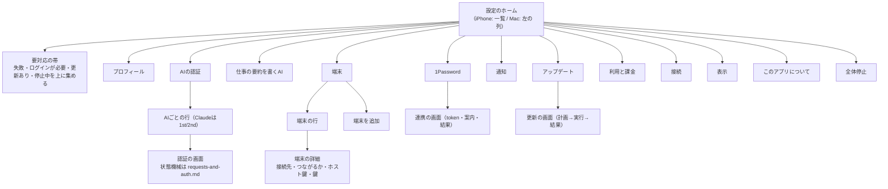
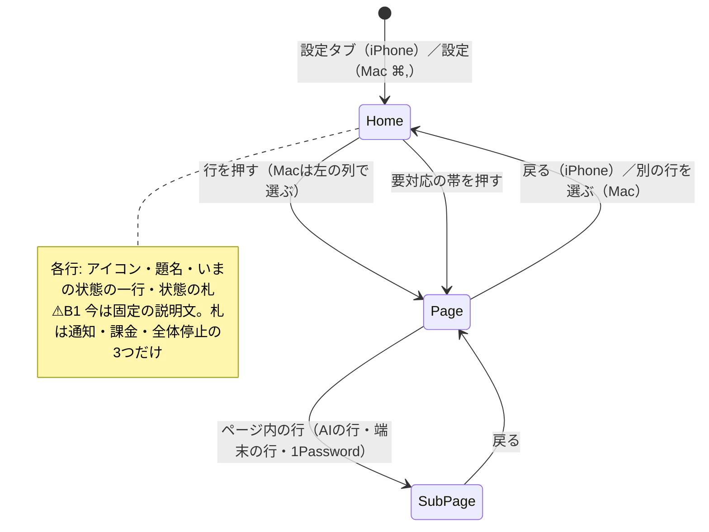
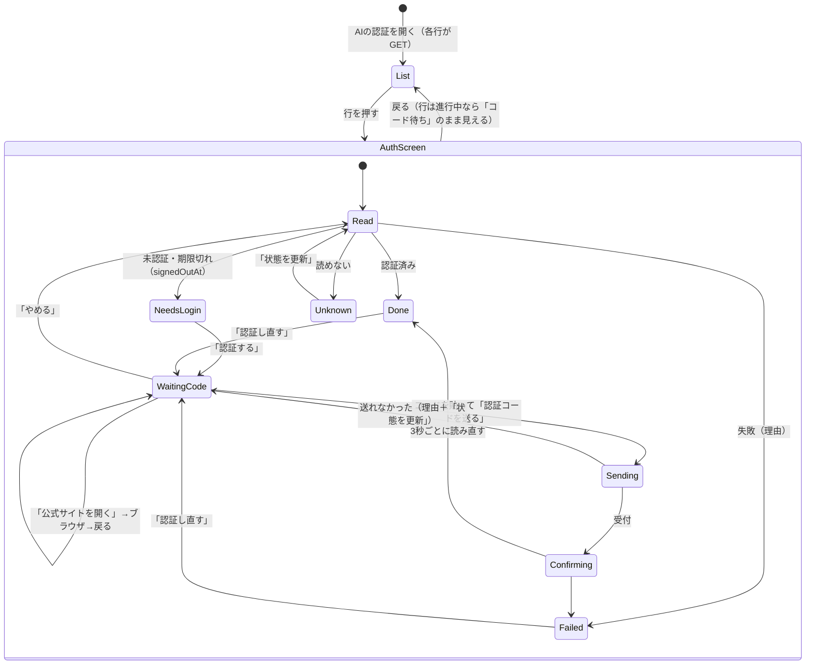
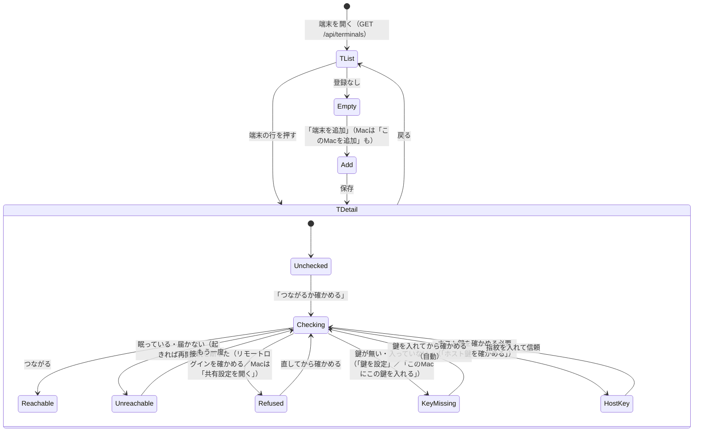
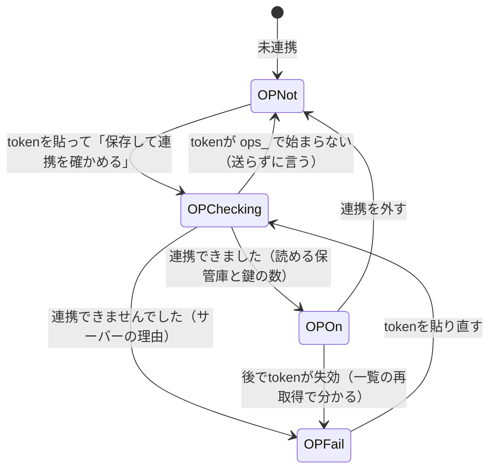
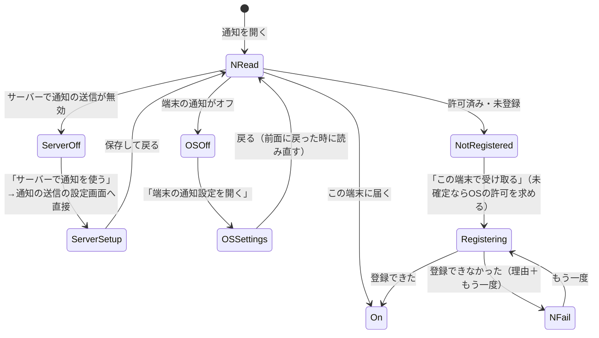
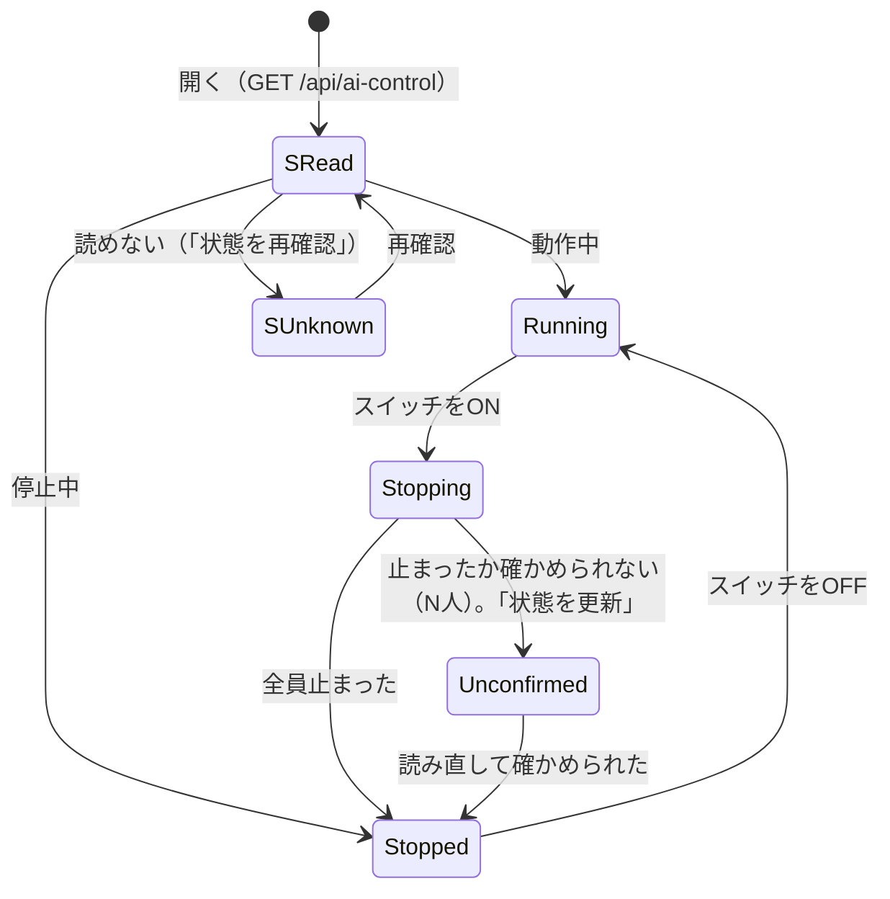
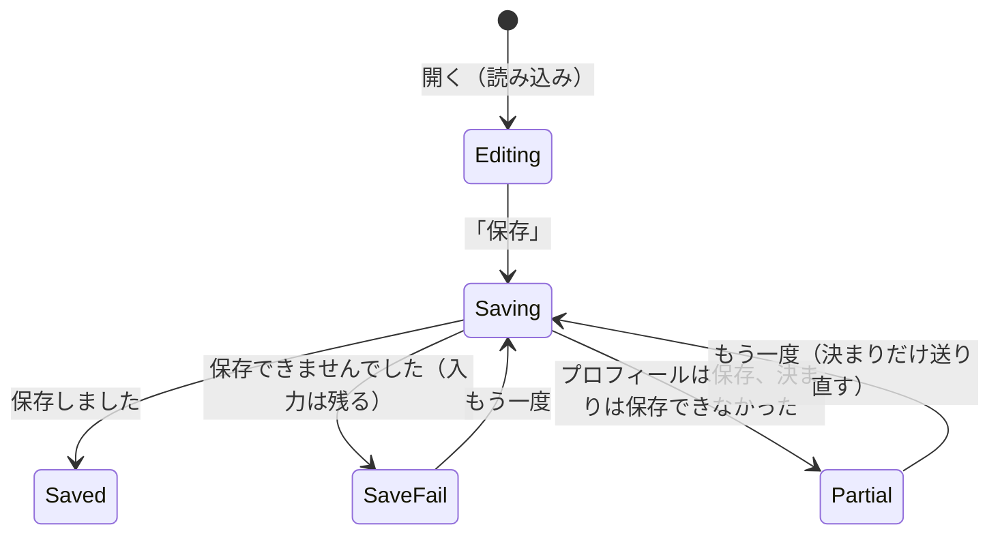

# 設定：機能図と利用者の導線（状態遷移）

[全体図](overview.md) / [設定・Ownerプロフィール（部品の責任）](settings-and-profile.md) / [AIの認証の状態機械](requests-and-auth.md#表示する認証の段階状態機械) / [端末](terminals.md) / [アップデート](update.md)。

この文書は設定画面の正本。**利用者が何をしようとして設定を開くか**から書く。部品の内部（draft・保存の順序・診断）は[settings-and-profile.md](settings-and-profile.md)・各機能の文書が持ち、ここは「どの画面で何が分かり、何を押し、どう抜けるか」だけを決める。iPhone（項目一覧→ページ）とMac/iPad（左に項目・右にページ）は同じ構造・同じ状態・同じ文で、配置だけが違う。

⚠印は、build 133（1.0.6）で導線が壊れている所。直す対象。

## 1. 利用者が設定を開く理由

| # | したいこと | 入口の項目 | 終わった状態 |
| --- | --- | --- | --- |
| U1 | AIが動かない・止まった。認証し直したい | AIの認証 | そのAI（Claudeは1st/2nd）が「認証済み」 |
| U2 | メンバーを外のMac/PCで動かしたい・動かない | 端末 | 端末が「つながる」、鍵が「設定済み」 |
| U3 | 1Passwordの鍵を使いたい | 1Password | 「連携中」、読める保管庫が分かる |
| U4 | メンバーからの連絡をこの端末に通知したい | 通知 | 「この端末に届きます」 |
| U5 | サーバーを最新にしたい | アップデート | 「すべて最新です」 |
| U6 | 全員のAIを今すぐ止めたい・再開したい | 全体停止 | 「停止中」／「動作中」 |
| U7 | 名前・写真・チームの決まりを直したい | プロフィール | 保存済み |
| U8 | 要約を書くAIを選びたい | 仕事の要約を書くAI | 保存済み |
| U9 | 購読を確かめる・買う | 利用と課金 | 「有効」 |
| U10 | 別のサーバーへ・ログアウト | 接続 | 接続先の選択画面 |
| U11 | 会話の開き方・版を見る | 表示／このアプリについて | — |

## 2. 機能図（項目・ページと、読む／書くサーバーの状態）

| 項目 | 何をする | 読む（GET・SSE） | 書く（変更） | 状態の持ち主 |
| --- | --- | --- | --- | --- |
| プロフィール | 名前・紹介・写真・リンク・チームの決まりを直す | `store.owner`、`GET /api/user-rules`、SSE `owner` | `PATCH /api/owner`、`PUT /api/user-rules` | サーバー（Owner・規範） |
| AIの認証 | AIごとの公式認証の状態を見て、認証し直す | `GET /api/harness-auth`、`GET /api/harness-auth/:h[?slot=2nd]`（各行・画面、進行中は3秒ごと）、`GET /api/accounts`（上限・使用中のメンバー・`signedOutAt`）、SSE `settings` | `POST /api/harness-auth/:h/{start,input,cancel}[?slot=2nd]` | サーバー（Aiterm・公式CLI） |
| 仕事の要約を書くAI | 要約用のAI・モデル・エフォートを選ぶ | `GET /api/settings`の`backgroundAgent`、`GET /api/models` | `PATCH /api/settings/backgroundAgent` | サーバー |
| 端末 | 外のMac/PCの登録・つながるか・鍵 | `GET /api/terminals`、`GET /api/terminals/:id/folders` | `PUT/DELETE /api/terminals/:id`、`POST …/check`、`…/trust`、`…/keys`、`…/authorize` | サーバー（つながるかは確認した時だけ） |
| 1Password | service account tokenで連携する | `GET /api/settings`の`onePassword` | `PATCH /api/settings/onePassword` | サーバー |
| 通知 | この端末を通知先にする | `GET /api/settings`（通知の送信が有効か）、端末の通知許可（OS）、`BellNotifications`の登録結果 | `POST /api/notifications/register` | サーバーの機能設定＋この端末 |
| アップデート | サーバーの部品を最新にする | `GET /api/updates`、保存した要求IDのGET、SSE `updates` | `POST /api/updates/plans`、`POST /api/updates/operations` | サーバー |
| 利用と課金 | 購読の状態・購入・復元 | `GET /api/subscription`、StoreKit | `POST /api/subscription/verify`、StoreKitの購入 | App Store＋サーバー |
| 接続 | 接続先とログイン方法を見る・変える | `store.serverURL`、`store.authMode` | 接続先の破棄（`POST /api/notifications/unregister`→端末の保存を消す） | この端末 |
| 表示 | 会話の開き方 | 端末のAppStorage | 端末のAppStorage | この端末 |
| このアプリについて | 版・接続先 | Bundle | — | この端末 |
| 全体停止 | 全員のAIを止める・再開 | `GET /api/ai-control`、SSE `ai-control` | `PATCH /api/ai-control` | サーバー |

## 3. 全項目に共通の状態と見せ方

すべての項目は次の語彙だけで状態を言う。ホームの各行は**右端に状態の札**、**題名の下にいまの状態の一行**（固定の説明文ではない）を出す。ページの先頭も同じ札と一行、その下に主ボタン1つ。

| 状態 | 札の色 | 意味 | 主ボタン |
| --- | --- | --- | --- |
| 未設定 | 灰 | まだ使っていない | 「設定する」系（項目ごとの動詞） |
| 設定済み／正常 | 緑 | 使える | なし、または「確かめる」 |
| 待ち | 紫 | 利用者の次の操作を待っている（コード待ち・公式サイトで認証の途中） | 「続ける」 |
| 確認中 | 紫 | サーバーや公式の応答を待っている | なし（自動で読み直す） |
| 完了 | 緑 | いま終わった | なし |
| 失敗 | 橙 | できなかった。理由を一文で | 「もう一度」系 |
| ログインし直す | 橙 | 資格情報が切れた | 「認証する」 |
| 確認できません | 橙 | 状態を読めなかった | 「読み直す」 |

- 失敗の一文は「何が起きたか＋利用者が次にすること」。生の符号・英文は閉じた「詳細」の中だけ。
- 橙（失敗・ログインし直す・確認できません）と更新あり・停止中の項目は、ホームの一番上の「要対応」の帯に重ねて出す。押すとその項目のページへ行く。⚠B1
- 状態を読めない時に「未設定」「未認証」と書かない。読めないことを言う。

## 4. 利用者の導線（状態遷移）

### 4.0 ホーム

### 4.1 AIの認証（U1）

段階・文・遷移は[requests-and-auth.md 状態機械](requests-and-auth.md#表示する認証の段階状態機械)が正本（checking / unknown / waitingSite / waitingCode / sendingCode / confirming / done / failed / needsLogin）。ここでは導線だけ。

- ⚠B2（直した：PR rapi/apple-auth-states）一覧のClaudeの行が`/api/accounts`の`loggedIn`で「認証済み」を出し、サーバーがコードを待っている間も終わったように見えた（11-11 20:01、開始24秒後に利用者が「済んだ」と判断）。
- ⚠B3（直した）待っている間の文が段階を問わず「公式サイトでの認証を待っています。」で、「コードを貼って送る」が言われていなかった。
- ⚠B4（直した）状態を見ただけの画面に「ログインの案内を取得できません」が出ていた。開き直した画面に「やめる」が無かった。
- ⚠B5 ホームの「AIの設定」行は、どのAIかがログインし直す必要があっても何も示さない。→ 行の一行は「すべて認証済み」／「Claude 1stのログインが必要」など最も悪い状態、札もそれに合わせる。

### 4.2 端末（U2）

- ⚠B6 一覧の行は、その場で「確かめる」を押した端末にしか「つながる／つながらない」を出さない（確認結果はこの画面のメモリだけ）。開いた時は全部「状態なし」で、IDと「アドレス · OS · 持ち主」の文字の列になる。→ 行の札は鍵の状態（未設定・設定済み）と、最後に確かめた結果（サーバーが返す時刻付き）。確かめていなければ「未確認」と言う。
- ⚠B7 ホームの「端末」行は、鍵が未設定・つながらない端末があっても何も示さない。→ 「2台・1台つながりません」の一行と橙の札。

### 4.3 1Password（U3）

- ⚠B8 1Passwordは「追加機能」の中にある。利用者は「1Password」を探すが、ホームには「追加機能：通知の送信などを使うための設定」としか無い。→ 1Passwordをホームの1項目にし、札（連携中・未連携・失敗）を出す。「追加機能」は残りの機能設定だけ（通知の送信など）。

### 4.4 通知（U4）

この端末に通知が届くには、3つが要る：サーバーで通知の送信が有効、端末のOSで許可、この端末の登録。

- ⚠B9 ページは「状態：…」の文字一行と、状態に関係なく常にある2つのボタン。登録済みでも「この端末で通知を受け取る」が並ぶ。開いた時の状態は「未設定」から始まり、ボタンを押すまで実際の状態を読まない。→ 開いた時にOSの許可とサーバーの設定を読み、上の4状態のどれかを札で言い、その状態の主ボタン1つだけ出す。
- ⚠B10 サーバーで無効の時は「追加機能で通知の送信を設定する」から一般の機能一覧へ飛び、そこから探させる。→ 通知の送信の設定画面へ直接行く。
- ⚠B11 ホームの札は「サーバーで無効」の時の「未設定」だけで、OSでオフ・未登録・登録失敗は出ない。

### 4.5 アップデート（U5）

段階と文は[update.md](update.md)が正本（確認中／更新を確認できませんでした／<名前>を更新できます／更新の前に→更新しています／更新しました／更新できませんでした／すべて最新です）。

- ⚠B12 ホームの「アップデート」行は、更新があっても固定の説明文「サーバーの部品を最新にする」だけ。更新ありはロゴ右の小さな印にしか出ない。→ 行の一行と札に「1つ更新できます」「更新しています」「更新できませんでした」「最新」。

### 4.6 全体停止（U6）

今の導線は成立している（札・一行・失敗からの出口あり）。ホームの札も出ている。

### 4.7 プロフィール（U7）・仕事の要約を書くAI（U8）

- ⚠B13 プロフィールの保存は2つの要求（Owner・決まり）で、後ろだけ失敗した時に「どちらが保存されたか」を言わない。→ 一部保存を別の文で言う。
- ⚠B14 「仕事の要約を書くAI」は「AIの設定」ページの、認証の一覧の下のカードで、ホームからは見えない。→ ホームの独立した1項目にし、一行に「Claude Haiku · 低」など選んでいる値。

### 4.8 接続（U10）・利用と課金（U9）・表示・このアプリについて

- ⚠B15 「別のサーバーにつなぎ直す」は確認なしの1回押しで、この端末の通知登録を外し、保存した接続先を消す。→ 「接続先を変えますか？この端末の通知も止まります」の確認を挟む。
- ⚠B16 「接続」と「このアプリについて」が同じ接続先を表示する。→ 接続先は「接続」だけ。「このアプリについて」は版だけ。
- 利用と課金：開発者として利用中／有効／未購入の札と一行。購入・復元の失敗は理由と「もう一度」。今の札はホームにある。

## 4.9 ボタンと、押した後に見えるもの

規則（Owner 2026-11-11 22:2x JST）：
- **押した結果は、押したボタンのその場に出る。** 待つ間はボタン自身が「…しています」になり、結果・失敗の一文はボタンのすぐ上か下。利用者に上下左右を探させない（スクロールしないと見えない所、別の列、画面の最下部に出さない）。
- **その状態で要るものだけを見せる。** 今の状態に関係ないボタン・欄は出さない。内部のID・生の値・符号・Aitermの文は出さない（必要なら閉じた「詳細」の中）。
- Mac/iPadの設定は「アプリの列｜設定の項目の列｜ページ」の3列。項目を押した結果は右のページに出る。ページの中の操作の結果は、そのページの中の押した所に出す（左の列や別の窓に出さない）。項目の列の札も同時に変わる。
- 次の一手が別の画面にある時は、その画面へ直接行くボタンを、結果の一文の隣に置く。

| 画面 | ボタン | 押した後に見えるもの（目標） | 今（build 133） |
| --- | --- | --- | --- |
| ホーム | 項目の行 | その項目のページ。先頭に札・状態の一文・主ボタン | ⚠B1 先頭は大きいアイコンと固定の説明文。状態はページを下まで読まないと分からない |
| ホーム | 要対応の帯 | 対応が要る項目のページ（AIの認証なら該当のAIの認証画面） | ⚠ 帯が無い |
| AIの認証の一覧 | AI・Claude 1st/2ndの行 | 認証画面。今の段階の一文と、その段階の操作だけ | 一覧の下に「仕事の要約を書くAI」のカードが常に並ぶ（⚠B14）。⚠ 撮影（mac-settings-ai）：2ndの行に「使用中: アドミ BellTeam Webアプリ、アリス Lattice Plan/lifecycle・席の…」と、メンバーの名前と役職の文が切れるまで並ぶ。札「認証済み」は小さな緑の文字だけ |
| 認証画面 | （開いた時） | 先頭に「Claude 1stアカウント」の名前と札、状態の一文。その状態の主ボタン1つ | ⚠ 撮影（mac-settings-ai-auth-claude-1st）：先頭が「52人が使用」、続いて「認証済みです。」と、Aitermの「認証完了／公式CLIで認証完了を確認しました。」が二重。ボタンは別の区画に「認証し直す」「状態を更新」の文字だけ |
| 認証画面 | 認証する／認証し直す | 同じカードの中で、一文が「コード待ち」になり、そのすぐ下に「公式サイトを開く」→コード欄→「認証コードを送る」の順 | ⚠ 待つ間の印と失敗の文はフォームの最下部（ボタンの下の別の行）。案内はボタンの上の別の区画。サーバーの文（Aitermの題・本文）と状態の文が二重に出る |
| 認証画面 | 公式サイトを開く | ブラウザ。戻ると同じ場所にコード欄があり、一文が「コードを貼って送る」と言う | ⚠B3（直した）一文が「公式サイトでの認証を待っています」だけで、終わったように読めた |
| 認証画面 | 認証コードを送る | ボタンが「送っています…」になり、その下に「公式の応答を待っています」→「認証済みです」 | ⚠ 待つ間の印と失敗の文は最下部。成功しても一文が上の別区画で変わるだけ |
| 認証画面 | 状態を更新 | その場の一文が新しい状態になる。失敗はボタンの下 | ⚠ いつも出ている（読めている時も）。失敗は最下部 |
| 認証画面 | やめる | 一文が「ログインが必要」等の読み直した状態に。コード欄は消える | ⚠B4（直した）開き直した画面では出なかった |
| 端末の一覧 | （開いた時） | 端末ごとに「つながる／つながらない／未確認」と鍵の札 | ⚠ 撮影（mac-settings-terminals）：「kite@192.168.1.12:22 · macOS · 自分の端末」と鍵の札だけ。つながるかは出ない |
| 端末の一覧 | 端末の行 | 端末の詳細。先頭に「つながる／つながらない（最後に確かめた時刻）」と鍵の札 | ⚠B6 行の題が内部のID（`terminalId`）、二行目がアドレス・OS・持ち主の生の値 |
| 端末の詳細 | つながるか確かめる | ボタンが「確かめています…」、結果の一文と、次の一手のボタン（鍵を設定・共有設定を開く・ホスト鍵を確かめる）がそのすぐ下 | 撮影で確かめる（[terminals.md](terminals.md)の確認結果の表の文） |
| 1Password | 保存して連携を確かめる | ボタンが「連携を確かめています…」、結果の一文は主ボタンのすぐ上 | 成立（[settings-and-profile.md 1Password](settings-and-profile.md#1password連携onepasswordusage-838)） |
| 通知 | （開いた時） | この端末の状態（届く／OSでオフ／未登録／サーバーで無効）の札と一文 | ⚠ 撮影（mac-settings-notifications）：サーバーでは有効なのに「状態 未設定」。押すまで実際の状態を読まない |
| 通知 | この端末で受け取る | ボタンが「登録しています…」、結果の一文はボタンの下。登録できたらボタンは消える | ⚠B9 登録済みでもボタンが残る。失敗は別区画の帯 |
| 通知 | 端末の通知設定を開く | OSの設定。戻ると読み直した状態 | ⚠ 状態に関係なく常に出ている。戻っても読み直さない |
| 通知 | サーバーで通知を使う | 通知の送信の設定画面へ直接 | ⚠B10 一般の「追加機能」の一覧へ飛ぶ |
| アップデート | 更新する | 同じまとまりの中に「更新の前に」（対象・止まるもの）と「更新を始める」 | 撮影で確かめる（[update.md](update.md)の標準画面） |
| プロフィール | 保存 | ボタンが「保存しています…」、結果の一文はボタンのすぐ近く | 撮影で確かめる。⚠B13 一部保存を言わない |
| 接続 | 別のサーバーにつなぎ直す | 確認（「通知も止まります」）→接続先の選択画面 | ⚠B15 確認なしで接続先の選択画面へ |
| 全体停止 | スイッチ | スイッチのすぐ下の一文が「停止の指示を送っています」→「停止中」 | 成立 |

## 5. 文字の一覧にしない規則（受入の基準）

- ホームの行の二行目は、その項目の**いまの状態**の一文。固定の説明文を置かない。
- ページの先頭は、札・状態の一文・主ボタン1つ。設定値の羅列（`LabeledContent`の並び）を主役にしない。
- 1つのページに主ボタンは1つ。状態に合わないボタンは出さない（登録済みに「登録する」を出さない）。
- どの失敗にも、その画面の中に出口（もう一度・読み直す・直す場所へ直接行くボタン）がある。

## 6. 版と互換

旧本体（`/api/accounts`・`signedOutAt`・`session_id`・`onePassword`・`/api/terminals`の無い本体）では、その項目の札を「確認できません」にせず、旧来の1行・旧来の文に戻す（各機能の文書の旧本体の節）。
