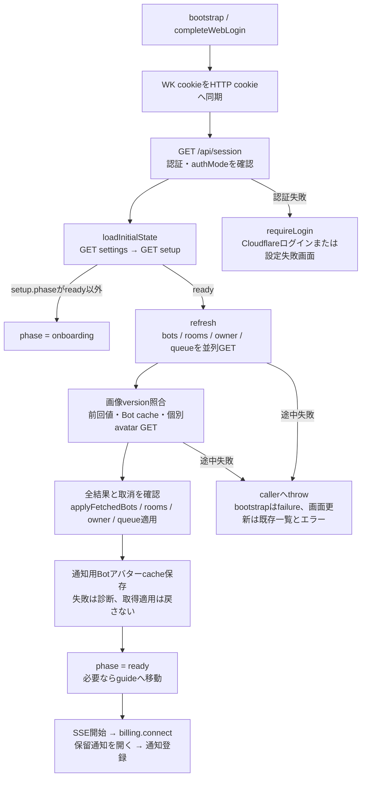
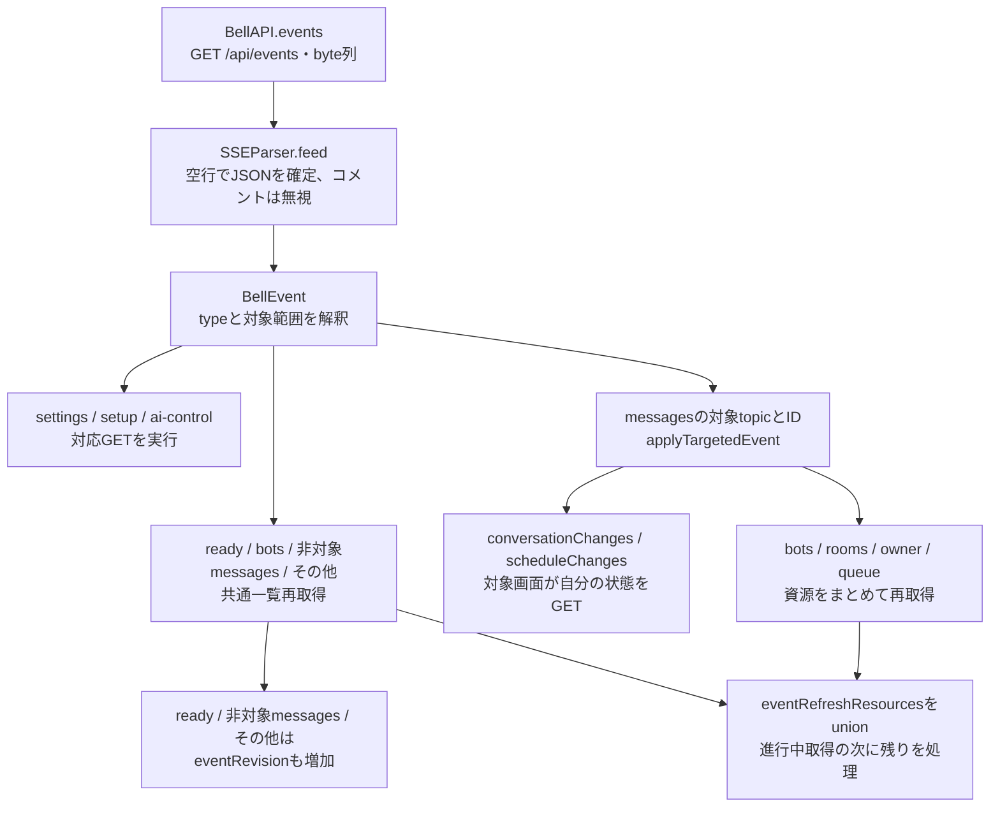
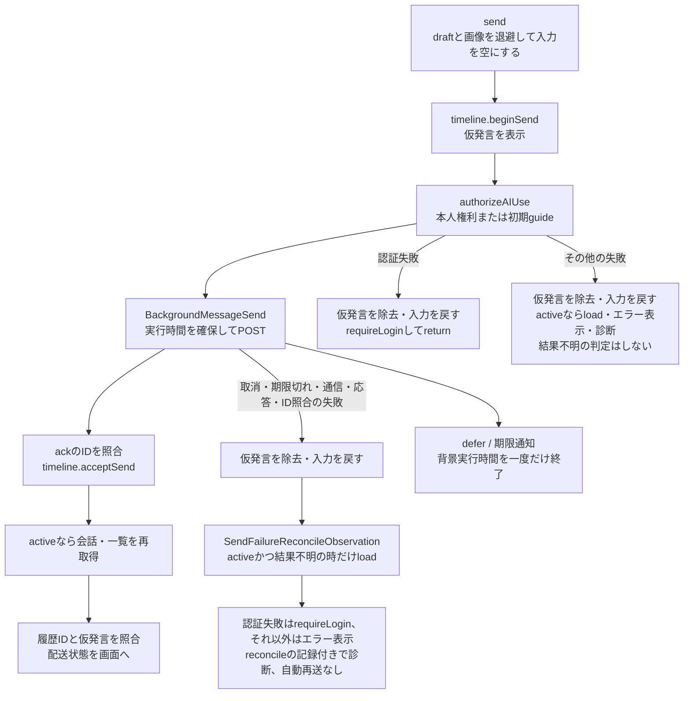

# 状態の所有とHTTP・SSE同期

[全体図](overview.md) / [メンバー・ルーム](members-and-rooms.md) / [設定・プロフィール](settings-and-profile.md) / [関数索引](function-index.md)。sourceは全体図と同じ固定HEAD。型や関数の位置は索引から辿れる。

## 状態の所有者

| 所有者 | 保持するもの | 読込・更新の返却先 |
| --- | --- | --- |
| `Core/Models.swift`の値型 | Bot/Room/Owner/RecentMessage、TimelineMessage/QueueItem、予定、初回認証、追加機能、質問、秘密要求、API応答 | Decodableで応答を値にする。自分で通信・保存・再取得しない。preview、status、path等は入力値から算出 |
| `Core/GoalModels.swift:3`の値型16個 | GoalSnapshot、capabilities・fieldCapabilities・binding、各harnessのgoalと履歴 | Decodableで応答を値にし、表示用の値を算出する。自分で通信・保存・再取得しない |
| `AppStore`、MainActor | phase/serverURL/authMode、setup/featureSettings、bots/rooms/owner、workingBotIDs、AI全体停止、接続エラー、タブ/chatPath、削除待ちID | Publishedを画面が購読。宛先変更は`conversationChanges`、予定変更は`scheduleChanges`。全更新通知は`eventRevision` |
| `AppStore`内の辞書 | 宛先別ConversationDraft、既存Bot編集draft、画像選択draft、会話の前回ページ | `draft(for:)`は同じ宛先に同じ参照を返す。文字入力はAppStoreのPublishedにしない。ページは世代が同じ応答だけ`remember` |
| `BellAPI` | baseURL、専用URLSession、cookieStorage、JSONDecoder、diagnostics | HTTPを型付きの戻り値・Data・Errorでcallerへ返す。AppStoreや画面へ直接代入しない。SSEは`onEvent` callback |
| 各画面 | 会話の履歴/pending送信/queue/カード、一覧の検索、編集フォーム、予定entries、`Core/GoalViewModel.swift:89`のGoalViewModel | HTTPの結果をローカル状態へ適用。共通一覧の更新はAppStoreへ返す。編集draftの例外は上の辞書 |
| `BillingStore` | 本体購読status、StoreKit entitlement/product/currentTransaction、照会・復元中、エラー | AppStoreが所有し、購読画面がObservedObjectで購読。権利変更callbackは通知登録へ |
| `BellNotifications.shared` | APNs token、登録API、署名取引、表示中会話、通知route、登録状況 | 通知タップはAppStoreのonOpen、OS delegateはsingletonへ返す |

下書きは`Core/ConversationDraft.swift:6`の`ConversationDraft`、添付値は同`:51`の`PendingImage`（`init(data:)`は`:56`、`init(fileURL:)`は`:63`）に置く。入力欄は`Views/ConversationInput.swift:5`の`ConversationInput`だけがdraftを観測し、同`:69`のprivateな`MessageInput`と`:135`の`MessageTextView`がUIKitの編集を扱う。会話画像の表示とcacheは`Views/ConversationImages.swift`に置く。状態の所有と寿命は変えない。

goalのGoalLoadCallContextとGoalForegroundLoadは`Core/GoalViewModel.swift:4,28`、通信専用型とGoalViewErrorは同`:57–86`に置く。`Views/GoalsView.swift:14,153`のStateObjectは一覧と会話barで独立したGoalViewModelを生成し、同`:15,154`のStateがGoalForegroundLoadを保持する。状態の生成位置と寿命は変えない。

## 初回読込と共通一覧の適用

`refresh`は4応答と必要な画像解決が揃うまで共通一覧を書き換えない。Bot cacheの保存は適用後。対象限定の`refreshResourcesFromEvent`は指定資源だけGETし、画像を解決してから適用する。`QueueItem.status == running`のbotId集合が`workingBotIDs`になる。queueの全項目をAppStoreで保持するわけではない。

`AppStore.applyFetchedBots`は前の一覧から消えたIDについてナビゲーション、会話draft、Bot編集draft、画像選択draftを消す。`applySavedRoom`は保存応答のroomを入れ替えるが、`recent`は前回一覧の値を保持してID順に並べる。両者とも画面状態への適用であり、本体の処理実行を担わない。

## SSEの適用

| 入力 | 適用先とHTTP再取得 |
| --- | --- |
| `ready` | eventRevision増加、共通一覧の全取得。SSE開始までの変化を再取得する |
| イベント名/type `settings`・`setup`・`ai-control` | `refreshSettings`・`refreshSetup`・`refreshAIControl`。この分岐でeventRevisionは増やさない |
| イベント名/type `updates` | `UpdateStore.refresh`（`GET /api/updates`と保存requestIdの照会）だけ。共通一覧とeventRevisionは動かさない。`ready`でも同じ取り直しを追加で行う。詳細は[Update画面](update.md) |
| イベント名/type `bots` | 共通一覧全取得。この分岐でeventRevisionは増やさない |
| `messages`の`.all`、その他イベント | eventRevision増加と共通一覧全取得 |
| topic `timeline`・`queue`・`requests`・`questions` | botIds/roomIdsの全宛先へconversationChanges。timeline/requests/questionsは該当種別の名簿も再取得 |
| topic `schedules` | IDからChatTarget集合を作りscheduleChangesへ。予定画面が対象分を取得 |
| topic `bots`・`rooms`・`owner`・`queue` | 対応する共通資源を再取得。queueはworkingBotIDsへ |
| topic `settings`・`setup`・`ai-control` | 対応する状態をGET。上のイベント単体の分岐と同じ関数 |
| 対象指定messagesを受けた時にrefreshErrorが残っている | 対象更新に進まずeventRevision増加と全取得 |
| type不正、allがfalseでない、未知/空topic、ID配列不正、宛先が必要なのに無い | BellEvent.scopeをallにする。型列挙はBellEventTopicの11値 |

本体が送信する全イベントの仕様をここでは検証していない。表はAppleが受信後に行う分岐だけを示す。

## HTTPの受付と操作の完了

| 操作 | 応答で確認する段階 | 再取得・画面反映と失敗時 |
| --- | --- | --- |
| メッセージ送信 | Roomはid、BotはdeliveryIdを`messageID(for:)`で要求。受付前submitting、受付後accepted | GET履歴に同IDが来ると仮表示を除く。queued/running/stopped/delivered/failedは履歴値。POSTの受付をAI完了としない |
| メンバー保存 | PATCH成功はBotSaveResult.saved。接続喪失・timeoutは同内容をGET照合しconfirmed/different/unconfirmed | savedの通常経路はAppStore.refresh成功後に閉じる。confirmed等を返した経路はその場で結果を表示。詳細は[編集図](members-and-rooms.md) |
| メンバー削除 | DELETE成功は受付としてpendingBotDeletionIDsへ | GET一覧で消失を確認するまで残す。失敗・結果不明は選択とdraftを保持 |
| ルーム保存・削除 | 保存はRoomResponse、削除はDELETE成功 | 保存はapplySavedRoom、削除はapplyDeletedRoomを直ちに適用。詳細は[編集図](members-and-rooms.md) |
| 個別停止 | `BotStopResponse.outcome`がBot ID、HTTP status、status、sessionPreservedを照合。202/stop_sentはsent、200/interruptedかつsessionPreserved=trueはconfirmed | sentとconfirmedを別表示。失敗はunconfirmed等を表示し履歴を再取得。自動でPOST再送しない |
| 再起動 | `AppStore.restartConversation(target:)`（`Core/AppStore.swift:401`）がauthorizeAIUse後にEmptyBodyを`POST T/restart`し、APIAcknowledgementを受領 | callerはDesktopInspector.profileとConversationDetailView.bodyのonRestart。成功時は前者がerrorを消し後者がdismiss。失敗は元のErrorを返し、画面ごとの表示・診断に委ねる。refresh・再送・完了待ちは追加しない |
| AI全体停止 | PATCH応答のAIControlを適用。stateはenabled/stopping/stopped/unconfirmed | PATCH失敗後はGETのみ。GET失敗ならaiControl=nil、エラーを表示。epoch/sequenceで古い応答を排除。更新中の読取要求は後続GETへ |
| Owner・規範、追加機能 | 個別更新応答の後にもGETがある | Ownerの途中保存、追加機能の反映errorは[設定図](settings-and-profile.md) |
| 予定run・goal・質問・秘密 | 予定runはack、goalはoutcome/snapshot、質問/秘密は更新された要求 | 各画面が保持する。予定runのackから実行終了を判定しない。goalのunconfirmedと変更通信失敗は再取得/明示更新の経路を持つ |

`BellAPIError.operationResultUnconfirmed`はURLError、DecodingError、invalidResponse、backgroundSendExpired、HTTP 5xxを結果不明と分類する。これはAppleの表示判断で、実際に本体で書けたかどうかの判定ではない。

## 送信・停止・取消・途中失敗

送信前の利用確認（`authorizeAIUse`）の失敗と、POSTの失敗は別の経路になる。前者は `ConversationView.swift` の764〜777行で、認証失敗なら`requireLogin`して戻り、それ以外は結果不明かどうかを問わずactiveなら`load`する。後者は792〜800行で、`SendFailureReconcileObservation.observe`（同31〜37行）がactiveかつ`operationResultUnconfirmed`の時だけ`load`する。

`ConversationContent.load`は非activeと送信応答待ちで取得を始めない。進行中readerがあれば次の読取要求をまとめる。初回本文とqueueは並列に取り、本文を先に表示するので、queueだけが失敗しても本文を残せる。初回は10件、過去取得は`ConversationHistoryPage.pageSize`の25件。更新は最新20件とafter取得を併合する。

| 場面 | 停止・後始末・返却先 |
| --- | --- |
| AppStoreがbackgroundへ | foregroundTaskをcancel、stopEventsでSSE task・資源再取得taskをcancelして保留集合を消す |
| activeへ復帰してready | 前のforegroundTaskをcancel、session.flush、一覧/購読本体状態、AI停止、Apple権利を順に確認。取消を各境界で確認してSSE・通知を開始 |
| 会話が非activeまたは非表示 | readerと過去読取taskをcancel、世代を増加。背景送信は専用の実行時間管理を通る |
| SSE終了・通信失敗・HTTP429/5xx | 画面へ再接続中と表示。1秒から倍増し最大30秒。30秒超の接続後は遅延・連続失敗数をリセット。URLError連続5回目に診断 |
| SSE認証失敗 | requireLoginへ渡して再接続loopを終了 |
| SSEのその他の応答/復号等の異常 | エラー表示・診断後にloop終了。自動再接続しない |
| 通常HTTPのGETでnetworkConnectionLost | BellAPI.loadが一度だけGETを取り直す。他のGET失敗やPOST/PATCH/PUT/DELETEをここでは再送しない |
| JSON/画像/HTTP検証の失敗 | throwしてcallerが表示・診断を決める。認証用保護sessionはredirectを拒否し、deferでinvalidateAndCancel |
| 会話ページを消した後の初回読取応答 | conversationGeneration不一致なら成功/失敗を適用しない。rememberも世代を検査 |
| requireLogin | foreground/SSEを停止、AI停止状態と接続エラーを消す。下書き辞書は保持。CloudflareはsignIn、local拒否はfailure |

通常JSON通信は2xx・最終接続先・認証・Content-Typeを検査し、JSONDecoderはsnake_caseを変換する。imageResponseはimage MIME、SSEはtext/event-streamを検査する。`exportConversation`も通常の`data`経路を通る。

## 端末保存と後始末

| 保存場所・状態 | 書込 | 明示logout時の扱い |
| --- | --- | --- |
| UserDefaults `bellbot.serverURL` | setServerAddress | signOutでは残す。changeServerがsignOut後に削除しserverURL/baseURLをnilにする |
| UserDefaults `bellbot.pushToken` | デバイス登録成功後 | detachの解除HTTP成功後に消す。解除失敗ではtokenを残して診断 |
| AppStorage `conversationOpening` | SettingsViewのPicker | signOutで削除する処理なし |
| HTTP cookieStorage / WK httpCookieStore | syncCookies・Webログイン | signOutは指定された両storeのcookieを全て削除する |
| App Group `avatars/<origin>/`とversions.json | BotAvatarCache.storeVersioned、前回名簿に無い画像は整理 | signOutでディスクcacheを削除する呼出しなし |
| drafts・Bot編集draft・profileImageDrafts | AppStore内のメモリ | 保持中ConversationDraftをclearして辞書も削除。会話ページも世代を増やして削除 |
| 履歴・画像・日付・色のメモリcache | conversationPages、`Views/ConversationImages.swift:198`のConversationImageCache、AvatarPortraitCache、BellDate、AvatarTone | signOutはconversationPagesを消す。後4つのstatic cacheを消す呼出しはない |
| BillingStore・通知 | 取引監視・登録状態・route | billing.stop、BellNotifications.detach、配信済み通知削除、route/表示中会話/secretを消す |
| 共通一覧bots/rooms/owner・setup・settings | GETの結果 | signOut自身では空にしない。changeServerが名簿・Owner・setup・settings等を消す |

端末内の下書き・会話ページをディスクへ保存する処理は、読んだ製品Swiftには無い。logoutの削除範囲をアプリ内の全cacheや全設定へ広げて記述しない。

## 整理候補

- **A-S1**：`ios/BellBot/BellBot/Core/BellAPI+BotSettings.swift:3`。BellAPIの保存・保存照合4関数を専用ファイルのextensionに定義する。値型とencodeは`Core/BotSettings.swift:3–150`、一般HTTP処理は`Core/BellAPI.swift:97`に残す。
- **A-S2**：`ios/BellBot/BellBot/Core/BellDiagnostics.swift:400`。診断送信はURLRequest、cookie付与、URLSession.shared、HTTP202確認を直接持ち、`Core/BellAPI.swift:416`にもrequest作成とcookie付与がある。

## 未調査

- 本体内部の状態writer、SSE発行とHTTP受付後の処理、実際の配送・停止完了。
- 実行時の競合・取消タイミング、複数window、長時間background、OSのcookie/cacheの保持。ビルド・試験は未実行。
- 関連XCTestのassertion・fixture本文。索引の試験対応は宣言だけの確認。
