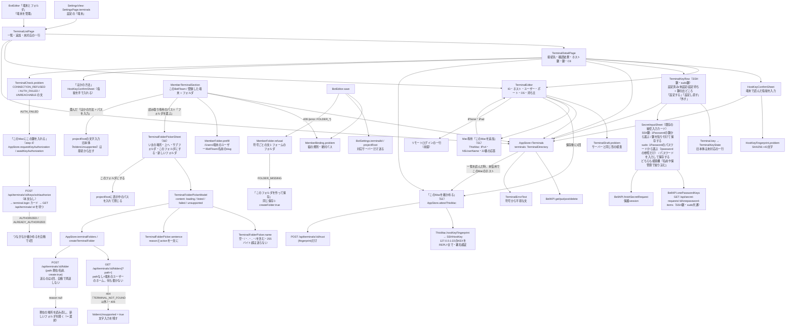
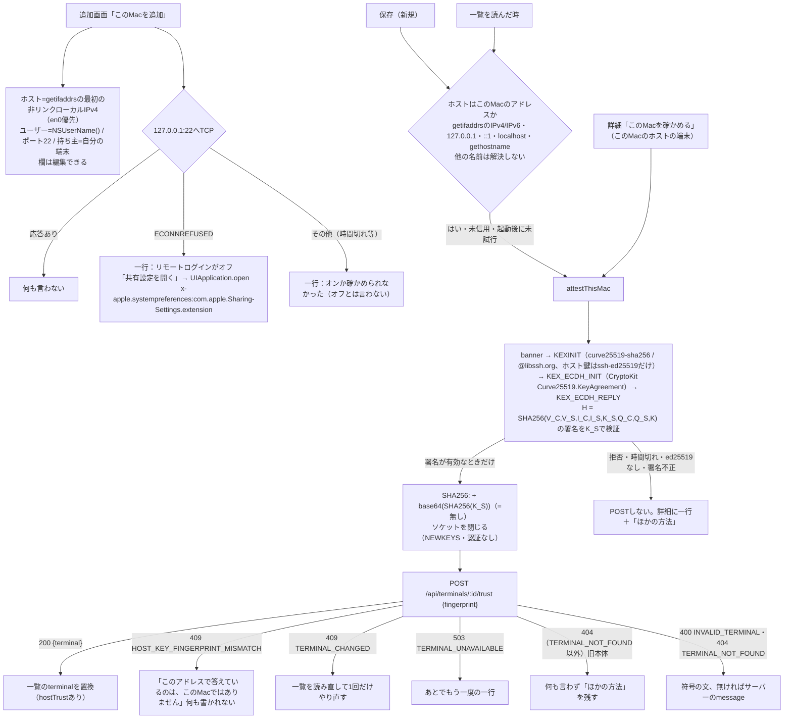
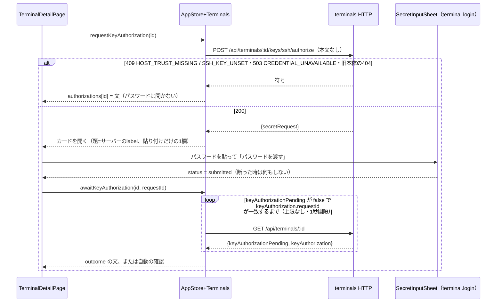
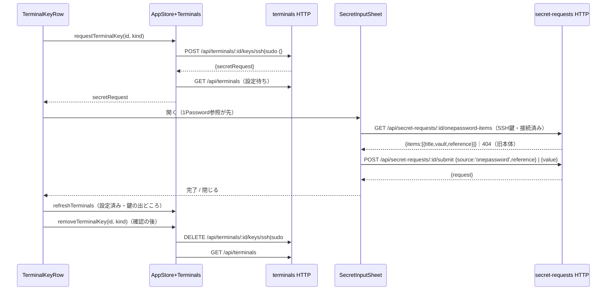
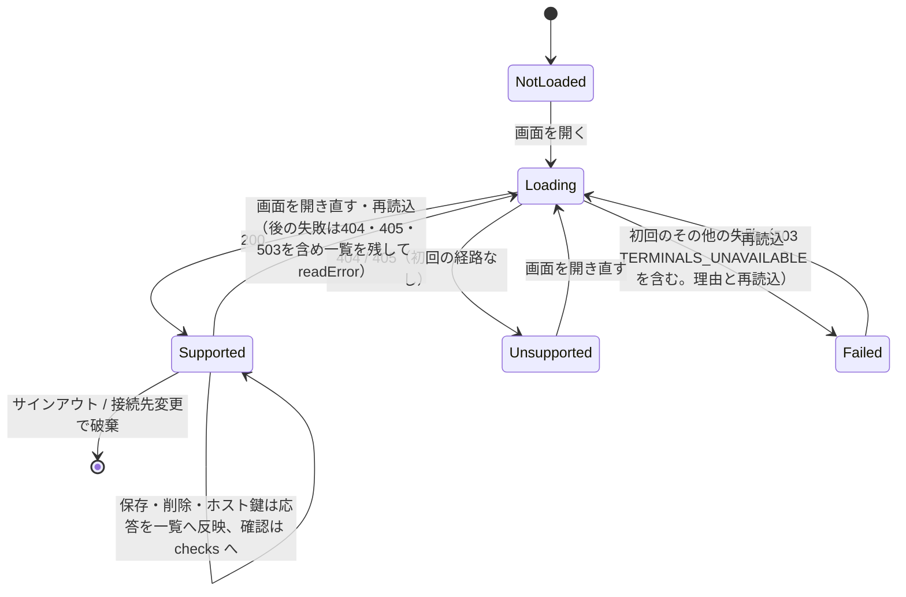
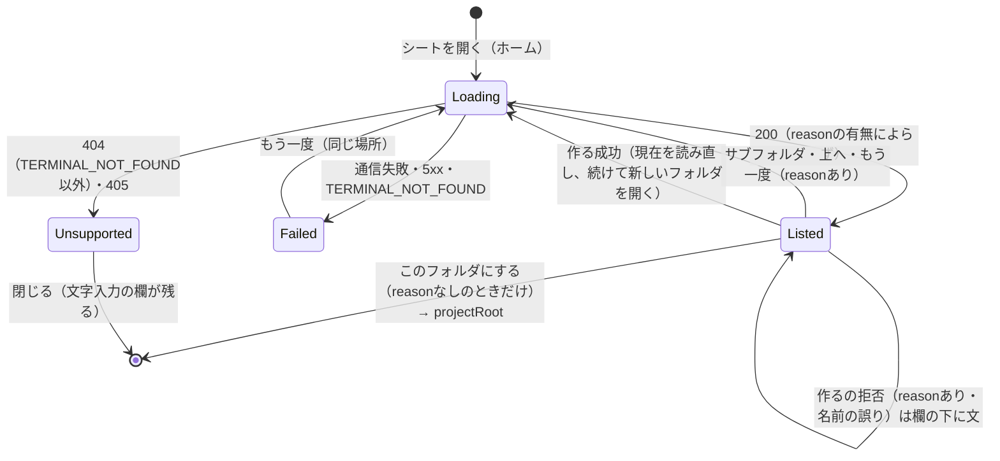

# 端末の登録とメンバーの端末・フォルダ（F-SEAT-HOST P2）

[全体図](overview.md) / [メンバー・ルーム編集](members-and-rooms.md) / [設定](settings-and-profile.md) / [関数索引](function-index.md) / [試験](tests.md)。以下の実装名は`ios/BellBot/BellBot/`からの相対名。

使う契約：[terminals](../terminals/README.md)（registry・reachability・C8 maintenance）、[ingress RS09/RS12](../integration/remote-seat-ingress.md#data-flow)（HTTP `/api/terminals*`）、[terminals「Key setting from the app」](../terminals/README.md#key-setting-from-the-app-trony-ruling-2026-11-09)（`POST|DELETE /api/terminals/:id/keys/{ssh|sudo}`、projectionの`keySource`・`sudoKeySource`・`sshKeyPending`・`sudoKeyPending`）、[members C1](../members/remote-seat.md#c1-member-binding)（`terminalId`・`projectRoot`）、[execution remote-seat「Launch notice」](../execution/remote-seat.md)（Kiro #892）のBot項目`seatLaunch`（表示は[一覧とメンバー](members-and-rooms.md)と[会話](conversation.md)。試験ではDEBUGの`-bellbot-preview-seat-launch action|code`が名簿へ同じ値を入れる）、[secret credentials](../usage/secret-credentials.md#owner-terminal-key-settings)と[秘密の入力](../../../secret-input.md)（既存の秘密入力カード、`inputOptions`で1Password参照を先・保存値を代替、`POST /api/secret-requests/:id/submit`。値は一般の欄に書かない）。[terminals「Self-service registration and assignment」](../terminals/README.md#self-service-registration-and-assignment-trony-request-2026-11-10-design)のS1・S2（Crust #856の`POST /api/terminals/:id/trust`、本文は`{fingerprint}`だけ）と、[Mika #855](../usage/secret-credentials.md)の`terminal.login`の秘密入力（[質問・秘密要求](requests-and-auth.md)）。Step 4の鍵の導入（Crust #858の`POST /api/terminals/:id/keys/ssh/authorize`と、projectionの`keyAuthorizationPending`・`keyAuthorization`）と、step 5のメンバーのフォルダ（[Belorta #859](../members/remote-seat.md)の`createFolder`、拒否は`{error: code}`と状態だけ）も使う。step 6のフォルダ選び（[terminals「Folder picker」](../terminals/README.md#folder-picker-s6-owner-request-2026-11-10-0940-jst-design)、Crust #887）の`GET /api/terminals/:id/folders[?path=]`と、既存の`POST /api/terminals/:id/folder {path, create:true}`も使う（サーバーの経路はmainにある。試験は同じ形の試験用サーバーで行う）。Appleはこれらの利用側で、契約を変えない。

## 機能図

### このMacの自己登録（S1・S2、Mac Catalystだけ）

Macアプリの端末の詳細・追加画面にだけ出る。iPhone・iPadに新しい表示はない。判定は`ProcessInfo.processInfo.isMacCatalystApp`。サンドボックスは`network.client`だけで、`/etc/ssh/ssh_host_ed25519_key.pub`は読めない（実測で拒否）。127.0.0.1:22へのTCPは通る。

他の端末・他のMacの詳細は、未信用のとき「このMacでBellTeamアプリを開くと、自動で確かめます」を出す。起動後の一覧の読み込みで、そのMacのアプリが自動で確かめる。手で指紋を入れる画面は「ほかの方法」（折りたたみ）の中へ移した。

| 部品 | 責任 |
| --- | --- |
| `Core/Terminals.swift` | `Terminal`・`TerminalCheck`・`TerminalMaintenance`（新しい項目はすべて省略可で読む）、`TerminalKeyKind`・`TerminalKeyState`（鍵の行）、`TerminalDraft`（登録の検査とbody）、`MemberBinding`（組の規則とフォルダの検査）、`HostKeyFingerprint`、`TerminalReachabilityText`（確認結果の文）、`TerminalErrorText`（HTTPの符号から文）、S2の`TerminalTrust`（結果の分類と一行）・`TerminalTrustBody`・`TerminalTrustNote`、step 4の`KeyAuthorization`・`TerminalAuthorize`（outcomeと拒否の文、待ちの状態）、step 5の`MemberFolder`（既定のフォルダ・prefillの規則・`FOLDER_*`の文）。`Terminal`は`keyAuthorizationPending`・`keyAuthorization`を省略可で読む。`TerminalCheck.problem`に`refused`・`authFailed`を足し、`explanation`はサーバーの`action`を文に使う |
| `Core/AppStore+Terminals.swift` | `TerminalDirectory`（`state`・`checks`・`checking`・`attesting`・`trustNotes`・`attested`）を`AppStore.terminals`に保持。`refreshTerminals`・`saveTerminal`・`confirmHostKey`・`removeTerminal`・`checkTerminal`・`requestTerminalKey`・`removeTerminalKey`、S2の`attestThisMacOnce`・`attestThisMac`（結果は`trustNotes`の一行。投げない）、step 4の`authorizations`・`requestKeyAuthorization`・`awaitKeyAuthorization`（待ちと結果の文は`authorizations`。確認結果を消さずに端末だけ更新する）。サインアウトと接続先変更で空に戻す |
| `Core/ThisMac.swift` | Mac専用の事実：`isThisMac`、`interfaces`・`primaryIPv4`・`userName`・`hostName`・`owns(host:)`、22番の`remoteLogin`、`hostKeyFingerprint`（ブロッキングの`LoopbackSocket`、全体の期限つき）。秘密は扱わない |
| `Core/SSHHostKey.swift` | SSHの配線（`SSHWire`：string・mpint・packet・Reader）と交換ハッシュ・署名検証・指紋（`SSHHostKey.fingerprint`）。署名が有効なときだけ値を返し、他は`SSHHostKeyError` |
| `Views/TerminalsView.swift` | 一覧・詳細・登録/編集・ホスト鍵の画面、鍵の行（`TerminalKeyRow`）と外す確認、メンバー編集の「端末とフォルダ」節。Macだけ：追加画面の「このMacを追加」、詳細の「このMacを確かめる」、ホスト鍵の節の「ほかの方法」、`CONNECTION_REFUSED`の「共有設定を開く」。Mac以外の追加画面：リモートログインの前提の一行。詳細：三つの理由の文、「このMacにこの鍵を入れる」と待ち・結果の文、メンバー編集のフォルダ（prefill・拒否の文・「このフォルダを作って保存」） |
| `Views/SecretRequestView.swift` | `SecretInputSheet`。`purpose:'terminal.login'`は1つのパスワード欄に貼るだけ（1Passwordの選択肢・参照欄なし）で、文は「このMacのログインパスワード（1回だけ使い、保存しません）」。端末の鍵でも会話の秘密要求と同じ入力欄を使う。SSH鍵とsudoは1Passwordの一覧（`OnePasswordKeyList`、sudoは`/password`の参照だけ）から検索して選べる（[質問・秘密要求](requests-and-auth.md)）。Macでは他の編集sheetと同じ大きさで開く |
| `Views/ManagementView.swift` | BotEditorに節を置き、保存前に組の規則を検査し、対応サーバーの時だけ2項目を送る。保存の拒否が`FOLDER_*`ならフォームのフォルダ入りの文を出し、`FOLDER_MISSING`だけ「このフォルダを作って保存」（同じ保存＋`createFolder:true`）を出す。フォームを編集するとボタンは消える |
| `Views/SettingsView.swift` | 設定の項目「端末」 |

### 鍵をMacに入れる（step 4、端末の詳細）

確認結果が`AUTH_FAILED`のとき、詳細の確認結果の下に「このMacにこの鍵を入れる」を出す（Mac・iPhone・iPad共通。パスワードはカードにだけ貼り、アプリは保存も表示もしない）。確認結果は証拠であって診断ではないので、文は「かもしれません」で止め、直し方のボタンを添える。

| 状態（`TerminalAuthorize.State`） | 画面 |
| --- | --- |
| 待ち（`waiting`） | 「Macに鍵を入れています…」。読めない間は「状態を読み込めませんでした。つながり直したら続けます…」（同じ待ちを続ける。打ち切らない）。詳細ページを離れると待ちを止めて消す |
| `AUTHORIZED`・`ALREADY_AUTHORIZED` | 文なし。古い確認結果を消して`POST …/check`を1回自動で行い、結果を通常どおり出す。確認が失敗したら「鍵はMacに入りました。つながるかは確かめられませんでした…」 |
| `PASSWORD_REJECTED` | 「パスワードが違いました。」＋ボタン（もう一度） |
| `AUTHORIZATION_UNCONFIRMED` | 「入れられたか確かめられませんでした。もう一度お試しください」＋ボタン（パスワードは使われたので、新しい依頼を出す） |
| `PASSWORD_AUTH_DISABLED` | 「このMacはパスワードでのログインを受け付けていません。…」ボタンなし（押しても同じ） |
| `TERMINAL_CHANGED`・`TERMINAL_UNAVAILABLE`・その他 | 平易な一文＋ボタン |
| `CREDENTIAL_UNAVAILABLE` | 「SSH鍵が使えませんでした。下の「鍵」で設定し直して…」ボタンなし |
| POSTの拒否 | `HOST_TRUST_MISSING`「先にこのMacを確かめてください。ホスト鍵を確かめる前は、パスワードを聞きません。」、`SSH_KEY_UNSET`「先にSSH鍵を設定してください。…」、`CREDENTIAL_UNAVAILABLE` 503「いまはパスワードの入力欄を開けません。…」、`TERMINAL_NOT_FOUND`以外の404（旧本体）「このBellTeamはまだ、アプリからMacに鍵を入れることに対応していません。」 |

文は新しい確認・保存・信用（`replaceTerminal`）で消える。同じ端末の新しい依頼は古い待ちを置き換える。再起動でサーバーの依頼は消えるので、アプリは待ちを離れ、ボタンでもう一度頼む。

### 確認結果の三つの理由（step 4）

| `reason` | 文（サーバーの`action`があればそれを文として使い、無ければ同じ意味のアプリの文） | 操作 |
| --- | --- | --- |
| `CONNECTION_REFUSED` | Macの「システム設定 > 一般 > 共有」で「リモートログイン」がオンか確かめてください | Macアプリで、この端末のホストがこのMacのとき「共有設定を開く」 |
| `AUTH_FAILED` | この鍵がまだMacに入っていないかもしれません | 「このMacにこの鍵を入れる」 |
| `UNREACHABLE` | Macが届きませんでした。Macが起きていて、同じネットワークにあるか確かめてください。起きれば自動で再開します | なし |

## データの流れ

| ID | 画面 -> HTTP | 送るもの / 戻り |
| --- | --- | --- |
| AT01 | 一覧・メンバー編集 -> `GET /api/terminals` | `{terminals:[…]}`。404・405（経路が無い旧本体。Webと同じ）だけ「未対応」として一行だけ出す（赤字なし）。503 `TERMINALS_UNAVAILABLE`（本体で端末の機能が動いていない）を含む他の失敗は理由と再読込で、読めていた一覧とメンバーの端末・フォルダ操作は残す。自動再試行はしない |
| AT02 | 登録・編集 -> `PUT /api/terminals/:id` | `host`・`user`・`port`・`os`・`accountOwner`だけ。鍵の項目は送らない。応答の公開projectionを一覧へ反映。IDは登録時だけ入力し、編集では変えない |
| AT03 | 確認 -> `POST /api/terminals/:id/check` | `{reachable, reason, action?, observedAt}`を端末ごとに`checks`へ保持（アプリ内だけ）。席は起動しない |
| AT04 | ホスト鍵 -> `PUT /api/terminals/:id` `{confirmHostKey:'SHA256:…'}` | オーナーが端末で読んだ指紋だけを送る。サーバーは一度scanし、等しい時だけ信用し直す。409 `HOST_KEY_FINGERPRINT_MISMATCH`は「指紋が違う」と表示して入力を残す |
| AT05 | 削除 -> `DELETE /api/terminals/:id` | 確認ダイアログの後。メンバーの設定と保留中のメッセージは残ると表示 |
| AT07 | 鍵の行「設定する」「設定し直す」 -> `POST /api/terminals/:id/keys/{ssh|sudo}`（本文は空の`{}`） | `{secretRequest:{id,label,inputOptions,…}}`。一覧を読み直して「設定待ち」にし、返った依頼で既存の秘密入力カードを開く。カードは`inputOptions.onePasswordAvailable`なら1Password参照を上・既定に、保存値を代替に出す。SSH鍵は題を「1Passwordの鍵から選ぶ」/「鍵を貼り付けて保存する」とし、前者は`GET /api/secret-requests/:id/onepassword-items`（`{items:[{title,vault,reference}]}`）の名前と保管庫の一覧から選ぶ（旧本体で404なら貼り付けだけ。未接続の貼り付けは設定の「1Password連携」への短い案内付き）。貼り付けは複数行欄。sudoも同じ一覧（`/password`で終わる参照だけ）から「1Passwordのパスワードから選ぶ」/「パスワードを入力して保存する」で選び、どちらの一覧にも検索欄「名前や保管庫で絞り込む」がある（入力側はSecureField1つ）。カードから`POST /api/secret-requests/:id/submit`（`{source:'onepassword',reference}`または`{value}`）。閉じた時と完了時に一覧を読み直す。鍵の値・参照はこの画面にもHTTPの鍵の入口にも出ない |
| AT09 | 詳細「このMacを確かめる」・保存後・一覧を読んだ後 -> `POST /api/terminals/:id/trust`（本文は`{"fingerprint":"SHA256:…"}`だけ） | 指紋は`ThisMac.hostKeyFingerprint`が127.0.0.1:端末のポートで読み、署名が有効だった値だけ。200 `{terminal}`は一覧の該当を置換。400 `INVALID_TERMINAL`はサーバーのmessage。404 `TERMINAL_NOT_FOUND`は「登録が見つかりません」、それ以外の404は旧本体で何も言わない。409 `HOST_KEY_FINGERPRINT_MISMATCH`は「このアドレスで答えているのは、このMacではありません」で何も書かれない。409 `TERMINAL_CHANGED`は一覧を読み直して1回だけやり直す。503 `TERMINAL_UNAVAILABLE`は「あとでもう一度」。自動再送はこの1回だけ（認証拒否は中断して再ログイン）。結果は詳細の一行（アプリ内だけ） |
| AT10 | 追加画面「このMacを追加」 -> アプリ内だけ（HTTPなし） | getifaddrs・NSUserName・127.0.0.1:22のTCP。サーバーへは保存したものだけが行く（AT02） |
| AT11 | 詳細「このMacにこの鍵を入れる」 -> `POST /api/terminals/:id/keys/ssh/authorize`（本文なし） | 200 `{secretRequest}`（`purpose:'terminal.login'`、labelはサーバーの日本語「端末 <id> のMacのログインパスワード」をそのまま題にする）。409・503・旧本体の404は文にして、カードを開かない。カードは貼り付けだけ。パスワードはカードから`POST /api/secret-requests/:id/submit`だけに行く |
| AT12 | カード送信後 -> `GET /api/terminals/:id`（1秒間隔） | `keyAuthorizationPending:false`かつ`keyAuthorization.requestId`が依頼のidに一致したら`outcome`を文にする（上の表）。成功は`POST …/check`を自動で1回。読み取りの失敗は理由を出して続け、認証拒否だけ再ログインで止める。`GET`の応答は確認結果を消さずに一覧へ反映する |
| AT13 | 「フォルダを選ぶ」・サブフォルダ・「上へ」・「もう一度」 -> `GET /api/terminals/:id/folders[?path=<絶対パス>]` | pathなしは端末のユーザーのホーム（最初は必ずホームで開く）。`path`のクエリ値を`/`以外の記号まで%エスケープして送る（`+`・`&`・`#`を含むフォルダ名のため）。200 `{terminalId, observedAt, home, path, parent, entries:[{name,path}], truncated, reason, action}`。`reason`が空なら`entries`を1行ずつ（タップで開く）、`parent`があれば「上へ」、`truncated`なら「フォルダが多いため、すべては表示していません。」の一行。`reason`があれば`entries`は空なので一覧を出さず、`UNREACHABLE`・`TERMINAL_UNAVAILABLE`・`CONNECTION_LOST`・`REMOTE_AITERM_*`は「いまこの端末に届きません…」、`FOLDER_NOT_PERMITTED`はメンバー保存と同じ文、その他はサーバーの`action`を一文＋「もう一度」（同じ場所を読み直す）。`reason`が空で`entries`も空なら「フォルダはありません」（「このフォルダにする」「新しいフォルダ」は使える）。404 `TERMINAL_NOT_FOUND`は「この端末は登録されていません。」、通信失敗・5xxは「フォルダの一覧を読み込めませんでした…」＋「もう一度」。404（`TERMINAL_NOT_FOUND`以外）・405は旧本体：`foldersUnsupported`を立て、メンバー編集は文字入力の欄を出す。次に読めたら外す。読むだけで何も書かない |
| AT14 | 「新しいフォルダ」の「作る」 -> `POST /api/terminals/:id/folder {path:"<現在>/<名前>", create:true}` | 名前は前後の空白を除き、空・`/`・`.`・`..`・`/`を含む・NULを含む・255 UTF-8バイト超は送らずに文で止める。200で`reason`が空なら、現在の場所を読み直し（AT13）、続けて作ったフォルダを開く（＝選択。「このフォルダにする」はその中を指す）。`reason`があれば現在の場所に留まり、`action`/S5の文を欄の下に出して名前を残す。通信失敗は作れたか不明なので再送せず、「作れたか確かめられませんでした」と現在の場所の読み直しを出す |
| AT08 | 鍵の行「外す」 -> `DELETE /api/terminals/:id/keys/{ssh|sudo}` | 確認ダイアログの後。サーバーが鍵を外し（設定待ちの依頼も取り消し）、一覧を読み直す |
| AT06 | メンバー保存 -> `PATCH /api/bots/:id` / `POST /api/bots` | 対応サーバーの時だけ`terminalId`・`projectRoot`（このBellTeamは両方空）。400 `BOT_TERMINAL_ID_INVALID`・`BOT_PROJECT_ROOT_INVALID`・`BOT_REMOTE_BINDING_INVALID`は画面の検査と同じ文。409 `FOLDER_*`と404 `TERMINAL_NOT_FOUND`は`{error: code}`と状態だけ（#859）なので、アプリが符号ごとに文を持つ（下の表）。`createFolder:true`は「このフォルダを作って保存」を押した時だけ同じ本文に足す（`BotSettingsRequest.createFolder`。保存済みの設定には入れず、保存結果の照合にも使わない） |

| 鍵の行（`Terminal.key`） | 表示と操作 |
| --- | --- |
| `sshKeyPending`/`sudoKeyPending`が無い（旧本体） | 設定済み/未設定と、節に一行「このBellTeamはまだアプリからの鍵の設定に対応していません」。ボタンなし。POSTが`TERMINAL_NOT_FOUND`以外の404を返した時も同じ |
| 未設定 | 「未設定」、「設定する」 |
| 設定待ち | 「設定待ち」と、設定済みなら今の鍵の出どころ（新しい鍵が結ばれるまで今の鍵を使う）。「設定する」/「設定し直す」で入力欄を開き直す（サーバーは新しい依頼に置き換える）。「外す」 |
| 設定済み | 「設定済み」と鍵の出どころ（`terminal-native`=端末にある鍵、`secret`=BellTeamに預けた鍵）。「設定し直す」「外す」 |

SSH鍵は「必須。これが無いと端末につなげません。」、sudo鍵は「任意。自分の端末では不要です。」と添える。ハンドル・値・`op://`参照は表示しない（projectionにも無い）。失敗は詳細ページ下の案内（`SettingsBanner`）に符号から選んだ平易な文で出し、サーバーの英文は出さない：`KEY_IN_REQUEST_REFUSED` 400（アプリは本文を送らないが、来たら入力欄だけに入れる案内）、`TERMINAL_NOT_FOUND` 404、`CREDENTIAL_UNAVAILABLE` 503（少し待って再試行）、`TERMINAL_UNAVAILABLE` 503（BellTeamのAitermを更新）、`TERMINAL_CHANGED` 409（もう一度押す）。自動再送はしない。

## 状態

| 確認結果（`reason`） | 表示 |
| --- | --- |
| `reachable:true` | つながる（確かめた時刻） |
| `UNREACHABLE` | つながらない。Macが起きていて同じネットワークにあるか。起きれば自動で再開する |
| `TERMINAL_UNAVAILABLE`・`REMOTE_AITERM_*`・`CONNECTION_LOST` | つながらない。端末が眠っているか届かない。起きれば自動で再開する |
| `CONNECTION_REFUSED` | つながらない。Macが接続を断った。リモートログインがオンか確かめる（Macアプリは「共有設定を開く」） |
| `AUTH_FAILED` | つながらない。この鍵がまだMacに入っていないかもしれない（「このMacにこの鍵を入れる」） |
| `CREDENTIAL_UNAVAILABLE`・`SSH_KEY_UNSET`・`CREDENTIAL_*` | つながらない。SSH鍵が無いか使えない |
| `TARGET_MISMATCH`・`HOST_TRUST_*`・`HOST_KEY_*` | つながらない。ホスト鍵を確かめる必要がある（「ホスト鍵を確かめる」を出す） |
| `TERMINAL_NOT_FOUND` | 登録が見つからない |

`CONNECTION_REFUSED`・`AUTH_FAILED`はサーバーの日本語の`action`をそのまま文にする（二度出さない）。それ以外の`action`は「サーバーの案内」として小さく添える。応答に指紋の項目は無い。`action`に`SHA256:`の指紋が含まれる時だけ「サーバーが示した指紋」として並べて見せ、入力した指紋との一致を表示する。どちらの場合も、オーナーが端末で読んだ指紋を入れない限り送らない。

### フォルダ選びの状態（S6）

最新の要求だけが画面を更新する（連打した古い読みは捨てる）。ロックや二重実行の防止は置かず、読みは何度でも繰り返せる。

## メンバー編集「端末とフォルダ」

| 状態 | 表示 |
| --- | --- |
| 一覧未対応（AT01） | 「このBellTeamはまだ端末の登録に対応していません」の一行。項目を送らない |
| メンバーの応答に`terminalId`が無い（旧本体） | 「このBellTeamはまだメンバーの端末設定に対応していません」の一行。項目を送らない |
| 対応 | 「動かす場所」Picker（このBellTeam / 登録した端末）。端末を選ぶとフォルダ欄。このBellTeamに戻すと両方空 |
| 保存済みの端末が一覧に無い | 「（登録が見つかりません）」付きで選択肢に残し、別の端末へ自動で替えない |

### フォルダ選び（S6、Crust #887）

端末を選ぶと、「フォルダ」は選んだパスを読み取り専用の文字で出し（空なら「未選択」）、下に「フォルダを選ぶ」を置く。パスの文字入力は畳んだ「ほかの方法」の中の「パスを入力」だけにある。次のprefill（`/Users/<user>/BellTeam/<slug>`）と保存の`FOLDER_*`の文・「このフォルダを作って保存」は変えない。選んだパスはprefillの対象外（打ち込んだ値と同じ扱い）。

「フォルダを選ぶ」はシートを開き（シートは`BotEditor`が出す。Formの行から出すと編集画面ごと閉じるため）、必ず端末のユーザーのホームから始める（選択中のフォルダの親から始めるのは、親がまだ無い場合の扱いが要るので見送った）。上から：いまの場所（パス）・「上へ」（`parent`がある時）、「このフォルダにする」、サブフォルダの行、「新しいフォルダ」（名前欄＋「作る」）。「このフォルダにする」は表示中のパスを`projectRoot`に入れて閉じ、`reason`がある場所（読めない場所）には出さない。作ったフォルダは開く（選択＝以後の「このフォルダにする」はそのフォルダ）。ネイティブのフォルダ選択パネル（このMac用）は付けない（任意）。

| 場所 | 画面 |
| --- | --- |
| 一覧できた | パス・上へ・行。空なら「フォルダはありません」。多すぎれば「フォルダが多いため、すべては表示していません。」 |
| `reason`あり | 一文＋「もう一度」。届かない系は「いまこの端末に届きません。Macが起きていて同じネットワークにあるか確かめて、もう一度お試しください。」で空の一覧に見せない。「上へ」は残る |
| 読み込み失敗 | 「フォルダの一覧を読み込めませんでした。つながりを確かめて、もう一度お試しください。」＋「もう一度」 |
| 旧本体 | シートは「このBellTeamはまだ、フォルダを選ぶ画面に対応していません。」を出して閉じられ、メンバー編集は文字入力の欄を最初から出す |

### フォルダ（step 5、Belorta #859）

端末を選ぶと、空のフォルダ欄に`/Users/<その端末のユーザー>/BellTeam/<メンバー名のslug>`を入れる。slugは名前の前後の空白を除き、`/`・`:`・NULを`-`にし、空・`.`・`..`なら`member`（Webの`memberFolder`・サーバーの`memberFolderSlug`と同じ）。入れた値のままの間は、名前や端末の変更に合わせて作り直す。打ち込んだ値と保存済みの値は書き換えない（`MemberFolder.prefill`）。

保存の拒否は`{error: code}`と状態だけなので、アプリが符号ごとに文を持ち、フォームのフォルダを末尾に添える（Webの`folderRefusal`と同じ文）。

| 符号 | 文 | ボタン |
| --- | --- | --- |
| `FOLDER_MISSING` | このフォルダはMacにありません。作るか、あるフォルダを選んでください | 「このフォルダを作って保存」（同じ保存＋`createFolder:true`） |
| `FOLDER_NOT_DIRECTORY` | これはファイルです。フォルダを選んでください | なし |
| `FOLDER_NOT_WRITABLE` | このMacのユーザーが書き込めるフォルダを選んでください | なし |
| `FOLDER_NOT_PERMITTED` | Macがこのフォルダを開かせてくれません。デスクトップ・書類・ダウンロードの外を選ぶか、リモートログインの「リモートユーザにフルディスクアクセスを許可」をオンにしてください | なし |
| 他の`FOLDER_*` | このフォルダは使えません | なし |
| 404 `TERMINAL_NOT_FOUND` | この端末は登録されていません。 | なし |

検査はサーバーと同じ：`terminalId`は`^[A-Za-z0-9][A-Za-z0-9._-]{0,127}$`、`projectRoot`は`/`で始まり、NUL・`.`・`..`・空の区切り・末尾の`/`（`/`だけは可）を含まず4096バイト以下。片方だけは保存しない。

## 旧本体との互換

すべての新しい項目は省略可で読む。旧本体では端末の一覧が404になり、メンバーに2項目が無いので、両方の節は一行の案内だけになる。端末の一覧はあるが鍵の入口が無い本体（projectionに`sshKeyPending`が無い）では、鍵の行だけが一行の案内になり、他の操作はそのまま使える。`BotSettings`の2項目は`nil`の時にencodeせず、保存結果の照合でも`nil`ならサーバーの現在値を採用する。`keyAuthorizationPending`・`keyAuthorization`が無い応答は「待ちなし・結果なし」と読む。`createFolder`は`true`の時だけ送る（ボタンはサーバーが`FOLDER_MISSING`を返した後にしか出ないので、旧本体へは送られない）。フォルダの一覧の経路が無い本体（404が`TERMINAL_NOT_FOUND`以外、または405）はシートで一文だけ出し、メンバー編集はこれまでどおりの文字入力の欄を出す（保存の送信は変わらない）。`authorize`の経路が無い本体（`TERMINAL_NOT_FOUND`以外の404）は一文で伝える。サーバーの`action`が無い確認結果は、アプリの同じ意味の文で出す。

## 試験と確認用の起動引数

単体は`TerminalsTests`、iPhoneの画面は`TerminalsUITests`と[terminals-ui-server.mjs](../../../../test/helpers/terminals-ui-server.mjs)（[試験の対応表](tests.md#terminalsuitestsswift)）。DEBUGの`-bellbot-preview-terminals`はpreview名簿に2項目を付ける（無ければ旧本体の名簿）。`-bellbot-preview-terminal add | addmac | detail:<id> | check:<id> | hostkey:<id> | edit:<id> | setkey:<id> | login:<id> | authorize:<id> | authorized:<id> | attest:<id>`（`authorize`は確認の後にMacのログインのカードを開く、`authorized`はそのカードを使い捨ての値で送って待ちと自動の確認まで進める。`-bellbot-preview-member-folder <terminalId>`は新規メンバーの編集で端末を選び、フォルダのprefillを見せて1回保存する。`setkey`はSSH鍵の入力欄を開く、`login`は`terminal.login`のカード、`addmac`は「このMacを追加」を押す、`attest`は「このMacを確かめる」を押す。`-bellbot-preview-remote-login off`で22番の確認をオフにする）は`-bellbot-preview-settings terminals`と組み合わせてその状態を開く。fixtureは`/test/mode?selfservice=1`（`locked-mac`=鍵がまだMacに無い、`closed-mac`=`CONNECTION_REFUSED`）と`authorize=authorized|already|rejected|disabled|unconfirmed|unavailable`（送信の一回後に結果が記録される）と`folder=ok|missing|notdir|notwritable|notpermitted|unchecked`（メンバー保存の`{error: code}`。`createFolder:true`で`missing`が通る）、`/test/mode?folders=ok|empty|truncated|offline|error|old`（`GET /api/terminals/:id/folders`と`POST …/folder`の二重。ホームは`/Users/<user>`、`Desktop`は`FOLDER_NOT_PERMITTED`、`offline`は`UNREACHABLE`、`error`は503、`old`は旧本体の404。作ったフォルダは`/test/reset`まで残り、`/test/proof.folderReads`・`folderCreates`に記録）と、`/test/mode?trust=ok|mismatch|unavailable|changed|old&thismac=1`（`POST /api/terminals/:id/trust`の結果と、ホスト127.0.0.1の端末`this-mac`）と`/test/mode?onepassword=1|0&picker=ok|empty|error|missing&setting=absent|off|connected|zero|rejected|cli`で1Passwordの状態（鍵の一覧、設定のバッジ）を切り替える。`-bellbot-preview-settings features -bellbot-preview-feature onePassword`は1Password連携のeditorを開く（[設定](settings-and-profile.md#1password連携onepasswordusage-838)）。

## 未調査

- step 4・5は試験用サーバーだけで確認した。実際のCrust #858・Belorta #859・Mika #855・Aitermとの結合（実パスワードでの`authorize-key`、実端末でのフォルダ作成）は未確認。
- フォルダ選びは試験用サーバーの二重（契約どおりの形）だけで確認した。サーバーの経路（Crust）とAitermの`list_dirs`（Elegg）との結合、実Macの`FOLDER_NOT_PERMITTED`は未確認。
- Mac Catalystのネイティブなフォルダ選択パネルは付けていない（契約では任意）。
- `keyAuthorizationPending`が戻らないまま（サーバー再起動で依頼が消えた等）の待ちは、詳細ページを離れるか「もう一度」を押すまで続ける（打ち切らない）。
- メンバー保存の成功応答の`bot.folderCheck.checked === false`（端末につながらず未確認）は、アプリでは出していない。

- 実際のAiterm・Crustの`trust`との結合は、本番で未確認（Crust #856がmainに入った後）。試験用サーバーは同じ形で答える。Macのサンドボックス内でのKEXは、Mac上の実機で確認した（指紋は`ssh-keygen -lf`と一致）。
- 一覧を読むのは端末の画面とメンバー編集を開いた時だけなので、自動の確認は起動直後ではなくその時に走る。
- サーバーが`action`に指紋を含めるか（Aitermの文面）。含まない時は端末で読んだ指紋の入力だけで確かめる。
- 実端末への確認・ホスト鍵の信用し直し・鍵の設定と外す操作は、試験用サーバー（`test/helpers/terminals-ui-server.mjs`）だけで確認した。実際のMika・1Password・Aitermとの結合は未確認。
