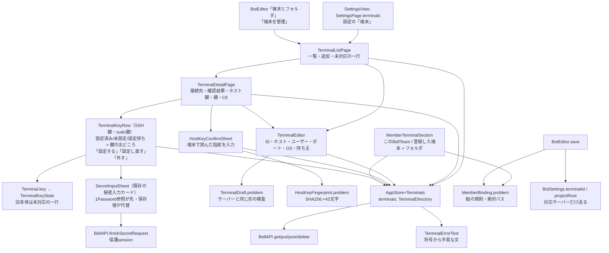
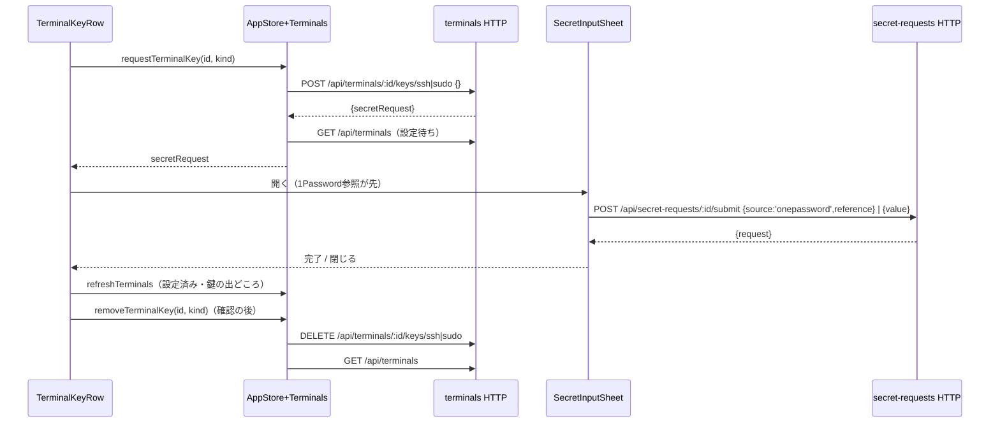
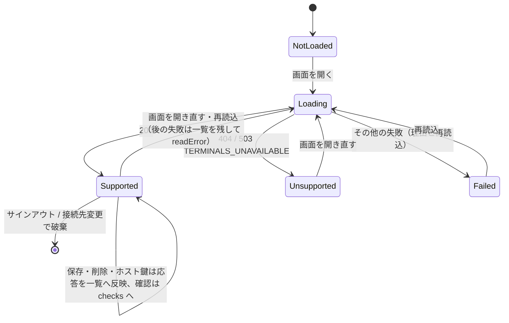

# 端末の登録とメンバーの端末・フォルダ（F-SEAT-HOST P2）

[全体図](overview.md) / [メンバー・ルーム編集](members-and-rooms.md) / [設定](settings-and-profile.md) / [関数索引](function-index.md) / [試験](tests.md)。以下の実装名は`ios/BellBot/BellBot/`からの相対名。

使う契約：[terminals](../terminals/README.md)（registry・reachability・C8 maintenance）、[ingress RS09/RS12](../integration/remote-seat-ingress.md#data-flow)（HTTP `/api/terminals*`）、[terminals「Key setting from the app」](../terminals/README.md#key-setting-from-the-app-trony-ruling-2026-11-09)（`POST|DELETE /api/terminals/:id/keys/{ssh|sudo}`、projectionの`keySource`・`sudoKeySource`・`sshKeyPending`・`sudoKeyPending`）、[members C1](../members/remote-seat.md#c1-member-binding)（`terminalId`・`projectRoot`）、[secret credentials](../usage/secret-credentials.md#owner-terminal-key-settings)と[秘密の入力](../../../secret-input.md)（既存の秘密入力カード、`inputOptions`で1Password参照を先・保存値を代替、`POST /api/secret-requests/:id/submit`。値は一般の欄に書かない）。Appleはこれらの利用側で、契約を変えない。

## 機能図

| 部品 | 責任 |
| --- | --- |
| `Core/Terminals.swift` | `Terminal`・`TerminalCheck`・`TerminalMaintenance`（新しい項目はすべて省略可で読む）、`TerminalKeyKind`・`TerminalKeyState`（鍵の行）、`TerminalDraft`（登録の検査とbody）、`MemberBinding`（組の規則とフォルダの検査）、`HostKeyFingerprint`、`TerminalReachabilityText`（確認結果の文）、`TerminalErrorText`（HTTPの符号から文） |
| `Core/AppStore+Terminals.swift` | `TerminalDirectory`（`state`・`checks`・`checking`）を`AppStore.terminals`に保持。`refreshTerminals`・`saveTerminal`・`confirmHostKey`・`removeTerminal`・`checkTerminal`・`requestTerminalKey`・`removeTerminalKey`。サインアウトと接続先変更で空に戻す |
| `Views/TerminalsView.swift` | 一覧・詳細・登録/編集・ホスト鍵の画面、鍵の行（`TerminalKeyRow`）と外す確認、メンバー編集の「端末とフォルダ」節 |
| `Views/SecretRequestView.swift` | `SecretInputSheet`。端末の鍵でも会話の秘密要求と同じ入力欄を使う（[質問・秘密要求](requests-and-auth.md)） |
| `Views/ManagementView.swift` | BotEditorに節を置き、保存前に組の規則を検査し、対応サーバーの時だけ2項目を送る |
| `Views/SettingsView.swift` | 設定の項目「端末」 |

## データの流れ

| ID | 画面 -> HTTP | 送るもの / 戻り |
| --- | --- | --- |
| AT01 | 一覧・メンバー編集 -> `GET /api/terminals` | `{terminals:[…]}`。404、または503 `TERMINALS_UNAVAILABLE`は「未対応」として一行だけ出す（赤字なし）。他の失敗は理由と再読込 |
| AT02 | 登録・編集 -> `PUT /api/terminals/:id` | `host`・`user`・`port`・`os`・`accountOwner`だけ。鍵の項目は送らない。応答の公開projectionを一覧へ反映。IDは登録時だけ入力し、編集では変えない |
| AT03 | 確認 -> `POST /api/terminals/:id/check` | `{reachable, reason, action?, observedAt}`を端末ごとに`checks`へ保持（アプリ内だけ）。席は起動しない |
| AT04 | ホスト鍵 -> `PUT /api/terminals/:id` `{confirmHostKey:'SHA256:…'}` | オーナーが端末で読んだ指紋だけを送る。サーバーは一度scanし、等しい時だけ信用し直す。409 `HOST_KEY_FINGERPRINT_MISMATCH`は「指紋が違う」と表示して入力を残す |
| AT05 | 削除 -> `DELETE /api/terminals/:id` | 確認ダイアログの後。メンバーの設定と保留中のメッセージは残ると表示 |
| AT07 | 鍵の行「設定する」「設定し直す」 -> `POST /api/terminals/:id/keys/{ssh|sudo}`（本文は空の`{}`） | `{secretRequest:{id,label,inputOptions,…}}`。一覧を読み直して「設定待ち」にし、返った依頼で既存の秘密入力カードを開く。カードは`inputOptions.onePasswordAvailable`なら1Password参照を上・既定に、保存値を代替に出す。SSH鍵は複数行欄。カードから`POST /api/secret-requests/:id/submit`（`{source:'onepassword',reference}`または`{value}`）。閉じた時と完了時に一覧を読み直す。鍵の値・参照はこの画面にもHTTPの鍵の入口にも出ない |
| AT08 | 鍵の行「外す」 -> `DELETE /api/terminals/:id/keys/{ssh|sudo}` | 確認ダイアログの後。サーバーが鍵を外し（設定待ちの依頼も取り消し）、一覧を読み直す |
| AT06 | メンバー保存 -> `PATCH /api/bots/:id` / `POST /api/bots` | 対応サーバーの時だけ`terminalId`・`projectRoot`（このBellTeamは両方空）。400 `BOT_TERMINAL_ID_INVALID`・`BOT_PROJECT_ROOT_INVALID`・`BOT_REMOTE_BINDING_INVALID`は画面の検査と同じ文 |

| 鍵の行（`Terminal.key`） | 表示と操作 |
| --- | --- |
| `sshKeyPending`/`sudoKeyPending`が無い（旧本体） | 設定済み/未設定と、節に一行「このBellTeamはまだアプリからの鍵の設定に対応していません」。ボタンなし。POSTが`TERMINAL_NOT_FOUND`以外の404を返した時も同じ |
| 未設定 | 「未設定」、「設定する」 |
| 設定待ち | 「設定待ち」と、設定済みなら今の鍵の出どころ（新しい鍵が結ばれるまで今の鍵を使う）。「設定する」/「設定し直す」で入力欄を開き直す（サーバーは新しい依頼に置き換える）。「外す」 |
| 設定済み | 「設定済み」と鍵の出どころ（`terminal-native`=端末にある鍵、`secret`=BellTeamに預けた鍵）。「設定し直す」「外す」 |

SSH鍵は「必須。これが無いと端末につなげません。」、sudo鍵は「任意。自分の端末では不要です。」と添える。ハンドル・値・`op://`参照は表示しない（projectionにも無い）。失敗は詳細ページ下の案内（`SettingsBanner`）に符号から選んだ平易な文で出し、サーバーの英文は出さない：`KEY_IN_REQUEST_REFUSED` 400（アプリは本文を送らないが、来たら入力欄だけに入れる案内）、`TERMINAL_NOT_FOUND` 404、`CREDENTIAL_UNAVAILABLE` 503（少し待って再試行）、`TERMINAL_UNAVAILABLE` 503（BellTeamのAitermを更新）、`TERMINAL_CHANGED` 409（もう一度押す）。自動再送はしない。

## 状態

| 確認結果（`reason`） | 表示 |
| --- | --- |
| `reachable:true` | つながる（確かめた時刻） |
| `TERMINAL_UNAVAILABLE`・`UNREACHABLE`・`REMOTE_AITERM_*`・`CONNECTION_LOST` | つながらない。端末が眠っているか届かない。起きれば自動で再開する |
| `CREDENTIAL_UNAVAILABLE`・`SSH_KEY_UNSET`・`CREDENTIAL_*`・`AUTH_FAILED` | つながらない。SSH鍵が無いか使えない |
| `TARGET_MISMATCH`・`HOST_TRUST_*`・`HOST_KEY_*` | つながらない。ホスト鍵を確かめる必要がある（「ホスト鍵を確かめる」を出す） |
| `TERMINAL_NOT_FOUND` | 登録が見つからない |

サーバーの`action`（英文）は「サーバーの案内」として小さく添える。応答に指紋の項目は無い。`action`に`SHA256:`の指紋が含まれる時だけ「サーバーが示した指紋」として並べて見せ、入力した指紋との一致を表示する。どちらの場合も、オーナーが端末で読んだ指紋を入れない限り送らない。

## メンバー編集「端末とフォルダ」

| 状態 | 表示 |
| --- | --- |
| 一覧未対応（AT01） | 「このBellTeamはまだ端末の登録に対応していません」の一行。項目を送らない |
| メンバーの応答に`terminalId`が無い（旧本体） | 「このBellTeamはまだメンバーの端末設定に対応していません」の一行。項目を送らない |
| 対応 | 「動かす場所」Picker（このBellTeam / 登録した端末）。端末を選ぶとフォルダ欄。このBellTeamに戻すと両方空 |
| 保存済みの端末が一覧に無い | 「（登録が見つかりません）」付きで選択肢に残し、別の端末へ自動で替えない |

検査はサーバーと同じ：`terminalId`は`^[A-Za-z0-9][A-Za-z0-9._-]{0,127}$`、`projectRoot`は`/`で始まり、NUL・`.`・`..`・空の区切り・末尾の`/`（`/`だけは可）を含まず4096バイト以下。片方だけは保存しない。

## 旧本体との互換

すべての新しい項目は省略可で読む。旧本体では端末の一覧が404になり、メンバーに2項目が無いので、両方の節は一行の案内だけになる。端末の一覧はあるが鍵の入口が無い本体（projectionに`sshKeyPending`が無い）では、鍵の行だけが一行の案内になり、他の操作はそのまま使える。`BotSettings`の2項目は`nil`の時にencodeせず、保存結果の照合でも`nil`ならサーバーの現在値を採用する。

## 試験と確認用の起動引数

単体は`TerminalsTests`、iPhoneの画面は`TerminalsUITests`と[terminals-ui-server.mjs](../../../../test/helpers/terminals-ui-server.mjs)（[試験の対応表](tests.md#terminalsuitestsswift)）。DEBUGの`-bellbot-preview-terminals`はpreview名簿に2項目を付ける（無ければ旧本体の名簿）。`-bellbot-preview-terminal add | detail:<id> | check:<id> | hostkey:<id> | edit:<id> | setkey:<id>`（`setkey`はSSH鍵の入力欄を開く）は`-bellbot-preview-settings terminals`と組み合わせてその状態を開く。

## 未調査

- サーバーが`action`に指紋を含めるか（Aitermの文面）。含まない時は端末で読んだ指紋の入力だけで確かめる。
- 実端末への確認・ホスト鍵の信用し直し・鍵の設定と外す操作は、試験用サーバー（`test/helpers/terminals-ui-server.mjs`）だけで確認した。実際のMika・1Password・Aitermとの結合は未確認。
