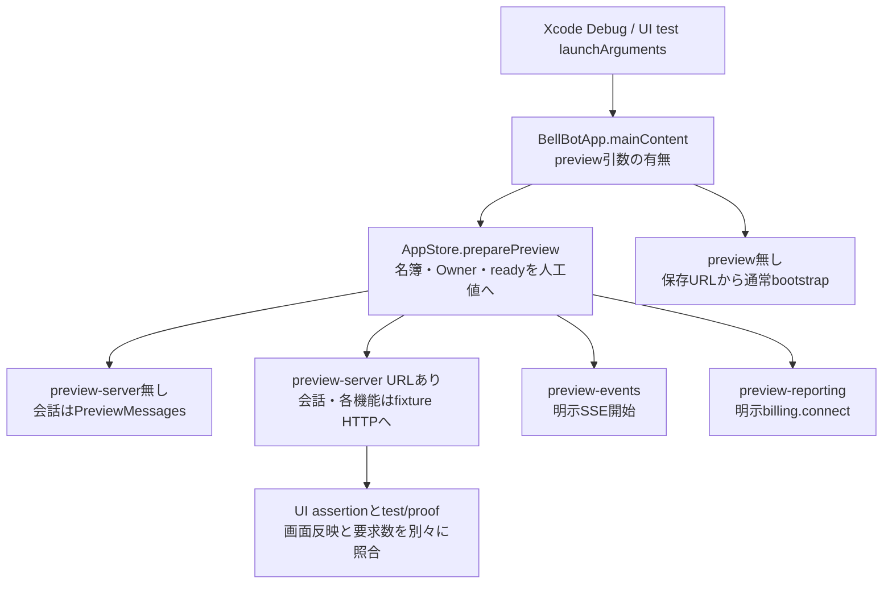

# Apple試験とfixtureの対応

[全体図](overview.md) / [会話](conversation.md) / [要求と認証](requests-and-auth.md) / [goal](goals.md) / [背景とplatform](lifecycle-and-platform.md)。

初回調査source：HEAD `afda9477bba4aaa7c8a6905100d3bacf26e47c90`（detached）。試験本文・assertion・補助型を静的に読んだ対応表。**初回調査時点では試験は全て未実行だった。** 後続のMac実行結果は[親の確認記録](refactor-progress.md#次の作業)を参照。機能の実装説明は上の各図と既存の[メンバー編集](members-and-rooms.md)、[設定](settings-and-profile.md)、[予定](schedule-list.md)を参照。

## 読取目録と試験の区分

BellBotTests 26ファイル、BellBotUITests 19ファイル、Tests 2ファイル、計47ファイルを全文読了した。指定3ディレクトリの本文未読ファイルは**無し**。以下はコンパイル条件を含めてソースに存在する試験関数の対応で、今回の端末で実行対象になることを保証しない。

- 単体試験の人工通信はURLProtocolとephemeral URLSession、保留continuation、注入callbackで失敗/競合を作る。端末の回線断やStoreKitの実取引と同一視しない。
- UI試験の多くはDebug preview＋指定URLのfixtureを利用し、画面と`/test/proof`の要求数/状態を照合する。環境変数未指定時はXCTSkipまたはXCTUnwrap失敗であり、通常起動すれば全て動く構成ではない。
- InstalledConversationUITestsは既存アプリをactivateする。EventStreamLiveTestsは指定実サーバーへ接続する。両者をpreviewだけの試験に数えない。
- DesktopWorkspaceUITestsはMac Catalystだけ。TabletWorkspaceUITestsは非CatalystかつiPadだけ。NetworkLifecycleProbeUITestsは非Catalyst。個々のphone/pad条件は各本文にもある。

## BellBotTests

### AIControlTests.swift

対象：全体停止（settings-and-profile.md）。補助型も同じファイルを読んだ。

| 試験関数 | 本文で確認した入力・状態・失敗時の契約 |
| --- | --- |
| [testOnAcceptanceIsStoppingUntilAuthoritativeReadConfirmsStopped](../../../../ios/BellBot/BellBotTests/AIControlTests.swift#L8) | 受付応答はstopping、後続GETだけでstoppedになりPATCHは1回 |
| [testUnconfirmedStopReadsBackPausedStateWithoutResendingPatch](../../../../ios/BellBot/BellBotTests/AIControlTests.swift#L25) | 502後GETのunconfirmedとBot ID・errorを保持、PATCH再送なし |
| [testLostPatchAndFailedReadNeverShowThePreviousOffState](../../../../ios/BellBot/BellBotTests/AIControlTests.swift#L41) | PATCH喪失とGET失敗で古いenabledを消しnil、GET切断のみ1回再取得 |
| [testFailedOffKeepsGlobalStopOnAfterReadback](../../../../ios/BellBot/BellBotTests/AIControlTests.swift#L57) | 停止解除503後もGETのpaused/stoppedを保持、falseのPATCHは1回 |

### UpdateCenterTests.swift

対象：[Update画面](update.md)。調査後に追加した試験（上の件数に含まない）。実行結果は下のとおり：Mac Catalyst、`-only-testing`で3クラス14関数、全て通過。fixture `Fixtures/update-examples.json`はサーバーの`updateExamples` 9種と`updateModuleExamples` 4種で、`test/apple-update-fixtures.test.mjs`が同一内容を検査する。通信はURLProtocol（`UpdateProtocol`）で作る。

| 試験関数 | 本文で確認した入力・状態・失敗時の契約 |
| --- | --- |
| [testAllThirteenServerExamplesDecode](../../../../ios/BellBot/BellBotTests/UpdateCenterTests.swift#L11) | 13種すべてdecodeでき、`hasAvailableUpdate`・restart・rollback・action省略・all計画のcomponentId nullを読む |
| [testOnlyVerifiedCompletedIsSettledSuccess](../../../../ios/BellBot/BellBotTests/UpdateCenterTests.swift#L23) | completedだけが完了。accepted・unknown・interruptedは未確定、execution_failedは確定 |
| [testUnknownEnumValueIsAnInvalidResponse](../../../../ios/BellBot/BellBotTests/UpdateCenterTests.swift#L33) | 列挙の未知の値はdecode失敗 |
| [testMissingNullableKeyIsAnInvalidResponseButUnknownKeyIsIgnored](../../../../ios/BellBot/BellBotTests/UpdateCenterTests.swift#L41) | 未知のtop-level keyは無視、必須nullのキー欠落は失敗 |
| [testConfirmedExecuteSendsOneRequestWithAFreshSavedRequestID](../../../../ios/BellBot/BellBotTests/UpdateCenterTests.swift#L54) | plan body、再起動未確認ではPOSTなし、確認後にplanId・小文字v4 requestId・confirm付きで1回、requestIdを接続先別に保存、保存中は再送なし |
| [testConflictAsksForANewPlanWithoutReplanningOrResending](../../../../ios/BellBot/BellBotTests/UpdateCenterTests.swift#L89) | 409で「再計画が必要」、計画を消し、要求ID・計画IDは過去の要求に残して同じIDで照会し直す。再送・再計画なし |
| [testSavedRequestIDIsQueriedAndOnlyVerifiedCompletionClearsIt](../../../../ios/BellBot/BellBotTests/UpdateCenterTests.swift#L119) | 保存IDでGET、unknownは保存IDを残し、completedで消える。POSTなし |
| [testDisconnectionKeepsTheRequestUnconfirmedWithoutResending](../../../../ios/BellBot/BellBotTests/UpdateCenterTests.swift#L146) | POST断線で保存IDを残し確認中、照会断線でも成功を補わず、POSTは1回のまま |
| [testNotFoundDoesNotClearTheSavedRequestAndQueriesItAgain](../../../../ios/BellBot/BellBotTests/UpdateCenterTests.swift#L170) | 照会404では保存IDを消さず「確認できません」、同じUUIDで2回照会、POSTは0回 |
| [testNewExecutionKeepsTheUnconfirmedRequestInHistory](../../../../ios/BellBot/BellBotTests/UpdateCenterTests.swift#L187) | 新しく実行しても確定していない前の要求を過去の要求に残し、照会を続ける。自動の再送なし |
| [testTheSameUnconfirmedPlanIsNotExecutedAgain](../../../../ios/BellBot/BellBotTests/UpdateCenterTests.swift#L211) | 結果を確定できていない要求と同じ計画は再実行せず、POSTは1回のまま |
| [testInterruptedRequestAllowsAnotherPlanButNotTheSamePlanAgain](../../../../ios/BellBot/BellBotTests/UpdateCenterTests.swift#L229) | 中断（accepted・unknown）では新しい計画を止めず、同じ計画は再実行しない。別の計画は一回だけ実行し、前の要求は過去の要求に残す |
| [testInventoryWithAnUnknownValueIsShownAsAnInvalidResponse](../../../../ios/BellBot/BellBotTests/UpdateCenterTests.swift#L261) | 未知のnotice stateでinventoryをnilにし応答形式の失敗を表示 |
| [testOnlyTheExactThreeKeysAreAccepted](../../../../ios/BellBot/BellBotTests/UpdateCenterTests.swift#L379) | 3key完全一致だけ受ける。余分key・欠落・型違い・大文字hex・63桁・kind違い・server型違いを捨て、既存`BellNotificationRoute`はkind=updateを受けない |
| [testEventTypeUpdatesIsNotAFullRefresh](../../../../ios/BellBot/BellBotTests/UpdateCenterTests.swift#L391) | `type=updates`のイベントがtypeとして読める |
| [testUpdatesEventReadsOnlyTheInventory](../../../../ios/BellBot/BellBotTests/UpdateCenterTests.swift#L397) | SSE `updates`でGET /api/updatesが1回、共通一覧（bots）は読まない |
| [testTapOpensUpdateAndReadsWithoutAnyPost](../../../../ios/BellBot/BellBotTests/UpdateCenterTests.swift#L411) | 一致するserverのタップで画面を開きGET、POSTは0回 |
| [testTapForAnotherServerOpensNothingAndCallsNothing](../../../../ios/BellBot/BellBotTests/UpdateCenterTests.swift#L423) | server不一致では開かず通信もせず、1件保留する |
| testUpdateStatusTreatsAnIncompatiblePartAsWaitingNotUnknown | 状態の計算：全部最新=upToDate、最新+incompatible=waiting（名前の並び）、unknown/unavailableが混ざれば今までどおりunknown、更新できる機能があればavailable。waitingの見出し・一文・incompatibleの印「使えない版」 |
| [testEachServerStateShowsOneSimpleStatus](../../../../ios/BellBot/BellBotTests/UpdateCenterTests.swift#L290) | サーバーの有限例7種で標準画面の見出しが状態ごとに一つに決まる。幅390・820の実画面を試験結果へ画像で添付する |
| [testUnconfirmedRequestKeepsCheckingButOffersAnotherFormalCandidate](../../../../ios/BellBot/BellBotTests/UpdateCenterTests.swift#L310) | interruptedでは主操作は状況の確認のまま。正式な候補がある時だけ別の計画を選べ、無ければ出さない。POSTは0回 |
| [testRejectionCodesStayInDetailsNotOnTheStandardScreen](../../../../ios/BellBot/BellBotTests/UpdateCenterTests.swift#L328) | 内部の符号入りの計画拒否や実行失敗でも、標準面の案内に符号・元の説明を出さず、元の文はStoreに保持する |
| [testPendingTapForAnotherServerOpensOnlyAfterTheUserSwitchesThere](../../../../ios/BellBot/BellBotTests/UpdateCenterTests.swift#L433) | 保留した不一致の通知は、利用者がその接続先へ切り替えてready後にだけ開きGET、POSTは0回 |
| [testTapBeforeReadyWaitsInsteadOfConnecting](../../../../ios/BellBot/BellBotTests/UpdateCenterTests.swift#L455) | ready前は開かず通信もしない |

### AuthSetupOrderingTests.swift

対象：認証の取得順序。補助型も同じファイルを読んだ。

| 試験関数 | 本文で確認した入力・状態・失敗時の契約 |
| --- | --- |
| [testOldSetupReadCannotReplaceConfirmedResponse](../../../../ios/BellBot/BellBotTests/AuthSetupOrderingTests.swift#L7) | 保留した旧setup GETが入力POST後のauthenticatedを上書きしない |
| [testUnknownResponseStopsAutomaticReadsAndRepeatInputUntilExplicitRefresh](../../../../ios/BellBot/BellBotTests/AuthSetupOrderingTests.swift#L31) | 入力502後は自動GET/再入力を止め、明示GETでneedsRefresh解除 |
| [testNewerSetupReadKeepsCompletionAgainstOldStateAndError](../../../../ios/BellBot/BellBotTests/AuthSetupOrderingTests.swift#L58) | 新しいsetup GET後は旧GETの状態と503を採用しない |
| [testNewerHarnessReadKeepsCompletionAgainstOldStateAndError](../../../../ios/BellBot/BellBotTests/AuthSetupOrderingTests.swift#L81) | 新しいharness refresh後は旧pollの状態と503を採用しない |

### AuthenticationRecoveryTests.swift

対象：接続再認証。補助型も同じファイルを読んだ。

| 試験関数 | 本文で確認した入力・状態・失敗時の契約 |
| --- | --- |
| [testAccessExpiryShowsCloudflareLoginAndPreservesDraft](../../../../ios/BellBot/BellBotTests/AuthenticationRecoveryTests.swift#L7) | Access期限でCloudflareログインへ移り、本文/宛先/同じdraft参照を保持 |
| [testLocalUnauthorizedStillShowsConfigurationFailure](../../../../ios/BellBot/BellBotTests/AuthenticationRecoveryTests.swift#L28) | localの認証拒否はfailure、自動Webログインを開かない |
| [testOnlyAuthenticationErrorsRequestLogin](../../../../ios/BellBot/BellBotTests/AuthenticationRecoveryTests.swift#L38) | 認証エラー2種だけログイン対象、通信断/500は対象外 |

### AvatarImageTests.swift

対象：プロフィール画像。補助型も同じファイルを読んだ。

| 試験関数 | 本文で確認した入力・状態・失敗時の契約 |
| --- | --- |
| [testAvatarActionLifetimeRejectsLateSuccessAuthenticationAndFailure](../../../../ios/BellBot/BellBotTests/AvatarImageTests.swift#L6) | 画像操作終了・無効化・再表示後の旧世代応答を拒否、現世代だけ受理 |
| [testProfileSheetPreviewUsesCurrentVariantAndPendingSelection](../../../../ios/BellBot/BellBotTests/AvatarImageTests.swift#L23) | variant別現在画像/大画像の小画像利用/未確認選択のpreviewを区別 |
| [testImageFileLoadsForTheSharedCropAndExportPath](../../../../ios/BellBot/BellBotTests/AvatarImageTests.swift#L42) | 一時PNGを読み512角JPEGを生成、終了時に一時file削除 |
| [testInvalidAndMissingImageFilesFailInsteadOfOpeningTheCropEditor](../../../../ios/BellBot/BellBotTests/AvatarImageTests.swift#L62) | 欠損file/非画像fileはthrow |
| [testDragClampsToImageEdgeAndExportsSquareJPEG](../../../../ios/BellBot/BellBotTests/AvatarImageTests.swift#L74) | 過大dragを端で制限し512角JPEGの中心画素を照合 |
| [testSmallAndLargeCropRectsRestoreTheirOwnImagePositions](../../../../ios/BellBot/BellBotTests/AvatarImageTests.swift#L104) | small/large各cropのzoom/offsetを復元しcanvas寸法へ出力、sourceも生成 |
| [testFormerWideLargeCropOpensAsSquareAroundTheSameCenter](../../../../ios/BellBot/BellBotTests/AvatarImageTests.swift#L132) | 旧横長cropを同じ中心の正方形へ復元 |
| [testFormerWidePortraitCropStaysInsideEditableZoomRange](../../../../ios/BellBot/BellBotTests/AvatarImageTests.swift#L150) | 旧縦画像cropは編集zoom上限内、中心保持 |

### BackgroundMessageSendTests.swift

対象：送信の背景実行。補助型も同じファイルを読んだ。

| 試験関数 | 本文で確認した入力・状態・失敗時の契約 |
| --- | --- |
| [testNativeExecutionTimeCanComplete](../../../../ios/BellBot/BellBotTests/BackgroundMessageSendTests.swift#L7) | 実UIApplicationの背景実行枠でoperationの値を返す |
| [testCompletedSendEndsExecutionTimeExactlyOnce](../../../../ios/BellBot/BellBotTests/BackgroundMessageSendTests.swift#L12) | 成功でendが同identifierへ1回 |
| [testFailedSendPreservesErrorAndEndsExecutionTime](../../../../ios/BellBot/BellBotTests/BackgroundMessageSendTests.swift#L19) | 通信失敗を保持しendを1回 |
| [testExpirationCancelsPendingSendAndEndsImmediately](../../../../ios/BellBot/BellBotTests/BackgroundMessageSendTests.swift#L30) | 期限通知内で即時endし子を取消、backgroundSendExpired、二重endなし |
| [testDeniedExecutionTimeDoesNotStartHTTP](../../../../ios/BellBot/BellBotTests/BackgroundMessageSendTests.swift#L49) | OS枠拒否でoperation未開始、end無し |
| [testCallerCancellationCancelsSendAndEndsExecutionTime](../../../../ios/BellBot/BellBotTests/BackgroundMessageSendTests.swift#L61) | caller取消を子へ伝えCancellationError、endを1回 |

### BellDiagnosticsTests.swift

対象：診断・SSE・予定の応答検査。補助型も同じファイルを読んだ。

| 試験関数 | 本文で確認した入力・状態・失敗時の契約 |
| --- | --- |
| [testAppStateRevisionChangesOnlyWhenScenePhaseChanges](../../../../ios/BellBot/BellBotTests/BellDiagnosticsTests.swift#L5) | sceneの値が変わる時だけrevision増加 |
| [testGoalTimeoutCarriesCallsiteWithoutPrivateRoute](../../../../ios/BellBot/BellBotTests/BellDiagnosticsTests.swift#L20) | 合成goal timeoutはcaller文脈を保持し私的route/queryを除外 |
| [testServerErrorStoresOnlyThisResponsesDiagnosticReference](../../../../ios/BellBot/BellBotTests/BellDiagnosticsTests.swift#L40) | 500応答自身の診断参照のみ採用、欠損/不正はunknown、502には付けない |
| [testProtectedRequestFailureStoresDiagnosticReferenceWithoutSecretOrID](../../../../ios/BellBot/BellBotTests/BellDiagnosticsTests.swift#L86) | 秘密POST失敗の参照を保持しrequest ID/秘密値を除外 |
| [testSameOfflineErrorKeepsMajorImpactVisibleWithoutAssigningAppDefect](../../../../ios/BellBot/BellBotTests/BellDiagnosticsTests.swift#L114) | 同じofflineでも起動不可と既存値保持を重大度/影響で区別、アプリ欠陥は未確定 |
| [testReadFailureIsNotNoImpactOnlyBecauseItPreservesData](../../../../ios/BellBot/BellBotTests/BellDiagnosticsTests.swift#L128) | 保持した読取失敗も無影響にしない |
| [testExpectedCancellationDoesNotBecomeRepairRequest](../../../../ios/BellBot/BellBotTests/BellDiagnosticsTests.swift#L136) | 期待した取消は通常診断/push診断とも報告0件 |
| [testNetworkLogExcludesURLAndErrorText](../../../../ios/BellBot/BellBotTests/BellDiagnosticsTests.swift#L144) | 通信ログへURL/エラー本文の秘密を出さない |
| [testServerErrorLogExcludesResponseText](../../../../ios/BellBot/BellBotTests/BellDiagnosticsTests.swift#L153) | HTTPエラーログへ応答本文を出さない |
| [testServerErrorLogKeepsOnlyFixedServerErrorCodeFromActualResponse](../../../../ios/BellBot/BellBotTests/BellDiagnosticsTests.swift#L159) | 実際の503応答（error＋message）から固定の失敗符号だけを残し、人向けの文・値付きの文は残さない。画面の文と失敗扱いは保持 |
| [testRequestRouteKeepsOnlyGeneratedOpaqueMemberIds](../../../../ios/BellBot/BellBotTests/BellDiagnosticsTests.swift#L181) | 生成形式のBot/room IDだけ保持し私的名前を:id化 |
| [testUnknownRequestRouteDoesNotBecomeSettingsFailure](../../../../ios/BellBot/BellBotTests/BellDiagnosticsTests.swift#L190) | 未知routeは/api/other、設定の報告pathからmodule/operationを補わない |
| [testFixedPublicGetRoutesKeepOnlyKnownNames](../../../../ios/BellBot/BellBotTests/BellDiagnosticsTests.swift#L232) | 既知固定GET routeとmoduleを照合、operationはunknown |
| [testExistingSettingsModelAndSubscriptionModulesStaySettings](../../../../ios/BellBot/BellBotTests/BellDiagnosticsTests.swift#L252) | 既存settings/models/subscriptionのmodule分類を保持 |
| [testRequestContextSeparatesContractFromObservedFailure](../../../../ios/BellBot/BellBotTests/BellDiagnosticsTests.swift#L266) | コードの期待結果と要求で観測した500を区別し画面観測を主張しない |
| [testRequestContextDoesNotInferOperationFromFallbackPath](../../../../ios/BellBot/BellBotTests/BellDiagnosticsTests.swift#L283) | trace無しではfallback pathからoperationを推定しない |
| [testScheduleTimeoutUsesTracedRequestWithoutClaimingScreenObservation](../../../../ios/BellBot/BellBotTests/BellDiagnosticsTests.swift#L294) | 予定timeoutはtraceのrouteを使い画面未観測と記録 |
| [testDecodingLogKeepsStaticFieldsAndHidesDynamicKeysAndValues](../../../../ios/BellBot/BellBotTests/BellDiagnosticsTests.swift#L308) | decodeの固定key/indexは保持、動的辞書key/値を隠す |
| [testDecodingRouteRemovesQueryAndGeneratedIDs](../../../../ios/BellBot/BellBotTests/BellDiagnosticsTests.swift#L333) | decode routeからqueryとIDを除外 |
| [testDeletingBotIsNotExpectedFromTheAllSchedulesResponse](../../../../ios/BellBot/BellBotTests/BellDiagnosticsTests.swift#L356) | 予定取得対象からdeleting=trueだけ除き、残る対象の応答を受理 |
| [testMissingScheduleTargetFailsAndReportsCountsWithoutIDs](../../../../ios/BellBot/BellBotTests/BellDiagnosticsTests.swift#L366) | 予定不足は件数だけのInvalidResponse診断、ID無し |
| [testDuplicateScheduleSourceStaysAnInvalidResponse](../../../../ios/BellBot/BellBotTests/BellDiagnosticsTests.swift#L384) | 予定source重複はinvalidResponse |
| [testKeepaliveCommentsAreSkipped](../../../../ios/BellBot/BellBotTests/BellDiagnosticsTests.swift#L400) | SSEのkeepaliveコメントを飛ばす |
| [testEventNameDistinguishesReadyFromMessageUpdate](../../../../ios/BellBot/BellBotTests/BellDiagnosticsTests.swift#L405) | SSEのevent名でready/messagesを区別 |
| [testTargetedMessageEventKeepsEveryAffectedConversation](../../../../ios/BellBot/BellBotTests/BellDiagnosticsTests.swift#L415) | 対象SSEの複数Bot/roomとtopicsを全て保持 |
| [testLegacyAndInvalidEventScopesRequireFullRefresh](../../../../ios/BellBot/BellBotTests/BellDiagnosticsTests.swift#L429) | 旧形式/未知topic/ID無し/数値allは全更新 |
| [testCRLFAndSplitDataLines](../../../../ios/BellBot/BellBotTests/BellDiagnosticsTests.swift#L442) | CRLFと複数data行をJSONへ組立て |
| [testDeviceStateIsNotReportedAsFailure](../../../../ios/BellBot/BellBotTests/BellDiagnosticsTests.swift#L446) | deviceState判定はofflineだけで接続喪失/timeoutと区別 |
| [testResetConnectionsKeepsAccessCookie](../../../../ios/BellBot/BellBotTests/BellDiagnosticsTests.swift#L454) | session.flush後も共有Access cookieを保持 |

### BillingStoreTests.swift

対象：購読と本人権利、PR4の`AppStore.restartConversation(target:)`直接呼出し。補助型も同じファイルを読んだ。PR4の追加5関数（後に旧本体の202を成功とみなす1関数を追加）とfixture拡張は固定source `22d56bfeb20263ee2e51ca0830a213ae6cb6aedf` からの変更。PR4実装時の文書更新ではビルド・試験は未実行だったが、[親の確認記録](refactor-progress.md#モデルの適用記録)では追加5関数を含む21件が通過している。

| 試験関数 | 本文で確認した入力・状態・失敗時の契約 |
| --- | --- |
| [testInitialStatusFailureShowsUnknownAccessAndRetainsDraftWithoutSending](../../../../ios/BellBot/BellBotTests/BillingStoreTests.swift#L6) | 本体購読初回失敗は未確認表示、draft保持、POST0件 |
| [testRetryAfterInitialFailureRecognizesDeveloper](../../../../ios/BellBot/BellBotTests/BillingStoreTests.swift#L30) | 初回失敗後の再確認でdeveloperを認識しAI許可 |
| [testVerifiedAppleSubscriptionStillWorksWhenInitialStatusFails](../../../../ios/BellBot/BellBotTests/BillingStoreTests.swift#L44) | 本体初回失敗でも有効な本人権利を再取得できればAI許可 |
| [testRetryAfterInitialFailureFindsActiveSubscription](../../../../ios/BellBot/BellBotTests/BillingStoreTests.swift#L56) | 本体再取得と本人権利でactiveへ回復 |
| [testRetryAfterInitialFailureFindsConfirmedUnpurchased](../../../../ios/BellBot/BellBotTests/BillingStoreTests.swift#L69) | 再確認した未購入はinactiveと購読案内 |
| [testUnknownStatusAndFailedAppleCheckStillOfferRecheck](../../../../ios/BellBot/BellBotTests/BillingStoreTests.swift#L86) | 本体不明とApple照会失敗は未確認の再確認案内 |
| [testKnownDeveloperSurvivesLaterStatusFailure](../../../../ios/BellBot/BellBotTests/BillingStoreTests.swift#L102) | 既知developerは後続本体GET失敗でも許可 |
| [testKnownActiveSubscriptionSurvivesLaterStatusFailure](../../../../ios/BellBot/BellBotTests/BillingStoreTests.swift#L113) | 既知本人権利は後続本体GET失敗でもactive |
| [testKnownAppleEntitlementStaysActiveWhenSubscriptionScreenGETTimesOut](../../../../ios/BellBot/BellBotTests/BillingStoreTests.swift#L126) | 購読画面GET timeoutでも既知本人権利activeとerrorを両方保持 |
| [testConfirmedUnpurchasedKeepsSubscriptionGuidanceAfterLaterFailure](../../../../ios/BellBot/BellBotTests/BillingStoreTests.swift#L140) | 確認済み未購入は後続GET失敗後も購読案内 |
| [testConnectionFailureDoesNotLeaveCheckingForever](../../../../ios/BellBot/BellBotTests/BillingStoreTests.swift#L157) | 未設定接続の失敗後checkingが終了しunavailable/error |
| [testInitialAndDelayedCheckDoNotReportNoSubscription](../../../../ios/BellBot/BellBotTests/BillingStoreTests.swift#L165) | 遅延権利照会2件は1読取へ合流し、待機中を未購入にしない |
| [testCompletedEmptyAppleCheckStillNeedsServerStatus](../../../../ios/BellBot/BellBotTests/BillingStoreTests.swift#L188) | Apple空結果でも本体status無しならunavailable |
| [testStoppingAnOldCheckDoesNotOverwriteTheNewConnection](../../../../ios/BellBot/BellBotTests/BillingStoreTests.swift#L197) | stop前の旧照会は新しいactiveを上書きしない |
| [testFailedCheckDoesNotReportNoSubscription](../../../../ios/BellBot/BellBotTests/BillingStoreTests.swift#L222) | Apple照会失敗はunavailable、checking解除 |
| [testRestoreKeepsCheckingThroughAuthenticationAndPreventsOverlap](../../../../ios/BellBot/BellBotTests/BillingStoreTests.swift#L232) | 復元の認証待ち全体をcheckingとし、復元/権利照会の重複を抑止 |
| [testRestartConversationDeniedAccessDoesNotPost](../../../../ios/BellBot/BellBotTests/BillingStoreTests.swift#L261) | 本体subscription・本人権利なしは権限確認のErrorを返し、再起動POST0件 |
| [testRestartConversationAuthorizedPostsEmptyJSONOnceToTarget](../../../../ios/BellBot/BellBotTests/BillingStoreTests.swift#L283) | 注入した本人権利の確認後、Bot/ルームそれぞれの正しいpathへ空JSONのPOST一回だけ。要求のtimeoutIntervalは120秒以上 |
| [testRestartConversationCountsAnOlderBodys202AsSuccess](../../../../ios/BellBot/BellBotTests/BillingStoreTests.swift) | 旧本体の202 `{restarting}`も成功 |
| [testRestartConversationPostFailuresPreserveErrorsWithoutRetry](../../../../ios/BellBot/BellBotTests/BillingStoreTests.swift#L306) | POSTのtimeoutはURLError.timedOut、401はBellAPIError.unauthorized、不正JSONはDecodingError.dataCorruptedを保持し、各POST一回で再送・refreshなし |
| [testRestartConversationInitialGuideRefreshesSetupBeforePost](../../../../ios/BellBot/BellBotTests/BillingStoreTests.swift#L339) | 保持中complete=trueからGET setupでfalseへ更新したguideは本人権利照会を免除。setup GET→restart POSTの順序 |
| [testRestartConversationCompletedGuideRequiresPaidAccessAfterSetupRefresh](../../../../ios/BellBot/BellBotTests/BillingStoreTests.swift#L357) | 保持中complete=falseでもGET setupがtrueなら本人権利を照会。権利なしで拒否しPOST0件 |

二つの画面の成功・失敗処理は[再起動図](settings-and-profile.md#再起動の共有操作)を参照。Mac実画面用の`profile-terminal-ui-server.mjs`には購読・再起動の503/200応答・要求と診断の記録・resetを追加済み。[Mac再起動試験](../../../../ios/BellBot/BellBotUITests/DesktopWorkspaceUITests.swift#L311)が失敗文言と診断一回・POST一回、再操作成功時のerror消去・inspector保持とPOST計二回・診断計一回を検査し、[親のMac確認記録](refactor-progress.md#次の作業)で通過している。

### BotSaveTests.swift

対象：メンバー保存・画像・fast。補助型も同じファイルを読んだ。

| 試験関数 | 本文で確認した入力・状態・失敗時の契約 |
| --- | --- |
| [testLateImageConfirmationCannotReleaseReplacementSelection](../../../../ios/BellBot/BellBotTests/BotSaveTests.swift#L7) | 遅い画像確認は置換済みの新選択を消さず、一致する選択だけ解放 |
| [testImageSelectionsSurviveFailureAndOtherTargetUntilSuccessOrDiscard](../../../../ios/BellBot/BellBotTests/BotSaveTests.swift#L23) | 画像保存失敗/不一致/未確認で選択保持、別variantの成功/破棄と独立 |
| [testImageOnlyRequestSendsExactlyTheSelectedTriplet](../../../../ios/BellBot/BellBotTests/BotSaveTests.swift#L48) | 画像だけの要求は選択variantのrender/source/cropの3keyだけ |
| [testSmallImageLostResponseConfirmsOnlySmallTriplet](../../../../ios/BellBot/BellBotTests/BotSaveTests.swift#L63) | 小画像保存の応答喪失はPATCH→GETで小3項目だけ照合、大3項目保持 |
| [testLargeImageLostResponseConfirmsOnlyLargeTriplet](../../../../ios/BellBot/BellBotTests/BotSaveTests.swift#L85) | 大画像保存の応答喪失はPATCH→GETで大3項目だけ照合、小3項目保持 |
| [testLostResponseAfterSavingIsConfirmedWithoutResendingPATCH](../../../../ios/BellBot/BellBotTests/BotSaveTests.swift#L106) | 保存後切断は読戻し一致でconfirmed、PATCH再送なし |
| [testAntigravityModelAndEffortSurviveSaveReadback](../../../../ios/BellBot/BellBotTests/BotSaveTests.swift#L115) | Antigravityの不透明なmodel/effortを保存読戻しで保持 |
| [testFailureBeforeSavingReportsDifferentWithoutResendingPATCH](../../../../ios/BellBot/BellBotTests/BotSaveTests.swift#L130) | 保存前切断はdifferent、元保存値とPATCH1回を確認 |
| [testUnavailableReadLeavesResultUnconfirmedWithoutResendingPATCH](../../../../ios/BellBot/BellBotTests/BotSaveTests.swift#L140) | 保存後GET不能はunconfirmedと元URLError |
| [testMissingBotReadLeavesDecodingPathUnconfirmedWithoutResendingPATCH](../../../../ios/BellBot/BellBotTests/BotSaveTests.swift#L148) | 保存後の照合GETが `bot` を欠くと unconfirmed(DecodingError.keyNotFound)。欠落キー `bot` と空のcoding pathを保持し、method列は PATCH→GET だけ |
| [testInvalidBotTypeReadLeavesDecodingPathUnconfirmedWithoutResendingPATCH](../../../../ios/BellBot/BellBotTests/BotSaveTests.swift#L161) | 保存後の照合GETの `bot` が型不正なら unconfirmed(DecodingError.typeMismatch)。coding path `["bot"]` を保持し、method列は PATCH→GET だけ |
| [testTransportFailureWaitsForHandledOutcome](../../../../ios/BellBot/BellBotTests/BotSaveTests.swift#L174) | 通常輸送の失敗だけでは診断を報告しない |
| [testProtectedDecodeFailureWaitsForHandledOutcome](../../../../ios/BellBot/BellBotTests/BotSaveTests.swift#L189) | 秘密応答decode失敗だけでは診断を報告しない |
| [testConfirmedSaveIsReferenceWithEvidenceAndNoRepeatedWrite](../../../../ios/BellBot/BellBotTests/BotSaveTests.swift#L204) | 読戻し確認成功はinfo/無影響/回復済みを1件、私的本文無し |
| [testTimedOutWriteAlsoChecksTheSavedContent](../../../../ios/BellBot/BellBotTests/BotSaveTests.swift#L220) | PATCH timeoutもGETで保存照合 |
| [testTextSavePreservesAnAvatarChangedOnAnotherDevice](../../../../ios/BellBot/BellBotTests/BotSaveTests.swift#L227) | 文面保存は別端末が変えた画像3項目を保持 |
| [testExplicitConfirmationAfterReconnectDoesNotWriteAgain](../../../../ios/BellBot/BellBotTests/BotSaveTests.swift#L242) | 復帰後の明示確認はGETだけ、PATCHを増やさない |
| [testAuthenticationFailureDuringConfirmationStillRequiresLogin](../../../../ios/BellBot/BellBotTests/BotSaveTests.swift#L252) | 保存照合GETの401を認証エラーとして返す |
| [testFastModeIsSentOnlyWhenChanged](../../../../ios/BellBot/BellBotTests/BotSaveTests.swift#L261) | fastModeは変更時だけencode、true/false双方を確認 |
| [testCreateFolderIsSentOnlyWhenPressedAndNeverEntersTheSavedSettings](../../../../ios/BellBot/BellBotTests/BotSaveTests.swift#L279) | `createFolder`は`true`の時だけ本文に足し、旧い呼び出し・`false`では送らない |
| [testSavingWithCreateFolderSendsOnePatchAndConfirmsAgainstTheSettingsOnly](../../../../ios/BellBot/BellBotTests/BotSaveTests.swift#L291) | `createFolder:true`でもPATCH1回、保存結果の照合は設定だけで比べる |
| [testEditorInputSurvivesReauthenticationAndExplicitSignOutClearsIt](../../../../ios/BellBot/BellBotTests/BotSaveTests.swift#L280) | 編集/画像draftは再認証を保持、logoutで消去、編集だけではAppStore更新通知無し |
| [testDefaultModelAndListedModelUseTheirFastCapability](../../../../ios/BellBot/BellBotTests/BotSaveTests.swift#L395) | 既定/一覧モデルのfast可否と一覧外モデルを区別 |
| [testAccountUnavailableReasonIsShown](../../../../ios/BellBot/BellBotTests/BotSaveTests.swift#L409) | アカウントのfast利用不能理由を表示用に返す |
| [testMissingDefaultModelCannotBeEnabled](../../../../ios/BellBot/BellBotTests/BotSaveTests.swift#L416) | 既定モデルが一覧に無ければfastを許可しない |

### BotStopTests.swift

対象：個別停止。補助型も同じファイルを読んだ。

| 試験関数 | 本文で確認した入力・状態・失敗時の契約 |
| --- | --- |
| [testOnlyMatching202ReportsSentAndMatchingLegacy200ConfirmsInterruption](../../../../ios/BellBot/BellBotTests/BotStopTests.swift#L7) | POST本文無し、202/stop_sentと200/interrupted+session保持を照合し不整合を未確認にする |
| [testUnconfirmedResultsAreNotRetried](../../../../ios/BellBot/BellBotTests/BotStopTests.swift#L31) | 502/応答喪失は1POST、404も停止済みとしない |

### BotTerminalTextViewTests.swift

対象：端末表示。補助型も同じファイルを読んだ。

| 試験関数 | 本文で確認した入力・状態・失敗時の契約 |
| --- | --- |
| [testSnapshotReplacementPreservesReadingPositionAndFollowsBottom](../../../../ios/BellBot/BellBotTests/BotTerminalTextViewTests.swift#L6) | 1万行snapshotの置換は重複追記せず過去offset保持、末尾時だけ追従 |

### CommunicationNotificationTests.swift

対象：通知Intentと画像保存。補助型も同じファイルを読んだ。

| 試験関数 | 本文で確認した入力・状態・失敗時の契約 |
| --- | --- |
| [testDirectMessageUsesTheSenderAndKeepsTheFixedBody](../../../../ios/BellBot/BellBotTests/CommunicationNotificationTests.swift#L8) | DMのsender名trim・ID・画像・固定body・conversationIdentifier |
| [testRoomMessageUsesTheRoomNameAsTheGroup](../../../../ios/BellBot/BellBotTests/CommunicationNotificationTests.swift#L25) | room名をgroupにし送り主/会話IDを保持 |
| [testMissingSenderOrAvatarLeavesNoIntent](../../../../ios/BellBot/BellBotTests/CommunicationNotificationTests.swift#L37) | sender/画像/名前/body不足や不正IDでIntent無し |
| [testAvatarCacheIsScopedToTheServerAndDropsRemovedBots](../../../../ios/BellBot/BellBotTests/CommunicationNotificationTests.swift#L55) | 画像cacheはserver別、削除Bot/空画像を整理、不正IDでpathを作らない |
| [testTruncatedAvatarIsRejectedAndStorageFailureIsReported](../../../../ios/BellBot/BellBotTests/CommunicationNotificationTests.swift#L73) | 破損画像を拒否し保存先fileの書込失敗をthrow |
| [testUpdatedContentKeepsTheFixedBodyAndNotificationRoute](../../../../ios/BellBot/BellBotTests/CommunicationNotificationTests.swift#L81) | Intent書換え後もbodyと通知routeを保持 |

### ConversationAppearanceTests.swift

対象：会話描画・本文・関連値型。補助型も同じファイルを読んだ。

| 試験関数 | 本文で確認した入力・状態・失敗時の契約 |
| --- | --- |
| [testParagraphDoesNotLeaveAnEmptyLineBelowItsSource](../../../../ios/BellBot/BellBotTests/ConversationAppearanceTests.swift#L8) | 段落末に追加改行を残さず標準UITextViewと同じ高さ |
| [testLastParagraphKeepsSpacingBetweenParagraphs](../../../../ios/BellBot/BellBotTests/ConversationAppearanceTests.swift#L30) | 段落間16ptを保ち最後だけ余白0 |
| [testCodeBlockKeepsItsPaddingAndSmallFinalTerminator](../../../../ios/BellBot/BellBotTests/ConversationAppearanceTests.swift#L41) | code blockのpadding行と1ptの終端を保持 |
| [testTimelineDecodesAllImageURLsForDirectAndRoomMessages](../../../../ios/BellBot/BellBotTests/ConversationAppearanceTests.swift#L59) | DM/roomの複数image URLとoutgoing判定をdecode |
| [testLegacyImageURLAndUnsavedImagesKeepTheirRepresentation](../../../../ios/BellBot/BellBotTests/ConversationAppearanceTests.swift#L73) | 旧imageUrlとURL無し画像枚数を保持 |
| [testSelectedPartCopiesWithoutTheRestOfTheMessage](../../../../ios/BellBot/BellBotTests/ConversationAppearanceTests.swift#L87) | 選択範囲だけコピーし本文の残りを含めない |
| [testSelectableMessageRetainsMarkdownAndLinks](../../../../ios/BellBot/BellBotTests/ConversationAppearanceTests.swift#L98) | 見出し/強調/斜体/link/改行を選択可本文へ描画 |
| [testBareAndNamedLinksRemainTappable](../../../../ios/BellBot/BellBotTests/ConversationAppearanceTests.swift#L117) | 裸URLと名前付きURLのlink属性を保持 |
| [testTableRendersAsAttachmentAndCopiesItsCells](../../../../ios/BellBot/BellBotTests/ConversationAppearanceTests.swift#L129) | 表を1attachmentへ描画しセルをtab区切りコピー |
| [testPortraitColorsProduceDifferentBubbleTones](../../../../ios/BellBot/BellBotTests/ConversationAppearanceTests.swift#L170) | 赤/青画像の代表色を区別、白は代表色無し |
| [testWheelNotchesAddUpAndStopWithinFiniteDistance](../../../../ios/BellBot/BellBotTests/ConversationAppearanceTests.swift#L189) | ホイール同方向加速・逆向き反転と有限距離の減速 |
| [testAllSchedulesResponseMapsSourcesToTargets](../../../../ios/BellBot/BellBotTests/ConversationAppearanceTests.swift#L205) | 予定sourceをChatTargetへ対応し未知kind/不足/重複を拒否 |
| [testClearedConversationPagesRejectLateResponses](../../../../ios/BellBot/BellBotTests/ConversationAppearanceTests.swift#L224) | 会話page clear後は旧世代rememberを拒否、現世代を受理 |

### ConversationDraftTests.swift

対象：下書きとlogout。補助型も同じファイルを読んだ。

| 試験関数 | 本文で確認した入力・状態・失敗時の契約 |
| --- | --- |
| [testTypingDoesNotPublishApplicationWideChanges](../../../../ios/BellBot/BellBotTests/ConversationDraftTests.swift#L8) | 文字入力はAppStore全体の更新通知を出さない |
| [testDraftIsSharedOnlyByTheSameConversation](../../../../ios/BellBot/BellBotTests/ConversationDraftTests.swift#L23) | 同じ宛先だけ参照共有、Bot/room同IDは別、空白だけは送信不可 |
| [testAppendingTextPublishesOnlyWhenInputStateChanges](../../../../ios/BellBot/BellBotTests/ConversationDraftTests.swift#L45) | 入力の空/送信可否が変わる時だけdraft通知 |
| [testSignOutClearsDraftsAlreadyHeldByInputViews](../../../../ios/BellBot/BellBotTests/ConversationDraftTests.swift#L64) | logoutは保持中の旧draft参照もclearし新参照へ |
| [testSignOutClearsOnlyItsOwnCookieStores](../../../../ios/BellBot/BellBotTests/ConversationDraftTests.swift#L80) | logoutは渡したHTTP/WK cookie storeだけ消し別storeを保持 |

### ConversationTimelineStateTests.swift

対象：履歴と仮送信。補助型も同じファイルを読んだ。

| 試験関数 | 本文で確認した入力・状態・失敗時の契約 |
| --- | --- |
| [testIdenticalPendingTextsReconcileOnlyTheirAcceptedIDs](../../../../ios/BellBot/BellBotTests/ConversationTimelineStateTests.swift#L6) | 同じ本文の2送信は受付ID別に照合し未受付の仮行を保持 |
| [testRefreshUpdatesKnownStatusAndAppendsOnlyCursorAdditions](../../../../ios/BellBot/BellBotTests/ConversationTimelineStateTests.swift#L27) | latestで配送状態更新、afterで未知IDだけ追加、過去追加も重複除去 |

### EventStreamLiveTests.swift

対象：実接続SSE。補助型も同じファイルを読んだ。

| 試験関数 | 本文で確認した入力・状態・失敗時の契約 |
| --- | --- |
| [testEventsStayOpenPastRequestTimeout](../../../../ios/BellBot/BellBotTests/EventStreamLiveTests.swift#L6) | 指定実サーバーで既定330秒待ち後cancelし、正常終端を失敗とする。task.isCancelledだけでは生存を判定していない |

### ForegroundRefreshTests.swift

対象：背景復帰と資源取得。補助型も同じファイルを読んだ。

| 試験関数 | 本文で確認した入力・状態・失敗時の契約 |
| --- | --- |
| [testEventsDuringARefreshAreCombinedIntoOneFurtherRefresh](../../../../ios/BellBot/BellBotTests/ForegroundRefreshTests.swift#L8) | 進行中の全資源取得へ20通知をまとめ、追加4GETを1回だけ |
| [testBackgroundCancelsPendingGETsBeforeTheyUpdateStateOrStartBilling](../../../../ios/BellBot/BellBotTests/ForegroundRefreshTests.swift#L28) | backgroundで保留4GETをcancel、Owner未反映・購読未開始 |
| [testNewForegroundCancelsOldGETsAndLoadsFreshState](../../../../ios/BellBot/BellBotTests/ForegroundRefreshTests.swift#L49) | 再activeは旧4GETをcancelし新状態だけ適用、本人権利照会1回 |

### HarnessAuthenticationTests.swift

対象：AI再認証。補助型も同じファイルを読んだ。

| 試験関数 | 本文で確認した入力・状態・失敗時の契約 |
| --- | --- |
| [testStartConfirmationMatchesTheWebForEveryOfficialState](../../../../ios/BellBot/BellBotTests/HarnessAuthenticationTests.swift#L8) | 警告付きAIの開始確認をstatus別に照合、blocked/警告無しは不要 |
| [testUnsupportedReloginCapabilityAndOldServerDecode](../../../../ios/BellBot/BellBotTests/HarnessAuthenticationTests.swift#L18) | reloginSupported=falseと旧応答のnilをdecodeし開始確認を区別 |
| [testUnsupportedReloginStillAllowsFirstAuthentication](../../../../ios/BellBot/BellBotTests/HarnessAuthenticationTests.swift#L29) | 再認証非対応でもblocked/failedの初回開始は可能 |
| [testViewingTheStateDoesNotStartOrCancelAuthentication](../../../../ios/BellBot/BellBotTests/HarnessAuthenticationTests.swift#L41) | 状態GETだけではstart/cancel POSTをしない |
| [testStartResponseAndCompletionUseTheTypedEndpoints](../../../../ios/BellBot/BellBotTests/HarnessAuthenticationTests.swift#L51) | start/inputのtyped endpointとbinding/digest/responseだけを送る |
| [testCancelRechecksTheRealStateInsteadOfAssumingTheOldLoginSurvives](../../../../ios/BellBot/BellBotTests/HarnessAuthenticationTests.swift#L74) | cancel POST後GETのblockedを表示し旧認証の残存を仮定しない |
| [testFailedStartIsNotRetriedOrReportedAsStarted](../../../../ios/BellBot/BellBotTests/HarnessAuthenticationTests.swift#L88) | 409開始失敗でstarted/busy解除、再送なし |
| [testUnknownAuthenticationStatusIsAnInvalidResponse](../../../../ios/BellBot/BellBotTests/HarnessAuthenticationTests.swift#L103) | 未知statusはdecode失敗、auth無し・busy解除 |
| [testWaitingPollDoesNotDisableTheInputControls](../../../../ios/BellBot/BellBotTests/HarnessAuthenticationTests.swift#L115) | waiting pollはbusyを立てず入力を無効にしない |
| [testUnknownResponseRequiresExplicitRefreshBeforeAnotherInput](../../../../ios/BellBot/BellBotTests/HarnessAuthenticationTests.swift#L127) | 入力502後はpoll/再入力を止め明示refreshで解除 |

### MemberActivityTests.swift

対象：queueと稼働表示。補助型も同じファイルを読んだ。

| 試験関数 | 本文で確認した入力・状態・失敗時の契約 |
| --- | --- |
| [testConversationQueueShowsOneRowPerBotAndStatus](../../../../ios/BellBot/BellBotTests/MemberActivityTests.swift#L7) | queue表示はBot+statusで重複整理し元配列は不変、ID無しは別行 |
| [testStoppedDeliveryIsDistinctAndAnotherRunningMemberRemainsVisible](../../../../ios/BellBot/BellBotTests/MemberActivityTests.swift#L24) | DM/roomのstoppedを区別し別メンバーrunningを優先 |
| [testRunningWorkUsesBotIdentityAndUpdatesWhenWorkEnds](../../../../ios/BellBot/BellBotTests/MemberActivityTests.swift#L37) | queueのrunning Bot IDだけ稼働集合へ、空queueで解除 |

### MemberDeletionTests.swift

対象：メンバー削除。補助型も同じファイルを読んだ。

| 試験関数 | 本文で確認した入力・状態・失敗時の契約 |
| --- | --- |
| [testAcceptedDeletionKeepsMemberUntilSuccessfulListOmitsIt](../../../../ios/BellBot/BellBotTests/MemberDeletionTests.swift#L8) | 削除202では一覧/選択/draft保持、一覧消失で対象だけ整理 |
| [testRejectedDeletionKeepsMemberSelectionAndDraft](../../../../ios/BellBot/BellBotTests/MemberDeletionTests.swift#L32) | 削除503は受付扱いせず一覧/選択/draft保持 |
| [testLostResponseDoesNotClaimAcceptanceOrClearTheMember](../../../../ios/BellBot/BellBotTests/MemberDeletionTests.swift#L49) | 削除応答喪失は未確認、受付待ちにも入れず選択保持 |

### MessageInputTests.swift

対象：入力キー。補助型も同じファイルを読んだ。

| 試験関数 | 本文で確認した入力・状態・失敗時の契約 |
| --- | --- |
| [testTabletReturnSendsAndModifiersInsertNewlines](../../../../ios/BellBot/BellBotTests/MessageInputTests.swift#L8) | iPad/MacのShift/Option Returnは改行とdelegate、Returnだけ送信 |
| [testCopiedImageFileIsAttachedBeforeItsIconAndOtherFilesFail](../../../../ios/BellBot/BellBotTests/MessageInputTests.swift#L35) | Finderでコピーした画像ファイル（file URL＋アイコン画像）はファイル本体を添付し、画像以外のファイルは添付せず失敗を表示する。名前付きのクリップボードで確かめる |
| [testPhoneReturnUsesSystemKeyboardBehavior](../../../../ios/BellBot/BellBotTests/MessageInputTests.swift#L70) | iPhoneは独自Return送信コマンド無し |

### NetworkRecoveryTests.swift

対象：通信・同期・診断・取消。補助型も同じファイルを読んだ。

goalの直接4件は、`Core/GoalViewModel.swift:4`のGoalLoadCallContext（`testGoalTimeoutOrdersCallPhaseChangeAndRequestOnContinuousClock`）と、同`:28`のGoalForegroundLoad（下表のforeground/view taskの3件）に対応する。型の移動後も試験名・操作・assertは同じで、GoalViewModel.load/changeの直接試験を意味しない。

| 試験関数 | 本文で確認した入力・状態・失敗時の契約 |
| --- | --- |
| [testMessageAcknowledgementUsesExistingDirectAndRoomIDs](../../../../ios/BellBot/BellBotTests/NetworkRecoveryTests.swift#L10) | DMはdelivery_id、roomはidを受付IDへ、誤った種別はthrow |
| [testIdenticalRefreshDoesNotPublishWholeAppAgain](../../../../ios/BellBot/BellBotTests/NetworkRecoveryTests.swift#L22) | 同一refreshでAppStore更新通知を繰り返さない |
| [testAccessRedirectDuringRefreshOpensLoginInsteadOfLeavingAnErrorBanner](../../../../ios/BellBot/BellBotTests/NetworkRecoveryTests.swift#L33) | 一覧Access redirectはログインへ、接続error消去・draft保持 |
| [testAccessRedirectDuringBootstrapOpensWebLoginAutomatically](../../../../ios/BellBot/BellBotTests/NetworkRecoveryTests.swift#L48) | bootstrapのAccess redirectで自動Webログイン、sessionは1GET |
| [testAccessRedirectDuringEventsOpensWebLoginAutomatically](../../../../ios/BellBot/BellBotTests/NetworkRecoveryTests.swift#L60) | SSEのAccess redirectでログイン、eventsは1GET |
| [testLostGETIsRetriedOnceWithoutReportingRecoveredFailure](../../../../ios/BellBot/BellBotTests/NetworkRecoveryTests.swift#L80) | GET接続喪失1回だけ再取得、回復は報告無し |
| [testRepeatedLostGETReportsOnceAndIncludesAnonymousContext](../../../../ios/BellBot/BellBotTests/NetworkRecoveryTests.swift#L88) | 連続GET喪失は2試行・診断1件、既存値保持と匿名化した各試行記録 |
| [testBackgroundMemberListTimeoutRecordsItsCaller](../../../../ios/BellBot/BellBotTests/NetworkRecoveryTests.swift#L127) | 背景の名簿timeoutに呼出元/時計/状態revisionを保持 |
| [testGoalListFailureDirectReportIncludesCallerContext](../../../../ios/BellBot/BellBotTests/NetworkRecoveryTests.swift#L158) | 合成goal一覧2試行の直接診断にcallerを含めquery秘密を隠す（UI未再現） |
| [testGoalTimeoutOrdersCallPhaseChangeAndRequestOnContinuousClock](../../../../ios/BellBot/BellBotTests/NetworkRecoveryTests.swift#L185) | goal呼出→scene変化→試行の連続時計順序と状態revisionを記録 |
| [testForegroundGoalReadCancelsStaleGETAndWaitsBeforeNewActiveGET](../../../../ios/BellBot/BellBotTests/NetworkRecoveryTests.swift#L228) | 前景goalは旧処理終了待ち、新activeのGETだけ開始 |
| [testGoalViewTaskCancellationDoesNotCancelItsReplacement](../../../../ios/BellBot/BellBotTests/NetworkRecoveryTests.swift#L260) | view task取消を自分の子へ伝え、置換後の読取は取消さない |
| [testInactiveGoalViewTaskDoesNotStartOrCancelCurrentRead](../../../../ios/BellBot/BellBotTests/NetworkRecoveryTests.swift#L314) | 非activeのview taskはload未開始、既存読取も取消さない |
| [testSendFailureReconcileReportsOnlyTheLoadCallBoundary](../../../../ios/BellBot/BellBotTests/NetworkRecoveryTests.swift#L337) | 送信照合観測はload呼出境界の4結果だけ、HTTP成功は主張しない |
| [testPostIsNotReplayed](../../../../ios/BellBot/BellBotTests/NetworkRecoveryTests.swift#L390) | 接続喪失POSTは1回、結果未確認と入力秘密無しの診断 |
| [testHTTP500PostTellsUserToCheckConversationBeforeRetry](../../../../ios/BellBot/BellBotTests/NetworkRecoveryTests.swift#L409) | 500 POSTは再操作前の現在状態確認を案内し1回だけ |
| [testTimedOutGETReportKeepsItsOwnRouteAndStartStateWithoutQuery](../../../../ios/BellBot/BellBotTests/NetworkRecoveryTests.swift#L425) | GET timeoutは1試行、要求route/開始終了状態/timeout/時計を保持、query/名前除去 |
| [testSuccessfulManualGETClearsOnlyItsErrorAndKeepsDraft](../../../../ios/BellBot/BellBotTests/NetworkRecoveryTests.swift#L466) | 手動GET回復はGET errorだけ消しdraftを保持、timeout自動再送無し |
| [testTLSReadFailureStopsUntilExplicitScheduleReload](../../../../ios/BellBot/BellBotTests/NetworkRecoveryTests.swift#L482) | 予定TLS失敗は自動再送無し、明示した次GETのみ成功 |
| [testPushRegistrationTimeoutDoesNotAutomaticallyRepeatPost](../../../../ios/BellBot/BellBotTests/NetworkRecoveryTests.swift#L502) | push登録timeoutはPOST1回、次の明示POSTだけ追加 |
| [testSuccessfulGETDoesNotHideSSEReconnectWarning](../../../../ios/BellBot/BellBotTests/NetworkRecoveryTests.swift#L525) | 通常GET成功でSSE再接続errorを消さない |
| [testSSERecoveryKeepsOutstandingGETErrorUntilGETRecovers](../../../../ios/BellBot/BellBotTests/NetworkRecoveryTests.swift#L544) | SSE回復で未解決GET errorを消さない |
| [testHTTP500ReportUsesFailedConversationRoute](../../../../ios/BellBot/BellBotTests/NetworkRecoveryTests.swift#L571) | 500は実際に失敗した会話routeで診断、名前/query無し |
| [testEvents502ThenReadyReportsInterruptionAndReceivesUpdate](../../../../ios/BellBot/BellBotTests/NetworkRecoveryTests.swift#L590) | SSE初回502後の明示再接続でmessages受信と診断1件 |
| [testEvents502ShowsReconnectThenClearsItAfterReady](../../../../ios/BellBot/BellBotTests/NetworkRecoveryTests.swift#L614) | AppStoreのSSE再接続は警告を出し受信後に解除 |
| [testReadyAfterReconnectFetchesUpdatesMissedDuringDisconnection](../../../../ios/BellBot/BellBotTests/NetworkRecoveryTests.swift#L635) | 再接続readyは切断中の変化を共通一覧GETで補う |
| [testTargetedSSEUpdatesOnlyAffectedConversationAndBotList](../../../../ios/BellBot/BellBotTests/NetworkRecoveryTests.swift#L650) | 対象timelineはそのBot通知とBot一覧GETだけ、eventRevision不変 |
| [testInitialReadyClosesTheGapBetweenFirstReadAndEventConnection](../../../../ios/BellBot/BellBotTests/NetworkRecoveryTests.swift#L671) | 初回readyで全4資源を再取得 |
| [testTargetedScheduleEventDoesNotFetchConversationOrLists](../../../../ios/BellBot/BellBotTests/NetworkRecoveryTests.swift#L688) | 対象予定はscheduleChangesだけ、会話/一覧取得無し |
| [testMixedBotRoomQueueEventKeepsEveryTarget](../../../../ios/BellBot/BellBotTests/NetworkRecoveryTests.swift#L706) | Bot/room混在timeline+queueは全宛先通知と3資源取得 |
| [testQueueOnlyEventReadsQueueWithoutUnrelatedLists](../../../../ios/BellBot/BellBotTests/NetworkRecoveryTests.swift#L726) | queue単独は対象会話通知とqueue GETだけ |
| [testUnknownTopicFallsBackToFullRefresh](../../../../ios/BellBot/BellBotTests/NetworkRecoveryTests.swift#L747) | 未知topicはeventRevisionと全4資源取得 |
| [testNotificationFailureHasOnlyItsStageReport](../../../../ios/BellBot/BellBotTests/NetworkRecoveryTests.swift#L764) | 通知失敗はstage付き診断1件、輸送層の二重報告無し |
| [testUnchangedAvatarsAreNotDownloadedAgain](../../../../ios/BellBot/BellBotTests/NetworkRecoveryTests.swift#L777) | 同version画像は再downloadせずApp Groupからも復元可能 |

### NotificationTests.swift

対象：通知routeと移動。補助型も同じファイルを読んだ。

| 試験関数 | 本文で確認した入力・状態・失敗時の契約 |
| --- | --- |
| [testNotificationChangesAnOpenConversationAndRefreshesRepeatedTarget](../../../../ios/BellBot/BellBotTests/NotificationTests.swift#L7) | 通知は表示会話を置換し会話tabへ、同宛先でもrevision増加 |
| [testReplyOpensSenderConversation](../../../../ios/BellBot/BellBotTests/NotificationTests.swift#L41) | replyはBot宛て、server末尾slashを許容し別origin拒否 |
| [testSecretRequestOpensRoomAndInput](../../../../ios/BellBot/BellBotTests/NotificationTests.swift#L51) | 秘密通知はroomとrequest IDへ |
| [testSenderFieldsDoNotChangeTheRoute](../../../../ios/BellBot/BellBotTests/NotificationTests.swift#L60) | sender/room名の補助項目はrouteを変えない |
| [testOwnerQuestionOpensTheSenderConversation](../../../../ios/BellBot/BellBotTests/NotificationTests.swift#L77) | 質問通知はBot会話へ、秘密request ID無し |
| [testUnrecognizedNotificationDoesNotNavigate](../../../../ios/BellBot/BellBotTests/NotificationTests.swift#L86) | 不明payload/kind/public HTTPはroute無し |

### OnboardingTests.swift

対象：初回利用・origin・typed入力。補助型も同じファイルを読んだ。

| 試験関数 | 本文で確認した入力・状態・失敗時の契約 |
| --- | --- |
| [testHTTPSAndLocalHTTPOrigins](../../../../ios/BellBot/BellBotTests/OnboardingTests.swift#L5) | HTTPS/local HTTPを受理、public HTTP/資格情報/path/他schemeを拒否 |
| [testSetupDecodesOfficialAuthenticationAndGuide](../../../../ios/BellBot/BellBotTests/OnboardingTests.swift#L15) | 初回auth/guideをdecode、旧input_requiredだけではtyped UI無し |
| [testTypedAuthenticationResponseKeepsNativeBindingAndDigest](../../../../ios/BellBot/BellBotTests/OnboardingTests.swift#L27) | replyにbinding/digestを保持し異種入力/公式URL欠損を拒否 |
| [testSessionDistinguishesLocalAndCloudflareAuthentication](../../../../ios/BellBot/BellBotTests/OnboardingTests.swift#L48) | sessionはlocal/Cloudflareと認証Boolを別にdecode |
| [testAuthenticationInputsAndSettingsRejectPublicHTTP](../../../../ios/BellBot/BellBotTests/OnboardingTests.swift#L57) | 認証入力と秘密設定はpublic HTTPへ送らない |
| [testFeatureErrorsRemainVisibleForEnabledSettings](../../../../ios/BellBot/BellBotTests/OnboardingTests.swift#L75) | enabledでも反映errorを優先表示、未設定と区別 |
| [testLocalNotificationKeepsOriginAndTarget](../../../../ios/BellBot/BellBotTests/OnboardingTests.swift#L87) | LAN通知はoriginとBotを保持、別LAN先を拒否 |

### RoomDeletionTests.swift

対象：ルーム削除。補助型も同じファイルを読んだ。

| 試験関数 | 本文で確認した入力・状態・失敗時の契約 |
| --- | --- |
| [testDeletionClearsOnlyTheDeletedRoomsNavigationAndDraft](../../../../ios/BellBot/BellBotTests/RoomDeletionTests.swift#L6) | 削除roomの一覧/選択/旧draftだけclear、他room/Bot/draft保持 |
| [testFailedDeletionKeepsTheRoomConversationAndDraft](../../../../ios/BellBot/BellBotTests/RoomDeletionTests.swift#L29) | 未設定接続の削除失敗はroom/選択/draft保持 |

### SecretTransportTests.swift

対象：秘密通信。補助型も同じファイルを読んだ。

| 試験関数 | 本文で確認した入力・状態・失敗時の契約 |
| --- | --- |
| [testSecretSubmissionRejectsPublicHTTP](../../../../ios/BellBot/BellBotTests/SecretTransportTests.swift#L5) | 秘密値をpublic HTTPへ送らずnotConfigured |
| [testSecretBodyDoesNotFollowRedirect](../../../../ios/BellBot/BellBotTests/SecretTransportTests.swift#L14) | 専用HTTPSの307を追跡せずHTTP307を返す |

### SelectableTextLayoutTests.swift

対象：選択本文寸法。補助型も同じファイルを読んだ。

| 試験関数 | 本文で確認した入力・状態・失敗時の契約 |
| --- | --- |
| [testRepeatedSizingProposalsPreserveNativeTextGeometry](../../../../ios/BellBot/BellBotTests/SelectableTextLayoutTests.swift#L7) | 100段落の反復幅提案でも高さ有限・同幅同値（時間は記録だけ） |
| [testMeasurementsMatchNativeLayoutAndInvalidateWithContent](../../../../ios/BellBot/BellBotTests/SelectableTextLayoutTests.swift#L25) | 短文/長文/本文置換/幅変更でnative layoutと寸法一致 |
| [testResizingRetainsIntrinsicProposalsAndMeasuresEachNewWidthOnce](../../../../ios/BellBot/BellBotTests/SelectableTextLayoutTests.swift#L43) | 0/自然幅をcache保持し20幅変更の実組版22回、再計測無し |

### TerminalsTests.swift

対象：端末の登録とメンバーの端末・フォルダ（[図](terminals.md)）。補助型も同じファイルを読んだ。

| 試験関数 | 本文で確認した入力・状態・失敗時の契約 |
| --- | --- |
| testSeatLaunchDecodesAndReadsAsOneLine | Bot項目`seatLaunch`：欠落・`null`は無し、全項目ありは「Macで起動できません: <action>」、`action`が無い・`null`・空白だけは`code`、両方無しは行なし |
| testMalformedSeatLaunchIsAbsentAndDoesNotBreakTheBot | 文字列・数・配列・真偽の`seatLaunch`でもBotは読め行は出ない、型違いの項目だけ無いものとして読む |
| testTerminalDecodesTheRegistryProjectionAndAnOlderPartialBody | 公開projection（鍵は設定済み表示だけ、hostTrust、C8）と、項目が欠けた旧い応答を既定値で読む |
| testKeyFieldsDecodeAndMapToRowStates | `keySource`・`sudoKeySource`・`sshKeyPending`・`sudoKeyPending`の解読と鍵の行（未設定/設定待ち/設定済み、出どころの文、「設定する」/「設定し直す」、外せるか）。設定待ちでも今の鍵の出どころを残す。項目の無い旧い応答は未対応 |
| testTerminalKeyRequestDecodesTheSecretCardWithOnePasswordFirst | 鍵の入口の`{secretRequest:{id,label,inputOptions}}`だけの応答（`botId`なし→nil、pending）、全項目の応答、`inputOptions`の無いBotの依頼。1Passwordを先に開く条件、送信body（`{source:'onepassword',reference}` / `{value}`）、`op://`の検査 |
| testKeyRouteErrorsAreCalm | `KEY_IN_REQUEST_REFUSED`・`CREDENTIAL_UNAVAILABLE`・`TERMINAL_UNAVAILABLE`・`TERMINAL_CHANGED`の文。`TERMINAL_NOT_FOUND`以外の404だけを鍵の入口の未対応とする |
| testOnePasswordSettingDecodesWithAndWithoutGuideAndConnection | `guide`・`connection`あり、旧本体（無し）、崩れた値（nil・一覧を失敗させない）。接続の一行 |
| testOnlyAnHttpsGuideLinkOpens | 案内リンクはhttpsだけ開く（http・javascript・host無しは開かない） |
| testOnePasswordBadgeStateAndConnectionLine | 連携中/未連携/失敗の対応（errorがあれば連携中にしない）、バッジの文、鍵0件の次の一手 |
| testOnePasswordResultLineComesOnlyFromThePatchResponse | 結果の一行：連携できました（保管庫の一行あり/なし）・連携できませんでした+理由・解除・拒否=空・確認中の文。開いた時の失敗は1回出す、確認中の再取得は上書きしない、消えた失敗は隠す |
| testOnePasswordTokenMustStartWithOps | `ops_`で始まらないtokenを拒否（空・`op://`・大文字）、前後の空白は除く |
| testSettingTokenIsSentThroughTheOwnerPatch | `{enabled, values:{token}}`のbody |
| testSshKeyPickerDecodesAndSubmitsTheChosenReference | 鍵一覧の読込（`vault`省略可）と、送信body`{source:'onepassword',reference}`が変わらないこと |
| testSshKeyPickerStateAfterFailures | 一覧404=未対応（貼り付けへ）、503・500・通信失敗=失敗 |
| testMemberDecodesWithAndWithoutBindingFields | メンバーの`terminalId`・`projectRoot`が無い応答はnil、ある応答は値 |
| testBindingFieldsAreSentOnlyWhenAvailable | nilの2項目は送らない、空文字は送る。照合では送っていない項目にサーバー値を採る |
| testPairRuleAndFolderFormMatchTheServer | 組の規則、端末IDの形、フォルダの絶対パス（相対・末尾/・//・.・..・NUL・4096バイト超を拒否） |
| testTerminalDraftAndFingerprintFollowTheRegistryForms | 端末ID・ホスト・ユーザー・ポートの形、既存IDは検査しない、指紋の形、`action`内の指紋の抽出 |
| testCheckReasonsBecomePlainJapanese | 確認結果の`reason`を分類（`CONNECTION_REFUSED`→refused、`AUTH_FAILED`→authFailed、他は従来）＋その他の平易な文へ |
| testRefusedAuthFailedAndUnreachableAreSentencesThatNameTheLikelyFix | `CONNECTION_REFUSED`・`AUTH_FAILED`はサーバーの日本語の`action`をそのまま文にして二行目を出さず、空・無しはアプリの同じ意味の文。`UNREACHABLE`は「起きていて、同じネットワーク」。ボタンの出し分け（認証→鍵を入れる、拒否→共有設定）。他の理由は`action`を二行目に残す |
| testAuthorizationFieldsDecodeAndAnOlderBodyHasNone | `keyAuthorizationPending`・`keyAuthorization{requestId,outcome,observedAt}`の解読、無い旧い応答は待ちなし・結果なし、崩れた値はnil |
| testEveryAuthorizationOutcomeHasAPlainSentence | `AUTHORIZED`・`ALREADY_AUTHORIZED`は文なし（自動の確認）、`PASSWORD_REJECTED`・`AUTHORIZATION_UNCONFIRMED`の文とボタン、`PASSWORD_AUTH_DISABLED`・`CREDENTIAL_UNAVAILABLE`はボタンなし、他の符号・符号なしは一般の文＋ボタン |
| testAuthorizeRefusalsGetWordsAndAnythingElseFallsThrough | 409 `HOST_TRUST_MISSING`・`SSH_KEY_UNSET`、503 `CREDENTIAL_UNAVAILABLE`、`TERMINAL_NOT_FOUND`以外の404の文。`TERMINAL_NOT_FOUND`・400・通信失敗は文にせず投げる |
| testRequestingAuthorizationSendsAnEmptyBodyAndKeepsAWordedRefusal | `POST …/keys/ssh/authorize`の本文は`{}`、返ったカードはサーバーのlabelのまま、拒否は`authorizations`の文でカードなし、文の無い失敗は投げ、新しい依頼の前に古い文が消える |
| testAuthorizedOutcomeEndsTheWaitAndRunsTheCheckByItself | 待ち中のGETで、古い依頼の結果と`pending`のままは終わらせず、一致した`ALREADY_AUTHORIZED`で終わり、古い確認結果を捨てて`POST …/check`を1回自動で行う |
| testRejectedOutcomeAsksAgainAndAFailedReadIsRetriedNotGivenUp | 読めない間は`readFailed`で待ち続け、次の読みで`PASSWORD_REJECTED`の文＋ボタン、確認は走らせない |
| testANewerRequestOrACancelledPageEndsTheWaitQuietly | 同じ端末の新しい依頼が観測を置き換えると古い待ちは黙って終わり、キャンセルされた待ちは状態を触らない |
| testMemberFolderDefaultAndPrefillFollowTheEditorRules | 既定のフォルダ（`/Users/<user>/BellTeam/<slug>`、`/`・`:`・NUL→`-`、空・`.`・`..`→`member`）、空・prefillのままの欄だけが名前・端末の変更に追従し、打ち込んだ値と保存済みの値は書き換えない |
| testFoldersDecodeListedRefusedAndAnUnknownHome | 一覧の応答（`entries`・`truncated`・`parent`）、`reason`ありで`home:null`、`/`では`parent`なし、項目が欠けても読める |
| testNewFolderNameRulesAndChildPath | 新しいフォルダの名前：空・空白だけ・`/`・`.`・`..`・`/`を含む・NUL・256バイトは止め、255バイトちょうど（日本語85字）は通す、前後の空白は除く。`/`直下の連結、クエリの%エスケープ（`+`・`&`・`#`・日本語） |
| testReasonsBecomeOneSentenceAndUnreachableNeverReadsAsAnEmptyList | 届かない系はactionによらず「いまこの端末に届きません」、`FOLDER_NOT_PERMITTED`はS5と同じ文、他はサーバーのaction、無ければアプリの文 |
| testOnlyAnOlderBodysFoldersRouteCountsAsUnsupported | 404（`TERMINAL_NOT_FOUND`以外）・405だけが旧本体。`TERMINAL_NOT_FOUND`・503・400は違う |
| testStoreReadsTheFoldersWithTheEscapedPathAndFlagsAnOlderBody | pathなしはクエリなし、`+`を`%2B`で送る、旧本体の404で`foldersUnsupported`を立て、次に読めたら外す |
| testPickerOpensAtHomeThenSubfolderAndUp | ホーム（pathなし）→サブフォルダ→`parent`の順に読む |
| testPickerFailuresAreOneSentenceAndAgainReadsTheSamePath | 5xxは一文、「もう一度」は同じ場所を読み直す、旧本体は`unsupported`、`TERMINAL_NOT_FOUND`は登録なしの文 |
| testCreateSendsOnceListsTheParentAgainThenOpensTheNewFolder | 作成の送信は1回（空白を除いた名前）→現在の場所を読み直す→作ったフォルダを開く |
| testCreateRefusesBadNamesBeforeSendingAndShowsAServerReason | 誤った名前は送らず文、サーバーの`reason`は文にして現在の場所に留まり名前を残す |
| testFailedCreateIsNotResentAndTheParentIsReadAgain | 通信失敗は再送せず、一覧を読み直して文を出す |
| testMemberFolderRefusalsAreWordedPerCodeWithTheFormsFolder | `FOLDER_MISSING`（作成ボタンあり）・`NOT_DIRECTORY`・`NOT_WRITABLE`・`NOT_PERMITTED`の文＋フォームのフォルダ、未知の`FOLDER_*`は一行、`TERMINAL_NOT_FOUND`、他の符号と符号なしはnil、符号だけの本文から符号を読む |
| testServerErrorsMapToTheSameMessagesWithoutEchoingTheServerText | `trace.serverErrorCode`から文を選び、英文の`message`を画面に出さない。404と405だけを未対応とし、503 `TERMINALS_UNAVAILABLE`は一時的な失敗とする |
| testTrustBodyIsExactlyTheFingerprintAndTheReplyHoldsTheTerminal | `POST …/trust`の本文は`{fingerprint}`だけ、応答`{terminal}`は信用済みとして読む |
| testTrustResultsMapEachServerCode | 409 `HOST_KEY_FINGERPRINT_MISMATCH`（このMacではありません）・409 `TERMINAL_CHANGED`・503 `TERMINAL_UNAVAILABLE`・404 `TERMINAL_NOT_FOUND`・400 `INVALID_TERMINAL`（サーバーのmessage）・符号なし/`NOT_FOUND`の404=旧本体（一行も出さない）・通信失敗 |
| testALocalFailureGivesANoteAndNeverAFingerprint | 拒否はリモートログインがオフ＋「共有設定を開く」、時間切れ・ed25519なし・署名不正・形の崩れは一行と「ほかの方法」 |
| testAttestSendsTheReadFingerprintAndReplacesTheTerminal | 端末のポートで読んだ指紋を`/trust`へ`{fingerprint}`だけで送り、応答で一覧の端末を置換（信用済み）、`attesting`が空に戻る |
| testAttestMismatchWritesNothingAndSaysItIsNotThisMac | 409 mismatchは端末を信用にせず、詳細の一行は「このアドレスで答えているのは、このMacではありません」 |
| testAttestAfterTerminalChangedReadsTheListAndTriesOnceMore | 409 `TERMINAL_CHANGED`→一覧を読み直して指紋を読み直し1回だけやり直す。2回続けたら止めて「もう一度」の一行 |
| testAttestOlderBodyAndUnavailableAndLocalFailure | 旧本体の404は一行なし、503は「あとでもう一度」、署名を確かめられない鍵はPOSTしない |
| testTheLoginPasswordCardIsPasteOnlyWhateverTheServerOffers | `purpose:'terminal.login'`は`inputOptions`が1Passwordを勧めても選択肢も参照欄も出さない。`terminal.ssh`は従来どおり |
| testUnsupportedServerShowsTheCalmStateAndKeepsAListOnALaterFailure | URLProtocolで404/405→未対応、初回503→失敗（再読込あり、未対応ではない）、200→一覧、後の503・500は一覧を残して`readError` |

### SSHHostKeyTests.swift

対象：S2のSSH鍵交換と自分のアドレスの判定（[図](terminals.md)）。記録は2026-11-10に、このMacのOpenSSH_10.5へ`SSHHostKey`で1回つないだ実物（バナー・両方のKEXINIT・返信・使い捨てのX25519鍵）。同じMacの`ssh-keygen -lf /etc/ssh/ssh_host_ed25519_key.pub`が同じ指紋を示した。

| 試験関数 | 本文で確認した入力・状態・失敗時の契約 |
| --- | --- |
| testWireEncodesStringsAndMpints | uint32・string・mpint（0、上位ビットで0バイト先頭、先頭の0を落とす。RFC 4251の例） |
| testPacketRoundTripsWithValidPadding | 平文パケットの長さが8の倍数・パディング4以上、payloadの往復、崩れたbodyは拒否 |
| testReaderReadsFieldsAndRefusesShortData | name-list・uint32・byteの読みと不足の拒否 |
| testClientKexInitOffersOnlyEd25519AndCurve25519 | 送るKEXINITはcurve25519の2種とssh-ed25519だけ |
| testRecordedServerOffersWhatTheClientNeeds | 記録したsshdのKEXINITからcurve25519-sha256を選ぶ |
| testNegotiationNamesWhatIsMissing | ed25519なし・curve25519なし・推測パケットは型付きの`unsupported` |
| testEcdhInitCarriesTheEphemeralPublicKey | KEX_ECDH_INITは30番＋32バイトの公開鍵 |
| testRecordedHandshakeVerifiesAndGivesTheSshKeygenFingerprint | 記録でH=SHA256(V_C,V_S,I_C,I_S,K_S,Q_C,Q_S,K)の署名が通り、指紋が`ssh-keygen`と同じ |
| testFingerprintHasTheSha256FormTheServerChecks | `SHA256:`＋43文字・`=`なし・`HostKeyFingerprint.problem`が通る |
| testABadSignatureOrAnAlteredExchangeGivesNoFingerprint | 署名の1ビット、別のバナー、別のホスト鍵に替えた返信はどれも`badSignature`で指紋を返さない |
| testOtherHostKeyTypesAndBrokenRepliesAreTypedErrors | ssh-rsa・短い/別番号/崩れた返信は型付きの失敗 |
| testPrimaryIPv4PrefersEn0AndSkipsLoopbackAndLinkLocal | S1のホストはen0優先、127.・169.254.を飛ばす、無ければnil |
| testOwnsMatchesOnlyThisMacsAddressesAndNames | 自分のIPv4/IPv6（綴り違い・ゾーン付き）・127.0.0.1・::1・localhost・ホスト名（.localの有無）だけがこのMac。別の名前・IPは解決せず不一致 |

## BellBotUITests

### AuthTypedUITests.swift

対象：認証とAntigravity設定。補助型も同じファイルを読んだ。

| 試験関数 | 本文で確認した入力・状態・失敗時の契約 |
| --- | --- |
| [testAntigravityInitialAuthenticationUsesTypedURLAndCode](../../../../ios/BellBot/BellBotUITests/AuthTypedUITests.swift#L4) | Antigravity初回のdevice code→paste code→認証済み、入力1件とdigest/種別/値 |
| [testTabletAntigravityModelAndEffortReadback](../../../../ios/BellBot/BellBotUITests/AuthTypedUITests.swift#L35) | id付きAntigravityモデル/effortをiPadで保存しproofと再編集で読戻し |
| [testTabletDeviceCodeInstructions](../../../../ios/BellBot/BellBotUITests/AuthTypedUITests.swift#L75) | iPadでdevice codeのURL/コードを表示し入力欄無し |
| [testFourHarnessesUseTypedInstructions](../../../../ios/BellBot/BellBotUITests/AuthTypedUITests.swift#L101) | 4harness別URL/コード/choice/入力を表示し生キーを出さずtyped POST2件 |

### AvatarCropUITests.swift

対象：Owner画像選択。補助型も同じファイルを読んだ。

| 試験関数 | 本文で確認した入力・状態・失敗時の契約 |
| --- | --- |
| [testSelectedOwnerPhotoRemainsAfterForegroundReturn](../../../../ios/BellBot/BellBotUITests/AvatarCropUITests.swift#L4) | 未保存Owner写真は選択・crop後の前面復帰で保持 |
| [testSelectedPhotoCanBeAdjustedBeforeProfileSave](../../../../ios/BellBot/BellBotUITests/AvatarCropUITests.swift#L26) | Owner写真のzoom/drag→使用でcropを閉じ変更ボタンへ戻る |

### BotStopUITests.swift

対象：個別停止UI。補助型も同じファイルを読んだ。

| 試験関数 | 本文で確認した入力・状態・失敗時の契約 |
| --- | --- |
| [testDirectConversationShowsStopBesideInputWithoutClearingDraft](../../../../ios/BellBot/BellBotUITests/BotStopUITests.swift#L4) | 個別停止は入力横、確認alert無し、失敗時draft保持 |
| [testRoomStopControlsNameTheirMembers](../../../../ios/BellBot/BellBotUITests/BotStopUITests.swift#L22) | roomの停止ボタンはメンバー別、単独Bot停止ボタン無し |

### ConnectionErrorUITests.swift

対象：接続表示。補助型も同じファイルを読んだ。

| 試験関数 | 本文で確認した入力・状態・失敗時の契約 |
| --- | --- |
| [testIPhoneShowsReconnectingMessage](../../../../ios/BellBot/BellBotUITests/ConnectionErrorUITests.swift#L4) | previewの再接続文言を画面へ表示 |

### ConversationAppearanceUITests.swift

対象：会話・画像・入力・質問。画像fixtureとPR3のMac操作は[PR3の起動手順](#pr3のmac確認の補助試験)を参照。

| 試験関数 | 本文で確認した入力・状態・失敗時の契約 |
| --- | --- |
| [testSentImagesLoadInDirectAndRoomConversations](../../../../ios/BellBot/BellBotUITests/ConversationAppearanceUITests.swift#L6) | DM3枚/room2枚の束→gallery、thumbnail・iOSのswipe・Macの前ボタン・閉じるで選択と画像表示。proofでPNG/JPEGのGET成功とpath集合を照合。Macはサイドバーから開き、クリックで操作する（全画面のgalleryはsheetとして公開されない） |
| [testLegacyImageLoadsAndUnsavedImagesKeepTheirLabel](../../../../ios/BellBot/BellBotUITests/ConversationAppearanceUITests.swift#L81) | 旧imageUrlの単画像galleryとURL無し2枚label、単一thumbnail無し。Macはハルのサイドバーボタンからクリックで操作し、proofでJPEG一種だけのGET成功を照合 |
| [testPartOfMessageCopiesIntoComposer](../../../../ios/BellBot/BellBotUITests/ConversationAppearanceUITests.swift#L305) | 部分コピーをcomposerへ貼り、元本文の部分だけであることを照合 |
| [testComposerGrowsWithTypedLines](../../../../ios/BellBot/BellBotUITests/ConversationAppearanceUITests.swift#L333) | 4行入力で本文保持と入力高さ増加 |
| [testComposerGrowsAfterPastingManyLines](../../../../ios/BellBot/BellBotUITests/ConversationAppearanceUITests.swift#L365) | 10行貼付けで本文保持と最大5行高さ |
| [testPastedImagesBecomeAttachmentsAndReturnAfterFailedSend](../../../../ios/BellBot/BellBotUITests/ConversationAppearanceUITests.swift#L391) | 2画像貼付け→送信失敗で本文/2枚復元、1枚削除 |
| [testOwnerQuestionCardShowsOptionsAndReportsSendFailure](../../../../ios/BellBot/BellBotUITests/ConversationAppearanceUITests.swift#L431) | 質問選択肢を表示し利用許可失敗後カードと操作を保持 |
| [testMessageLinkOpensInBrowser](../../../../ios/BellBot/BellBotUITests/ConversationAppearanceUITests.swift#L451) | メッセージのLinkからSafariを前面へ |
| [testMacImageGetFailureAppearsInMessageAndGallery](../../../../ios/BellBot/BellBotUITests/ConversationAppearanceUITests.swift#L118) | Mac専用。画像GETを503にし、単画像カードとgalleryの「画像を読み込めません」、1 / 1、画像未表示、閉じた後のカードとURL無し枚数ラベルを確認。proofで対象JPEGのGET失敗と送信ゼロを照合 |
| [testMacImageFilePickerAddsAttachmentAndRemovalClearsDraft](../../../../ios/BellBot/BellBotUITests/ConversationAppearanceUITests.swift#L153) | Mac専用。「画像を添付」→ファイル選択シート→⌘⇧Gで一時PNGを指定→開く。1枚の添付と本文無しの送信可能状態、除去後の送信無効と会話切替後のdraft除去、POSTゼロを確認 |
| [testMacPastedImagesRestoreAfterPostFailureAndCanBeRemoved](../../../../ios/BellBot/BellBotUITests/ConversationAppearanceUITests.swift#L201) | Mac専用。画像を⌘Vで2回貼り付け、本文と送信。人工購読でPOSTまで進め、保留中の本文・添付clear、503後の本文・2枚復元と除去を確認。proofでPOST一回・本文・復号可能なJPEG2枚を照合 |

### ConversationFreezeUITests.swift

対象：更新中の操作とカード状態。補助型も同じファイルを読んだ。

| 試験関数 | 本文で確認した入力・状態・失敗時の契約 |
| --- | --- |
| [testLongConversationRemainsResponsiveDuringUpdates](../../../../ios/BellBot/BellBotUITests/ConversationFreezeUITests.swift#L5) | 更新中100行は全件配置せず、scroll/入力に応答 |
| [testQuestionDraftSurvivesRowRemovalAndReturn](../../../../ios/BellBot/BellBotUITests/ConversationFreezeUITests.swift#L34) | 質問行を画面外へ出して戻してもその他draft保持 |
| [testSecretSheetSurvivesUpdatesThatMoveItsRowOffscreen](../../../../ios/BellBot/BellBotUITests/ConversationFreezeUITests.swift#L55) | 更新で元行が外れても秘密sheet/値保持、閉じた後新着表示 |
| [testConversationRemainsResponsiveDuringUpdatesAndScrolling](../../../../ios/BellBot/BellBotUITests/ConversationFreezeUITests.swift#L80) | 更新中のscroll/keyboard/詳細sheet操作に応答 |

### ConversationScrollUITests.swift

対象：履歴取得・読書位置。補助型も同じファイルを読んだ。

| 試験関数 | 本文で確認した入力・状態・失敗時の契約 |
| --- | --- |
| [testLatestMessageStaysVisibleAfterMarkdownRendering](../../../../ios/BellBot/BellBotUITests/ConversationScrollUITests.swift#L21) | 初回10件だけ取得しMarkdown後も最新行が入力欄に隠れない |
| [testOlderMessagesLoadAutomaticallyAtTopAndKeepPosition](../../../../ios/BellBot/BellBotUITests/ConversationScrollUITests.swift#L35) | 上方取得はbefore=m051/25件、既存先頭行の位置を保持 |
| [testOlderFailureIsShownAndNotRetried](../../../../ios/BellBot/BellBotUITests/ConversationScrollUITests.swift#L53) | 過去GET失敗はerror表示、時間経過だけでは再取得無し |
| [testShortInitialPageLoadsOlderOnlyWhenUserScrolls](../../../../ios/BellBot/BellBotUITests/ConversationScrollUITests.swift#L63) | 短いiOS初回pageは開いただけで過去GETせず上方操作で取得 |
| [testNewMessageWhileReadingOlderDoesNotJumpToBottom](../../../../ios/BellBot/BellBotUITests/ConversationScrollUITests.swift#L75) | 過去閲覧中の新着はoffset保持と新着ボタン、押すと最新へ |
| [testTargetedEventDoesNotReloadAnotherConversation](../../../../ios/BellBot/BellBotUITests/ConversationScrollUITests.swift#L105) | 別Botの対象通知は会話GET無し、対象Bot新着は取得表示 |
| [testWindowCanReachOldestAcrossMultiplePages](../../../../ios/BellBot/BellBotUITests/ConversationScrollUITests.swift#L125) | 60件の最古まで25件ずつ2page取得、最古の位置安定 |
| [testOlderReadingPositionSurvivesTabletRotation](../../../../ios/BellBot/BellBotUITests/ConversationScrollUITests.swift#L140) | iPad回転で幅が変わっても同じ過去行の縦位置を保持 |

### DesktopWorkspaceUITests.swift

対象：Mac配置・入力・履歴。補助型も同じファイルを読んだ。

| 試験関数 | 本文で確認した入力・状態・失敗時の契約 |
| --- | --- |
| [testMacLongConversationCanScrollAndAcceptInput](../../../../ios/BellBot/BellBotUITests/DesktopWorkspaceUITests.swift#L5) | Macの100行更新中もscrollとdraft入力に応答 |
| [testMacWheelObserverKeepsScrollingAndReportsNoStall](../../../../ios/BellBot/BellBotUITests/DesktopWorkspaceUITests.swift#L32) | Macホイールで最古へ到達し通常操作の診断報告無し |
| [testMacJumpIntoUnloadedHistoryReachesTheOldestMessage](../../../../ios/BellBot/BellBotUITests/DesktopWorkspaceUITests.swift#L72) | Macの大きなscroll移動でも最古に到達 |
| [testMacShortPageLoadsOlderWithoutScrolling](../../../../ios/BellBot/BellBotUITests/DesktopWorkspaceUITests.swift#L95) | Mac短pageは自動で過去1回取得、最古済みは無し、失敗反復無し |
| [testMacHasOneInspectorButtonAndNoProfilePopup](../../../../ios/BellBot/BellBotUITests/DesktopWorkspaceUITests.swift#L142) | 詳細toggleでpopup/windowを増やさず、端末とプロフィールへ戻れる |
| [testSaveWithoutAvatarChangesWhileModelsArePending](../../../../ios/BellBot/BellBotUITests/DesktopWorkspaceUITests.swift#L167) | モデルGET保留中に既存Botの役職を編集。保存ボタンが有効、editorが閉じることを維持し、proofでPATCH一回・宛先・文面・保存済みモデル・画像キーの省略・保存後の一覧応答を照合。画面でも全メンバー/ルーム、会話draft、inspectorを保持。保存はMacのツールバーのラベル「保存」で探す |
| [testConversationReturnKeys](../../../../ios/BellBot/BellBotUITests/DesktopWorkspaceUITests.swift#L230) | Shift/Option Returnは改行、Return送信の失敗でも本文保持 |
| [testBotScreenStaysInInspectorAndEditorOpensLargeWindow](../../../../ios/BellBot/BellBotUITests/DesktopWorkspaceUITests.swift#L256) | 端末はinspector内、Bot編集は大きな独立window |
| [testConversationSwitchPreservesDraftAndInspector](../../../../ios/BellBot/BellBotUITests/DesktopWorkspaceUITests.swift#L282) | 会話切替でdraft保持、inspector toggleとroom詳細 |
| [testMacInspectorRestartFailureReportsOnceAndSuccessKeepsInspector](../../../../ios/BellBot/BellBotUITests/DesktopWorkspaceUITests.swift#L311) | 人工購読の利用許可を使い、inspectorの再起動POSTが503の時は結果未確認の全文と診断一回・POST一回を照合。明示再操作の200成功で失敗文言を消し、inspector・window数・sheet無しを保持。二操作で空JSONのPOST計二回、診断は計一回 |
| [testMacInspectorScreenPollsOnlyWhileVisible](../../../../ios/BellBot/BellBotUITests/DesktopWorkspaceUITests.swift#L379) | Macのinspectorで端末本文と追加行の反映を待ち、screen要求の増加と全要求のhistory=1を照合。⌘⇧Iで端末を非表示にし、会話を前面に残したまま2.4秒間screen要求が増えないことを照合 |
| [testMacSmallCropSaveShowsResultAndWritesOnce](../../../../ios/BellBot/BellBotUITests/DesktopWorkspaceUITests.swift#L429) | Macのinspectorから既存の小画像を選びcrop調整して保存。成功文言とinspector、PATCH一回・小画像3keyだけ・crop幅・source・大画像crop保持を照合。写真ライブラリは使わない |

### PR3のMac確認の補助試験

固定source `refactor/apple-feature-map-20261103` / `5b55b9c836ff5980c301c57330ca7046f8dd3235` に対する試験準備。対象は `ConversationAppearanceUITests.swift` と新規 `test/helpers/conversation-images-server.mjs`。製品コード、Shared、NotificationService、Xcode設定は変更しない。既存の入力・画像・HTTP契約を試験から操作するため、機能図と接続線の変更は不要。

画像の契約は `BellAPI.imageResponse/request/sendMessage`、`Models.TimelineMessage.displayedImageURLs/ListResponse/SendMessageBody`、`ConversationView`の取得・添付・復元、`ConversationImages`のcard/gallery/cache、`ConversationList`の行配置と `MessageRow` のURL無しラベルから合わせる。`imageUrls`がある時は束、旧`imageUrl`だけなら単画像、URLが無ければ`image/imageCount`のラベルを返す。画像URLはModelsが返す相対pathをBellAPIがそのままGETする。画像は48×32のPNG/JPEGをhelper内へ埋め込み、実行時の外部画像取得や画像変換は不要。

#### helperのrouteと応答

method未記載の制御routeはGET。JSONには`Content-Type: application/json`を付ける。

| route | 応答・記録 |
| --- | --- |
| `GET /api/bots/bot-one/messages` | `{items:[sent-many],has_more:false,remaining_before:0}`。`image:true,imageCount:3,imageUrls:[PNG,JPEG,PNG]`の送信済み1行 |
| `GET /api/rooms/planning/messages` | 同じpage型。`sent-many`は`imageCount:2,imageUrls:[PNG,JPEG]` |
| `GET /api/bots/bot-two/messages` | 同じpage型。`legacy-one`は`imageUrl`だけのJPEG、`unsaved-two`は`image:true,imageCount:2`でURLキー無し。画像以外はid/kind/direction/sender/at/deliveryの有限値 |
| 上記3routeのquery | 全履歴は初回limit=10以内。既知IDの`before/after`はその前後の行だけを返す。`mode=attachments`では空page。GETのpath/queryを`reads`へ記録 |
| `GET /api/images/pr3-one.png`、`/api/images/pr3-three.png` | 生のPNG、`Content-Type: image/png`、`Content-Length`、`Cache-Control: no-store` |
| `GET /api/images/pr3-two.jpg` | 生のJPEG、`Content-Type: image/jpeg`。同じ長さ/cache header。全画像GETのmethod/path/status/contentTypeを`reads`へ記録 |
| 画像GET失敗設定中の上記3route | HTTP 503 `{error:"IMAGE_GET_FIXTURE_FAILED"}`。画像MIMEとして成功させない |
| 上記3会話の`POST .../messages` | method/path/bodyを`sends`へ記録し、HTTP 503 `{error:"IMAGE_SEND_FIXTURE_FAILED"}`。成功ackや実配送は作らない。`holdSend=1`時は明示releaseまで応答を保留 |
| `POST /api/diagnostics` | method/path/bodyを`diagnostics`へ記録、HTTP 202 `{ok:true}` |
| `GET /api/bots`、`/api/rooms`、`/api/owner` | 既存`PreviewFixtures.swift`の人工名簿を各キーへ格納。`avatar=omit`queryも同じ応答 |
| `GET /api/subscription` | `{subscription:{productId:"dev.kitepon.bellbot.monthly",environment:"Production",accessMode:"developer",setupComplete:true,entitled:false,state:"none",autoRenewing:false}}`。実購読を使わずPOSTへ進める |
| `GET /api/queue`、`/api/bots/:id/queue`、`/api/rooms/:id/queue` | `{items:[]}` |
| `GET /api/settings`、`/api/harness-auth`、`/api/goals` | それぞれ`{settings:[]}`、`{harnesses:[]}`、`{goals:[]}` |
| `GET /api/events` | SSE `ready`を一回送り接続を維持。変化のないイベントを反復送信しない |
| `/test/reset` | `{ok:true}`。履歴modeを`images`、画像GETを成功、送信を即時503へ戻し、reads/sends/diagnosticsを空にする。保留送信は503で終了、SSEも閉じる。`mode=attachments`、`failImages=1`、`holdSend=1`で各試験の条件を設定可能 |
| `/test/release-send` | 保留送信へ503を返し、以降は即時503。`{released:件数}` |
| `/test/proof` | `{mode,failImages,reads,sends,diagnostics,heldSends}`。配列長は要求数、heldSendsは応答待ち数。sends.bodyは元の`message/images/targets`を保持 |
| 未定義route / 未対応method / 不正JSON / 未定義mode | 順に404 `NOT_FOUND` / 405 `METHOD_NOT_ALLOWED` / 400 `INVALID_JSON` / 400 `UNKNOWN_MODE` |

#### 親の起動手順

1. repo直下の専用terminalで `node test/helpers/conversation-images-server.mjs` を起動する。`listen(0, '127.0.0.1')` が選んだURLをJSON一行 `{"url":"http://127.0.0.1:PORT"}` で出す。標準出力のURLを使い、固定portは仮定しない。
2. XcodeのTest環境変数に `BELLTEAM_IMAGE_SMOKE_URL` を設定し、Mac Catalyst / Debugを選ぶ。コマンドでは次のようにtest runnerへ渡す。親の署名・DerivedData・xcresultの指定があれば併用する。

```sh
TEST_RUNNER_BELLTEAM_IMAGE_SMOKE_URL='http://127.0.0.1:実際のPORT' \
xcodebuild -project ios/BellBot/BellBot.xcodeproj -scheme BellTeam \
  -configuration Debug -destination 'platform=macOS,variant=Mac Catalyst' \
  -parallel-testing-enabled NO \
  -only-testing:BellBotUITests/ConversationAppearanceUITests/testSentImagesLoadInDirectAndRoomConversations \
  -only-testing:BellBotUITests/ConversationAppearanceUITests/testLegacyImageLoadsAndUnsavedImagesKeepTheirLabel \
  -only-testing:BellBotUITests/ConversationAppearanceUITests/testMacImageGetFailureAppearsInMessageAndGallery \
  -only-testing:BellBotUITests/ConversationAppearanceUITests/testMacImageFilePickerAddsAttachmentAndRemovalClearsDraft \
  -only-testing:BellBotUITests/ConversationAppearanceUITests/testMacPastedImagesRestoreAfterPostFailureAndCanBeRemoved \
  test
```

3. 全5件が最初にresetするため、同じhelperを直列で使う。Macは実際のサイドバーから会話を開く。ファイル選択のボタンは`app.sheets`の中から探す。galleryは全画面表示でsheetとして公開されないため`app`から探す。MacではSwiftUIのボタンへ`tap()`が届かないため`click()`で押す。Macのgalleryはthumbnailと「前の画像」で切替を確認し、iOSの既存swipeのassertは保持する。画像POST失敗試験だけ`-bellbot-preview-reporting`を足し、`billing.connect()`で人工developer応答を読み込む。指定URL以外の本番サーバー・Botへ接続しない。
4. ファイル選択試験はhelperのPNGをrunnerの一時ディレクトリへ保存し、「画像を添付」→⌘⇧G→絶対path→「開く」で製品のfileImporterを通す。OSのパネルの公開位置・日本語「開く」・パス欄の検出と、runnerからの画像貼付けがMac上で使えるかは、親の初回実行でUI階層とxcresultを確認する。検出に失敗した時にskipやassert緩和で合格させない。試験中は共有clipboardの画像を差し替えるため、他のコピー操作をしない。
5. 画像束・gallery、GET失敗、ファイル添付、POST失敗の復元のスクリーンショットをxcresultへ保持する。試験はアプリを終了し、clipboardを元へ戻し、一時画像を削除する。完了後はhelperをCtrl-Cで止める。

自動試験へ追加していないのはFinderでコピーした画像ファイルURLの貼付け。runnerが合成したfile URLでは、Finderがclipboardへ渡すファイルの読取許可まで再現できると確かめられていないため、同等の確認とは扱わない。ファイル選択試験はfileImporter経由の添付を扱い、画像clipboard試験は画像内容の貼付けを扱う。

OSのファイル選択やclipboardがrunnerから操作できない場合は、そのUI階層・止まった操作を親が記録し、製品コードを変えずに同じhelperへDebugアプリを接続して次を手で確かめる。

- `/test/reset?mode=attachments`の後、`curl "$URL/api/images/pr3-one.png" -o /tmp/bellteam-pr3-attach.png`でPNGを用意する。Debugアプリを`-bellbot-preview -bellbot-preview-reporting -bellbot-preview-server "$URL"`で起動し、ユキの会話で「画像を添付」からPNGを選ぶ。1枚表示、本文無しで送信可能、×で除去後に送信無効、会話を切り替えても除去済みを確認する。
- FinderでそのPNGをコピーして入力欄に⌘V、続けてプレビュー.appで画像内容をコピーして⌘Vし、ファイルと画像の両経路で計2枚になることを確認する。本文を入力し送信するとhelperは503を返す。失敗文言・本文・2枚の復元、除去を画面で確認し、`/test/proof.sends`の一回のPOSTとJPEG2枚を照合する。送信中clearも見る時は最初のresetに`&holdSend=1`を足し、clear後に`/test/release-send`を呼ぶ。
- 画面とproofを組み合わせて確認し、ファイルURLの貼付け・drop・iPhone/iPadの写真pickerは、このMacの画像clipboard試験の合格だけでは確認済みにしない。

### PR1・PR4のMac確認の補助試験

固定source `refactor/apple-feature-map-20261103` / `d1114a499cab282da7dff9826861ad5c71a4a1d0` を静的に確認し、上記二件とhelperを更新した。**ビルド・試験・helper起動は実施していない。** 製品の処理・状態・HTTP/SSE契約は変えていないため、機能図の変更は不要。

PR1の既存失敗について、静的に分かった範囲：

- `ManagementView.swift` の `BotEditor.body` は `loadingModels` の外でtoolbarと `save-member` を作る。保存の無効条件にも `loadingModels` はない。initで既存値を持ち、`load()` がモデルGETで待機しても保存操作を隠す分岐はない。
- `BellBotApp.swift` の `WindowGroup("メンバーを編集", id: "member-editor", for: String.self)` と試験のwindow名は一致する。`MemberEditorWindow` は共通 `BotEditor` を配置し、保存後のclose callbackを渡す。SwiftUIのtoolbarが実際にどのaccessibility要素・window配下へ公開されるかは、Swiftソースだけでは確定しない。
- `member-editor-server.mjs` はモデルGETだけをreleaseまで保留する。保存PATCHは `{ok: true}`、後続refreshのbots/rooms/owner/queueも既存の復号型に対応している。画像未変更では `BotSettingsRequest` が画像キーを省略する。モデル応答を解放する場合には必須の `ModelChoice.fast` が欠けていたので `fast: true` を補ったが、ボタン検索前は応答自体が未返却であり、この不足は180〜181行の失敗を説明しない。
- **原因は試験の要素探索。** 失敗時のUI階層（2026-11-03、Mac Catalyst）では、保存ボタンは「メンバーを編集」windowのツールバーに、識別子なし・ラベル「保存」のButtonとして公開されていた。Mac Catalystのツールバーへ出たボタンでは `accessibilityIdentifier("save-member")` が外れるため、`editor.buttons["save-member"]` では見つからない。試験を `editor.toolbars.buttons["保存"]` で探す形へ直し、5秒・有効性・保存後closeのassertは保持した。修正後の試験はMacで通過した。画像保存の結果表示はこの文面保存試験では確認しない。

親が実行する手順（以下のコマンドは今回未実行）：

1. repo直下で `node test/helpers/member-editor-server.mjs` と `node test/helpers/profile-terminal-ui-server.mjs` をそれぞれ専用terminalで起動する。各標準出力の `{"url":"http://127.0.0.1:PORT"}` を控える。PR1用helperはモデル保留と要求記録を初期化するため、試行ごとに新しいプロセスにする。
2. XcodeのTest環境変数には `BELLTEAM_MEMBER_EDITOR_SMOKE_URL` と `BELLTEAM_PROFILE_TERMINAL_URL` を指定する。`xcodebuild` は次のように `TEST_RUNNER_` 接頭辞でtest runnerへ渡す（手元の `xcodebuild(1)` の環境変数仕様を静的に確認済み）。親の署名・DerivedData・証跡の指定があれば併用する。

```sh
TEST_RUNNER_BELLTEAM_MEMBER_EDITOR_SMOKE_URL='http://127.0.0.1:PR1のPORT' \
TEST_RUNNER_BELLTEAM_PROFILE_TERMINAL_URL='http://127.0.0.1:PR4のPORT' \
xcodebuild -project ios/BellBot/BellBot.xcodeproj -scheme BellTeam \
  -configuration Debug -destination 'platform=macOS,variant=Mac Catalyst' \
  -parallel-testing-enabled NO \
  -only-testing:BellBotUITests/DesktopWorkspaceUITests/testSaveWithoutAvatarChangesWhileModelsArePending \
  -only-testing:BellBotUITests/DesktopWorkspaceUITests/testMacInspectorRestartFailureReportsOnceAndSuccessKeepsInspector \
  test
```

3. PR1は `-bellbot-preview -bellbot-preview-server URL`、PR4は既存の `-bellbot-preview-profile-terminal` と `-bellbot-preview-reporting` も付けて試験自身が起動する。後者は購読の `billing.connect()` と診断送信を有効にするため必須。通常のpreviewでは診断POSTは抑止される。実Botや実購読へは接続しない。
4. PR4は試験自身が `/test/reset` → `/test/restart-failure` → 操作 → `/test/restart-success` → 再操作の順に制御する。`/test/proof` の `restarts` と `diagnostics` はmethod/path/bodyの配列で、長さが受信回数。resetは両配列を空にし再起動応答を成功へ戻す。従来のread/write等の意味は維持する。
5. 両試験は `defer` で起動したアプリを終了する。終了後は専用terminalのhelper二本もCtrl-Cで止める。PR1の保存ボタン検出失敗が続く場合、追加したUI階層とxcresultを調べる。今回の追加を成功実績に数えない。

### PR1・PR2・PR5のMac確認の補助試験

固定source `refactor/apple-feature-map-20261103` / `e9935631c1cd6d9f319377be2d249db93dc36837` に対する追加準備。ビルド・試験・helper起動は行わず、実行結果は親が記録する。製品コード・Shared・NotificationServiceとfixtureの応答・記録は変更していない。既存の配置とHTTP契約を試験から確認するため、機能図の変更は不要。

- PR2は追加した `DesktopWorkspaceUITests.testMacInspectorScreenPollsOnlyWhileVisible` を使う。profile-terminalの既存 `/test/proof.reads` からpathが `/api/bots/bot-one/screen` の要求だけを数える。非表示前に本文更新と要求の継続を確認し、非表示後の二周期以上を照合する。appを終了・背景化して停止を作る試験にはしない。
- PR1は追加した `DesktopWorkspaceUITests.testMacSmallCropSaveShowsResultAndWritesOnce` を使う。`ProfileTerminalUITests.testPhoneSmallCropSavesWithoutReplacingLargeImage` と同じfixture応答、既存の小画像→画像調整→使用する→保存結果の経路。Macの「使用する」はシート内の`app.sheets.buttons["使用する"]`で探す。写真pickerの操作可否は未調査で、写真選択の成功・失敗はこの試験では判定しない。小画像の再調整による保存結果の確認には写真libraryの準備が不要。
- PR5は下表の既存10件を再利用する。Macはサイドバーの「ゴール」、他platformはタブバーから開く。対象10件の操作はMacでclick、それ以外でtapとし、既存assertは維持する。createボタンはMacのツールバーのButton「追加」、一覧更新はButton「更新」で探す。今回修正した一覧のカード操作は、識別子を保持するButtonをScrollView内で探す。独自のMac用goal試験とfixture変更は追加していない。

親が実行する手順（repo直下。以下は今回未実行）：

1. 専用terminalで `node test/helpers/profile-terminal-ui-server.mjs` を起動し、標準出力の `{"url":"http://127.0.0.1:PORT"}` を控える。
2. XcodeのTest環境変数へ `BELLTEAM_PROFILE_TERMINAL_URL` を設定する。コマンドの場合はtest runnerへ `TEST_RUNNER_` 接頭辞で渡す。親の署名・DerivedData・証跡指定を併用する。

```sh
TEST_RUNNER_BELLTEAM_PROFILE_TERMINAL_URL='http://127.0.0.1:PROFILEのPORT' \
xcodebuild -project ios/BellBot/BellBot.xcodeproj -scheme BellTeam \
  -configuration Debug -destination 'platform=macOS,variant=Mac Catalyst' \
  -parallel-testing-enabled NO \
  -only-testing:BellBotUITests/DesktopWorkspaceUITests/testMacInspectorScreenPollsOnlyWhileVisible \
  -only-testing:BellBotUITests/DesktopWorkspaceUITests/testMacSmallCropSaveShowsResultAndWritesOnce \
  test
```

3. 両試験が `/test/reset` とpreview起動引数を自身で設定する。PR1の文面保存とPR4の通過済み試験は、今回の追加を確認するための再実行に含めない。`BELLTEAM_MEMBER_EDITOR_SMOKE_URL` は今回の追加二件には不要。
4. PR5は次の五構成をそれぞれ新しいhelperプロセスで起動する。示していない `GOALS_FIXTURE_*` は未設定にし、構成を混ぜない。FULLのcreate確認はCHATを併用すると初期goalが既にあるため、別構成にする。各構成内の試験は自身で `/test/reset` する。並列実行はしない。

| 構成 | 専用terminalでの起動 | 対象（全て `GoalsUITests`） |
| --- | --- | --- |
| FULL | `GOALS_FIXTURE_FULL=1 node test/helpers/goals-ui-server.mjs` | `testGoalCreateAndEditWhenCapabilityIsAvailable`（一覧・editor・目的と予算を単独項目で各一回保存）、`testUnconfirmedGoalChangeWaitsForRefreshWithoutResending`（結果不明の無効化・明示更新・一回POST）、`testLostGoalResponseReadsCurrentStateWithoutResending`（応答喪失後は同Botを一回GETしPOST再送なし）、`testGoalPageHidesPreviousStatusAfterFailedRefresh`（一覧読取失敗で古い値を隠し明示更新で回復） |
| FULL＋CHAT | `GOALS_FIXTURE_FULL=1 GOALS_FIXTURE_CHAT=1 node test/helpers/goals-ui-server.mjs` | `testChatPillShowsCurrentStateAndSharesGoalActions`（会話の目的・状態・経過、pause/resume/clearとproof）、`testChatGoalEditorSavesOneObjectiveChange`（会話editorは目的だけ一回POST）、`testChatPillHidesPreviousStatusAfterFailedRefresh`（詳細読取失敗で古い目的・経過・操作を隠し明示更新で回復） |
| TAGGED | `GOALS_FIXTURE_TAGGED=1 node test/helpers/goals-ui-server.mjs` | `testTaggedClaudeGoalAndClearedHistory`（Claude履歴・使用量・ターン、Codex native、取消一回） |
| GROK＋符号付きtoken | `GOALS_FIXTURE_GROK=1 GOALS_FIXTURE_GROK_SIGNED_TOKENS=1 node test/helpers/goals-ui-server.mjs` | `testGrokSignedCurrentTokensRemainVisible`（現在token=-1を保持、書込なし） |
| GROK＋DETAIL | `GOALS_FIXTURE_GROK=1 GOALS_FIXTURE_GROK_DETAIL=1 node test/helpers/goals-ui-server.mjs` | `testGrokDetailDisplaysRawFieldsAndAllowsNullPhase`（raw表示とnull phase、書込なし） |

5. 各helperの標準出力URLを `BELLTEAM_GOALS_FIXTURE_URL` に設定する。次のFULLの例と同じ共通引数を使い、他構成は直後のselector一覧から該当分だけ指定する。

```sh
TEST_RUNNER_BELLTEAM_GOALS_FIXTURE_URL='http://127.0.0.1:GOALSのPORT' \
xcodebuild -project ios/BellBot/BellBot.xcodeproj -scheme BellTeam \
  -configuration Debug -destination 'platform=macOS,variant=Mac Catalyst' \
  -parallel-testing-enabled NO \
  -only-testing:BellBotUITests/GoalsUITests/testGoalCreateAndEditWhenCapabilityIsAvailable \
  -only-testing:BellBotUITests/GoalsUITests/testUnconfirmedGoalChangeWaitsForRefreshWithoutResending \
  -only-testing:BellBotUITests/GoalsUITests/testLostGoalResponseReadsCurrentStateWithoutResending \
  -only-testing:BellBotUITests/GoalsUITests/testGoalPageHidesPreviousStatusAfterFailedRefresh \
  test
```

その他の構成の `-only-testing` 一覧（各構成を別々に実行する）：

```sh
# FULL＋CHAT
-only-testing:BellBotUITests/GoalsUITests/testChatPillShowsCurrentStateAndSharesGoalActions
-only-testing:BellBotUITests/GoalsUITests/testChatGoalEditorSavesOneObjectiveChange
-only-testing:BellBotUITests/GoalsUITests/testChatPillHidesPreviousStatusAfterFailedRefresh
# TAGGED
-only-testing:BellBotUITests/GoalsUITests/testTaggedClaudeGoalAndClearedHistory
# GROK＋符号付きtoken
-only-testing:BellBotUITests/GoalsUITests/testGrokSignedCurrentTokensRemainVisible
# GROK＋DETAIL
-only-testing:BellBotUITests/GoalsUITests/testGrokDetailDisplaysRawFieldsAndAllowsNullPhase
```

6. 各試験は `defer` でアプリを終了する。親は各構成の完了後に専用terminalのhelperをCtrl-Cで止めてから次の構成を起動し、最後にprofile-terminalも止める。Macの未観測の要素公開で停止した場合はxcresultとUI階層を確認し、assertを弱めて通さない。今回の追加を実行済みに数えない。

### GoalsUITests.swift

対象：goal一覧と会話内goal。補助型も同じファイルを読んだ。

画面は`Views/GoalsView.swift:11,149,262,386`のGoalsView・ChatGoalBar・GoalCard・GoalEditor、取得・変更状態は`Core/GoalViewModel.swift:89`、値型とharness別decodeは`Core/GoalModels.swift:3`に対応する。下表の20件のうち、上記の実行構成に挙げた10件にMacの操作を追加した。既存assertと`test/helpers/goals-ui-server.mjs`のfixture応答は維持する。他の10件のMac実行は今回の準備に含めない。

#### Mac Catalystの一覧操作の修正と残る不一致

固定sourceは`refactor/apple-feature-map-20261103`、HEAD `b8c4f08f1c27f0c5b5d40eea1cefeed5f4fd2988`。親から渡された証跡ディレクトリ`/Users/kite/Library/Developer/BellTeam-evidence/2026-11-03-apple-refactor/`の`v3-g-*.fail.txt`、`v3-g-full.log`・`v3-g-tagged.log`・`v3-g-grokd.log`と、対応する既存xcresultの`App UI hierarchy`添付を読み合わせた。以下は過去の失敗時の観測であり、修正後の合格報告ではない。今回ビルド・試験は実行していない。

| 操作 | sourceとMacでの公開 | 試験の検索 |
| --- | --- | --- |
| 作成 | `GoalsView.swift:93–97`は候補1人ならplusのButton。FULLの作成失敗時ツリーはネイティブToolbar直下のButton、label「追加」、identifier無し。指定label「ゴールを設定」も公開されていない | Macは`app.toolbars.buttons["追加"]`。iPhone・iPadは従来の`goal-create-bot-one` |
| 一覧更新 | `GoalsView.swift:83–90`はarrow.clockwiseのButton。FULL/GROK_DETAILの更新失敗時ツリーはToolbar直下のButton、label「更新」、identifier無し | Macは`app.toolbars.buttons["更新"]`。iPhone・iPadは従来の「ゴールを更新」 |
| 一時停止 | `GoalsView.swift:366–368`のButton。FULLのログで`goal-pause-bot-two`の存在確認とclickが成功し、作成失敗時ツリーにも同identifierとlabel「一時停止」がある | Macは`app.scrollViews.buttons["goal-pause-bot-two"]`。識別子を変更しない |
| 編集 | `GoalsView.swift:361–364`のButton。FULLの作成/更新失敗時ツリーは`goal-edit-bot-two`、label「編集」 | 作成後のMacは同じID規則の`app.scrollViews.buttons["goal-edit-bot-one"]`。作成後のbot-one自体は未観測 |
| クリア | `GoalsView.swift:374–376`のButton。FULLのツリーは`goal-clear-bot-two`、label「取り消す」。TAGGEDのログでは`goal-clear-bot-one`の検索とclickが成功 | Macは`app.scrollViews.buttons["goal-clear-bot-one"]`。取消後の非存在も同じ要素で確認 |

失敗文の`computed PopUpButton ... vs Button`だけでgoalボタンの型を判定しない。失敗時ツリーのPopUpButtonはサイドバーの「追加」（identifier `workspace-sidebar`）で、goalの作成/更新とは別要素。Toolbar内に検索を絞って区別する。sourceには作成候補が複数ならMenuとなる分岐もあるが、今回のFULL fixtureは候補1人であり、そのMenuのMacでの公開は未観測。

- `testGoalCreateAndEditWhenCapabilityIsAvailable`：Macの作成をToolbar「追加」、編集をScrollView内のIDで検索する。目的・予算の保存内容と2POSTのassertを維持する。作成後のフォーム・項目切替のMac公開はこの証跡では未確認で、要素不在時は画面ツリーを残す。
- `testGoalPageHidesPreviousStatusAfterFailedRefresh`：失敗を起こす更新と回復の更新をToolbar「更新」へ変更する。旧目的/操作の非表示、確認不可表示、回復、0POSTのassertを維持する。
- `testGrokDetailDisplaysRawFieldsAndAllowsNullPhase`：null phaseへの切替後の更新をToolbar「更新」へ変更する。raw表示と0POSTのassertを維持する。
- `testUnconfirmedGoalChangeWaitsForRefreshWithoutResending`：最初のpauseは検索成功済み。失敗はunconfirmed後の`pause.isEnabled`取得であり、IDが外れたためではない。`GoalViewModel.swift:202–204`が`needsRefresh = true`、同`:97`が`currentSnapshots = []`とし、`GoalsView.swift:53–56`は確認不可表示へ替える。失敗時ツリーにも確認不可とgoal-errorだけがあり、pauseはない。Macのカード検索範囲と更新ラベル、要素不在時の診断を直したが、無効ボタンの存在を前提とする既存assertはそのまま。検索変更だけでは通過できない。
- `testTaggedClaudeGoalAndClearedHistory`：clearの検索とclickは成功済み。fixtureはclearで`nativeHistory`を保存して`goal = null`にする（`goals-ui-server.mjs:180–184`）。`GoalsView.swift:18–19`は`goal != nil`だけを一覧へ出すため、同`:322–324`の履歴Textを持つカード自体が消える。取消後のツリーにもbot-oneのカード/履歴はない。Macのclear検索範囲と診断を直したが、取消履歴のassertはそのまま。検索変更だけでは通過できない。

この2件を合格させるには製品と試験が要求する表示契約の不一致を解消する必要があるため、今回の指示に従って製品・fixture・既存assertを変更していない。要素の存在を要求するassertへ`app.debugDescription`を追加し、unconfirmed後も要素取得より先に不在を記録する。製品の状態・接続・画面構成は変更しないため、機能図の変更は不要。

| 試験関数 | 本文で確認した入力・状態・失敗時の契約 |
| --- | --- |
| [testTabletGoalListShowsAvailabilityAndStatus](../../../../ios/BellBot/BellBotUITests/GoalsUITests.swift#L6) | iPad一覧に取得goal表示、未設定card無し、対応理由の文言 |
| [testTabletGoalEditorSavesOneFieldAtATime](../../../../ios/BellBot/BellBotUITests/GoalsUITests.swift#L28) | iPadのcreate/edit予算は各1項目ずつ2POST |
| [testGoalListUsesCapabilitiesAndChangesCurrentGoal](../../../../ios/BellBot/BellBotUITests/GoalsUITests.swift#L74) | capabilityで操作を出し分け、pause→resume→clear |
| [testGoalCreateAndEditWhenCapabilityIsAvailable](../../../../ios/BellBot/BellBotUITests/GoalsUITests.swift#L101) | 目的createと予算editを別POST、表示値/送信項目照合 |
| [testEditorKeepsDraftWhenSameBindingCapabilitiesChange](../../../../ios/BellBot/BellBotUITests/GoalsUITests.swift#L162) | 同bindingでfield可否が変わっても目的draft保持、保存は目的だけ |
| [testUnconfirmedGoalChangeWaitsForRefreshWithoutResending](../../../../ios/BellBot/BellBotUITests/GoalsUITests.swift#L214) | unconfirmedで操作無効・1POST、明示更新後解除 |
| [testLostGoalResponseReadsCurrentStateWithoutResending](../../../../ios/BellBot/BellBotUITests/GoalsUITests.swift#L258) | 応答喪失後は同Botを1GETしpause現在値、POST再送無し |
| [testOldGoalListCannotOverwriteAnEdit](../../../../ios/BellBot/BellBotUITests/GoalsUITests.swift#L285) | 一覧GET中は保存不可、応答後draft保持して1編集POST |
| [testTaggedClaudeGoalAndClearedHistory](../../../../ios/BellBot/BellBotUITests/GoalsUITests.swift#L344) | Claude taggedの使用量/ターンと取消履歴、Codex nativeも表示 |
| [testGrokUsesCurrentStatusAndKeepsBusyUnavailable](../../../../ios/BellBot/BellBotUITests/GoalsUITests.swift#L385) | Grokは現在status/tokens/timeを使い保存nativeの古い値を使わず、不可操作無し |
| [testGrokSignedCurrentTokensRemainVisible](../../../../ios/BellBot/BellBotUITests/GoalsUITests.swift#L413) | Grok現在tokens=-1を0へ補正せず表示 |
| [testGrokDetailDisplaysRawFieldsAndAllowsNullPhase](../../../../ios/BellBot/BellBotUITests/GoalsUITests.swift#L435) | Grok detailのraw表示を保持、null phaseを古いnativeで補わない |
| [testGrokIdleClearIsOneWriteAndReadsBackNoGoal](../../../../ios/BellBot/BellBotUITests/GoalsUITests.swift#L464) | Grok idle clearは1POST、fresh GETでもgoal:null、再更新でclear復活無し |
| [testGrokActiveAndDetailDoNotOfferClear](../../../../ios/BellBot/BellBotUITests/GoalsUITests.swift#L499) | Grok active/detailのclear不可はボタン無し・0POST |
| [testChatPillShowsCurrentStateAndSharesGoalActions](../../../../ios/BellBot/BellBotUITests/GoalsUITests.swift#L524) | chat pillに状態/時間、展開して目的とpause/resume/clearの順を照合 |
| [testChatGoalUnavailableAndUnsupportedShowReasons](../../../../ios/BellBot/BellBotUITests/GoalsUITests.swift#L562) | chatのunavailable/unsupportedは理由表示・clear無し |
| [testChatLongGoalCanScrollWithoutHidingComposer](../../../../ios/BellBot/BellBotUITests/GoalsUITests.swift#L590) | 長いchat目的は高さ100超〜181以内、composerと操作が存在（scroll操作のassert無し） |
| [testChatGoalEditorSavesOneObjectiveChange](../../../../ios/BellBot/BellBotUITests/GoalsUITests.swift#L611) | chat editorは目的edit1回、予算項目無し |
| [testGoalPageHidesPreviousStatusAfterFailedRefresh](../../../../ios/BellBot/BellBotUITests/GoalsUITests.swift#L642) | 一覧GET失敗時は旧goalを隠し未確認、更新成功で回復、POST無し |
| [testChatPillHidesPreviousStatusAfterFailedRefresh](../../../../ios/BellBot/BellBotUITests/GoalsUITests.swift#L674) | chat GET失敗時は旧目的/経過/操作を隠し更新成功で回復 |

### HarnessAuthenticationUITests.swift

対象：AI再認証UI。補助型も同じファイルを読んだ。

| 試験関数 | 本文で確認した入力・状態・失敗時の契約 |
| --- | --- |
| [testAntigravityShowsOfficialCliWithoutUnsupportedStart](../../../../ios/BellBot/BellBotUITests/HarnessAuthenticationUITests.swift#L4) | 認証済みAntigravityはstart/cancel/input無し、明示GETだけ追加 |
| [testAntigravityCanStartFirstAuthentication](../../../../ios/BellBot/BellBotUITests/HarnessAuthenticationUITests.swift#L35) | 未認証Antigravityは初回start可能で1POST |
| [testListShowsEachStateAndActionWithoutStarting](../../../../ios/BellBot/BellBotUITests/HarnessAuthenticationUITests.swift#L61) | 一覧はAI別に認証済み/未認証/確認不能と次の操作、POST無し |
| [testConfirmationUntypedInputIsHiddenCancelAndCommunicationError](../../../../ios/BellBot/BellBotUITests/HarnessAuthenticationUITests.swift#L88) | 開始警告の取消はPOST無し、開始/取消/再照会、旧input_requiredで入力欄無し、失敗後自動poll停止 |

### InstalledConversationUITests.swift

対象：導入済みアプリの操作。補助型も同じファイルを読んだ。

| 試験関数 | 本文で確認した入力・状態・失敗時の契約 |
| --- | --- |
| [testPrepareExistingMemberSaveInterruption](../../../../ios/BellBot/BellBotUITests/InstalledConversationUITests.swift#L6) | 既存メンバーeditorを開き名前と保存ボタン確認、保存は行わない |
| [testPullToRefreshAndNotificationStatus](../../../../ios/BellBot/BellBotUITests/InstalledConversationUITests.swift#L39) | 既存アプリの通知登録文言→一覧pull→会話表示 |
| [testScrollingKeyboardAndDetailsRemainResponsive](../../../../ios/BellBot/BellBotUITests/InstalledConversationUITests.swift#L89) | 既存会話のscroll/keyboard/詳細開閉に応答 |

### MemberDeletionUITests.swift

対象：メンバー削除UI。補助型も同じファイルを読んだ。

| 試験関数 | 本文で確認した入力・状態・失敗時の契約 |
| --- | --- |
| [testConfirmationExplainsScopeAndFailureKeepsMember](../../../../ios/BellBot/BellBotUITests/MemberDeletionUITests.swift#L4) | 削除範囲のalertと取消、未接続失敗後も削除UI保持 |

### NetworkLifecycleProbeUITests.swift

対象：背景・送信・同期・診断。補助型も同じファイルを読んだ。

| 試験関数 | 本文で確認した入力・状態・失敗時の契約 |
| --- | --- |
| [testFeatureSettingEditorRequiresSuccessfulInitialRead](../../../../ios/BellBot/BellBotUITests/NetworkLifecycleProbeUITests.swift#L6) | 設定editor初回GET失敗は保存不可、明示再読込後既知値、PATCH無し |
| [testFeatureSettingKeepsKnownValuesAfterLaterReadFailure](../../../../ios/BellBot/BellBotUITests/NetworkLifecycleProbeUITests.swift#L31) | 設定保存後のGET失敗でも既知入力/Toggle/一覧保持、PATCH1回 |
| [testKnownScheduleSurvivesBackgroundCancellationAndReloadsOnReturn](../../../../ios/BellBot/BellBotUITests/NetworkLifecycleProbeUITests.swift#L59) | 既知予定の復帰GET保留→背景で閉鎖、新GET無し→復帰の新結果反映 |
| [testScheduleTimeoutKeepsKnownEntryUntilExplicitReload](../../../../ios/BellBot/BellBotUITests/NetworkLifecycleProbeUITests.swift#L107) | 予定timeoutは既知予定保持・自動再送無し、復帰で再取得 |
| [testConversationGETCancelsOnBackgroundAndReloadsOnReturn](../../../../ios/BellBot/BellBotUITests/NetworkLifecycleProbeUITests.swift#L149) | 会話GET保留中は既知行保持、背景で接続閉鎖、復帰で表示 |
| [testConversationTimeoutKeepsKnownRowsUntilExplicitReload](../../../../ios/BellBot/BellBotUITests/NetworkLifecycleProbeUITests.swift#L185) | 会話timeoutは既知行保持・GET自動再送無し、復帰で解除 |
| [testQueueTimeoutKeepsKnownConversationUntilExplicitReload](../../../../ios/BellBot/BellBotUITests/NetworkLifecycleProbeUITests.swift#L224) | queue timeoutは会話行保持・自動再送無し、復帰で解除 |
| [testSSE502ShowsReconnectThenClearsOnReady](../../../../ios/BellBot/BellBotUITests/NetworkLifecycleProbeUITests.swift#L263) | SSE502警告→readyで消去、events2回/購読1接続 |
| [testFailedImagePostRestoresComposerWithoutResend](../../../../ios/BellBot/BellBotUITests/NetworkLifecycleProbeUITests.swift#L282) | 画像POST切断は本文/画像/既知会話保持、1POST |
| [testHTTP503PostKeepsComposerUntilExplicitRetry](../../../../ios/BellBot/BellBotUITests/NetworkLifecycleProbeUITests.swift#L306) | 503画像POSTは保持、明示送信だけ2回目と通常読戻し |
| [testHTTP500ReportStoresServerDiagnosticReference](../../../../ios/BellBot/BellBotUITests/NetworkLifecycleProbeUITests.swift#L346) | 500 POSTの診断参照3項目を受信したreportで確認 |
| [testHTTP500PostKeepsDraftUntilExplicitRetry](../../../../ios/BellBot/BellBotUITests/NetworkLifecycleProbeUITests.swift#L375) | 500 POSTは本文保持、明示再送後に共通一覧GETと入力clear |
| [testStopHTTP502ShowsUnknownOutcomeWithoutAutomaticRetry](../../../../ios/BellBot/BellBotUITests/NetworkLifecycleProbeUITests.swift#L418) | 停止502は未確認とdraft/停止ボタン保持、明示再操作だけ次POST/queue読取 |
| [testSentTextAppearsBeforeServerAcknowledgementAndReconciles](../../../../ios/BellBot/BellBotUITests/NetworkLifecycleProbeUITests.swift#L456) | 送信直後の仮行→受付IDの履歴へ置換、応答前通知でも二重行無し、続きdraft保持 |
| [testSentTextIsVisibleAboveComposerWithKeyboardAndLongReply](../../../../ios/BellBot/BellBotUITests/NetworkLifecycleProbeUITests.swift#L500) | 長い返信/keyboard中の仮行と正本はcomposer上に収まり続きdraft保持 |
| [testAcceptedSendRemainsVisibleAfterKeyboardReopens](../../../../ios/BellBot/BellBotUITests/NetworkLifecycleProbeUITests.swift#L554) | 正本置換後に詳細を開閉しkeyboard再表示しても本文がcomposer上 |
| [testKeyboardReopenKeepsOlderReadingPosition](../../../../ios/BellBot/BellBotUITests/NetworkLifecycleProbeUITests.swift#L603) | 過去閲覧中のkeyboard再表示は長い返信途中を保ち末尾へ飛ばない |
| [testReportingUsesHandledWriteResultAndPreservesDraft](../../../../ios/BellBot/BellBotUITests/NetworkLifecycleProbeUITests.swift#L635) | POST失敗の複数行案内/操作可/draft保持、reportの影響/匿名化と1POST |
| [testConfirmedSaveReferenceReachesMainReceiver](../../../../ios/BellBot/BellBotUITests/NetworkLifecycleProbeUITests.swift#L672) | 保存応答喪失のGET確認はinfo/resolved/無影響、PATCH1回 |
| [testExpectedScheduleCancellationDoesNotRegisterFailure](../../../../ios/BellBot/BellBotUITests/NetworkLifecycleProbeUITests.swift#L706) | 背景の予定取消は実接続closed・報告無し、復帰後再取得 |
| [testMeasureSendRequestsAcrossBackground](../../../../ios/BellBot/BellBotUITests/NetworkLifecycleProbeUITests.swift#L736) | 遅延POSTの背景完了は再送/失敗復元無し、背景中の後続GET無し、復帰後GET |
| [testMeasureScheduleRequestsAcrossBackground](../../../../ios/BellBot/BellBotUITests/NetworkLifecycleProbeUITests.swift#L781) | 予定の背景中は次GET無し、復帰後の正常GET/空表示 |
| [testRealServerTargetsOpenConversationAndFallsBackForLegacyEvents](../../../../ios/BellBot/BellBotUITests/NetworkLifecycleProbeUITests.swift#L810) | 結合fixtureの対象/別Bot/旧形式/未知/再接続readyと不正JSON時SSE停止を照合 |
| [testRealServerScheduleEventReadsOnlyAffectedSource](../../../../ios/BellBot/BellBotUITests/NetworkLifecycleProbeUITests.swift#L869) | 結合fixtureの予定通知は対象Bot予定だけ取得し会話GET無し |

### NotificationNavigationUITests.swift

対象：通知移動。補助型も同じファイルを読んだ。

| 試験関数 | 本文で確認した入力・状態・失敗時の契約 |
| --- | --- |
| [testNotificationReplacesVisibleConversationLog](../../../../ios/BellBot/BellBotUITests/NotificationNavigationUITests.swift#L4) | preview通知callbackでBot→Bot→roomの履歴を置換、旧本文を残さない |

### ProfileTerminalUITests.swift

対象：プロフィールと端末。補助型も同じファイルを読んだ。

Macの端末表示中の照会と非表示後の停止、小画像保存の結果表示は上記 `DesktopWorkspaceUITests.testMacInspectorScreenPollsOnlyWhileVisible` と `testMacSmallCropSaveShowsResultAndWritesOnce` に準備した。Macの再起動失敗・診断・再操作成功は上記 `DesktopWorkspaceUITests.testMacInspectorRestartFailureReportsOnceAndSuccessKeepsInspector` が同じ `BELLTEAM_PROFILE_TERMINAL_URL` とhelperを使う。下表のphone/pad試験の操作・assertは変更していない。`testTabletKeepsInspectorWithNewProfileContent` は引き続き再起動ボタンの存在までで、POST成功の検証には数えない。

| 試験関数 | 本文で確認した入力・状態・失敗時の契約 |
| --- | --- |
| [testPhoneSearchProfileAndVisibleScreenPolling](../../../../ios/BellBot/BellBotUITests/ProfileTerminalUITests.swift#L6) | iPhone検索clear、プロフィールとhistory=1照会、snapshot重複無し、閉じた後poll停止 |
| [testPhoneLongHistoryRequestsHistoryAndCapturesScreen](../../../../ios/BellBot/BellBotUITests/ProfileTerminalUITests.swift#L62) | 1万行fixtureでhistory=1の要求と画面取得を確認する。端末本文の行数・最終行はこの試験では照合しない |
| [testOldProfileSchemaKeepsTextSaveAndDisablesNewImageEditing](../../../../ios/BellBot/BellBotUITests/ProfileTerminalUITests.swift#L88) | 旧画像schemaは独立編集無効、文面保存可能、端末GET無し |
| [testPhoneAvatarSheetShowsCurrentImagesWithoutReloadingOnOpen](../../../../ios/BellBot/BellBotUITests/ProfileTerminalUITests.swift#L119) | 画像sheetを開くだけでは完全設定GET無し、調整時のみ1GET、取消POST無し |
| [testPhoneCropEditorKeepsAdjustmentAcrossBotRefresh](../../../../ios/BellBot/BellBotUITests/ProfileTerminalUITests.swift#L178) | crop調整をBot更新/復帰で保持、明示取消後は初期zoomへ |
| [testPhoneChosenPhotoSurvivesBotRefreshBeforeUse](../../../../ios/BellBot/BellBotUITests/ProfileTerminalUITests.swift#L240) | 写真pickerと未使用cropはBot更新後も存在・zoom保持 |
| [testPhoneImageChangePreparationSurvivesBotRefreshAndForegroundReturn](../../../../ios/BellBot/BellBotUITests/ProfileTerminalUITests.swift#L304) | 画像変更準備中のBot更新/復帰後も写真→cropへ進める |
| [testPhoneOwnerPhotoSurvivesInitialRulesReply](../../../../ios/BellBot/BellBotUITests/ProfileTerminalUITests.swift#L335) | 遅い初回規範応答より先に選んだOwner写真を応答後も保持 |
| [testPhoneNewMemberPhotoSurvivesInitialModelsReply](../../../../ios/BellBot/BellBotUITests/ProfileTerminalUITests.swift#L377) | 遅い初回モデル応答より先に選んだ新Bot写真を応答後も保持 |
| [testPhoneSmallCropSavesWithoutReplacingLargeImage](../../../../ios/BellBot/BellBotUITests/ProfileTerminalUITests.swift#L420) | 小crop保存は小3keyだけ、大cropを保持 |
| [testPhoneLargeCropSavesSquareSelectionAndKeepsSmallImage](../../../../ios/BellBot/BellBotUITests/ProfileTerminalUITests.swift#L462) | 大crop保存は大3keyだけ、正方形crop |
| [testPhoneImageTargetsStaySeparateAndCancelDoesNotSave](../../../../ios/BellBot/BellBotUITests/ProfileTerminalUITests.swift#L501) | 小/大画像操作を分け取消だけなら0write |
| [testTabletKeepsInspectorWithNewProfileContent](../../../../ios/BellBot/BellBotUITests/ProfileTerminalUITests.swift#L531) | iPad検索消去と詳細inspectorのAI/役職/再起動、sheet無し |

### RoomDeletionUITests.swift

対象：ルーム削除UI。補助型も同じファイルを読んだ。

| 試験関数 | 本文で確認した入力・状態・失敗時の契約 |
| --- | --- |
| [testCancelAndFailureKeepTheRoom](../../../../ios/BellBot/BellBotUITests/RoomDeletionUITests.swift#L4) | 削除取消と失敗alert後もeditor保持 |
| [testSuccessfulDeletionReturnsToTheListAndKeepsMembers](../../../../ios/BellBot/BellBotUITests/RoomDeletionUITests.swift#L19) | 成功は対象roomだけ一覧から消し他room/メンバーを保持 |

### SecretInputUITests.swift

対象：秘密入力UI。補助型も同じファイルを読んだ。

| 試験関数 | 本文で確認した入力・状態・失敗時の契約 |
| --- | --- |
| [testSecureInputHidesValueAndShowsSubmittedAfterRelaunch](../../../../ios/BellBot/BellBotUITests/SecretInputUITests.swift#L4) | 登録表示・値と入力欄の非表示・再起動後の表示を確認する。通常会話へのPOST件数はこの試験では確認しない |

### ServerSetupUITests.swift

対象：接続とガイド。補助型も同じファイルを読んだ。

| 試験関数 | 本文で確認した入力・状態・失敗時の契約 |
| --- | --- |
| [testConnectionToInstalledServerShowsTheInitialAIChoices](../../../../ios/BellBot/BellBotUITests/ServerSetupUITests.swift#L4) | 入力した接続先へbootstrap後4AI選択を表示 |
| [testFirstUseGuideOpensWithoutAServerAndKeepsTheEnteredAddress](../../../../ios/BellBot/BellBotUITests/ServerSetupUITests.swift#L31) | サーバー無しでガイド/依頼文コピー、閉じた後URL入力保持 |

### TabletWorkspaceUITests.swift

対象：iPad配置と共通編集。補助型も同じファイルを読んだ。

| 試験関数 | 本文で確認した入力・状態・失敗時の契約 |
| --- | --- |
| [testRightProfileSmallImageIsHalfOnIPad](../../../../ios/BellBot/BellBotUITests/TabletWorkspaceUITests.swift#L15) | iPad右プロフィールの小画像76pt |
| [testLandscapeColumnsRotationAndConversationDrafts](../../../../ios/BellBot/BellBotUITests/TabletWorkspaceUITests.swift#L33) | 横3列/会話切替/縦回転でもdraft保持、入力幅と画面内配置 |
| [testLandscapeInspectorKeepsComposerAboveKeyboard](../../../../ios/BellBot/BellBotUITests/TabletWorkspaceUITests.swift#L65) | 詳細/keyboardの開閉と入力再開後もinput/send操作可・会話末尾が上 |
| [testMemberAndRoomEditorsUseSharedSheets](../../../../ios/BellBot/BellBotUITests/TabletWorkspaceUITests.swift#L128) | 共通Bot/room editor sheetと削除確認取消でroom保持 |

### TerminalsUITests.swift

対象：iPhoneの端末画面とメンバー編集（[図](terminals.md)）。`BELLTEAM_TERMINALS_FIXTURE_URL` → [terminals-ui-server.mjs](../../../../test/helpers/terminals-ui-server.mjs)。無ければ失敗、iPhone以外はskip。各状態の画面写真を添付に残す。

| 試験関数 | 本文で確認した入力・状態・失敗時の契約 |
| --- | --- |
| testTerminalListAddCheckAndHostKeyConfirm | 一覧の宛先・鍵の状態（`op://`無し）、つながる/眠っている/ホスト鍵変化/信用なし/鍵なしの確認結果、指紋の誤りは409で信用せず、端末で読んだ指紋だけを`confirmHostKey`で送る、追加の検査とbody（鍵の項目なし）、編集でIDを変えない、確認後の削除、設定の項目「端末」 |
| testKeySettingThroughTheSecretCardAndRemoval | 鍵の行（設定済み+端末にある鍵、未設定+自分の端末では不要）、「設定する」で空のPOSTと秘密入力カード（1Password参照が上・既定、題は端末と鍵の種類）、参照を入れて登録→設定済み+BellTeamに預けた鍵、参照を画面に出さず、submitは`source`/`reference`だけ。SSH鍵の「設定し直す」は1Passwordの鍵の一覧（名前と保管庫）と貼り付けの二択で、貼り付けに替えると複数行欄、閉じると設定待ちで今の鍵を表示しsubmitなし。sudoを確認の後に外す（DELETE）。503 `CREDENTIAL_UNAVAILABLE`は平易な文でカードを開かない。旧い応答では鍵の行だけ一行の案内でボタンなし |
| testSshKeyPickerSubmitsTheChosenReferenceAndFallsBack | SSH鍵カードの一覧（名前と保管庫、参照は出さない、選ぶまで送れない）→選んで登録→submitは`source`/`reference`だけ。未接続は貼り付けだけ＋設定の「1Password連携」への案内。一覧404は選択肢を隠して貼り付け＋一行。一覧503は「読めませんでした」と貼り付けの選択を残す |
| testOnePasswordSettingBadgeGuideAndTokenCheck | 追加機能に1Password行（未連携）、案内が開いている、`ops_`でないtokenはPATCHせず止める、拒否されたtokenは失敗バッジと結果の一行「連携できませんでした。」+サーバーの文（符号なし）、受理で連携中・案内が畳まれ読める保管庫と鍵の数の一行、tokenを画面に返さない、PATCH2回・`values`は`token`だけ。鍵0件の次の一手、項目の無い旧本体は行が増えない |
| testAttestHintAndOtherWaysOnAnUntrustedTerminal | iPhoneでは未信用の端末の詳細に「このMacでBellTeamアプリを開くと、自動で確かめます」を出し、「このMacを確かめる」は出さない。指紋を手で入れる操作は「ほかの方法」を開いた中にある |
| testLoginPasswordCardIsOneHiddenFieldWithNoOnePasswordChoice | `terminal.login`のカード：パスワード欄1つ、入力方法の選択も参照欄も無く、「このMacのログインパスワード（1回だけ使い、保存しません）」を出す |
| testAddFormOnIPhoneStatesTheRemoteLoginPrecondition | iPhoneの追加画面に「リモートログイン」をオンにする一行（前提）があり、「このMacを追加」は無い |
| testCheckReasonsRefusedAndAuthFailedOfferTheirLikelyFix | `closed-mac`（`CONNECTION_REFUSED`）の文はサーバーの案内を一度だけ出し、鍵を入れるボタンも共有設定も出さない。`locked-mac`（`AUTH_FAILED`）は「この鍵がまだMacに入っていないかもしれません」と「このMacにこの鍵を入れる」 |
| testAuthorizeCardOutcomesAndTheAutomaticCheck | ボタン→カード（題はサーバーのlabel、貼り付け1欄）→送信→`PASSWORD_REJECTED`の文とボタンが残る→`AUTHORIZATION_UNCONFIRMED`の文→`AUTHORIZED`で確認が自動で走り「つながる」。要求の本文は空、パスワードはfixtureに残らない |
| testAuthorizeDisabledGivesASentenceWithoutAButton | `PASSWORD_AUTH_DISABLED`は文だけでボタンなし |
| testFolderPickerOpensAtHomeBrowsesCreatesAndChooses | 「フォルダを選ぶ」でホーム（pathなしの読み）から始まり、行・上へ・このフォルダにするがある→サブフォルダ→上へ→誤った名前（`..`）は送らず文→「scratch」を作ると親を読み直して開く（空の一行）、作成の本文は`{path, create:true}`だけ→このフォルダにするで読み取り専用のパスが替わり、保存で`projectRoot`が送られる。写真：ホーム・サブフォルダ・作成後・選んだ後 |
| testFolderPickerReasonsOfflineAndReadFailureAskAgain | 届かない時は「いまこの端末に届きません」で空の一覧に見せず選べない→もう一度で読み直す→5xxは一文＋もう一度で同じ場所→`Desktop`は保存と同じ`FOLDER_NOT_PERMITTED`の文で「上へ」が残る |
| testFolderPickerEmptyListStillChoosableAndTruncatedSaysSo | 空の一覧は「フォルダはありません」でも選べて作れる、`truncated`は一行 |
| testOlderBodyWithoutTheFoldersRouteKeepsTheTextField | 経路が無い本体はシートで一文、閉じると文字入力の欄（保存済みのパス入り）が出て選ぶボタンは無い |
| testMemberFolderMissingOffersToCreateAndSavesOnce | 端末を替えて保存→`FOLDER_MISSING`の文（フォームのフォルダ入り）と「このフォルダを作って保存」、断られた保存は残らない→ボタンで同じ保存＋`createFolder:true`、保存して閉じる |
| testMemberFolderOtherRefusalsHaveNoCreateButton | `FOLDER_NOT_DIRECTORY`・`NOT_WRITABLE`・`NOT_PERMITTED`の文だけでボタンなし |
| testSeatLaunchNoticeShowsOnTheMemberRowAndTheConversationHeader | `-bellbot-preview-seat-launch action|code`（名簿は内蔵の見本で、サーバーの応答ではない。読取は`TerminalsTests`）：一覧の行に「Macで起動できません: <action>」が1つだけ、会話ヘッダーにも同じ行、actionが無ければcode、引数なしなら出ない |
| testMemberEditorTerminalAndFolder | 保存済みの端末とフォルダの読み取り専用の表示と「フォルダを選ぶ」（文字入力は畳んだ「ほかの方法」の中）、相対パスは画面で止めてPATCHしない、このBellTeamへ戻すと両方空で保存 |
| testOldServerShowsOneCalmLineAndSendsNoNewFields | 一覧404とメンバー項目なしで一行の案内だけ、保存bodyに2項目を含めない |

### WorkGraphTapUITests.swift

対象：iPhoneの相関図のタブ。`test/helpers/work-graph-server.mjs`のURLを`TEST_RUNNER_BELLTEAM_WORK_GRAPH_FIXTURE_URL`で渡す（無ければskip）。Mac・iPadはskip。

| 試験関数 | 本文で確認した入力・状態・失敗時の契約 |
| --- | --- |
| [testTappingAMemberOpensTheirChatAndBackReturnsToTheGraph](../../../../ios/BellBot/BellBotUITests/WorkGraphTapUITests.swift#L6) | ハルのアイコンを押すとハルの会話（書出しボタン・題名）が開き、戻ると相関図のタブが選ばれ会話は消える。前後の画面写真を添付 |

## Testsの独立チェック

Xcode targetのTests登録はproject.ymlにはない。`@main`からprecondition/guardで検査する2プログラム。今回はコンパイル・実行しない。

| ファイル | 確認する契約 |
| --- | --- |
| [AppleSubscriptionAccessChecks.swift](../../../../ios/BellBot/Tests/AppleSubscriptionAccessChecks.swift#L3) | 12条件：期限直前/同時刻、猶予期限、権利無し、developer、初期guide免除。guideはID一致・初期設定未完が必要、Bot/guide ID無しは不可 |
| [BotStopContractChecks.swift](../../../../ios/BellBot/Tests/BotStopContractChecks.swift#L3) | 202/stop_sentと200/interrupted+sessionPreservedの正例、HTTP/status不一致・session終了・Bot ID不一致の6組と必須ID欠損decodeの1組 |

## fixtureと起動引数



### アプリ内preview

[PreviewFixtures.swift](../../../../ios/BellBot/BellBot/Core/PreviewFixtures.swift#L5)、[BellBotApp.swift](../../../../ios/BellBot/BellBot/App/BellBotApp.swift#L36)、[ConversationView.swift](../../../../ios/BellBot/BellBot/Views/ConversationView.swift#L600)の本文を確認した。

| 引数・fixture | 変更する状態・観測上の範囲 |
| --- | --- |
| `-bellbot-preview`または同prefixのいずれか | DebugだけpreparePreviewへ。api.baseURLをnilにし、Bot3人・room2件・Owner・workingBotIDs・phase.readyを設定。通常bootstrapを省く。RootViewはpreview中sceneChangedを呼ばない |
| `-bellbot-preview-server URL` | api.baseURLと診断先を指定。preparePreviewの名簿/readyは使い、会話はローカル履歴分岐を省きHTTPへ。AppStore.serverURLそのものをこの関数から変更しない |
| `-bellbot.serverURL URL` | UserDefaultsの`bellbot.serverURL`としてAppStore初期化が読む。preview-serverと別の受渡し。通知UI試験は両者の差を使う |
| `-bellbot-preview-events` | BellBotAppのpreview起動taskからSSE開始 |
| `-bellbot-preview-reporting` | 同taskからbilling.connect。HTTP fixtureのdeveloper応答を送信許可判定へ利用 |
| `-bellbot-preview-chat` / `-bellbot-preview-markdown` | RootViewでBot one / twoのConversationViewを直接NavigationStackに表示 |
| `-bellbot-preview-stop` | 初回履歴のローカル分岐でBot running、roomはone running/three queuedを表示 |
| `-bellbot-preview-attachment` | preparePreviewで青い16px画像をBot one draftへ1枚追加 |
| `-bellbot-preview-connection-error` | 再接続文言をconnectionErrorへ直接設定。実SSE切断を作る引数ではない |
| `-bellbot-preview-profile-terminal` | BellPortraitからBot oneの画像とsmall/large versionを設定。端末本文自体はHTTPから |
| `-bellbot-preview-notification` | RootView上部に2つの人工通知ボタン。singleton.onOpenへrouteを直接渡す。APNs受信試験ではない |
| `-bellbot-preview-server-setup` / `-bellbot-preview-avatar-crop` | ready分岐から接続画面または人工画像のcrop sheetを直接表示 |
| `-bellbot-preview-updating-chat` | 350ms後10行fixture、200ms間隔でprefixを100回置換。4tickごと末尾移動 |
| `-bellbot-preview-performance-chat` | updating-chatと組合せて100行、97〜100行のprefixを使う |
| `-bellbot-preview-window-state` / `-bellbot-preview-window-state-updates` | 100行＋質問＋秘密。後者は200msごと100新着を追加し末尾時だけ移動 |
| PreviewMessages | Bot oneは通常3行、threeは質問1件、その他BotはMarkdown、roomは専用本文。richMarkdownは見出し/強調/link/表/list/引用/code。質問は選択2件＋その他、秘密はpending |
| PreviewAvatarCropView | 青/緑の320×240画像からcropを開きcallbackで完了文言。永続保存無し |

### 外部fixtureの本文読取

fixtureは起動していない。本体型のimport先は読まず、fixtureが使う公開窓口・人工入力・制御routeだけを記録する。

| 試験の環境・fixture | 本文で確認した人工状態・制御・記録 |
| --- | --- |
| `BELLTEAM_AUTH_TYPED_URL` → [auth-ui-server.mjs](../../../../test/helpers/auth-ui-server.mjs) | 4harnessのtyped段階、binding/digest照合、choice→code→complete。setup/harness旧GETを保留・成功/503で解放、入力結果不明502、read/write件数をproofへ |
| `BELLTEAM_ANTIGRAVITY_ONBOARDING_URL` → [antigravity-onboarding-server.mjs](../../../../test/helpers/antigravity-onboarding-server.mjs) | session local認証、AI選択→device_code→paste_code→complete。固定binding/digestと入力値を検査、入力bodyをproofへ |
| `BELLTEAM_ANTIGRAVITY_EDITOR_URL` → [antigravity-editor-server.mjs](../../../../test/helpers/antigravity-editor-server.mjs) | PreviewFixturesから名簿を読み、人工model/effort候補、PATCHを名簿へ反映、保存body/モデル要求数をproofへ |
| `BELLTEAM_AUTH_SMOKE_URL` → [harness-auth-server.mjs](../../../../test/helpers/harness-auth-server.mjs) | 認証済み/blocked/unreadable/次GET500、旧input_required付き待機、start/cancelと要求body記録。公式CLI・実資格情報へ接続しない |
| `BELLTEAM_MEMBER_EDITOR_SMOKE_URL` → [member-editor-server.mjs](../../../../test/helpers/member-editor-server.mjs) | モデルGETをreleaseまで保留（解放後の候補は必須fast付き）。従来のsaves.body/modelsPendingにmethod/pathを追加し、botListReadsへ一覧GETと応答時のBot値を複製して記録。preview名簿の保存値更新。試行ごとに新規起動 |
| `BELLTEAM_SCROLL_FIXTURE_URL` → [conversation-scroll-server.mjs](../../../../test/helpers/conversation-scroll-server.mjs) | 60行の混合Markdown/短文、35短文、before/after/limit、旧remaining_before無し、過去GET500、短page。append/対象通知のSSE、要求queryと診断codeをproofへ |
| `BELLTEAM_GOALS_FIXTURE_URL` → [goals-ui-server.mjs](../../../../test/helpers/goals-ui-server.mjs) | FULL/TAGGED/GROK/GROK_SIGNED_TOKENS/GROK_DETAIL/GROK_CLEAR/GROK_ACTIVE_NO_CLEAR/CHAT/CHAT_LONG（`GOALS_FIXTURE_`接頭辞、値1）で応答を選ぶ。binding/capability/単独項目を検査。unconfirmed/応答破棄/旧一覧保留/GET失敗/field変更、read/writeのproof |
| `BELLTEAM_PROFILE_TERMINAL_URL` → [profile-terminal-ui-server.mjs](../../../../test/helpers/profile-terminal-ui-server.mjs) | BellPortraitのsmall/large/source/crop、旧schema、1万行端末、遅延profile/rules/models、Bot更新SSE、画像3項目PATCH、従来のread/write/完了数を保持。developer購読、再起動POSTの503/200切替、diagnostics POST受信と202応答を追加。proofのrestarts/diagnosticsへmethod/path/bodyを記録しresetで初期化 |
| `BELLTEAM_TERMINALS_FIXTURE_URL` → [terminals-ui-server.mjs](../../../../test/helpers/terminals-ui-server.mjs) | PreviewFixturesの名簿に`terminalId`・`projectRoot`を付け、人工の端末4台（つながる/眠っている/信用なし/ホスト鍵変化）を返す。check・PUT（`confirmHostKey`は端末ごとの人工指紋と一致した時だけ信用）・DELETE・メンバーPATCHの組の規則。鍵の`POST|DELETE /api/terminals/:id/keys/{ssh|sudo}`（本文ありは400 `KEY_IN_REQUEST_REFUSED`）と秘密入力の`GET /api/secret-requests/:id`・`submit`・`cancel`（submitで設定待ちの依頼だけを設定済み・`secret`にする）。`POST /api/terminals/:id/trust`（本文が`{fingerprint}`だけで`SHA256:`＋43文字の時だけ受け、`/test/mode?trust=ok|mismatch|unavailable|changed|old`で200/409/503/409→200/旧本体404、`thismac=1`でホスト127.0.0.1の`this-mac`、`/test/proof.trusts`に本文）、`/test/mode`で一覧404・503、旧メンバー応答、`keys=old`（#811の項目なし・鍵の入口404）・`keys=unavailable`（503 `CREDENTIAL_UNAVAILABLE`）・`onepassword=0`、`/test/proof`へPUT/DELETE/check/保存body・鍵の要求/外す・submitの形（項目名・source・参照の先頭5文字だけ）、`/test/fingerprint`はオーナーが端末で読む指紋の代わり。SSH・鍵・実端末へ接続しない |
| `BELLTEAM_NETWORK_PROBE_URL` → [network-lifecycle-server.mjs](../../../../test/helpers/network-lifecycle-server.mjs) | developer購読、20秒POST/8秒予定GET/fast1秒、開始/完了/close時刻・同時数/peak・全GET記録。HTTP受付IDを返すがGET履歴は空 |
| `BELLTEAM_REPORTING_PROBE_URL` → [bughub-ui-probe.mjs](../../../../test/fixtures/bughub-ui-probe.mjs) | 設定初回/後続503、予定/会話/queue無応答、POST切断/500/503/保留受付、停止502/202、SSE502→ready、保存後応答喪失。要求時刻/closed/imageCount、受信診断をproofへ。人工本文は診断へ含めないassertを試験が持つ |
| `BELLTEAM_APPLE_INTEGRATION_URL` → [apple-integration-server.mjs](../../../../test/helpers/apple-integration-server.mjs) | 人工Bot/認証/未来予定と製品HTTP/SSEを接続。新着/配送状態/room/queue/秘密/質問/予定の制御、旧/不正JSON/未知topic注入、再接続、sourceRevision/要求/frame/変更元/CLI記録。中継はGET/HEADとdiagnosticsだけ受理。終了でstream/2server/一時rootを整理 |
| `BELLTEAM_SECRET_SMOKE=1` → [secret-input-smoke.mjs](../../../../scripts/secret-input-smoke.mjs) | 一時証明書のlocalhost HTTPS、秘密要求、307 routeを作る。SIGINT時にredirect未追跡、保存した合成値一致・通知本文へ値が無いことを検査しserver/一時root整理。UI試験だけのassertと、このscript終了時検査は別 |
| `BELLTEAM_LIVE_URL` / `BELLTEAM_LIVE_SECONDS` | EventStreamLiveTestsが直接読む。既定330秒。fixtureの代わりに渡されたURLでSSEを接続 |
| `BELLTEAM_IMAGE_SMOKE_URL` → [conversation-images-server.mjs](../../../../test/helpers/conversation-images-server.mjs) | DM3枚・room2枚・旧単画像・URL無し枚数ラベル、PNG/JPEGのGET成功/503、添付POSTの保留/503と要求・診断のproof。起動とMac5件の操作は[PR3手順](#pr3のmac確認の補助試験)、通過結果は[親の確認記録](refactor-progress.md#次の作業)を参照 |
| `BELLTEAM_ROOM_SMOKE_URL` / `BELLTEAM_INSTALL_SMOKE_URL` | Swift本文の利用route/期待値は確認。対応する独立fixture実装・installerの試験起動手順までは特定していない |

### 単体試験内のfixtureと構成

| 補助型・構成 | 対象と後始末 |
| --- | --- |
| AIControlProtocol | 受付/unconfirmed/保存失敗/応答喪失とGET件数・paused値。sessionをinvalidate |
| BackgroundMessageSendTests.ExecutionTime | begin/end/expireを注入、実OS枠の試験は別関数 |
| ServerErrorProtocol | status/headerを注入して診断参照を検査 |
| BillingScenario / BillingProtocol | 有限の応答列。本体GET subscription成功/timeoutに、GET setupのguide・complete、再起動POSTの200空JSON/timeout/401/不正JSONを追加。method/path/bodyを記録し、Protocolは指定statusを返す。Apple権利/復元は既存closure/continuation注入。sessionとstatic scenarioを解除 |
| SaveFixture / SaveProtocol | PATCH適用前後切断、GET失敗/401、bodyをmerge。画像/設定照合と診断を確認。session/static fixtureを解除 |
| BotStopProtocol | ID別に202/200/502/404/不正応答/切断。POST body無し・要求回数を記録 |
| DelayedForegroundGETs / Protocol | 4GETを保留し開始/取消/次回期待値。finishAll・SSE停止・session/static fixture解除 |
| HarnessAuthProtocol / RequestLog | typed body/GET/POSTを保存しstatus/JSONを注入。session/handler解除 |
| MemberActivityProtocol / MemberDeletionProtocol | queue JSON、削除202/503/切断。名簿はpreviewまたは空fixture |
| NetworkScenario / Protocol | route別失敗回数、Accessの最終URL、SSE/画像MIME、保留接続、診断/要求queryを記録 |
| UITextView/window/画像/一時file | 描画・寸法・コピーはnative view、合成画像、UIWindowで確認。window非表示、一時file削除、pasteboard消去を各試験が持つ |
| [project.yml](../../../../ios/BellBot/project.yml) / [BellTeam.xcscheme](../../../../ios/BellBot/BellBot.xcodeproj/xcshareddata/xcschemes/BellTeam.xcscheme) | DebugでBellBotTests/BellBotUITestsの2target、preview起動引数。schemeの両試験targetはparallelizable=NO。Testsの独立2本はこの登録に含まない |

## 整理候補

- **A-T1（PR0反映済み）**：`ios/BellBot/BellBotUITests/SecretInputUITests.swift:4,25,30`。関数名とコメントを登録表示・値と入力欄の非表示・再起動後の表示に合わせた。通常会話へのPOST件数は確認しない。操作・assertは変更していない。
- **A-T2（PR0反映済み）**：`ios/BellBot/BellBotUITests/ProfileTerminalUITests.swift:62,66,79,81,82,85`。関数名とコメントを1万行fixtureでのhistory=1要求と画面取得に合わせた。端末本文の行数・最終行は照合しない。操作・assertは変更していない。
- **A-T3（PR0反映済み）**：`ios/BellBot/BellBotUITests/ConversationScrollUITests.swift:34,46`。過去取得のコメントを25件へ訂正し、assertのqueryはlimit=25のまま維持した。

## 未調査

- 指定3ディレクトリの試験本文未読は無し。本文読了は47ファイル。固定HEAD `3df013d09eac6a7f83dc91d14a79a2984bbf82ad` のXCTest宣言数は単体202関数・UI119関数（計321）、独立チェック2プログラム。各Swiftの行頭から空白を除いた`func test…(`宣言を数え、コンパイル条件による除外はしていない。単体はBot保存2件・再起動5件、UIは画像3件を旧集計へ追加した。Mac再起動1件・端末照会1件・小画像保存1件は旧UI116関数にも含まれていた。
- 初回調査（`afda9477bba4aaa7c8a6905100d3bacf26e47c90`）では試験は全て未実行。後続のMac実行結果は[親の確認記録](refactor-progress.md#次の作業)を参照し、その記録にない試験の現在の合否、実機/Simulatorの状態・写真library・言語/keyboard、実接続・OS権限・証明書・StoreKit/APNs環境は未確認。
- ROOM_SMOKEのfixture実装、INSTALL_SMOKEのinstaller起動手順。これらのSwiftに指定されたURLの実環境は未確認。IMAGE_SMOKEは上表のfixtureとPR3手順で対応済み。Finderからの画像ファイルURLの貼付けは自動化していない。
- fixtureがimportする`src/`・`web/`内部、Xcode生成projectの全登録照合、Mermaid描画結果。
