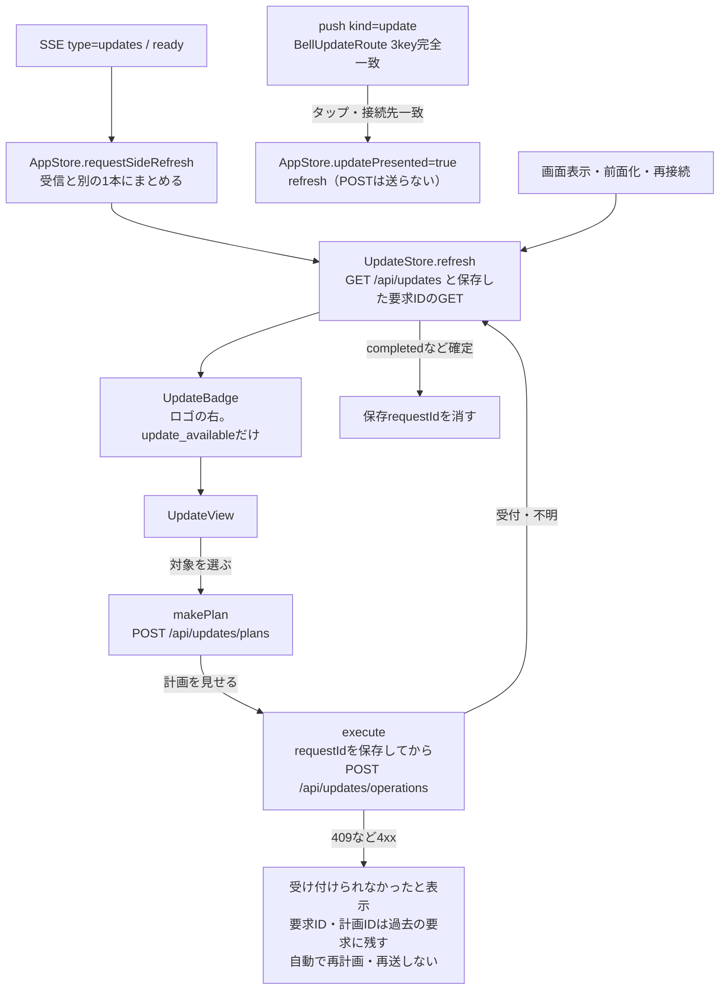

# Update画面（商用更新の表示と実行）

[担当の正本](README.md)。Appleの利用側だけを示す。契約の正本は`src/update-center-contract.mjs`、HTTPは`/api/updates`系、Webの同じ機能は[Webとの共通状態設計](../web/update-notice-design.md)。公開版・比較・実行結果は本体が所有し、Appleは表示と要求だけを行う。

## 流れ

## 責任と受渡し

| 段階 | 所有者と場所 | 契約 |
| --- | --- | --- |
| 応答の型 | `Core/UpdateModels.swift` | `bellteam.updates.v1`をそのままCodableにする。列挙の未知の値・必須nullのキー欠落はdecode失敗＝応答不正。未知のkeyは無視し、版の比較や補完はしない |
| 状態 | `Core/UpdateStore.swift`（`AppStore.updates`） | inventory、計画、保存requestIdの照会結果、確認中の文言。サーバーの応答を正本とし、SSEや通知の内容は再取得のきっかけにだけ使う |
| 要求ID | `UpdateStore.execute` | 実行操作ごとに小文字v4のUUIDを作り、送信前に`UserDefaults`へ接続先ごと（`bellbot.updateRequestID.<origin>`）に保存する。計画IDも同じく保存する。新しい計画は、受け付け済みで進行中の更新がある間だけ取れない（`UpdateStore.canStartPlan`）。状態が分からない要求（中断を含む）があっても、利用者は別の計画を明示的に取れる |
| 確定の判定と保持 | `UpdateOperation.isSettled`・`UpdateStore.history` | サーバーの照会で確定（rejected、completed、failedかつexecution failed）した要求だけ保存IDを外す。4xxは「受け付けられませんでした」と表示するが、要求ID・計画IDは消さずに過去の要求（`history`、端末に保存）へ移す。照会の404・認証失敗・断線は未受付と確定せず、保存IDを残して「結果を確認できません」と表示し、同じUUIDで照会し直す。新しく実行すると、確定していない前の要求は消さずに過去の要求へ移して照会を続ける。結果を確定できていない要求と同じ計画は再実行せず、利用者が取り直した別の計画（capability.supported）だけを一回実行する。手での消去、自動の再送・再計画はしない（Web版と同じ） |
| 受付の失敗 | `UpdateStore.execute` | HTTP 4xx（409は再計画が必要）は「受け付けられませんでした」と表示して計画を捨てるが、要求ID・計画IDは消さずに過去の要求へ移す。URLError・5xx・応答不正は受付不明として保存IDを残し、再送しない |
| 表示 | `Views/UpdateView.swift` | notice、各機能のname/description/current/published/comparison/changes/capability/availability、operation・previousOperationのphase/admission/execution/verification/error、計画のtargets/compatibility/impact/期限。再起動を伴う計画は確認のToggleを必須にする |
| ロゴ右の印 | `UpdateBadge`（`HomeView.header`、`DesktopWorkspaceView.sidebar`） | 見える文字の無いアイコンだけ（読上げ名「更新があります。アップデートを開く」）。iPadのsidebar幅230〜270ptでもタイトルと追加ボタンを押し潰さない。いずれかの`comparison.state == update_available`の時だけ。押すと`AppStore.updatePresented`でシートを開く（`BellBotApp.RootView`） |
| 診断 | 既存`BellDiagnostics.report` | 取得は`.read`、受付不明のPOSTは`.write`。4xxは既存規則で報告しない |
| 接続先・ログアウト | `AppStore.setServerAddress`・`signOut` | `updates.reset()`で前の接続先の表示を捨てる。保存requestIdは端末に残る |

## 標準画面（製品契約 `update-page-product-design-20261104.md`）

`Views/UpdateView.swift` の `UpdateContent`。最初に見せるのは「更新があるか」「何がよくなるか」「次に押すもの」の三点だけで、機能の一覧は標準画面に並べない。

| 状態（`UpdateContent.status`） | 見出し | 主ボタン |
| --- | --- | --- |
| 取得中 | 確認しています | なし |
| inventoryを取得できない、比較を確認できない | 更新を確認できませんでした | 状況を確認（GET） |
| 受け付け済みで進行中 | 更新しています（段階を一文で） | なし |
| admission・phaseがunknown、照会できていない保存ID | 更新の結果を確認中 | 状況を確認（同じIDのGET）。`canStartPlan`で正式な候補がある時だけ、補助の「別の更新を選ぶ」で別の計画を明示的に取れる（同じ計画の再実行はStoreが拒む） |
| 直近の操作が失敗 | 更新できませんでした（短い案内だけ） | 更新できる対象があれば「もう一度更新する」（新しい計画を明示的に取る）、なければ状況を確認 |
| 更新できる対象がある | 更新があります | 更新する（対象が1つならその計画、複数なら短い名前の候補から選ぶ） |
| 直近の操作がcompleted | 更新しました（実際の対象名） | なし |
| すべて公開版と一致 | 最新の状態です | なし |

- 計画を取ったら「更新の前に」で対象名・停止の影響を見せ、再起動が要る時は確認を必須にして「更新を始める」。「やめる」は計画を閉じるだけ（`UpdateStore.discardPlan`）。
- 「更新内容」は、更新できる・失敗した時だけ、公開版の`changes`をそのまま重複なしで出す。作文しない。
- 技術情報（版・比較の理由・要求ID・計画ID・内部の符号・保持している操作結果）は、閉じた「詳細」の中だけに置く。操作の失敗やサーバーの説明（`UpdateStore.message`、`notice`、`operation.error`）も、標準面には短い案内（`heroNote`）だけを出し、元の文と符号は詳細で正確に見せる。
- 幅は最大560ptの一枚にまとめ、広い画面でも横へ広げない。

## 更新ジョブと機能の問題（共通契約 `docs/architecture/modules/integration/update-jobs.md`）

| 項目 | Appleの扱い |
| --- | --- |
| `components[].status`（任意。契約 `apple-update-status-display-contract.md`、本体 c1a32534 / PR #545） | `UpdateComponent.PartStatus`。1つでも`status`があれば、標準画面の「機能の状態」に機能ごと1行で`name`と`status.line`をそのまま出す（言い換え・短縮・合成をしない）。`tone`がattentionの行は強調し、その下に`status.action`を出す。updatingは進行中の印を付ける。この時「ジョブの状態」は標準画面に出さず、ジョブID・raw state・符号は「詳細」だけに置く（`latestJob`のjobId/state/reason、既存の`jobs[]`一覧）。`status`だけは読めない値（未知の列挙など）をその機能のnilとして扱い、その行は従来の表示に戻す。画面全体は読める |
| `jobs[]`（inventory・operationの両方） | `UpdateJob`（`bellteam.update-job.v1`）。状態は queued/downloading/verifying/swapping/ready/failed の6つだけで、それ以外は応答不正として扱い、状態を作らない。`UpdateContent.jobRecords`が今回の操作・在庫の操作・最近のジョブを`kind:jobId`で重ねずに並べる。`status`の無い旧サーバーだけ、標準画面の「ジョブの状態」に機能名・`状態: <state>`・ジョブID・失敗時の`code / message`をWebと同じ文言でそのまま出す。`status`がある時は同じ一覧を「詳細」に出す |
| `problems[]` | `UpdateProblem`。「機能の問題」に機能名・再起動の繰り返し・open/resolved、回数・集計秒数、直近の終了コード/シグナル（nullは未観測）、直近の理由を出す |
| `admission:"pending"` | 全stepの受付記録が揃う前の付帯情報。表示は「受付中」。ジョブの状態とは別で、確定扱いにしない |
| 読めない時（503 `UNREADABLE`） | inventoryを持たず、詳細に「取得エラー: <理由>」を出す。状態は作らない。`code`・`path`はBellAPIが保持しないので表示しない |
| SSE `type=updates` | 付いてくる`jobs`/`error`は読まず、既存どおりGETで読み直す（AppStoreの`requestSideRefresh`で1本にまとめる） |
| 旧サーバー | `jobs`・`problems`の無い応答はこれまでどおり表示し、2つの欄を出さない |

## SSEとpush

- SSE：現在の本体は`type=updates`（topics `["updates"]`、`all:false`）をジョブまたは読取エラーが変わった時だけ送る。`AppStore.startEvents`は`requestSideRefresh([.updates])`へ積み、受信ループでGETを待たない（共通一覧は再取得しない）。旧本体の`all:true`も更新画面だけ取り直す。`ready`（接続・再接続・前面化後の再接続）でも同じ作業へ積む。`BellEventTopic.updates`は`messages`のtopicとして届いた場合の対応。
- push：`userInfo["bellteam"]`が`server`・`kind == "update"`・`messageId`（64桁小文字hex）の3keyだけの時に`BellUpdateRoute`として受ける。余分なkey・型違い・kind違いは捨てる。`aps`は読まない。既存3種（reply/secret_request/owner_question）の解析は変えない。
- タップ：`AppStore.openPendingUpdateNotification`。ready前は保留し、ready後にserverが認証済みの接続先と一致する時だけ画面を開いてGETで確認する。不一致では開かずに1件だけ保留し（`pendingUpdateNotification`、端末の再起動は跨がない）、利用者が明示的にその接続先へ切り替えて認証しreadyになった後で開いてGETする。受信やタップで自動の切替・認証・実行はしない（ミカの契約 `docs/architecture/modules/usage/update-push.md`、git 320f69d2）。タップでPOSTは送らない。前面で届いた一致する通知はbanner/list/soundで表示する。

## 確認済みと未確認

確認済み：`UpdateCenterTests`（[試験の対応](tests.md#updatecentertestsswift)）。サーバーの有限例13種のdecode、plan→確認→operationsが保存requestId付きで1回だけ送られること、409で再送・再計画しないこと、保存requestIdでの照会、unknown・断線で成功にしないこと、SSE `updates`、push 3key、server不一致、タップでPOST 0回。

未確認：iPhone・iPad・Macの実画面での見え方、実機のpush受信、実サーバーとの接続。
