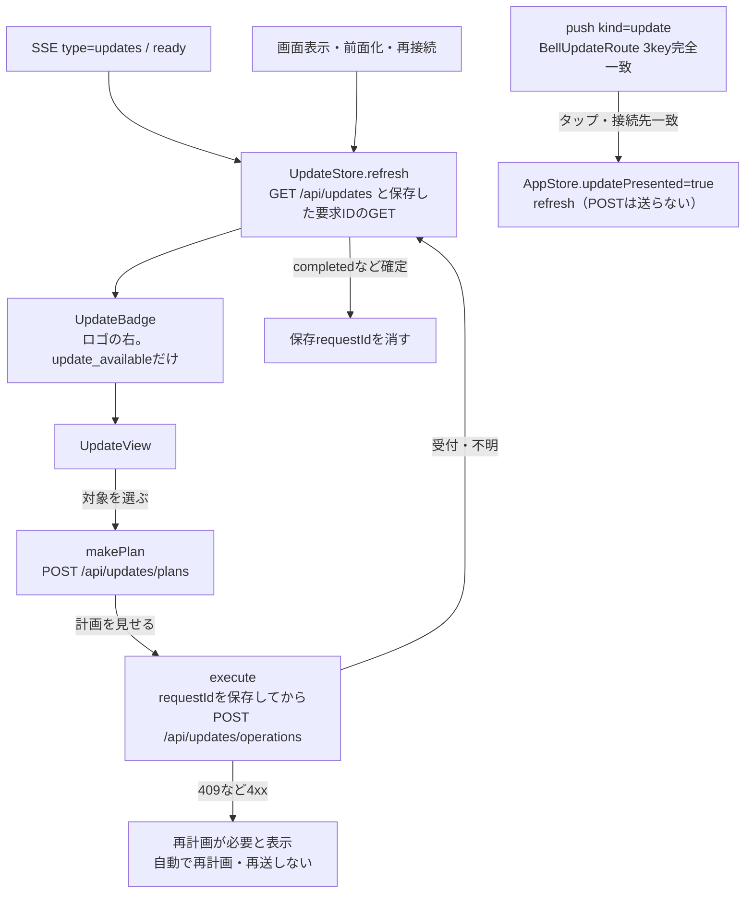

# Update画面（商用更新の表示と実行）

[担当の正本](README.md)。Appleの利用側だけを示す。契約の正本は`src/update-center-contract.mjs`、HTTPは`/api/updates`系、Webの同じ機能は[Webとの共通状態設計](../web/update-notice-design.md)。公開版・比較・実行結果は本体が所有し、Appleは表示と要求だけを行う。

## 流れ

## 責任と受渡し

| 段階 | 所有者と場所 | 契約 |
| --- | --- | --- |
| 応答の型 | `Core/UpdateModels.swift` | `bellteam.updates.v1`をそのままCodableにする。列挙の未知の値・必須nullのキー欠落はdecode失敗＝応答不正。未知のkeyは無視し、版の比較や補完はしない |
| 状態 | `Core/UpdateStore.swift`（`AppStore.updates`） | inventory、計画、保存requestIdの照会結果、確認中の文言。サーバーの応答を正本とし、SSEや通知の内容は再取得のきっかけにだけ使う |
| 要求ID | `UpdateStore.execute` | 実行操作ごとに小文字v4のUUIDを作り、送信前に`UserDefaults`へ接続先ごと（`bellbot.updateRequestID.<origin>`）に保存する。保存中は新しい実行を始めない |
| 確定の判定 | `UpdateOperation.isSettled` | 未受付、`completed`（accepted/succeeded/succeeded）、`failed`かつexecution failedだけ確定。確定で保存IDを消す。unknown・断線・照会失敗は「確認中」のまま残し、成功にしない |
| 受付の失敗 | `UpdateStore.execute` | HTTP 4xx（409は再計画が必要）はサーバーが受け付けなかった確定として保存IDを消し、計画を捨てる。URLError・5xx・応答不正は受付不明として保存IDを残し、再送しない |
| 表示 | `Views/UpdateView.swift` | notice、各機能のname/description/current/published/comparison/changes/capability/availability、operation・previousOperationのphase/admission/execution/verification/error、計画のtargets/compatibility/impact/期限。再起動を伴う計画は確認のToggleを必須にする |
| ロゴ右の印 | `UpdateBadge`（`HomeView.header`、`DesktopWorkspaceView.sidebar`） | いずれかの`comparison.state == update_available`の時だけ。押すと`AppStore.updatePresented`でシートを開く（`BellBotApp.RootView`） |
| 診断 | 既存`BellDiagnostics.report` | 取得は`.read`、受付不明のPOSTは`.write`。4xxは既存規則で報告しない |
| 接続先・ログアウト | `AppStore.setServerAddress`・`signOut` | `updates.reset()`で前の接続先の表示を捨てる。保存requestIdは端末に残る |

## SSEとpush

- SSE：`type=updates`（topics `["updates"]`、`all: true`）は`AppStore.startEvents`の`updates`分岐で`updates.refresh()`だけを呼ぶ（共通一覧は再取得しない）。`ready`（接続・再接続・前面化後の再接続）でも取り直す。`BellEventTopic.updates`は`messages`のtopicとして届いた場合の対応。
- push：`userInfo["bellteam"]`が`server`・`kind == "update"`・`messageId`（64桁小文字hex）の3keyだけの時に`BellUpdateRoute`として受ける。余分なkey・型違い・kind違いは捨てる。`aps`は読まない。既存3種（reply/secret_request/owner_question）の解析は変えない。
- タップ：`AppStore.openPendingUpdateNotification`。ready前は保留し、ready後にserverが認証済みの接続先と一致する時だけ画面を開いてGETで確認する。不一致では何も開かず、接続も実行もしない（既存`openPendingNotification`と同じ扱い）。タップでPOSTは送らない。前面で届いた一致する通知はbanner/list/soundで表示する。

## 確認済みと未確認

確認済み：`UpdateCenterTests`（[試験の対応](tests.md#updatecentertestsswift)）。サーバーの有限例13種のdecode、plan→確認→operationsが保存requestId付きで1回だけ送られること、409で再送・再計画しないこと、保存requestIdでの照会、unknown・断線で成功にしないこと、SSE `updates`、push 3key、server不一致、タップでPOST 0回。

未確認：iPhone・iPad・Macの実画面での見え方、実機のpush受信、実サーバーとの接続。照会が404を返し続ける場合の保存IDの解除手段は設けていない。
