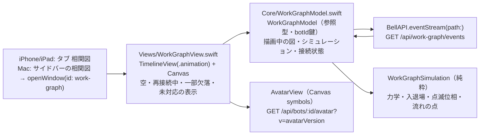

# 相関図（work graph）の描画

[全体図](overview.md) / [機能索引](function-index.md)。データの契約と動きの仕様は [work-graph module](../work-graph/README.md) と [behavior-spec](../work-graph/behavior-spec.md) が正本で、ここではApple側の部品と状態の持ち主だけを書く。数値（力・時間・大きさ・色）は仕様から写し、ここへ複製しない。以下のファイル名は`ios/BellBot/BellBot/`からの相対名。

## 部品

| 部品 | 持つもの | 持たないもの |
| --- | --- | --- |
| `WorkGraphModel` | 描画中のnodes/edges（botId・edge id鍵）、epoch/version、各nodeの位置・速度・入退場の開始時刻、熱α、接続状態（接続中・再接続中・degraded・未対応）、再接続の待ち時間 | 永続状態（無い）。HTTPの再試行の判断以外の通信 |
| `WorkGraphSimulation` | 1フレームの力計算と積分、入退場の補間、点滅の不透明度、流れの点の位置 | 状態の保持（引数で受けて返す） |
| `WorkGraphView` | 1つのTimelineViewと1つのCanvas。描画順は辺→node→label。アクセシビリティ要素の一覧 | 位置の計算（モデルが持つ） |

## 流れ

| 段階 | 処理 |
| --- | --- |
| 開く | 画面が見えてactiveの間だけ`GET /api/work-graph/events`を開く。最初の`snapshot`で描画中の図を置き換える（2回目以降の接続ではbotId/edge idで差分を取り、両方にあるnodeは位置を保つ） |
| 変更 | `change`はepochが一致し`version == 前回 + 1`の時だけ順に適用。それ以外（欠番・新epoch・解釈失敗）は接続を閉じて取り直す |
| 入退場 | member-enterは画面外の決まった角度から飛び込み、member-leaveは中心から外へ飛び去る。leave開始後のnodeは力を出さない |
| 辺 | edge-startで線が依頼元から伸び、その後に点が依頼元から依頼先へ流れる。edge-endで薄れて消える |
| 熱 | 変更を適用した時と大きさが変わった時にα=1。毎フレーム減衰し、下限で漂い続ける |
| 切断 | 通信の失敗・終了、または35秒無通信。最後の図を残し、点滅と流れを止め、彩度を落として`再接続中…`を出す。直ちに、その後1,2,4,8,15,15…秒（±20%）で再接続し、開いている間は諦めない |
| degraded | 空でない間は図を出したまま`一部の情報を取得できていません`を出す |
| 未対応 | 旧サーバーで404の時は`このサーバーでは相関図をまだ使えません`を出し、60秒に1回だけ確かめ直す（速い再試行はしない）。本体が入れ替わって次のsnapshotが届いたら描き始める。止まるのは取消と認証失敗（出口はログイン）だけ |
| 読めない応答 | 図を残して`相関図の応答を読めませんでした。再接続しています…`を出し、同じ待ち時間で再接続を続ける |
| 背景 | iOSで背景へ回る、Macで窓を閉じる時は接続を閉じる。戻ったら接続し、snapshotとの差分を描く |

## 仕様との違い（Owner指示、2026-11-08）

- 配置・大きさはbehavior-spec.mdの改訂（描画範囲Dで正規化した力、各軸の広がりに合わせた重力、`S×2.2`の衝突、人数による縮小）と同じ式で、`WorkGraphModel.step`に写している。数値は仕様と[layout-sim.mjs](../work-graph/layout-sim.mjs)が正本。
- 線とアイコンを重ねない（Owner）：衝突の後に、つながっていない線から`S/2+10pt`より近いアイコンを線に垂直に押し出し（不足分の35%/フレーム）、線の両端を各7.5%逆へ動かす。
- 演出（Owner）：線は依頼元の会話の窓の色（`AvatarTone`、アバター画像からの代表色）を濃くした電線（淡い被覆7pt＋導線2.5pt）。中を同じ色相の明るい筋（破線16/30pt）が90pt/sで依頼元から依頼先へ走る。光はぼかさず太さの違う2本で描く。依頼の文は封筒の印・依頼元の色の左帯と縁・線を指す尖りの付いた白い札。札は最大180pt幅で、文は切らずに折り返し、行の高さ16ptで行数ぶん伸びる（behavior-spec.md、Owner裁定 2026-11-09）。封筒は1行目の高さに置く。
- 描画は1秒30回（TimelineViewのminimumInterval）。毎表示フレームと毎フレームのぼかしで、Mac 115の相関図がCPUを94%使った。
- ラベルはアイコン・名前・他のラベルに重ねない（behavior-spec.md #738）。`label`がnull（要約がまだ無い）の線は札を出さない（読み上げは`<依頼元>から<依頼先>へ依頼`）。依頼が始まった順（サーバーの`startedAt`、同時なら線のID順、`WorkGraphModel.labelOrder`）に、線の上の`t = 0.5, 0.45, 0.55, 0.4, 0.6, 0.35, 0.65, 0.3, 0.7`で空いた所を取る。障害物はアイコン（点滅の輪を含め6pt広げた四角）・名前の欄・置いた札（尖りを含む）で、札を4pt広げて重なれば次のtへ進む。空きが無ければ出さない（全文は長押し・ポインタで最前面に重ねる）。混んでいる時（開いた依頼が10本超、または線が120pt未満）は、始まって3秒（サーバーの`startedAt`から。無ければ受け取った時刻から）だけ札を出し、その後400msで消す（`WorkGraphModel.labelOpacity`）。消えた札は長押し・ポインタで出る。線が伸びている間（0.35秒）は出さない。
- 応答を読めない時は`相関図の応答を読めませんでした。再接続しています…`を出したまま再接続を続け、読めるsnapshotで消える（止めるには保護の名前と自力の出口が要る、トロニー裁定）。欠番・新epochは仕様どおり取り直す。

## 配置

- iPhone/iPad: 予定・ゴール・相関図・設定の順のタブ（`AppStore.selectedTab`）。全画面。
- Mac: サイドバーの`相関図`ボタンが`WindowGroup("相関図", id: "work-graph")`を開く。最小480×360pt、大きさ変更可。

## 試験

- `BellBotTests/WorkGraphModelTests.swift`: 変更の適用順・欠番での取り直し・snapshot差分で位置を保つ・leaveの猶予なし（サーバー側の責任）・力学1ステップの不変条件（境界・衝突）・札の文の折り返し（行の高さ16pt）・札を置く順（`startedAt`の古い順）・混んでいる時の札の3秒表示と400msの消え方。
- 描画の画面写真は`test/helpers/work-graph-server.mjs`（契約どおりのsnapshotとchangeを流すfixture。長い依頼の文2本と`label`がnullの線を含む）で撮る。
